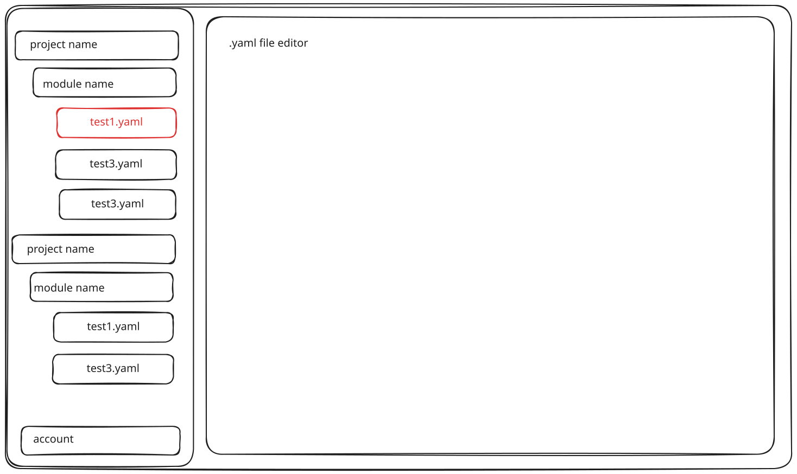
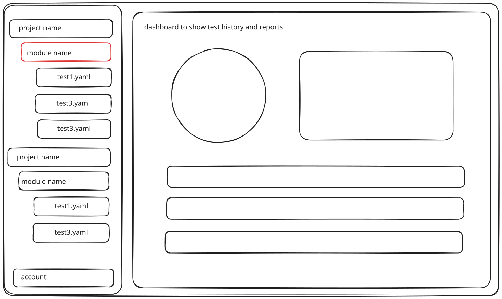

# Jevwright - AI Testing Platform

## 1. Document Overview

### 1.1 Purpose

This document defines the product requirements for **Jevwright**, an AI-assisted web testing platform built on Jev and Playwright. The goal is a test framework that is cheaper and faster to run than LLM-driven alternatives. It serves as the primary reference for product development, testing, and acceptance.

### 1.2 Scope of This Document

This document describes what the product must do and how users interact with it. Technical implementation details (system architecture, database schema, internal API specifications) are covered in separate technical design documents under [`docs/tech/`](tech/).

### 1.3 Document Status and Revision History

| Version | Date       | Author              | Change                      |
| ------- | ---------- | ------------------- | --------------------------- |
| 0.1     | 2026-10-27 | Zhimin Gan          | Initial version of the PRD  |
| 0.2     | 2026-10-27 | Zhimin Gan, Yike Li | Added MoSCoW Prioritization |
| 0.3     | 2026-10-29 | Zhimin Gan          | Moved syntax technical details to the Syntax Analyzer technical design |
| 0.3.1   | 2026-10-29 | Zhimin Gan          | Linked the interactive UI prototype |
| 0.3.2   | 2026-10-30 | Zhimin Gan          | Linked the architecture and run sequence diagrams; moved the UI prototype link to GitHub Pages |

### 1.4 Key Concepts

This document is written for readers with no prior background, so the core concepts needed to follow it are defined below:

- **Playwright**: An open-source browser automation framework. Traditional Playwright tests are written as code and locate page elements with brittle selectors such as CSS classes, XPaths, or `data-testid` attributes.
- **Midscene**: An open-source tool that adds AI to Playwright. It supports both LLM-driven auto-planning (`ai` / `aiAct`) and step-by-step Instant Actions (`aiTap`, `aiInput`, etc.), and can repair failing selectors when a page changes.
- **Jev**: A lightweight, structured-output model that is significantly faster and cheaper than a general-purpose LLM. Instead of free text, it returns formatted outputs (a choice, a boolean, or a bounding box with a confidence score) and also accepts an image as input.
- **Test Case (Declarative Test File)**: A declarative test file representing our platform's high-level abstraction layer over Playwright (currently written in `.yaml` for convenience, though any structured format could be used) that verifies one behavior on a target website. Because it abstracts away low-level Playwright APIs, AI coding agents can write test files much faster and with far fewer errors than writing raw Playwright scripts. It consists of basic information about the test and an ordered list of **Steps**, where each Step performs one browser **Action** (such as opening a page, clicking, typing, pressing a key, scrolling, or waiting) or one **Assertion** (checking that a condition holds). A Step identifies its element with a selector, a natural-language description, or both; when both are given, the selector is tried before AI locating. The platform never rewrites a Test Case file. The exact syntax is defined in the [Syntax Analyzer technical design](tech/syntax-analyzer.md).

- **Visual Locate (`jev with screenshot`)**: Finding a Step's target element from a page screenshot using Jev.
- **DOM Locate (`jev with dom`)**: Finding a Step's target element by extracting interactive DOM elements from the page and asking Jev to choose the best match.
- **Run**: A single execution of a Test Case's Steps, whose per-Step progress is streamed live and whose final report, screenshots, and logs are stored.
- **External Agent**: Any external AI coding assistant (such as Claude Code or Antigravity) or script outside our platform that plans test scenarios, authors `.yaml` Test Cases, and repairs failing Test Cases. The AI agent itself will not be integrated into the application in this version.

---

## 2. Product Background

### 2.1 Problem Statement

Traditional web testing suffers from high authoring and maintenance overhead. Manual testing cannot keep pace with rapid releases, while traditional automated testing (such as raw Playwright scripts) relies on hardcoded CSS selectors, `data-testid`, or XPaths tied directly to the frontend code. Writing raw Playwright scripts—whether by hand or with an AI coding agent—is slow and error-prone due to low-level browser APIs and timing issues. Worse, whenever the UI layout or component structure changes, hardcoded selectors break, forcing teams to spend significant time maintaining old tests instead of shipping features.

An **AI-integrated automated testing platform** overcomes these limitations of traditional testing in two fundamental ways:
1. **Faster, Less Error-Prone Test Authoring via a Playwright Middle Layer**: By adding a high-level abstraction layer on top of Playwright, AI coding agents and developers can generate declarative test files (such as `.yaml`) much faster and with far fewer errors than writing raw Playwright code directly.
2. **Drastically Lower Maintenance via AI Runtime Locating**: Instead of relying solely on brittle selectors, AI visually and semantically locates elements on the page and evaluates assertions in natural language, so tests keep working when UI details change.

However, existing AI testing tools (such as Midscene) rely on heavy general-purpose LLMs at runtime. Their high latency and token cost make running a full regression suite on every change too slow and expensive, turning testing into a budget and release bottleneck.

**Jevwright** solves this by powering the AI testing platform with **Jev**—a lightweight, structured-output model (accepting both text and images in v1.14) that is orders of magnitude faster and cheaper than a general-purpose LLM. Jevwright uses Jev exclusively for the two runtime jobs that need AI—**locating an element** and **judging an assertion**—so teams get all the benefits of AI-automated testing over traditional testing while running their **full test suite** fast and cheaply enough that it never blocks a release.

---

## 3. Goals and Success Metrics

### 3.1 Product Goals

- **Run Full Test Suites Without Cost or Release Bottlenecks**: By using Jev instead of a general-purpose LLM for runtime element locating and assertion judging, the platform runs significantly faster and at a fraction of the cost—allowing teams to execute their **full test suite** on every change and release without worrying about budget or delaying deployment.
- **Abstraction Layer Over Playwright for Faster, Less Error-Prone AI Test Authoring**: Writing raw Playwright code directly is complex and error-prone for AI coding agents. Jevwright provides an abstracted middle layer and declarative test file format (currently `.yaml`) so AI agents and developers can generate tests faster and more reliably, while AI-assisted locating minimizes ongoing test maintenance time.
- **Actionable Visibility and Test Management**: The platform provides real-time step-by-step execution progress, visual evidence (screenshots, traces, and logs), and historical run reports so teams can easily track test health across versions.

### 3.2 Non-Goals

- **Server-Side Test Execution Security and Privacy**: Implementing security isolation (such as container sandboxing or network restrictions) and sensitive data privacy hardening for tests running on the backend server is out of scope for this version.

### 3.3 Success Metrics

- **Benchmark Suite Pass Rate**: The benchmark test suite executed against our target Demo App achieves a high pass rate using the Core runner.
- **Step Execution Speed & Cost**: Average AI-assisted step latency (Locate or Assert via Jev) is under **3 seconds per step**, reducing per-run token cost by **>80%** compared to full LLM-planning runners.
- **Validation Accuracy**: The Syntax Analyzer (`validate`) catches **100%** of malformed test files, unknown action keys, and prohibited LLM-planning keys before a browser is launched, returning actionable line-numbered error messages.
- **End-to-End Demonstrability**: Both the **CLI Flow** and the **Web UI Flow** (authoring, live per-step WebSocket streaming, and historical report viewing) run reliably end-to-end in production.

---

## 4. User Stories and User Journeys

### 4.1 User Stories

- **Developer**: *As a Developer, instead of writing raw Playwright scripts (which are tedious by hand and error-prone when generated by AI), I want an AI-integrated testing platform with an abstraction layer over Playwright so my AI coding agent can write test files much faster and more reliably to verify new code.*
- **Tester (QA Engineer)**: *As a Tester, instead of constantly fixing broken CSS/XPath selectors like in traditional automated testing, I want AI-assisted visual and DOM element locating that adapts to UI changes automatically, along with screenshots and traces, so I can drastically reduce test maintenance time.*
- **Tech Manager**: *As a Tech Manager, instead of skipping full regression tests due to slow execution or manual testing bottlenecks, I want fast, automated full-suite runs and historical reports before every release so testing never delays going live.*
- **Company Executive / Budget Owner**: *As a Company Manager, I want a Jev-powered AI testing platform that is orders of magnitude cheaper and faster than LLM-driven runners, so our team gets all the productivity gains of AI-automated testing and can run the full test suite continuously without worrying about token costs or execution time.*

### 4.2 User Journeys

#### 4.2.1 CLI Flow

1. Install the CLI package locally.
2. A human developer or an External Agent creates or edits a declarative test file (e.g., `.yaml`) targeting Jevwright's abstraction layer instead of writing raw Playwright scripts.
3. Optionally run the `validate` command to check syntax and schema compliance without launching a browser.
4. Run the test file or full test suite on the local machine (headless or headed).
5. Watch step-by-step progress in the terminal while the Core runner executes the steps via Jev and Playwright.
6. Inspect the terminal summary and the persisted `.json` report, Playwright trace file, and error output (if any) on disk.

#### 4.2.2 Web UI Flow

1. Open the Web platform and log in with email and password.
2. Select or create a Project and Module in the left sidebar, then create, edit, or upload a test file.
3. Validate and save the test file in the in-browser editor.
4. Click the **Run** button; the backend queues and executes the test on the server worker.
5. Watch live step-by-step progress, status updates, and screenshots in the Dashboard's **Test Process** view.
6. Review the final pass/fail outcome, step timings, locate methods, and screenshots in the **Test History & Reports** view, or export the report.

### 4.3 User Stories and Acceptance Criteria

#### 4.3.1 Abstraction Layer Validation
- **US-4.3.1 (Must)**: *As a Developer or External Agent authoring test files against the Playwright abstraction layer, I want immediate, line-numbered validation errors when a test file violates the schema or syntax rules, so that mistakes are caught instantly before launching a browser.*
  - **Acceptance Criteria**:
    - **Given** a test file with invalid syntax, missing required keys, multiple actions in a single Step, or unsupported actions such as LLM planning,
    - **When** the file is checked via the Editor, API upload, or `validate` CLI command,
    - **Then** the system rejects the file without starting a browser and returns the exact line number and reason for each error.

#### 4.3.2 Low-Maintenance AI Element Targeting
- **US-4.3.2 (Must)**: *As a Tester, I want each step to try an optional selector first, then Jev Visual Locate, and then Jev DOM Locate, so that tests run fast and don't require manual selector maintenance when the UI changes.*
  - **Acceptance Criteria**:
    - **Given** a Step with a selector that matches an element, **When** the Step executes, **Then** Playwright uses the selector directly without calling Jev.
    - **Given** a Step with a natural-language description and no selector (or a selector that fails to match), **When** the Step executes, **Then** the runner attempts Visual Locate (`jev with screenshot`) and falls back to DOM Locate (`jev with dom`) if needed.
    - **Given** all locating methods fail, **When** the Step finishes its attempts, **Then** the Step and the Run are marked as `failed` with the failure reason and screenshot recorded.

#### 4.3.3 Test Suite Organization and Authoring
- **US-4.3.3 (Must)**: *As a Tester, I want to organize test files under Projects and Modules and edit or upload them in the browser, so that I can manage full regression suites cleanly.*
  - **Acceptance Criteria**:
    - **Given** a logged-in user, **When** they create a Project, Module, and test file in the Web UI, **Then** the hierarchy is persisted and displayed in the left sidebar tree.

#### 4.3.4 Fast Live Execution
- **US-4.3.4 (Must)**: *As a Tester or Developer, I want to trigger test runs from the Web UI and watch each step's status update in real time, so that I can verify full workflows quickly without delaying releases.*
  - **Acceptance Criteria**:
    - **Given** a valid Test Case in the Web UI, **When** the user clicks **Run**, **Then** the Run enters `queued` or `running` status and streams per-Step status transitions (`pending` → `running` → `passed`/`failed`) over WebSocket without requiring a page refresh.
    - **Given** another Run is currently executing on the worker, **When** a second Run is triggered, **Then** the second Run displays a `queued` status until the worker is free.

#### 4.3.5 Run History and Reports
- **US-4.3.5 (Must)**: *As a Tech Manager or Tester, I want to browse historical runs and inspect step-by-step screenshots, locate methods, and logs, so that I can quickly assess release readiness and diagnose failures.*
  - **Acceptance Criteria**:
    - **Given** completed Runs for a Test Case, **When** the user opens the Dashboard's **Test History** tab, **Then** all past Runs are listed with status, duration, trigger time, and summary counts.

#### 4.3.6 Local CLI for Rapid Verification
- **US-4.3.6 (Must)**: *As a Developer, I want a local CLI to validate and run test files against my local environment and persist a `.json` report, Playwright trace file, and error details locally, so that I can run full regression checks and debug failures before pushing code.*
  - **Acceptance Criteria**:
    - **Given** a local test file, **When** the developer runs the CLI `run` command, **Then** the Core runner executes locally, persists a structured `.json` report, a Playwright trace file, and error information (if an error occurs) to disk, and exits with code `0` on pass or non-zero on failure.

#### 4.3.7 Authentication and Access
- **US-4.3.7 (Must)**: *As a Platform Owner, I want users to authenticate with email and password and be rate-limited when triggering cloud runs, so that each user's projects are isolated and the platform's shared Jev API key is protected.*
  - **Acceptance Criteria**:
    - **Given** an unauthenticated visitor, **When** they attempt to access projects or trigger a cloud Run via Web UI or API, **Then** access is denied (`401 Unauthorized`) and redirected to Login.
    - **Given** a logged-in user who exceeds the configured Run rate limit, **When** they trigger another Run, **Then** the request is rejected with `429 Too Many Requests` and a clear cooldown message.

#### 4.3.8 Public API for AI Agents and CI
- **US-4.3.8 (Must)**: *As an External Agent or CI script, I want a documented REST API to upload test files, trigger runs, and fetch reports, so that AI coding agents and automated pipelines can generate and run tests programmatically.*
  - **Acceptance Criteria**:
    - **Given** a valid API token/JWT, **When** a client calls the REST endpoints to upload a test file, start a Run, and query its result, **Then** the responses match the published OpenAPI/Swagger specification served by the platform.

#### 4.3.9 Higher AI Locating and Assertion Accuracy
- **US-4.3.9 (Could)**: *As a Tester or Developer, I want the Jev Harness to further improve element locating and assertion accuracy on complex or dynamic UIs, so that fewer steps fail due to ambiguous visual or DOM candidates.*
  - **Acceptance Criteria**:
    - **Given** complex pages in the benchmark test suite, **When** the Jev Harness refines its visual/DOM context extraction and fallback strategy, **Then** overall locating and assertion pass rates improve without significantly increasing step latency.

#### 4.3.10 Server-Side Execution Security and Privacy Hardening
- **US-4.3.10 (Won't)**: *As a Platform Owner, I might want strict server-side security isolation (e.g., container sandboxing, network restrictions) and sensitive data privacy hardening for cloud test runs, but this will not be implemented in this version.*
  - **Acceptance Criteria**:
    - **Given** the scope of the current version, **When** tests are executed on the backend server, **Then** server-side security sandboxing and privacy hardening are explicitly excluded and deferred to a future release.

---

## 5. Functional Requirements

The modules below and how they connect are shown in the architecture diagram ([online](https://yike2.github.io/Jevwright/archify/jevwright-architecture/), [source](archify/jevwright-architecture/index.html)). The run sequence diagram ([online](https://yike2.github.io/Jevwright/archify/jevwright-sequence/), [source](archify/jevwright-sequence/index.html)) shows how a queued run executes, from parsing the file through locating, assertions, and the report.

### 5.1 Core Module (Test Runner)

The Core Module is the shared execution engine used by both the local CLI and the Backend. It parses a `.yaml` Test Case, launches a browser instance, uses the Jev Harness for element locating and assertions, and produces a test report.

#### 5.1.1 Test File Format and Syntax Analyzer
- **YAML Syntax Definition**: Define a clear `.yaml` format for Test Cases, specifying the meaning of each key-value pair and the indentation rules.
- **Syntax & Validity Check**: Validate `.yaml` files before execution and return clear, line-numbered error messages when a file is invalid.

#### 5.1.2 Jev Harness
- **Input & Prompt Assembly**: Combine a question, the expected output format (`choice`, `boolean`, or bounding box), and page context (`Image` or `Text`) into a request for Jev.
- **Formatted Output Handling**: Parse Jev's structured output and confidence score so the Locator and Assertion modules can consume them reliably, with a bounded number of retries per step.

#### 5.1.3 Browser Lifecycle and Page Inspection
- **Browser Instance Management**: Create and manage an isolated Chrome/Chromium instance (`create a chrome instance`) for each test run, and ensure the page is ready before each step executes.
- **Page Content Extraction**: Read and extract current page state—such as capturing page screenshots or retrieving the interactive DOM element list—to serve as input for the Locator, Assertion, and Report modules.

#### 5.1.4 Element Locator
- **Multi-Stage Element Locating**: Locate the target element of a step by trying an optional selector first, then Visual Locate (`jev with screenshot`), and finally DOM Locate (`jev with dom`). If all methods fail, the step fails without modifying the test file.

#### 5.1.5 Step Execution (Playwright APIs and Assertions)
- **Actions (`playwright APIs`)**: Execute standard browser actions (such as opening a page, clicking, typing, pressing a key, scrolling, and waiting) on the page or located element.
- **Assertions (`assert with playwright/jev`)**: Evaluate whether a stated condition holds true on the page using Playwright or the Jev Harness, marking the step as passed or failed.

#### 5.1.6 Report Generation
- **Test Run Report (`report`)**: Generate a structured `.json` summary report at the end of a run containing the overall outcome, step-by-step results, timings, Playwright trace file, and error details (if an error occurs).

#### 5.1.7 Overall Execution Pipeline (Core Workflow)
- **End-to-End Pipeline Orchestration**: Connect all Core sub-modules into a complete execution workflow—taking a `.yaml` test file from a CLI or API request, running the Syntax Analyzer, launching the Chrome instance, iterating through each Step sequentially (locating elements, executing Playwright actions or assertions, and streaming step status), stopping on failure, and outputting the final report.

---

### 5.2 CLI Module

- **Local Validate & Run**: Provide local CLI commands for developers and External Agents to validate `.yaml` syntax without launching a browser and to run `.yaml` test files locally using the Core module.
- **Persistent JSON Report, Playwright Trace & Error Output**: Persist our structured `.json` report, the Playwright trace file, and detailed error output (if an error occurs) to a local directory after each CLI run so developers and External Agents can inspect results and replay traces.

---

### 5.3 Backend and Database Module

#### 5.3.1 Cloud Core Execution
- **Server-Side Test Execution**: Receive run requests from users, invoke the Core module on the backend, queue concurrent runs, and push live step progress to the frontend.

#### 5.3.2 Data Storage and Management
- **Test Files (`.yaml files`)**: Store and manage `.yaml` test files organized under `Project -> Module -> Test File`.
- **Run History (`test history`)**: Store historical test run records and status summaries for each test file.
- **Screenshots and Reports (`test screenshots and reports`)**: Store step screenshots, logs, and generated reports for historical viewing and download.

#### 5.3.3 User Account and Access Control
- **Authentication & Usage Protection**: Support user registration and login, isolate project data by account, and restrict cloud test runs to authenticated users with usage limits.

#### 5.3.4 Public API
- **Programmatic Access & API Documentation**: Expose documented HTTP APIs (with OpenAPI/Swagger documentation) so frontend clients, scripts, and External Agents can manage `.yaml` test files, trigger runs, and retrieve reports.

---

### 5.4 Frontend Module (Web UI)

#### 5.4.1 Workspace Sidebar
- **Project, Module & File Tree**: Display the `project name -> module name -> test.yaml` hierarchy in the left sidebar for navigating and managing test files, with an `account` entry at the bottom.

#### 5.4.2 YAML File Editor (`edit .yaml file`)
- **In-Browser Editor**: Allow users to create, edit, upload, and validate `.yaml` test files in the browser and trigger a test run.

#### 5.4.3 Dashboard (`dashboard to show test history and reports`)
- **Files Overview (`.yaml files`)**: View the list of test files and their latest status in the selected project or module.
- **Live Test Process (`test process`)**: Watch real-time step-by-step execution progress and screenshots while a test is running.
- **Test History and Reports (`test history`)**: Browse past test runs and inspect detailed step results, screenshots, and reports.

---

### 5.5 Benchmark Test Suite and Demo App Module

- **What It Contains**: A dedicated target Demo Web Application (`Demo APP for test`) with common web interactions, paired with a collection of `.yaml` test files covering various user flows, actions, assertions, and locating scenarios.
- **Role & Purpose**: Executed with the Core module (`run with core`) to verify element-locating accuracy, measure execution speed and cost savings against LLM-based tools, tune Jev Harness parameters, and provide ready-to-use examples for demos.

---

## 6. MoSCoW Prioritization

### 6.1 Priority Definitions

- **Must**: Required for this version to be considered complete; the core execution path and every capability backed by a Must user story in Section 4.3.
- **Should**: Planned for this version and important to the product experience, but the platform still functions end-to-end without it.
- **Could**: Desirable enhancements to pursue if time allows after all Must and Should items are delivered.
- **Won't**: Explicitly out of scope for this version (see Section 3.2 Non-Goals).

### 6.2 Prioritization Table

| Priority | Requirement                                                        | PRD Section | Rationale                                                                                                                                                                                                                                                           |
| -------- | ------------------------------------------------------------------ | ----------- | ------------------------------------------------------------------------------------------------------------------------------------------------------------------------------------------------------------------------------------------------------------------- |
| Must     | YAML Syntax Definition & Syntax/Validity Check                     | 5.1.1       | Foundation of every Test Case; required by US-4.3.1 and the Validation Accuracy metric.                                                                                                                                                                             |
| Must     | Jev Harness (Input & Prompt Assembly, Formatted Output Handling)   | 5.1.2       | The only runtime AI component; all Visual/DOM Locate and Jev assertions depend on it.                                                                                                                                                                               |
| Must     | Browser Lifecycle and Page Inspection                              | 5.1.3       | Provides the browser instance, screenshots, and DOM element list consumed by the Locator, Assertion, and Report modules.                                                                                                                                            |
| Must     | Multi-Stage Element Locator (selector → Visual Locate → DOM Locate) | 5.1.4       | Core product value of resilient, low-cost locating; required by US-4.3.2.                                                                                                                                                                                           |
| Must     | Step Execution (Playwright Actions and Assertions)                 | 5.1.5       | Without action execution and assertion judging, no Test Case can run.                                                                                                                                                                                               |
| Must     | Report Generation (`.json` report)                                 | 5.1.6       | Required output of every Run for both the CLI and the Web UI.                                                                                                                                                                                                       |
| Must     | Overall Execution Pipeline (Core Workflow)                         | 5.1.7       | Connects all Core sub-modules into a working end-to-end runner.                                                                                                                                                                                                     |
| Must     | CLI Local Validate & Run                                           | 5.2         | Primary entry point for Developers and External Agents; required by US-4.3.6.                                                                                                                                                                                       |
| Must     | CLI Persistent JSON Report, Playwright Trace & Error Output        | 5.2         | Enables local debugging and lets External Agents read results to repair tests; required by US-4.3.6.                                                                                                                                                                |
| Must     | Server-Side Test Execution with Run Queue and Live Progress Push   | 5.3.1       | Powers the Web UI **Run** flow and queued concurrent runs; required by US-4.3.4.                                                                                                                                                                                    |
| Must     | Test File Storage (`Project -> Module -> Test File`)               | 5.3.2       | Persists the test suite hierarchy; required by US-4.3.3.                                                                                                                                                                                                            |
| Must     | Run History Storage                                                | 5.3.2       | Backs the Test History view; required by US-4.3.5.                                                                                                                                                                                                                  |
| Must     | Screenshots, Logs, and Reports Storage                             | 5.3.2       | Provides visual evidence for diagnosing failures; required by US-4.3.5.                                                                                                                                                                                             |
| Must     | User Authentication, Account Isolation & Run Rate Limiting         | 5.3.3       | Protects user data and the shared Jev API key; required by US-4.3.7.                                                                                                                                                                                                |
| Must     | Public API with OpenAPI/Swagger Documentation                      | 5.3.4       | Enables External Agents and CI scripts to integrate programmatically; required by US-4.3.8.                                                                                                                                                                         |
| Must     | Workspace Sidebar (Project / Module / File Tree)                   | 5.4.1       | Primary navigation for test management in the Web UI; required by US-4.3.3.                                                                                                                                                                                         |
| Must     | In-Browser YAML File Editor                                        | 5.4.2       | Lets Testers create, edit, upload, validate, and run Test Cases; required by US-4.3.3.                                                                                                                                                                              |
| Must     | Dashboard: Live Test Process                                       | 5.4.3       | Real-time per-Step status streaming over WebSocket; required by US-4.3.4.                                                                                                                                                                                           |
| Must     | Dashboard: Test History and Reports                                | 5.4.3       | Historical run browsing and step-level inspection; required by US-4.3.5.                                                                                                                                                                                            |
| Should   | Dashboard: Files Overview with Latest Status                       | 5.4.3       | Improves at-a-glance test health tracking, but files remain accessible through the sidebar without it.                                                                                                                                                              |
| Should   | Benchmark Test Suite and Demo App                                  | 5.5         | Needed to measure the Success Metrics and to tune and demo the platform, but not required for the product to function.                                                                                                                                              |
| Could    | Locating and Assertion Accuracy Optimization                       | —           | Further improve element-locating and assertion-judging accuracy beyond the baseline, for example by tuning Jev Harness prompts and confidence thresholds, preprocessing screenshots, and filtering DOM candidates, using the Benchmark Test Suite to measure gains. |
| Won't    | Server-Side Test Execution Security and Privacy                    | 3.2         | Implementing security isolation (such as container sandboxing or network restrictions) and sensitive data privacy hardening for tests running on the backend server is out of scope for this version.                                                               |

---

## 7. UI and CLI Overview

### 7.1 Web Pages

The Web UI uses a consistent workspace layout illustrated by the wireframes in [`workspace.svg`](references/workspace.svg) and [`dashboard.svg`](references/dashboard.svg), paired with an authentication screen. An interactive UI prototype ([online](https://yike2.github.io/Jevwright/references/ui-prototype.html), [source](references/ui-prototype.html)) shows the full flow, from login to the editor and dashboard.

#### 7.1.1 Login and Register
```text
+-------------------------------------------------------+
|          Jevwright — AI Web Testing Platform          |
|                                                       |
|            +-----------------------------+            |
|            |  [ Login ]    [ Register ]  |            |
|            |                             |            |
|            |  Email:    [_____________]  |            |
|            |  Password: [*************]  |            |
|            |                             |            |
|            |       [   Submit   ]        |            |
|            +-----------------------------+            |
+-------------------------------------------------------+
```
- **Description**: A clean authentication page where users register or sign in with their email address and password. Upon authentication, the user is redirected to the main workspace.

#### 7.1.2 Workspace & `.yaml` File Editor (`references/workspace.svg`)



- **Left Sidebar (`Project / Module / File Tree & Account`)**: Displays collapsible `project name` → `module name` → `.yaml` files (`test1.yaml`, `test3.yaml`, etc.) for quick navigation and file management, with the `account` control anchored at the bottom.
- **Main Pane (`.yaml file editor`)**: Provides an in-browser code editor for authoring and uploading `.yaml` test files, inline validation feedback with line numbers, and a **Run** button to launch the test.

#### 7.1.3 Dashboard: Live Test Process, Run History & Reports (`references/dashboard.svg`)



- **Left Sidebar**: Shares the same persistent `project name` → `module name` → `.yaml` file tree and `account` entry as the editor view.
- **Main Pane (`dashboard to show test history and reports`)**:
  - **`.yaml files` tab**: Lists test files in the current project/module with their latest status.
  - **`test process` (Live Run View)**: Streams real-time step-by-step execution status (`queued`, `running`, `passed`, `failed`), live screenshots, and active locate methods over WebSocket.
  - **`test history` (Run History & Report View)**: Displays historical runs with filtering, step-level timing and confidence breakdowns, annotated screenshots, execution logs, and HTML/JSON report export.

---

### 7.2 CLI Commands

The local CLI (`jevwright`) provides two primary commands for local development, CI pipelines, and External Agents:

#### 7.2.1 `run` — Execute Local `.yaml` Test Cases
- **Usage**:
  ```bash
  jevwright run <file-or-glob> [options]
  ```
- **Key Options**:
  - `--headed`: Run browser in headed mode for visual debugging (defaults to headless).
  - `--out-dir <dir>`: Directory to persist the `.json` report, Playwright trace file, and error details (defaults to `./jevwright-reports`).
  - `--timeout <ms>`: Override default per-step timeout in milliseconds.
- **Expected Output & Exit Codes**:
  ```text
  $ jevwright run ./tests/login.yaml
  [PASS] Step 1: open https://demo.example.com/login (410ms)
  [PASS] Step 2: input "Email address input field" [selector] (85ms)
  [PASS] Step 3: click "Sign In button" [visual-locate, conf=0.92] (1420ms)
  [PASS] Step 4: assert "Dashboard welcome banner is visible" [noul=0.95] (980ms)
  ✔ Run PASSED (4/4 steps in 2.90s) — Saved report.json & trace.zip to ./jevwright-reports/
  ```
  - Exit code `0`: All steps passed.
  - Exit code `1`: One or more steps/assertions failed.
  - Exit code `2`: File validation error or missing configuration.

#### 7.2.2 `validate` — Lint and Validate `.yaml` Test Files Without a Browser
- **Usage**:
  ```bash
  jevwright validate <file-or-glob> [--json]
  ```
- **Key Options**:
  - `--json`: Emit machine-readable JSON validation diagnostics for External Agents.
- **Expected Output & Exit Codes**:
  ```text
  $ jevwright validate ./tests/broken.yaml
  ✖ ./tests/broken.yaml:12:5 — Error: Unknown action "aiAct"
  ✖ ./tests/broken.yaml:18:3 — Error: Step must contain exactly one action, found "click" and "input"
  Validation FAILED (2 errors).
  ```
  Error codes and messages are defined in the [Syntax Analyzer technical design](tech/syntax-analyzer.md).
  - Exit code `0`: All specified `.yaml` files conform to the schema.
  - Exit code `2`: One or more validation errors found.

---

## 8. References

- **Jev (TypeSafe AI)**: [https://typesafe.ai](https://typesafe.ai)
- **Playwright**: [https://playwright.dev](https://playwright.dev)
- **Midscene.js**: [https://midscenejs.com](https://midscenejs.com)
