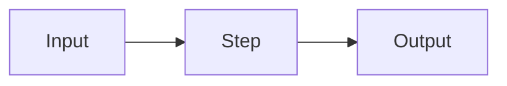

# <Module Name>

One or two sentences on what this module does.

## 1. Functional Definition

What the module does and the rules or formats it defines. Use tables for fields, rules, and options.

## 2. Internal Flow



1. The main processing steps, in order.

## 3. External Interface

Functions and types exposed to other modules, written as TypeScript, and how errors are reported.

```ts
function example(input: Input): Output;
```

## 4. Class Architecture

### 4.1 Modules

| Module / Class | Responsibility |
| -------------- | -------------- |
| … | … |

### 4.2 Directory Layout

```text
core/src/<module>/
└── …
```

## 5. Test Plan

| Type        | Coverage | Location |
| ----------- | -------- | -------- |
| Unit        | … | … |
| Integration | … | … |
