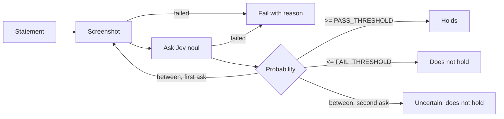

# Asserter

The Asserter judges a natural-language statement about the current page with Jev, either once or by polling until it holds. It never runs Playwright checks; those stay in the Executor.

## 1. Functional Definition

### 1.1 Responsibilities

| Used by                             | Asserter call | Notes                                                       |
| ----------------------------------- | ------------- | ----------------------------------------------------------- |
| `assert` with only `statement`      | `judge`       |                                                             |
| `assert` with `check` + `statement` | `judge`       | Only after the Executor's Playwright check fails (fallback) |
| `waitFor` with `condition`          | `waitUntil`   | Polls until the condition holds or the step times out       |

The Executor runs Playwright checks (`check`, `waitFor` `selector`/`url`) through the BrowserAdapter, decides when to fall back, and marks fallback passes in the report.

### 1.2 Judging a Statement (`judge`)

1. Take a screenshot and ask Jev `noul` with the statement.
2. Classify the probability:

| Probability         | Outcome                                            |
| ------------------- | -------------------------------------------------- |
| `>= PASS_THRESHOLD` | Holds                                              |
| `<= FAIL_THRESHOLD` | Does not hold                                      |
| Between the two     | Uncertain: take a new screenshot and ask once more |

3. If the second answer is also uncertain, the statement does not hold and the reason says it was uncertain.
4. If the Harness returns `{ ok: false, reason }`, judging fails with that reason. The Harness already retries, so the Asserter does not.
5. The result always includes the last probability, so the report can show it (e.g. `[noul=0.95]`).

### 1.3 Waiting for a Condition (`waitUntil`)

1. Poll: take a screenshot and ask Jev `noul` with the condition. The first poll starts immediately.
2. If the probability is `>= PASS_THRESHOLD`, the condition holds and waiting ends. Any other probability means "not yet": wait `POLL_INTERVAL_MS`, then poll again.
3. Waiting fails when the deadline (`timeoutMs` after the start) has passed; the reason includes the last probability. There is no per-step AbortSignal, so a poll already in progress runs to completion and the total time may exceed `timeoutMs` by up to one Jev call.
4. At least one poll always runs.
5. If the Harness returns `{ ok: false, reason }`, waiting fails immediately with that reason.

### 1.4 Constants

| Constant           | Value  | Meaning                                                 |
| ------------------ | ------ | ------------------------------------------------------- |
| `PASS_THRESHOLD`   | `0.8`  | Probability at or above which a statement holds         |
| `FAIL_THRESHOLD`   | `0.2`  | Probability at or below which a statement does not hold |
| `POLL_INTERVAL_MS` | `1000` | Wait between polls in `waitUntil`                       |

All constants live in `constants.ts`. Thresholds follow design-context Q36 and are kept configurable per Q38.

## 2. Internal Flow



`judge`:

1. Take a screenshot; if it fails, return its reason.
2. Ask Jev `noul` with `QUESTION_PREFIX + statement` and the screenshot; if Jev fails, return its reason.
3. Classify the probability. If it is uncertain on the first ask, go back to step 1 once.
4. Return the result with the last probability.

`waitUntil`:

1. Record the deadline as now + `timeoutMs`.
2. Take a screenshot and ask Jev, as in `judge` steps 1–2.
3. If the probability is `>= PASS_THRESHOLD`, return holds.
4. If the deadline has passed, return the timeout reason with the last probability.
5. Otherwise wait `POLL_INTERVAL_MS` and go back to step 2.

## 3. External Interface

```ts
function judge(
  statement: string,
  adapter: Pick<BrowserAdapter, "screenshot">,
  jev: Pick<JevClient, "noul">,
): Promise<JudgeResult>;

function waitUntil(
  condition: string,
  timeoutMs: number,
  adapter: Pick<BrowserAdapter, "screenshot">,
  jev: Pick<JevClient, "noul">,
): Promise<JudgeResult>;

type JudgeResult =
  | { ok: true; probability: number }
  | { ok: false; reason: string; probability?: number };
```

- Each ask sends `noul(QUESTION_PREFIX + statement, { image })`, where `QUESTION_PREFIX` is `"Is the following true for this page? "`.
- `probability` is the last probability Jev returned. It is absent only when no probability was obtained (the screenshot or Jev failed).
- `JudgeResult` has no `dialogs`. The Executor adds them when turning it into a step result.
- Neither function throws for a failed judgment. Errors thrown by the adapter or Jev client (e.g. a disconnected browser) propagate unchanged.

### 3.1 Failure Reasons

| Case | Reason |
| ---- | ------ |
| Does not hold | `Statement does not hold (noul=0.12)` |
| Uncertain after the second ask | `Statement is uncertain after 2 asks (noul=0.55)` |
| `waitUntil` deadline passed | `Condition did not hold within 15000ms (last noul=0.30)` |
| Screenshot or Jev returns `{ ok: false, reason }` | That `reason`, unchanged |

`index.ts` exports `judge`, `waitUntil`, and the `JudgeResult` type. Constants are not exported.

## 4. Class Architecture

### 4.1 Modules

| Module          | Responsibility |
| --------------- | -------------- |
| `constants.ts`  | `PASS_THRESHOLD`, `FAIL_THRESHOLD`, `POLL_INTERVAL_MS`, `QUESTION_PREFIX` |
| `types.ts`      | `JudgeResult` |
| `ask.ts`        | `ask(statement, adapter, jev)`: one screenshot + one `noul` call, returns `ReadResult<{ probability }>`. Internal, not exported |
| `judge.ts`      | `judge()`: classifies with both thresholds and re-asks once when uncertain |
| `wait-until.ts` | `waitUntil()`: polls `ask()` until `PASS_THRESHOLD` or the deadline |
| `index.ts`      | Exports `judge`, `waitUntil`, `JudgeResult` |

### 4.2 Directory Layout

```text
src/core/asserter/
├── constants.ts
├── types.ts
├── ask.ts
├── judge.ts
├── wait-until.ts
└── index.ts
```

## 5. Test Plan

| Type | Coverage | Location |
| ---- | -------- | -------- |
| Unit | `ask()`: question is `QUESTION_PREFIX + statement`; screenshot buffer is passed as `{ image }`; screenshot or Jev failure returns its reason without calling the next step | `src/tests/unit/core/asserter/ask.test.ts` |
| Unit | `judge()`: exactly `0.8` holds and exactly `0.2` does not hold; uncertain re-asks once with a new screenshot (screenshot and `noul` each called twice); uncertain twice fails with the uncertain reason; a clear answer on the first ask calls Jev once; reasons and `probability` match 3.1 | `src/tests/unit/core/asserter/judge.test.ts` |
| Unit | `waitUntil()` with fake timers: the first poll is immediate; polls are `POLL_INTERVAL_MS` apart; stops as soon as a poll reaches `PASS_THRESHOLD`; `<= FAIL_THRESHOLD` keeps polling; at least one poll even when `timeoutMs` is `0`; timeout reason includes the last probability; a Jev failure stops immediately | `src/tests/unit/core/asserter/wait-until.test.ts` |
| Live | `judge()` with the real Jev on the `statements` in the Locator fixtures (`src/tests/integration/core/locator/fixtures/*/expected.json`): `holds: true` → `ok: true`, `holds: false` → `ok: false` | `src/tests/live/core/asserter/judge.live.test.ts` |

There is no fake-Jev integration test: `judge` reads only a screenshot, so a fake Jev would only repeat the unit tests. Wiring into the Executor is part of the Run Pipeline issue.