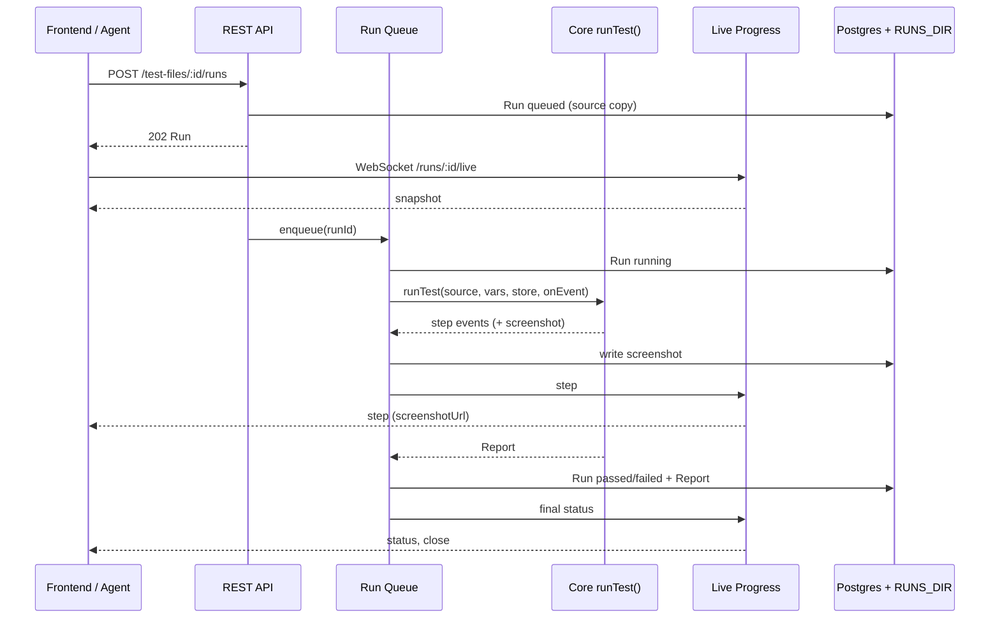

# Backend

The Backend is one Express service that stores users' test files, runs them with Core on the server, streams each step's progress over WebSocket, and keeps every Run's report and screenshots. The Next.js frontend and External Agents use it only through its REST API.

## 1. Functional Definition

### 1.1 Terms

| Term | Meaning |
| ---- | ------- |
| **Project**, **Module**, **Test File** | The three levels of a user's workspace (PRD 5.3.2). A Test File holds the `.yaml` source |
| **Project Variable** | A name and value of a Project, passed to Core as a `{{NAME}}` Variable on every Run of the Project's Test Files |
| **Run** | One execution of a Test File on the server, with the source as it was when the Run was triggered |
| **Run Queue** | The in-process queue that starts queued Runs in trigger order, at most `RUN_CONCURRENCY` at a time |
| **Run Files** | A Run's report bundle on disk: `report.json`, `trace.zip`, and one screenshot per executed step |
| **Live Progress** | The WebSocket stream of one Run: its status and each step as it starts and finishes |

### 1.2 Accounts and Tokens

- A user registers and logs in with an email and a password of at least 8 characters. Emails are compared in lower case. Passwords are hashed with bcrypt (`bcryptjs`, cost 12) and never logged or returned.
- Register and login return a JWT (HS256, signed with `JWT_SECRET`, `sub` = user id, valid `TOKEN_TTL` = 7 days). The frontend, CI scripts, and External Agents all send it as `Authorization: Bearer <token>`.
- Every route except register, login, health, and the API docs needs a valid token, or answers `401`.
- Every query is scoped to the token's user. Another user's Project, Module, Test File, or Run answers `404`, never `403`, so ids of other users' data are not revealed.
- There is no Run rate limit (PRD 4.3.7).

### 1.3 Workspace

| Rule | |
| ---- | - |
| Names | Project and Module names are 1–100 characters and unique within their parent. A Test File name ends in `.yaml` and is unique within its Module |
| Source size | A Test File source is at most `MAX_SOURCE_BYTES` (256 KiB); larger answers `413` |
| Saving | A Test File is saved even when its source has diagnostics. Saving answers the Syntax Analyzer's `diagnostics`, so the editor can mark the lines |
| Validating | `POST /test-files/validate` analyzes a source without saving it |
| Deleting | Deleting a Project deletes its Modules, Test Files, and Variables; deleting a Module deletes its Test Files. Runs are kept: their `testFileId` becomes `null`, and they keep their source and file name |
| Variables | Names follow `[A-Z_][A-Z0-9_]*`. The API returns names only, never values |

### 1.4 Runs

1. `POST /test-files/:id/runs` analyzes the Test File's source. With diagnostics it answers `422` and the diagnostics; otherwise it stores a Run with status `queued`, a copy of the source and file name, and answers `202` with the Run.
2. The Run Queue starts queued Runs first in, first out, at most `RUN_CONCURRENCY` (default 1) at a time across all users. A Run waiting behind others stays `queued` (PRD 4.3.4).
3. A started Run becomes `running` and calls Core's `runTest()` with:
   - the Project Variables as `vars`;
   - `screenshotEveryStep: true`, so every executed step has a screenshot;
   - `network: "public"`, so the browser reaches only public addresses (1.6);
   - a Run Files store that writes the bundle to `RUNS_DIR/<runId>/`.
4. On each step event the Backend writes the step's screenshot to the Run Files right away and publishes the step on the Run's Live Progress.
5. When `runTest()` returns, the Run takes the Report's `status`, `durationMs`, step counts, and the whole Report. When it throws, the Run becomes `failed` with `error` set to the error's name; nothing about the error's message reaches the API, since it may hold a Variable value.
6. At start-up, Runs still `queued` or `running` from a previous process become `failed` with `error: "Interrupted by a server restart"`.

### 1.5 Live Progress

A client opens `GET /api/v1/runs/:runId/live?token=<jwt>` as a WebSocket (browsers cannot set headers on a WebSocket). A bad token or another user's Run closes the socket with code `4401` or `4404`.

On connect, the server sends one `snapshot` message with the Run's status and every step so far, so a client that connects late misses nothing. Then it sends each change:

| Message | When | Fields |
| ------- | ---- | ------ |
| `snapshot` | On connect | `run` (as `GET /runs/:id` without `report`), `steps` (`LiveStep[]`) |
| `status` | The Run's status changes | `status`, and on the final status `durationMs` and `summary` |
| `step` | A step starts or finishes | `step` (`LiveStep`) |

```ts
type LiveStep = {
  index: number;
  line: number;
  action: string;
  status: "running" | "passed" | "failed";
  durationMs?: number;
  locateMethod?: "selector" | "visual" | "dom";
  reason?: string;          // redacted by Core
  screenshotUrl?: string;   // /api/v1/runs/<id>/files/screenshots/step-<index>.png
};
```

The server closes the socket after the final `status` message. Pending steps are not sent; a Run that stops early leaves them out.

### 1.6 Private Network Blocking

Users' tests run on the server, so a test could open `http://postgres:5432`, `http://localhost`, or a cloud metadata address and capture what it shows. With `network: "public"`, the Browser Adapter routes every request and aborts it unless its URL is `http:` or `https:` and every address its host resolves to is public: not loopback, private (RFC 1918, `fc00::/7`), link-local, carrier-grade NAT, unspecified, or multicast. The step that made the request fails with Playwright's `net::ERR_FAILED` reason. This is not a sandbox (PRD 3.2 *Won't*): DNS rebinding between the check and Chromium's own lookup is not prevented.

The Benchmark Demo App therefore runs at a public address in production, for example `https://demo.<domain>`, set as the Project Variable `BASE`.

### 1.7 Errors

Every error answers JSON `{ "error": { "code": string, "message": string, "details"?: unknown } }`:

| Status | Code | When |
| ------ | ---- | ---- |
| `400` | `invalid_request` | A body, query, or path parameter fails its zod schema; `details` lists the issues |
| `401` | `unauthorized` | No token, a bad or expired token, or a wrong email or password at login |
| `404` | `not_found` | No such resource for this user |
| `409` | `conflict` | A duplicate email or name |
| `413` | `too_large` | A source over `MAX_SOURCE_BYTES` |
| `422` | `invalid_test` | A Run of a Test File with diagnostics; `details` is the diagnostics |
| `500` | `internal` | Anything else; the message is generic and the error is logged without request bodies |

### 1.8 Configuration

Environment variables are validated with zod at start-up; a missing or invalid one stops the process before it listens. `.env.example` lists them.

| Variable | Default | Use |
| -------- | ------- | --- |
| `DATABASE_URL` | – | PostgreSQL connection for Prisma |
| `JWT_SECRET` | – | At least 32 characters |
| `OPENROUTER_API_KEY` | – | Jev, for every Run |
| `RUNS_DIR` | `./data/runs` | Run Files; a docker volume in production |
| `RUN_CONCURRENCY` | `1` | Runs at a time, 1–8 |
| `PORT` | `4000` | HTTP and WebSocket port |
| `CORS_ORIGIN` | – | The frontend's origin, allowed by CORS |

## 2. Internal Flow



1. A route checks the token, parses the request with zod, and queries Prisma scoped to the user.
2. Triggering a Run stores it and hands its id to the Run Queue; the HTTP request returns before the Run starts.
3. The Run Queue's worker loads the Run and the Project Variables, runs Core, and turns Core's step events into Run Files and Live Progress messages.
4. The Run's final row holds the summary and the Report; the history and report routes read only Postgres and `RUNS_DIR`.

## 3. External Interface

### 3.1 REST API

All routes are under `/api/v1`. Bodies are JSON. `GET /api/v1/openapi.json` is the OpenAPI 3.1 document generated from the zod schemas, and `GET /api/v1/docs` serves it in Swagger UI.

| Method | Path | Body | Answer |
| ------ | ---- | ---- | ------ |
| `GET` | `/health` | – | `200 { status: "ok" }`, no token |
| `POST` | `/auth/register` | `{ email, password }` | `201 { token, user }` |
| `POST` | `/auth/login` | `{ email, password }` | `200 { token, user }` |
| `GET` | `/auth/me` | – | `200 { user }` |
| `GET` | `/tree` | – | `200 Project[]` with Modules and Test Files (no sources), each Test File with its latest Run's `status` |
| `GET` / `POST` | `/projects` | `{ name }` | `200 Project[]` / `201 Project` |
| `PATCH` / `DELETE` | `/projects/:projectId` | `{ name }` | `200 Project` / `204` |
| `GET` | `/projects/:projectId/variables` | – | `200 { names: string[] }` |
| `PUT` / `DELETE` | `/projects/:projectId/variables/:name` | `{ value }` | `204` / `204` |
| `GET` / `POST` | `/projects/:projectId/modules` | `{ name }` | `200 Module[]` / `201 Module` |
| `PATCH` / `DELETE` | `/modules/:moduleId` | `{ name }` | `200 Module` / `204` |
| `GET` / `POST` | `/modules/:moduleId/test-files` | `{ name, source }` | `200 TestFile[]` (no sources) / `201 { testFile, diagnostics }` |
| `GET` | `/test-files/:testFileId` | – | `200 TestFile` with `source` |
| `PATCH` / `DELETE` | `/test-files/:testFileId` | `{ name?, source? }` | `200 { testFile, diagnostics }` / `204` |
| `POST` | `/test-files/validate` | `{ source }` | `200 { diagnostics }` |
| `POST` | `/test-files/:testFileId/runs` | – | `202 Run`, or `422` |
| `GET` | `/test-files/:testFileId/runs` | – | `200 Run[]`, newest first, without `report` |
| `GET` | `/runs/:runId` | – | `200 Run` with `source` and `report` |
| `GET` | `/runs/:runId/files/*path` | – | The Run File (`report.json`, `trace.zip`, `screenshots/step-<n>.png`); paths outside the Run's folder answer `404` |
| WebSocket | `/runs/:runId/live?token=` | – | Live Progress (1.5) |

```ts
type User = { id: string; email: string; createdAt: string };
type Project = { id: string; name: string; createdAt: string; updatedAt: string };
type Module = { id: string; projectId: string; name: string; createdAt: string; updatedAt: string };
type TestFile = { id: string; moduleId: string; name: string; source?: string; createdAt: string; updatedAt: string };
type RunStatus = "queued" | "running" | "passed" | "failed";
type Run = {
  id: string;
  testFileId: string | null;
  fileName: string;
  status: RunStatus;
  createdAt: string;          // trigger time
  startedAt: string | null;
  finishedAt: string | null;
  durationMs: number | null;
  summary: { total: number; passed: number; failed: number; pending: number } | null;
  error: string | null;
  source?: string;
  report?: Report;            // Core report.md, with screenshot paths relative to /runs/:id/files/
};
```

### 3.2 Core Changes

The Backend needs two options in Core, both off by default so the CLI keeps its behavior:

```ts
type RunTestOptions = {
  // ...existing fields
  screenshotEveryStep?: boolean; // Executor: a screenshot after every executed step, not only a failed one
  network?: "any" | "public";    // Browser Adapter: abort requests to non-public addresses (1.6)
};
```

`executor.md`, `browser-adapter.md`, `pipeline.md`, and `report.md` describe them in the PR that adds them.

### 3.3 Database

```mermaid
erDiagram
  User ||--o{ Project : owns
  User ||--o{ Run : triggers
  Project ||--o{ Module : has
  Project ||--o{ Variable : has
  Module ||--o{ TestFile : has
  TestFile |o--o{ Run : "ran as"
  User { uuid id PK; string email UK; string passwordHash; datetime createdAt }
  Project { uuid id PK; uuid userId FK; string name; datetime createdAt; datetime updatedAt }
  Variable { uuid id PK; uuid projectId FK; string name; string value }
  Module { uuid id PK; uuid projectId FK; string name; datetime createdAt; datetime updatedAt }
  TestFile { uuid id PK; uuid moduleId FK; string name; text source; datetime createdAt; datetime updatedAt }
  Run { uuid id PK; uuid userId FK; uuid testFileId FK "nullable"; string fileName; text source; enum status; datetime createdAt; datetime startedAt; datetime finishedAt; int durationMs; int total; int passed; int failed; int pending; string error; jsonb report }
```

Unique: `User.email`; `(Project.userId, name)`; `(Module.projectId, name)`; `(TestFile.moduleId, name)`; `(Variable.projectId, name)`. Index: `Run (testFileId, createdAt)`, `Run (status)`. Screenshots and traces live only in `RUNS_DIR`, never in Postgres.

## 4. Class Architecture

### 4.1 Modules

| Module | Responsibility |
| ------ | -------------- |
| `main.ts` | Reads the env, connects Prisma, recovers interrupted Runs, starts HTTP and WebSocket |
| `env.ts` | The zod schema of 1.8 |
| `app.ts` | `createApp(deps)`: Express app with JSON parsing, CORS, routes, and the error handler; deps are injected for tests |
| `http/` | `errors.ts` (the `ApiError` type and handler of 1.7), `validate.ts` (zod parsing of body, query, params), `auth.ts` (the Bearer middleware) |
| `auth/` | `password.ts` (bcrypt), `token.ts` (sign and verify with `jose`), `routes.ts` |
| `workspace/` | Routes for projects, modules, test files, variables, and the tree |
| `runs/queue.ts` | `RunQueue`: FIFO with a concurrency limit, `enqueue(runId)`, `recover()` |
| `runs/execute-run.ts` | Runs one Run with Core, writes Run Files, updates the row, publishes progress |
| `runs/run-files.ts` | The disk `ReportStore` and safe file paths under `RUNS_DIR/<runId>/` |
| `runs/live.ts` | `LiveHub`: per-Run state and subscribers; the WebSocket upgrade handler |
| `runs/routes.ts` | Trigger, history, run, and file routes |
| `openapi.ts` | Builds the OpenAPI document from the route schemas with `z.toJSONSchema` |

### 4.2 Directory Layout

`src/app/backend` is a pnpm workspace package with its own `package.json`; it imports Core through the root `@/core/...` path.

```text
src/app/backend/
├── package.json         # express, ws, zod, @prisma/client, jose, bcryptjs, swagger-ui-express
├── Dockerfile           # FROM the Playwright image; prisma migrate deploy, then node
├── prisma/
│   ├── schema.prisma
│   └── migrations/
└── src/
    ├── main.ts
    ├── env.ts
    ├── app.ts
    ├── openapi.ts
    ├── http/
    ├── auth/
    ├── workspace/
    └── runs/
```

## 5. Test Plan

Integration tests need PostgreSQL: CI runs a `postgres` service container, and locally `docker compose -f compose.dev.yaml up -d postgres` starts one. Without `DATABASE_URL` they are skipped. Each test file uses its own schema and truncates tables between tests. Runs use a fake `JevClient` and local HTML fixtures, never the real Jev.

| Type | Coverage | Location |
| ---- | -------- | -------- |
| Unit | `env`: missing and invalid variables stop start-up | `src/tests/unit/app/backend/env.test.ts` |
| Unit | `password`, `token`: hash and verify, wrong password, expired and tampered tokens | `src/tests/unit/app/backend/auth/` |
| Unit | `RunQueue`: FIFO order, the concurrency limit, a failing Run does not stop the queue | `src/tests/unit/app/backend/runs/queue.test.ts` |
| Unit | `run-files`: paths outside the Run's folder rejected | `src/tests/unit/app/backend/runs/run-files.test.ts` |
| Unit | `LiveHub`: snapshot for a late subscriber, step and status messages, close after the final status | `src/tests/unit/app/backend/runs/live.test.ts` |
| Unit | Core: `screenshotEveryStep`, `network: "public"` address checks | `src/tests/unit/core/...` |
| Integration | Auth: register, duplicate email, login, wrong password, `401` without or with a bad token | `src/tests/integration/app/backend/auth.test.ts` |
| Integration | Workspace: CRUD of every level, unique names, cascade deletes, `404` for another user's data, saving a source with diagnostics, `413`, variables return names only | `src/tests/integration/app/backend/workspace.test.ts` |
| Integration | Runs: `422` for an invalid file, `202` and `queued`, a second Run stays `queued` while one runs, the final row and Report, files served and traversal rejected, history order, restart recovery | `src/tests/integration/app/backend/runs.test.ts` |
| Integration | Live Progress over a real WebSocket: snapshot, steps with screenshot URLs, final status, `4401` and `4404` | `src/tests/integration/app/backend/live.test.ts` |
| Integration | Core with `network: "public"`: a page on `127.0.0.1` is blocked | `src/tests/integration/core/browser/` |
| Integration | OpenAPI: every route of 3.1 is in the document, and the document is valid OpenAPI 3.1 | `src/tests/integration/app/backend/openapi.test.ts` |
| E2E | Login → edit → validate → run → history through the frontend (Epic 6) | `src/tests/e2e/` |
