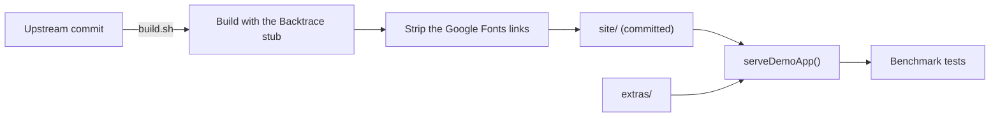

# Benchmark

The Benchmark is the Demo App and the suite of `.yaml` test files that run against it, to measure how well and how cheaply Jevwright locates elements and judges assertions (PRD §5.5). It lives in `src/tests/benchmark/` and makes no request outside localhost.

## 1. Functional Definition

### 1.1 Terms

| Term | Meaning |
| ---- | ------- |
| **Demo App** | Swag Labs, a shopping site built for test automation practice, served locally from its static build |
| **Extra page** | One of our own pages next to the Demo App, for actions Swag Labs has no page for |
| **Flow** | One user journey through the Demo App, such as checking out, written as one test file |
| **Locating mode** | How a suite file finds its elements: `selector` only, `target` only, or `both` (`syntax-analyzer.md` 1.1) |
| **Atomic case** | A test file that tests locating one hard element by `target`, with every other step by `selector` |
| **Benchmark run** | One run of the whole suite in every locating mode, summed up as pass rates, latency, and cost |

### 1.2 Demo App

The Demo App is the static build of [saucelabs/sample-app-web](https://github.com/saucelabs/sample-app-web) at a pinned commit, under its MIT license. It has a sign-in page, a product list with sorting, product details, a cart, a two-step checkout, a side menu, and pages that load products lazily, behind a spinner, or in a slider. Its users change how it behaves:

| User | Behavior |
| ---- | -------- |
| `standard_user` | Works as expected |
| `locked_out_user` | Cannot sign in; the sign-in page shows an error |
| `problem_user` | Wrong images, and some buttons and fields do not work |
| `performance_glitch_user` | The product list takes about 5 seconds to appear |
| `error_user` | Some actions throw errors |
| `visual_user` | Some buttons, the header, the side menu, and the cart look different from `standard_user` |

Every user signs in with the password `secret_sauce`. The build differs from upstream only so that it makes no request outside localhost:

- `@backtrace/react` is replaced by a stub that reports nothing and keeps `ErrorBoundary`'s fallback.
- The Google Fonts stylesheet is removed from every page, so the pages use system fonts.

The build also holds pages that upstream ships for locating tests: iframes (`/frames/`), shadow roots (`/shadow-dom/`), and both nested together (`/mixed-nesting/`).

### 1.3 Extra Pages

| Page | Covers |
| ---- | ------ |
| `/extras/dialogs.html` | `alert` (Save profile), `prompt` (Change display name), `confirm` (Delete account), with the outcome in `#status` |
| `/extras/tabs.html` | Links that open `/extras/returns.html` and `/extras/shipping.html` in a new tab |
| `/extras/menus.html` | An account menu that opens on hover, a file list with a right-click menu, and a double-click that opens a file |

### 1.4 Server

`serveDemoApp()` serves the Demo App on a free port of `127.0.0.1`:

- `/extras/<file>` comes from the extra pages, and any other path from the build.
- A path with no file gets `index.html`, because the app routes on the client at paths such as `/inventory.html`.
- Each file gets the content type of its extension; browsers run the app's module scripts only with a JavaScript type.

### 1.5 Suite

The suite is in `src/tests/benchmark/suite/`, one folder per locating mode plus `atomic/`:

| Folder | Elements found by | Measures |
| ------ | ----------------- | -------- |
| `selector/` | `selector` only | The Playwright baseline: speed and cost without Jev |
| `target/` | `target` only | Jev alone: Visual Locate, then DOM Locate |
| `both/` | `selector` and `target` | The fallback: Jev runs only where a selector misses |
| `atomic/` | `selector`, and `target` for one element | Locating accuracy, one element per file |

A Flow has the same file name and the same steps in `selector/`, `target/`, and `both/`; only how each element is found differs. The Flows with `problem_user` or `visual_user` are in `target/` and `both/` only. In `both/` their selectors are the ones of the `standard_user` page, so a selector misses where that user's page differs, and Jev has to take over.

Every Flow can be completed by a user: a Flow does not include a bug of its user that no locating could get past.

| Group | Flows |
| ----- | ----- |
| Shopping | `sign-in`, `locked-out`, `sort-products`, `cart-add-remove`, `checkout`, `checkout-errors`, `product-detail`, `menu-logout` |
| Dynamic pages | `lazy-load`, `spinner`, `slider` |
| Extra pages | `dialogs`, `new-tab`, `hover-menu`, `file-menu` |
| Other users | `problem-user-checkout`, `visual-user-checkout`, `visual-user-menu-logout` |

Sorting uses the keyboard, because the syntax has no action that picks a `<select>` option: `click` the sort box, then `press` `ArrowDown` and `Enter`.

An Atomic case signs in and navigates by `selector`, then runs one element action by `target`, then checks its effect with a Playwright `assert` by `selector`, so its outcome shows whether the right element was found. About 40 Atomic cases are named `<page>-<element>.yaml`:

| Page | Hard elements |
| ---- | ------------- |
| Sign-in | The fields and button, the close button of the error |
| Product list | The "Add to cart" of one product among six alike, a product image, the sort box, the cart icon and badge, the menu button |
| Product detail, cart, checkout | "Back to products", "Remove" of one item among several, the form fields, "Continue", "Cancel", "Finish" |
| Side menu | Each menu item, the close button |
| Frames and shadow roots | Elements inside an iframe, a shadow root, and both nested |
| Extra pages | A menu item that shows on hover, an item of the right-click menu |

Test files use two Variables: `{{BASE}}`, the Demo App's base URL, and `{{SWAG_PASSWORD}}`, the password. `.env.example` lists `SWAG_PASSWORD`.

### 1.6 Benchmark Run

A Benchmark run uses the CLI (#11) on each folder of the suite and sums up the `report.json` files it writes:

| Metric | Per | From |
| ------ | --- | ---- |
| Pass rate | Locating mode and Flow group | Report `status` |
| Step latency | Locate method (`selector`, `visual`, `dom`) and assertion kind | Step `durationMs` and `locateMethod` |
| Jev calls and token cost | Run and locating mode | Jev usage recorded in the Report |
| Locating accuracy | Atomic case | Whether its last `assert` passed |

The summary checks the PRD success metrics: an AI-assisted step under 3 seconds on average, and a high pass rate of the suite. The Report does not yet record Jev usage; the Jev Harness (#7) and the Report add it before the Benchmark run is built.

## 2. Internal Flow



1. `build.sh` clones the pinned commit, builds it with the Backtrace stub, and strips the font links from every page. It needs Node 24.9 or later, through nvm or Docker `node:24`; the repo stays on Node 22.
2. The build is committed as `site/`, so tests and benchmark runs need no build step.
3. `serveDemoApp()` serves `site/` and `extras/` to the tests.
4. The suite test analyzes every suite file and runs `selector/` with the Executor; a Benchmark run runs every folder with the CLI and sums up the Reports (1.6).

## 3. External Interface

```ts
function serveDemoApp(): Promise<{ baseUrl: string; stop: () => Promise<void> }>;
```

`baseUrl` is `http://127.0.0.1:<port>`; test files use it through the Variable `{{BASE}}`.

## 4. Class Architecture

### 4.1 Modules

| Module | Responsibility |
| ------ | -------------- |
| `server.ts` | `serveDemoApp()` (1.4) |
| `demo-app/build.sh` | Rebuilds `site/` from the pinned commit (2) |
| `demo-app/backtrace-stub.jsx` | Stands in for `@backtrace/react` in the build |
| `demo-app/vite.config.jevwright.mjs` | Adds the stub to the upstream Vite config |
| `suite.test.ts` | Checks the suite (5) |

### 4.2 Directory Layout

```text
src/tests/benchmark/
├── server.ts
├── server.test.ts
├── demo-app.test.ts
├── suite.test.ts
├── suite/
│   ├── selector/        # one file per Flow
│   ├── target/
│   ├── both/
│   └── atomic/          # <page>-<element>.yaml
└── demo-app/
    ├── README.md        # source, license, and how to rebuild
    ├── LICENSE          # upstream MIT license
    ├── build.sh
    ├── backtrace-stub.jsx
    ├── vite.config.jevwright.mjs
    ├── site/            # the build, committed and marked generated
    └── extras/          # the extra pages and their stylesheet
```

## 5. Test Plan

| Type | Coverage | Location |
| ---- | -------- | -------- |
| Integration | `serveDemoApp()`: `index.html` at the root, a script with a JavaScript type, `index.html` for a client route, an extra page under `/extras/` | `src/tests/benchmark/server.test.ts` |
| Integration | With the Executor and the real browser: signing in as `standard_user`; the alert, prompt, and confirm; a new tab; hover, right-click, and double-click. No page or stylesheet of the build loads anything from outside localhost | `src/tests/benchmark/demo-app.test.ts` |
| Integration | The suite: every file has no diagnostics; every Flow of `selector/` is also in `target/` and `both/` with the same steps apart from locating; every `selector/` file passes with the Executor against the Demo App | `src/tests/benchmark/suite.test.ts` |
| Benchmark | Every folder with the CLI and the real Jev, summed up as in 1.6; not run in CI | `src/tests/benchmark/` |

## 6. Delivery

| Issue | Delivers | Needs |
| ----- | -------- | ----- |
| #29 | The Demo App, the Extra pages, and the server (1.2–1.4) | – |
| #30 | The suite and its test (1.5) | #29 |
| #31 | The Benchmark run and its summary (1.6) | #30, the CLI (#11), the Run Pipeline, the Jev Harness (#7), the Element Locator, the Asserter |
