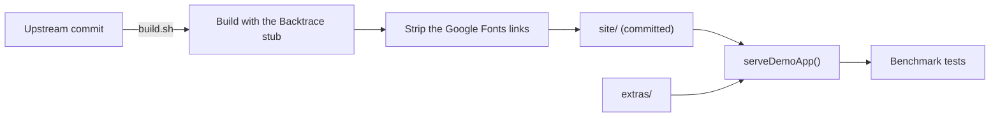

# Benchmark

The Benchmark is the Demo App and the suite of `.yaml` test files that run against it, to measure how well and how cheaply Jevwright locates elements and judges assertions (PRD §5.5). It lives in `src/tests/benchmark/` and makes no request outside localhost.

## 1. Functional Definition

### 1.1 Terms

| Term | Meaning |
| ---- | ------- |
| **Demo App** | Swag Labs, a shopping site built for test automation practice, served locally from its static build |
| **Extra page** | One of our own pages next to the Demo App, for actions Swag Labs has no page for |

### 1.2 Demo App

The Demo App is the static build of [saucelabs/sample-app-web](https://github.com/saucelabs/sample-app-web) at a pinned commit, under its MIT license. It has a sign-in page, a product list with sorting, product details, a cart, a two-step checkout, a side menu, and pages that load products lazily, behind a spinner, or in a slider. Its users change how it behaves:

| User | Behavior |
| ---- | -------- |
| `standard_user` | Works as expected |
| `locked_out_user` | Cannot sign in; the sign-in page shows an error |
| `problem_user` | Wrong images, and some buttons and fields do not work |
| `performance_glitch_user` | The product list takes about 5 seconds to appear |
| `error_user` | Some actions throw errors |
| `visual_user` | Some buttons, the header, the side menu, and the cart look different from `standard_user` |

Every user signs in with the password `secret_sauce`. The build differs from upstream only so that it makes no request outside localhost:

- `@backtrace/react` is replaced by a stub that reports nothing and keeps `ErrorBoundary`'s fallback.
- The Google Fonts stylesheet is removed from every page, so the pages use system fonts.

The build also holds pages that upstream ships for locating tests: iframes (`/frames/`), shadow roots (`/shadow-dom/`), and both nested together (`/mixed-nesting/`).

### 1.3 Extra Pages

| Page | Covers |
| ---- | ------ |
| `/extras/dialogs.html` | `alert` (Save profile), `prompt` (Change display name), `confirm` (Delete account), with the outcome in `#status` |
| `/extras/tabs.html` | Links that open `/extras/returns.html` and `/extras/shipping.html` in a new tab |
| `/extras/menus.html` | An account menu that opens on hover, a file list with a right-click menu, and a double-click that opens a file |

### 1.4 Server

`serveDemoApp()` serves the Demo App on a free port of `127.0.0.1`:

- `/extras/<file>` comes from the extra pages, and any other path from the build.
- A path with no file gets `index.html`, because the app routes on the client at paths such as `/inventory.html`.
- Each file gets the content type of its extension; browsers run the app's module scripts only with a JavaScript type.

## 2. Internal Flow



1. `build.sh` clones the pinned commit, builds it with the Backtrace stub, and strips the font links from every page. It needs Node 24.9 or later, through nvm or Docker `node:24`; the repo stays on Node 22.
2. The build is committed as `site/`, so tests and benchmark runs need no build step.
3. `serveDemoApp()` serves `site/` and `extras/` to the tests.

## 3. External Interface

```ts
function serveDemoApp(): Promise<{ baseUrl: string; stop: () => Promise<void> }>;
```

`baseUrl` is `http://127.0.0.1:<port>`; test files use it through the Variable `{{BASE}}`.

## 4. Class Architecture

### 4.1 Modules

| Module | Responsibility |
| ------ | -------------- |
| `server.ts` | `serveDemoApp()` (1.4) |
| `demo-app/build.sh` | Rebuilds `site/` from the pinned commit (2) |
| `demo-app/backtrace-stub.jsx` | Stands in for `@backtrace/react` in the build |
| `demo-app/vite.config.jevwright.mjs` | Adds the stub to the upstream Vite config |

### 4.2 Directory Layout

```text
src/tests/benchmark/
├── server.ts
├── server.test.ts
├── demo-app.test.ts
└── demo-app/
    ├── README.md        # source, license, and how to rebuild
    ├── LICENSE          # upstream MIT license
    ├── build.sh
    ├── backtrace-stub.jsx
    ├── vite.config.jevwright.mjs
    ├── site/            # the build, committed and marked generated
    └── extras/          # the extra pages and their stylesheet
```

## 5. Test Plan

| Type | Coverage | Location |
| ---- | -------- | -------- |
| Integration | `serveDemoApp()`: `index.html` at the root, a script with a JavaScript type, `index.html` for a client route, an extra page under `/extras/` | `src/tests/benchmark/server.test.ts` |
| Integration | With the Executor and the real browser: signing in as `standard_user`; the alert, prompt, and confirm; a new tab; hover, right-click, and double-click. No page or stylesheet of the build loads anything from outside localhost | `src/tests/benchmark/demo-app.test.ts` |
