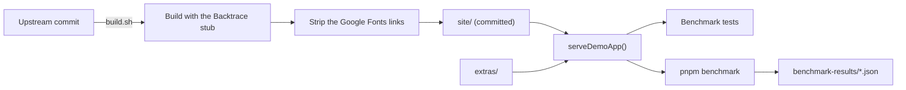

# Benchmark

The Benchmark is the Demo App and the suite of `.yaml` test files that run against it, to measure how well and how fast Jevwright locates elements and judges assertions (PRD §5.5). It lives in `src/tests/benchmark/` and makes no request outside localhost.

## 1. Functional Definition

### 1.1 Terms

| Term | Meaning |
| ---- | ------- |
| **Demo App** | Swag Labs, a shopping site built for test automation practice, served locally from its static build |
| **Extra page** | One of our own pages next to the Demo App, for actions Swag Labs has no page for |
| **Flow** | One user journey through the Demo App, such as checking out, written as one test file |
| **Locating mode** | How a suite file finds its elements: `selector` only, `target` only, or `both` (`syntax-analyzer.md` 1.1) |
| **Atomic case** | A test file that tests locating one hard element by `target`, with every other step by `selector` |
| **Assert case** | A test file whose elements are found by `selector` and whose last step is judged by Jev |
| **Stale selector** | A `selector` in `both/` that names its element the way an older version of the page might have, so it matches nothing and Jev locates the `target` |
| **Benchmark run** | One run of every file of the suite, summed up as pass rates, judging accuracy, and latency |

### 1.2 Demo App

The Demo App is the static build of [saucelabs/sample-app-web](https://github.com/saucelabs/sample-app-web) at a pinned commit, under its MIT license. It has a sign-in page, a product list with sorting, product details, a cart, a two-step checkout, a side menu, and pages that load products lazily, behind a spinner, or in a slider. Its users change how it behaves:

| User | Behavior |
| ---- | -------- |
| `standard_user` | Works as expected |
| `locked_out_user` | Cannot sign in; the sign-in page shows an error |
| `problem_user` | One placeholder image for every product; half of the "Add to cart" buttons, sorting, and the last name field do not work; product links open the wrong product |
| `performance_glitch_user` | The product list takes about 5 seconds to appear |
| `error_user` | Some actions throw errors |
| `visual_user` | The cart icon, the menu buttons, one product image, and the Checkout button are moved, rotated, or replaced; prices on the product list are random |

Every user signs in with the password `secret_sauce`. The build differs from upstream only so that it makes no request outside localhost:

- `@backtrace/react` is replaced by a stub that reports nothing and keeps `ErrorBoundary`'s fallback.
- The Google Fonts stylesheet is removed from every page, so the pages use system fonts.

The build also holds pages that upstream ships for locating tests: iframes (`/frames/`), shadow roots (`/shadow-dom/`), and both nested together (`/mixed-nesting/`).

### 1.3 Extra Pages

| Page | Covers |
| ---- | ------ |
| `/extras/dialogs.html` | `alert` (Save profile), `prompt` (Change display name), `confirm` (Delete account), with the outcome in `#status` |
| `/extras/tabs.html` | Links that open `/extras/returns.html` and `/extras/shipping.html` in a new tab |
| `/extras/menus.html` | An account menu that opens on hover, a file list with a right-click menu, and a double-click that opens a file |

### 1.4 Server

`serveDemoApp()` serves the Demo App on a free port of `127.0.0.1`:

- `/extras/<file>` comes from the extra pages, and any other path from the build.
- A path with no file gets `index.html`, because the app routes on the client at paths such as `/inventory.html`.
- Each file gets the content type of its extension; browsers run the app's module scripts only with a JavaScript type.

### 1.5 Suite

The suite is in `src/tests/benchmark/suite/`, one folder per locating mode plus `atomic/` and `assert/`:

| Folder | Elements found by | Assertions | Measures |
| ------ | ----------------- | ---------- | -------- |
| `selector/` | `selector` only | `selector` or `url` | The Playwright baseline: speed without Jev, and whether the Flows work at all |
| `target/` | `target` only | `selector` or `url` | Jev alone: Visual Locate, then DOM Locate |
| `both/` | `selector` and `target`, with some Stale selectors | `selector` or `url` | The fallback: the selector probe misses, then Jev locates the `target` |
| `atomic/` | `selector`, and `target` for one element | `selector` or `url` | Locating accuracy, one element per file |
| `assert/holds/`, `assert/fails/` | `selector` only | `statement`, or `waitFor` `condition` in `holds/` | Judging accuracy: a true statement holds and a false one fails |

Outside `assert/`, every assertion is a Playwright check, so a failure in `target/`, `both/`, or `atomic/` is a locating failure, never a judging one.

#### Flows

| Group | Flows | Folders |
| ----- | ----- | ------- |
| Shopping | `sign-in`, `locked-out`, `sort-products`, `cart-add-remove`, `checkout`, `checkout-errors`, `product-detail`, `menu-logout` | `selector/`, `target/`, `both/` |
| Dynamic pages | `lazy-load`, `spinner`, `slider` | `selector/`, `target/`, `both/` |
| Extra pages | `dialogs`, `new-tab`, `hover-menu`, `file-menu` | `selector/`, `target/`, `both/` |
| Other users | `problem-user-cart`, `visual-user-checkout`, `visual-user-menu-logout` | `target/` |

A Flow in more than one folder has the same file name and the same steps in each; only how each element is found differs.

In `both/`, each Flow has one to three Stale selectors, each marked with a `# stale` comment; its other selectors are those of `selector/`. A Stale selector names its element the way an older version of the page might have, such as `#login-btn` for the sign-in button, so it matches nothing.

The Other users Flows are in `target/` only. Their pages keep every `data-test` attribute and id of the `standard_user` page, so a selector finds the same element for them; only Jev meets the changed page. `visual_user` moves and rotates the cart icon and the menu buttons, moves the Checkout button to the top of the cart page, and shows random prices on the product list. `problem_user` shows one placeholder image for every product, and only the "Add to cart" buttons of the Backpack, the Bike Light, and the Onesie work.

Every Flow can be completed by its user: a Flow does not include a bug of its user that no locating could get past. `problem_user` cannot type a last name, so `problem-user-cart` adds the Backpack and the Bike Light, removes one in the cart, and signs out, without checking out.

Sorting uses the keyboard, because the syntax has no action that picks a `<select>` option: `click` the sort box, then `press` `ArrowDown` and `Enter`.

#### Atomic Cases

An Atomic case signs in and navigates by `selector`, then runs one element action by `target`, then checks its effect with a Playwright `assert`, so its outcome shows whether the right element was found. About 40 Atomic cases are named `<page>-<element>.yaml`:

| Page | Hard elements |
| ---- | ------------- |
| Sign-in | The fields and button, the close button of the error |
| Product list | The "Add to cart" of one product among six alike, a product image, the sort box, the cart icon and badge, the menu button |
| Product detail, cart, checkout | "Back to products", "Remove" of one item among several, the form fields, "Continue", "Cancel", "Finish" |
| Side menu | Each menu item, the close button |
| Shadow roots | An element inside an open shadow root, and one inside a nested shadow root (`/shadow-dom/`) |
| Extra pages | A menu item that shows on hover, an item of the right-click menu |

Elements inside iframes are not part of the suite, because the Page Snapshot does not enter frames. The shadow-root cases need the Page Snapshot to enter open shadow roots (#59); closed shadow roots stay out.

#### Assert Cases

An Assert case signs in and navigates by `selector`, then ends with one step that Jev judges: an `assert` with only a `statement`, or in `holds/` a `waitFor` with a `condition`. About 10 Assert cases in each folder are named `<page>-<what>.yaml`:

| Folder | Last step | Judged right when |
| ------ | --------- | ----------------- |
| `holds/` | A statement or condition that is true of the page, such as "The cart badge shows 2" | The file passes |
| `fails/` | A statement that is false of the page, such as "The cart is empty" after adding an item | The file fails at its last step |

`fails/` has no `waitFor` `condition`: Jev polls a false condition until the step times out.

#### Variables

Test files use two Variables: `{{BASE}}`, the Demo App's base URL, and `{{SWAG_PASSWORD}}`, the password. `.env.example` lists `SWAG_PASSWORD`.

### 1.6 Benchmark Run

`pnpm benchmark` serves the Demo App, sets `BASE` to its URL, runs every folder of the suite once with the CLI (#11), and sums up the Reports it writes:

| Metric | Per | From |
| ------ | --- | ---- |
| Pass rate | Folder (`selector/`, `target/`, `both/`, `atomic/`) and Flow group | Report `status` |
| Judging accuracy | `assert/` | Whether each file passed (`holds/`) or failed at its last step (`fails/`) |
| Jev step latency | Average and slowest, by `visual`, `dom`, and judged step | `durationMs` of every Jev step |
| Failures | Each failed file | Its failed step and `reason` |

A Jev step is an element action whose `locateMethod` is `visual` or `dom`, an `assert` with only a `statement`, or a `waitFor` with a `condition`. Its latency is the whole step's `durationMs`; in `both/` it includes the selector probe, since that is what a user waits for.

The summary is printed to the terminal and written to `benchmark-results/<timestamp>.json`, which git ignores. It shows the average Jev step latency next to the PRD target of 3 seconds without marking a pass or a fail, sets no pass-rate threshold, and does not measure token cost.

## 2. Internal Flow



1. `build.sh` clones the pinned commit, builds it with the Backtrace stub, and strips the font links from every page. It needs Node 24.9 or later, through nvm or Docker `node:24`; the repo stays on Node 22.
2. The build is committed as `site/`, so tests and benchmark runs need no build step.
3. `serveDemoApp()` serves `site/` and `extras/` to the tests and to `pnpm benchmark`.
4. The suite test analyzes every suite file and runs `selector/` with the Executor; `pnpm benchmark` runs every folder with the CLI and sums up the Reports (1.6).

## 3. External Interface

```ts
function serveDemoApp(): Promise<{ baseUrl: string; stop: () => Promise<void> }>;
```

`baseUrl` is `http://127.0.0.1:<port>`; test files use it through the Variable `{{BASE}}`.

## 4. Class Architecture

### 4.1 Modules

| Module | Responsibility |
| ------ | -------------- |
| `server.ts` | `serveDemoApp()` (1.4) |
| `demo-app/build.sh` | Rebuilds `site/` from the pinned commit (2) |
| `demo-app/backtrace-stub.jsx` | Stands in for `@backtrace/react` in the build |
| `demo-app/vite.config.jevwright.mjs` | Adds the stub to the upstream Vite config |
| `suite.test.ts` | Checks the suite (5) |
| `benchmark.ts` | `pnpm benchmark`: serves the Demo App, runs each folder with the CLI, writes the summary |
| `summary.ts` | Sums up Reports into the metrics of 1.6; no I/O |

### 4.2 Directory Layout

```text
src/tests/benchmark/
├── server.ts
├── server.test.ts
├── demo-app.test.ts
├── suite.test.ts
├── benchmark.ts
├── summary.ts
├── summary.test.ts
├── suite/
│   ├── selector/        # one file per Flow
│   ├── target/
│   ├── both/
│   ├── atomic/          # <page>-<element>.yaml
│   └── assert/
│       ├── holds/       # <page>-<what>.yaml
│       └── fails/
└── demo-app/
    ├── README.md        # source, license, and how to rebuild
    ├── LICENSE          # upstream MIT license
    ├── build.sh
    ├── backtrace-stub.jsx
    ├── vite.config.jevwright.mjs
    ├── site/            # the build, committed and marked generated
    └── extras/          # the extra pages and their stylesheet
```

## 5. Test Plan

| Type | Coverage | Location |
| ---- | -------- | -------- |
| Integration | `serveDemoApp()`: `index.html` at the root, a script with a JavaScript type, `index.html` for a client route, an extra page under `/extras/` | `src/tests/benchmark/server.test.ts` |
| Integration | With the Executor and the real browser: signing in as `standard_user`; the alert, prompt, and confirm; a new tab; hover, right-click, and double-click. No page or stylesheet of the build loads anything from outside localhost | `src/tests/benchmark/demo-app.test.ts` |
| Integration | The suite: every file has no diagnostics; every Flow of `selector/` is also in `target/` and `both/` with the same steps apart from locating; every `both/` Flow has one to three `# stale` selectors; every `selector/` file passes with the Executor against the Demo App | `src/tests/benchmark/suite.test.ts` |
| Unit | `summary.ts`: pass rate per folder and Flow group, judging accuracy of `holds/` and `fails/` (a `fails/` file that fails before its last step is judged wrong), Jev step latency by method, the failed files | `src/tests/benchmark/summary.test.ts` |
| Benchmark | `pnpm benchmark` with the real Jev; not run in CI | `src/tests/benchmark/benchmark.ts` |

## 6. Delivery

| Issue | Delivers | Needs |
| ----- | -------- | ----- |
| #29 | The Demo App, the Extra pages, and the server (1.2–1.4) | – |
| #30 | The suite and its test (1.5) | #29; #59 for the shadow-root Atomic cases |
| #59 | Page Snapshot elements inside open shadow roots | – |
| #31 | The Benchmark run and its summary (1.6) | #30, the CLI (#11), the Run Pipeline, the Element Locator, the Asserter |
