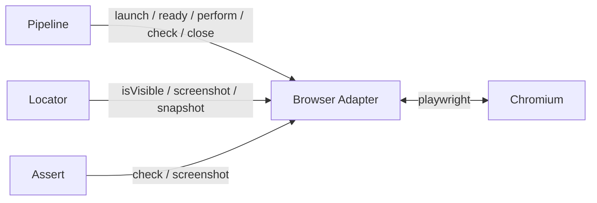
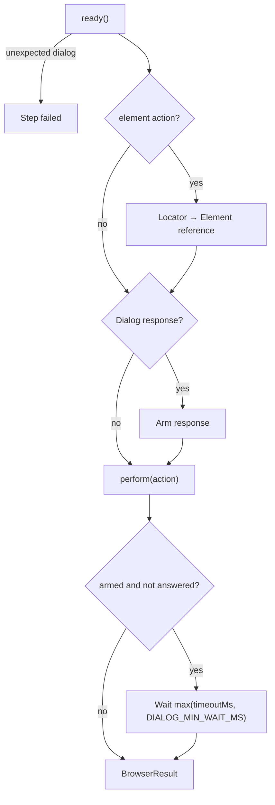
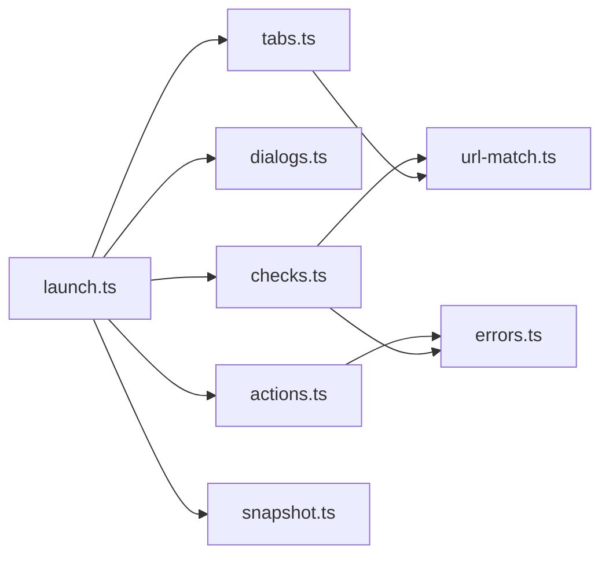

# Browser Adapter

The Browser Adapter owns the browser for one Run. It is the only module in Jevwright that imports Playwright: it launches and closes Chromium, records the trace, reads the page (screenshot, Page Snapshot, selector visibility), performs every action, runs every Playwright check, and handles dialogs and tabs. Other Core modules call its public methods and never touch Playwright themselves.

## 1. Functional Definition

### 1.1 Terms

| Term | Meaning |
| ---- | ------- |
| **Browser Adapter** | The object returned by `launchBrowser()`. One per Run; it owns one browser and every tab opened in it |
| **Current tab** | The tab that actions, checks, screenshots, and snapshots apply to. It is the first tab until a `switchTab` step changes it |
| **Page Snapshot** | The visible interactive elements inside the current tab's viewport at one moment, each with a snapshot id |
| **Snapshot id** | An element's number in a Page Snapshot, written to the page as `data-jev-id`. Valid only until the next snapshot |
| **Element reference** | How an action names its element: a Playwright selector, or a snapshot id chosen by Jev |
| **Dialog response** | A step's instruction for a native `alert`, `confirm`, `prompt`, or `beforeunload` dialog: accept or dismiss, optional prompt text, optional expected message |
| **Unexpected dialog** | A native dialog that appears when no Dialog response is armed |

### 1.2 Browser Lifecycle

| Rule | Value |
| ---- | ----- |
| Browser | Chromium from the `playwright` package, launched once per Run; never shared between Runs |
| Mode | Headless by default; headed when the caller asks (CLI `--headed`) |
| Context | One context per browser, with `viewport` `VIEWPORT`, `deviceScaleFactor` 1, and `baseURL` set to the TestCase `baseUrl` |
| Default timeout | `TestCase.timeoutMs`, set with `context.setDefaultTimeout()`; every wait below uses it unless stated otherwise |
| Trace | Always recorded: `context.tracing.start({ screenshots: true, snapshots: true })` at launch, stopped by `close()` |

`deviceScaleFactor` 1 makes one screenshot pixel equal one CSS pixel, so screenshot coordinates and snapshot `bbox` values share one coordinate system.

`close()` stops the trace, closes the browser, and returns the trace zip. The caller must call it in a `finally` block, including after an infrastructure error, so a crashed Run never leaves Chromium running. If `launchBrowser()` fails after Chromium started (creating the context, starting the trace, or opening the first tab), it closes the browser before rethrowing, since the caller has no Adapter to close.

### 1.3 Page Readiness

At the start of every step the pipeline calls `ready()`, which waits for the `load` event of the current tab (`waitForLoadState("load")`). On a page that has already loaded, this returns at once. Inside a step, actions rely on Playwright's auto-waiting. `networkidle` is not used: pages with polling or WebSockets never reach it.

`ready()` also reports an Unexpected dialog that appeared between steps (see 1.7).

### 1.4 Reading the Page

| Method | `data` on success | Used by |
| ------ | ----------------- | ------- |
| `isVisible(selector, timeoutMs)` | `true` once the first element matching `selector` is visible; `false` when it is not visible within `timeoutMs` | Locator selector stage |
| `screenshot()` | PNG of the current tab's viewport | Locator Visual Locate, Jev assertions, report evidence |
| `snapshot()` | `PageSnapshot` of the current tab | Locator Visual and DOM Locate |

Each method returns a `ReadResult`: `{ ok: true, data }`, or `{ ok: false, reason }` under the same error rules as every other method (1.10), for example when the current tab was closed or Playwright rejects the selector. A read is not a step, so it leaves the answered dialogs for the result of the step's `ready()`, `perform()`, or `check()`.

`isVisible` takes its own timeout because the Locator probes a selector with a shorter timeout than the step's.

### 1.5 Page Snapshot

`snapshot()` runs one script in the current tab:

1. Remove `data-jev-id` from every element, so ids from the previous snapshot cannot match.
2. Collect the elements matching `INTERACTIVE_SELECTOR` (links with `href`, buttons, inputs other than `hidden`, `select`, `textarea`, `summary`, elements with an interactive ARIA `role`, and elements with a non-negative `tabindex`).
3. Keep an element only when its box has a non-zero size, intersects the viewport, and `checkVisibility({ checkOpacity: true, checkVisibilityCSS: true })` is true.
4. Number the kept elements from `0` in DOM order and write the number to `data-jev-id`.

Each element is described by:

| Field | Value |
| ----- | ----- |
| `id` | Snapshot id |
| `tag` | Lowercase tag name |
| `role` | Explicit `role`, otherwise the implicit role of the tag (`a` → `link`, `input[type=checkbox]` → `checkbox`, `input[type=search]` → `searchbox`, other text inputs and `textarea` → `textbox`, `select` → `combobox`, ...) |
| `name` | Accessible name: `aria-label`, then `aria-labelledby` text, then `<label>` text, then visible text (a `submit`, `button`, or `reset` input's value), `title`, or `placeholder` |
| `text` | Visible text with whitespace collapsed; omitted when empty or equal to `name` |
| `attrs` | `type`, `placeholder`, `href`, `aria-checked`, `aria-selected`, `aria-current`, `aria-invalid` when present; `value` of a field when non-empty (not of checkboxes, radios, or button inputs); `checked` for checkboxes and radios; `disabled: true` when disabled |
| `bbox` | `{ x, y, width, height }` in CSS pixels relative to the viewport, rounded |
| `hittable` | `true` when `elementFromPoint` at the box center is the element, a descendant, or a `<label>` whose control is the element; `false` when something covers it (e.g. a modal backdrop) |

Only the viewport is captured, matching the viewport screenshot. To reach an element below the fold, the test scrolls first.

Known limitations: elements inside iframes and closed shadow roots are not collected.

### 1.6 Actions

`perform(action)` executes one action on the current tab. An element action resolves its Element reference to a Playwright locator: a selector becomes `page.locator(selector).first()`, and a snapshot id becomes `page.locator('[data-jev-id="<id>"]')`.

| Action | Playwright call | Fails when |
| ------ | --------------- | ---------- |
| `open` | `page.goto(url)`; relative URLs resolve against `baseURL` | Navigation error or timeout |
| `back`, `forward` | `page.goBack()` / `page.goForward()` | The tab's history (CDP `Page.getNavigationHistory`) has no entry before / after the current one. Cross-origin entries count, unlike in the Navigation API |
| `reload` | `page.reload()` | Navigation error or timeout |
| `press` | `page.keyboard.press(key)` | Playwright rejects the key name |
| `scroll` | `page.mouse.move()` to the viewport center, then `page.mouse.wheel(dx, dy)`; `up`/`left` are negative deltas | – |
| `sleep` | `page.waitForTimeout(ms)`, the only allowed use of it | – |
| `click` | `locator.click()` | The element is not actionable within the timeout |
| `doubleClick` | `locator.dblclick()` | Same |
| `rightClick` | `locator.click({ button: "right" })` | Same |
| `hover` | `locator.hover()` | Same |
| `input` | `locator.fill(value)` | Same, or the element is not editable |
| `switchTab` | See 1.8 | See 1.8 |

Failure reasons never contain the `input` value or prompt text, because those may hold resolved `{{VAR}}` values.

### 1.7 Dialogs

Playwright dismisses dialogs silently when no listener exists, and stalls the page when a listener does not answer. The Adapter therefore attaches one `dialog` listener to every tab, and that listener always answers.

An action may carry a Dialog response (its YAML form is defined in the Syntax Analyzer doc):

```ts
type DialogResponse = { accept: boolean; text?: string; message?: string };
```

| Situation | Behavior |
| --------- | -------- |
| The action has a Dialog response and a dialog appears | Armed before the action starts. The first dialog during the action is accepted (with `text` for a `prompt`) or dismissed as stated. If `message` is set and the dialog text does not contain it (case-sensitive), the step fails after the dialog is answered |
| The action has a Dialog response and no dialog appears | After the action, wait for the dialog up to `max(timeoutMs, DIALOG_MIN_WAIT_MS)`. If none appears, the step fails |
| A dialog appears while no response is armed (a second dialog during the same action, a dialog during a step without a response, or one between steps) | Dismissed at once so the page does not stall. The step it appeared in fails; a dialog between steps fails the next step at `ready()`. The reason names the dialog type and message |

Every answered dialog is returned in the result of the step it belongs to (`DialogRecord`), also when that step's action failed, so the report shows its type and message.

If Playwright cannot answer a dialog (for example, its tab closed first), the step fails with the reason `Could not answer the <type> dialog: <error>`, unless the step already failed for another reason.

Known limitations: `print` dialogs are not native dialog events and are not handled. A response is armed for the next dialog of any tab, so a dialog from an earlier step's timer that opens during the action takes the response; Playwright does not tell which action opened a dialog.

### 1.8 Tabs

The Adapter keeps the open tabs in opening order. A tab opened by the page (`target=_blank`, `window.open`) is added through `context.on("page")` and gets the dialog listener; it does not become the current tab by itself. A closed tab is removed.

`switchTab: { url }` makes the tab whose URL matches `url` the current tab:

1. Match every open tab's URL against `url` with the URL pattern rules below.
2. Exactly one match: it becomes the current tab and is brought to the front.
3. More than one match: the step fails, listing the matching URLs.
4. No match: poll every `TAB_POLL_MS` until the step timeout, since a new tab starts at `about:blank` before it navigates. On timeout the step fails, listing the open tab URLs.

If the page closes the current tab, every following step fails with the reason `The current tab was closed`, except `switchTab`, which can still select another tab.

URL patterns, used by `switchTab` and the `url` check (1.9) through one matcher in `url-match.ts`, so a pattern matches the same URLs in both:

- A pattern containing `*` is a glob: `*` matches any characters except `/`, `**` matches any characters. It is resolved against `baseUrl` first unless it starts with `*`.
- Any other pattern is resolved against `baseUrl` and compared exactly.
- No other character is special: `?`, `{`, `}`, `[`, and `]` match themselves.

### 1.9 Checks

`check(check)` runs one Playwright check on the current tab, waiting up to the step timeout. `waitFor` and the Playwright half of `assert` share these checks; a Jev `condition` or `statement` is not handled here.

| Check | Implementation | Passes when |
| ----- | -------------- | ----------- |
| `visible` | `page.locator(selector).first().waitFor({ state: "visible" })` | The first match is visible |
| `text` | Poll every `TEXT_POLL_MS`: `textContent()` of the first match, whitespace collapsed. On failure the reason quotes the last text read, even if the element disappeared afterwards | It contains `text` (case-sensitive) |
| `url` | `page.waitForURL()` with a predicate that applies the URL pattern rules (1.8) | The URL matches |

If several elements match `selector`, the first one is used; this is not an error.

### 1.10 Errors

Expected failures are typed results, never exceptions:

Every method except `close()` goes through the same handling. `ready()`, `perform()`, and `check()` return a `BrowserResult`; the reads in 1.4 return a `ReadResult`.

| Situation | Result |
| --------- | ------ |
| The current tab was closed (except for `switchTab`) | `{ ok: false, reason: "The current tab was closed" }`, without calling Playwright |
| `TimeoutError` | `{ ok: false, reason }`, naming what was awaited and the timeout; `isVisible` returns `{ ok: true, data: false }` instead |
| Any other error while the browser is still connected (invalid selector, unknown key, navigation error) | `{ ok: false, reason }` with Playwright's first message line |
| Any error after the browser disconnected or crashed, and any call made after that | Thrown; the pipeline treats it as an infrastructure failure |

`close()` throws on any error, because the Run is over and only the trace is left to save.

### 1.11 Constants

| Constant | Value | Description |
| -------- | ----- | ----------- |
| `VIEWPORT` | `{ width: 1280, height: 800 }` | Context viewport |
| `DIALOG_MIN_WAIT_MS` | `3000` | Minimum wait for an expected dialog after its action |
| `TAB_POLL_MS` | `100` | Poll interval for `switchTab` |
| `TEXT_POLL_MS` | `100` | Poll interval for the `text` check |
| `INTERACTIVE_SELECTOR` | See 1.5 | Elements collected by `snapshot()` |

All constants live in `constants.ts`.

## 2. Internal Flow

Where the Adapter sits in one Run:



One step:



1. `launchBrowser()` starts Chromium, the context, and the trace, and opens the first tab.
2. For each step, the pipeline calls `ready()`, then the Locator if the step is an element action, then `perform()` or `check()`.
3. `perform()` arms the Dialog response, runs the Playwright call, waits for an expected dialog, and disarms it.
4. Any Unexpected dialog seen during the call turns the result into a failure.
5. After the last step, or on the first failure or error, the pipeline calls `close()` and stores the trace.

## 3. External Interface

### 3.1 Functions

```ts
function launchBrowser(options: LaunchOptions): Promise<BrowserAdapter>;

type LaunchOptions = {
  headed: boolean;
  baseUrl?: string; // TestCase.baseUrl
  timeoutMs: number; // TestCase.timeoutMs
};

interface BrowserAdapter {
  ready(): Promise<BrowserResult>;
  isVisible(selector: string, timeoutMs: number): Promise<ReadResult<boolean>>;
  screenshot(): Promise<ReadResult<Buffer>>;
  snapshot(): Promise<ReadResult<PageSnapshot>>;
  perform(action: BrowserAction): Promise<BrowserResult>;
  check(check: BrowserCheck): Promise<BrowserResult>;
  close(): Promise<Buffer>; // trace zip
}
```

`BrowserAdapter` is an interface so the Locator, Assert, and pipeline tests can pass a fake.

### 3.2 Types

```ts
type ElementRef = { selector: string } | { snapshotId: number };

type DialogResponse = { accept: boolean; text?: string; message?: string };

type BrowserAction =
  | { action: "open"; url: string; dialog?: DialogResponse }
  | { action: "back" | "forward" | "reload"; dialog?: DialogResponse }
  | { action: "press"; key: string; dialog?: DialogResponse }
  | { action: "scroll"; direction: "up" | "down" | "left" | "right"; distance: number }
  | { action: "sleep"; ms: number }
  | { action: "click" | "doubleClick" | "rightClick" | "hover"; element: ElementRef; dialog?: DialogResponse }
  | { action: "input"; element: ElementRef; value: string; dialog?: DialogResponse }
  | { action: "switchTab"; url: string };

type BrowserCheck =
  | { check: "visible"; selector: string }
  | { check: "text"; selector: string; text: string }
  | { check: "url"; url: string };

type DialogRecord = {
  type: "alert" | "confirm" | "prompt" | "beforeunload";
  message: string;
  answer: "accepted" | "dismissed";
  expected: boolean; // false for an Unexpected dialog
};

type BrowserResult =
  | { ok: true; dialogs: DialogRecord[] }
  | { ok: false; reason: string; dialogs: DialogRecord[] };

type ReadResult<T> = { ok: true; data: T } | { ok: false; reason: string };

type BoundingBox = { x: number; y: number; width: number; height: number };

type SnapshotElement = {
  id: number;
  tag: string;
  role: string;
  name: string;
  text?: string;
  attrs: Record<string, string | boolean>;
  bbox: BoundingBox;
  hittable: boolean;
};

type PageSnapshot = {
  url: string;
  title: string;
  viewport: { width: number; height: number };
  elements: SnapshotElement[];
};
```

### 3.3 How the Pipeline Calls the Adapter

The Step Executor in `pipeline/` maps each `Step` to one call with an exhaustive `switch`:

| Step | Adapter call |
| ---- | ------------ |
| `open`, `back`, `forward`, `reload`, `press`, `scroll`, `sleep`, `switchTab` | `perform()` with the step's fields |
| Element actions | Locator → `ElementRef`, then `perform()` |
| `waitFor` with `selector` / `url` | `check({ check: "visible" })` / `check({ check: "url" })` |
| `waitFor` with `condition` | Assert module, using `screenshot()` |
| `assert` | Assert module: `check()` first, then Jev on `statement` if needed |

`{{VAR}}` values are substituted before the call; the Adapter never sees the raw template.

## 4. Class Architecture

### 4.1 Modules



| Module | Responsibility |
| ------ | -------------- |
| `launch.ts` | `launchBrowser()`: browser, context, trace, the `BrowserAdapter` implementation, `ready()` and `close()` |
| `tabs.ts` | Open tabs in order, current tab, `switchTab` (1.8) |
| `dialogs.ts` | Dialog listener per tab, armed response, Unexpected dialog records (1.7) |
| `actions.ts` | `perform()`: one function per action, Element reference to locator (1.6) |
| `checks.ts` | `check()`: `visible`, `text`, `url` (1.9) |
| `snapshot.ts` | The in-page snapshot script and `PageSnapshot` assembly (1.5) |
| `url-match.ts` | URL pattern matching for `switchTab` and the `url` check (1.8) |
| `errors.ts` | Turns Playwright errors into `BrowserResult` or rethrows them (1.10) |
| `constants.ts` | Constants in 1.11 |

To add an action, add its variant to `BrowserAction` in `types.ts` and its function in `actions.ts`; the exhaustive `switch` does not compile until both exist.

### 4.2 Directory Layout

```text
src/core/browser/
├── index.ts       # exports launchBrowser and types
├── types.ts
├── constants.ts
├── launch.ts
├── tabs.ts
├── dialogs.ts
├── actions.ts
├── checks.ts
├── snapshot.ts
├── url-match.ts
└── errors.ts
```

## 5. Test Plan

Browser tests launch real headless Chromium against local HTML pages served by `node:http` in the test setup, never external sites. CI installs the browser with `pnpm exec playwright install --with-deps chromium`.

| Type | Coverage | Location |
| ---- | -------- | -------- |
| Unit | `url-match`: glob `*` and `**`, exact match, relative URL resolved against `baseUrl`, `{` and `}` matched literally | `src/tests/unit/core/browser/url-match.test.ts` |
| Unit | `errors`: `TimeoutError` and selector errors become results; errors after disconnect are thrown | `src/tests/unit/core/browser/errors.test.ts` |
| Unit | `dialogs`: a dialog that cannot be answered fails the step and still releases the waiting action | `src/tests/unit/core/browser/dialogs.test.ts` |
| Integration | Lifecycle: screenshot size equals the viewport, trace zip returned by `close()`, `ready()` waiting for `load` after a click, calls after the browser is gone throw, Chromium closed when launching fails | `src/tests/integration/core/browser/launch.test.ts` |
| Integration | Every action in 1.6, including `back` with no history, `back` across origins, an invalid key, and a click on a covered element timing out | `src/tests/integration/core/browser/actions.test.ts` |
| Integration | Reads: `isVisible` visible, hidden, invalid selector; every read after the current tab closed; reads leave dialogs for the step result. Snapshot: viewport-only, hidden elements skipped, roles, names, text and attrs, `hittable: false` when covered, ids cleared between snapshots | `src/tests/integration/core/browser/snapshot.test.ts` |
| Integration | Dialogs: accept, dismiss, prompt text, `message` match and mismatch, expected dialog missing, Unexpected dialog during a step and between steps | `src/tests/integration/core/browser/dialogs.test.ts` |
| Integration | Tabs: switch to a `target=_blank` tab and back, ambiguous match, timeout, closed current tab | `src/tests/integration/core/browser/tabs.test.ts` |
| Integration | Checks: `visible`, `text`, and `url` pass and fail; first-match rule; `url` matches like `switchTab` | `src/tests/integration/core/browser/checks.test.ts` |

HTML pages live in `src/tests/integration/core/browser/fixtures/`, one page per scenario, named after it (e.g. `confirm-delete.html`, `open-new-tab.html`).
