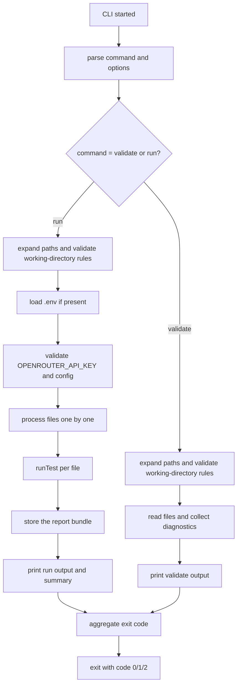

# CLI

The CLI runs local `.yaml` validation and test execution from the current working directory.

## 1. Functional Definition

### 1.1 Path Expansion

Each command expands each argument as follows:

- A path that contains `*`, `?`, or `[` is expanded with `fs.glob` from `node:fs/promises`.
- Entries matched by a glob that are directories are ignored; only files are kept.
- A directory is searched recursively for files ending in `.yaml`.
- A file path is used as given, whatever its extension.
- Results are de-duplicated and sorted.
- Every file must be inside the current working directory.
- A path that does not exist, a glob or directory that yields no files, or a file outside the working directory is a usage error and exits `2` before processing any file.
- Invalid command-line usage reported by commander (no command, unknown command or option, missing path argument) is a usage error and exits `2`; `--help` prints help to stdout and exits `0`.

### 1.2 Configuration for `run`

- If `.env` exists in the working directory, it is loaded with `process.loadEnvFile`.
- A missing `.env` is not an error.
- Variables already set in the environment are not overridden by `.env`.
- `OPENROUTER_API_KEY` must be non-empty; otherwise the CLI prints `OPENROUTER_API_KEY is not set` to stderr and exits `2` before processing any file.
- `validate` does not require `OPENROUTER_API_KEY`.
- `vars` passed to `runTest()` are every string value in `process.env` except `OPENROUTER_API_KEY`.
- The CLI does not check test variables; a missing variable fails its step in the Executor.
- The CLI creates the Jev client with `createJevClient({ apiKey, fetch: globalThis.fetch })`.
- The CLI never prints variable values, the API key, or unredacted error messages.

### 1.3 Running Each File

For every accepted file, the CLI reads the source and calls `runTest({ file, source }, { headed, vars, jev, store, onEvent })`.

- `file` is the file path relative to the working directory, using `/` on every OS.
- The output directory for a file is `<out-dir>/<timestamp>/<file without .yaml>/`.
- `timestamp` is generated once per CLI invocation as `new Date().toISOString()` with `:` replaced by `-`.
- `out-dir` defaults to `./jevwright-reports`.
- The CLI uses a file-system `ReportStore` in `src/cli`; it writes `report.json` with 2-space indentation and a trailing newline, and every other bundle file at its path, creating directories as needed.
- The `ReportStore` catches file-system errors and throws a `ReportStoreError` with the message `Failed to write report to <dir> (<code>)`, using `UNKNOWN` when the error has no code; it never includes the original message or cause.
- If `runTest()` throws, the CLI prints `<file>: unexpected error (<error.name>)` without the message, counts the file as failed, and continues.
- If reading a file fails, the CLI prints `<file>: unexpected error (<error.name>)` and continues; the file counts as failed for `run` and invalid for `validate`. With `validate --json`, this line goes to stderr so stdout stays valid JSON.
- An invalid file does not stop other files; every file is processed.

### 1.4 Output

#### 1.4.1 `validate`

- One line per diagnostic: `✖ <file>:<line> — Error: <message>`.
- Success case: `✔ Validation PASSED (N files).`
- Failure case: the last line is `Validation FAILED (N errors).`
- `--json` prints a JSON array of `{ file, code, message, line }` for all files; the result is `[]` when valid.

#### 1.4.2 `run`

For each file, the CLI prints one line per `finished` event, except pending steps. A line is formatted as:

```text
▶ suite/target/login.yaml
  ✔ line 8   open      410ms
  ✔ line 11  click     1420ms  [visual]
  ✖ line 20  assert    980ms   Statement does not hold (noul=0.12)
✖ FAILED (2/4 passed, 1 failed, 1 pending) in 2.90s → jevwright-reports/2026-11-07T10-00-00.000Z/suite/target/login
```

The summary line is exactly:

- `✔ PASSED (<passed>/<total> passed) in <s>s → <report directory>` when the report status is passed.
- `✖ FAILED (<passed>/<total> passed, <failed> failed, <pending> pending) in <s>s → <report directory>` when failed, omitting `<failed> failed` or `<pending> pending` when it is `0`.

`<s>` is `durationMs / 1000` with 2 decimal places. `<report directory>` is relative to the working directory and uses `/` as the separator.

Rules:

- `[method]` appears only when `locateMethod` is set.
- `reason` has already been redacted.
- If the report has `error`, the CLI prints `<kind>: <message>` before the summary line.
- An invalid file prints its diagnostics and no summary line.
- If `runTest()` throws, the CLI prints only the unexpected-error line and no summary line.
- With more than one file, the final line is `N files: P passed, F failed, I invalid`.

## 2. Internal Flow



1. Parse the command and arguments.
2. Expand and validate any path input before any file is processed.
3. For `run`, load `.env` if present and validate the API key.
4. For each accepted file, read the source, run the file, and save its bundle.
5. Print the command output for that file or for the full batch.
6. Merge the per-file results into the final exit code.

## 3. External Interface

### 3.1 Commands and Options

The CLI is invoked through the package.json script `"jevwright": "tsx src/cli/main.ts"`.

- Dependency: `commander`
- Dev dependency: `tsx`
- No `bin` field yet
- `--timeout` is not supported and is deferred

```bash
pnpm jevwright validate <paths...> [--json]
pnpm jevwright run <paths...> [--headed] [--out-dir <dir>]
```

| Command    | Argument / Option | Meaning                                                                 |
| ---------- | ----------------- | ----------------------------------------------------------------------- |
| `validate` | `<paths...>`      | One or more files, directories, or glob patterns                        |
| `validate` | `--json`          | Emit only a JSON array of diagnostics for all files                     |
| `run`      | `<paths...>`      | One or more files, directories, or glob patterns                        |
| `run`      | `--headed`        | Launch the browser in headed mode                                       |
| `run`      | `--out-dir <dir>` | Directory to store each report bundle; default is `./jevwright-reports` |

### 3.2 Output Streams

- Usage errors and configuration errors go to stderr.
- Everything else goes to stdout: diagnostics, step lines, summaries, and `--json` output.

### 3.3 `--json` Shape

`validate --json` prints only this JSON array shape:

```json
[
  { "file": "tests/broken.yaml", "code": "E005", "message": "Unknown action \"aiAct\"", "line": 12 }
]
```

The array is empty (`[]`) when the validation passes.

### 3.4 Exit Behavior

| Command    | Exit code | Meaning                                                                |
| ---------- | --------- | ---------------------------------------------------------------------- |
| `validate` | `0`       | All files are valid                                                    |
| `validate` | `2`       | A usage error occurs or any file is invalid                            |
| `run`      | `0`       | All files passed                                                       |
| `run`      | `1`       | Any file failed, including unexpected errors                           |
| `run`      | `2`       | A usage error occurs, configuration is missing, or any file is invalid |

The source for the exit-code rules is docs/PRD.md section 7.2.

## 4. Class Architecture

### 4.1 Modules

| Module              | Responsibility                                                                                  |
| ------------------- | ----------------------------------------------------------------------------------------------- |
| `main.ts`           | Process entry point: calls `runCli` with the command-line arguments and sets `process.exitCode` |
| `run-cli.ts`        | Commander setup and dispatch to `validate` and `run`; returns the exit code instead of exiting  |
| `path-expansion.ts` | Expand each path argument, enforce working-directory rules, and dedupe/sort results             |
| `config.ts`         | Load `.env`, validate required configuration for `run`, and assemble the runtime `vars` object  |
| `report-store.ts`   | File-system ReportStore: create directories, write `report.json`, and wrap file-system errors   |
| `output.ts`         | Human-readable output for validation and `run`, plus JSON serialization for `validate --json`   |
| `exit-codes.ts`     | Merge per-file outcomes into the final exit code                                                |

### 4.2 Directory Layout

```text
src/cli/
├── main.ts
├── run-cli.ts
├── path-expansion.ts
├── config.ts
├── report-store.ts
├── output.ts
└── exit-codes.ts
```

## 5. Test Plan

| Type        | Coverage                                                                                                                                                                                                                                                                  | Location                                     |
| ----------- | ------------------------------------------------------------------------------------------------------------------------------------------------------------------------------------------------------------------------------------------------------------------------- | -------------------------------------------- |
| Unit        | Path expansion: glob matching, directory recursion for `.yaml`, file pass-through, dedupe and sort, working-directory enforcement, missing paths and empty yields, and invalid files outside the working directory                                                        | `src/tests/unit/cli/path-expansion.test.ts`  |
| Unit        | Configuration: `.env` loading when present, missing `.env` as acceptable, `OPENROUTER_API_KEY` empty/absent handling, and `vars` built from `process.env` excluding the API key                                                                                           | `src/tests/unit/cli/config.test.ts`          |
| Unit        | Report-store behavior: write `report.json` with 2-space indentation and a trailing newline, create nested bundle directories, write each bundle file at its path, and wrap file-system errors with only the output directory and error code (or `UNKNOWN`) in the message | `src/tests/unit/cli/report-store.test.ts`    |
| Unit        | Output formatting: validate success/failure formatting and `--json` payload shape; run step output formatting with success/failure lines, final summary, and report `error` prefix                                                                                        | `src/tests/unit/cli/output.test.ts`          |
| Unit        | Exit-code aggregation: `0` when all files pass, `1` when any file fails, and `2` when invalid files or usage/configuration problems occur                                                                                                                                 | `src/tests/unit/cli/exit-codes.test.ts`      |
| Integration | CLI `validate` command: valid file output, invalid file diagnostics, `--json`, and exit codes `0` and `2`                                                                                                                                                                 | `src/tests/integration/cli/validate.test.ts` |
| Integration | CLI `run` command with selector-only steps, `--out-dir`, exit codes `0`, `1`, and `2` when `OPENROUTER_API_KEY` is missing; verify `report.json`, `trace.zip` (starts with `PK`), and a failed step screenshot (PNG signature) exist on disk under the expected directory | `src/tests/integration/cli/run.test.ts`      |
