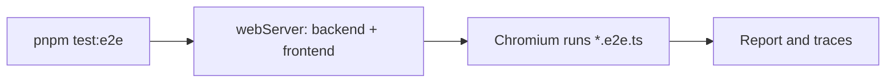

# E2E Tests

End-to-end tests drive the real frontend in Chromium against the real backend and database, covering the user flows the unit and integration tests cannot.

## 1. Functional Definition

### 1.1 Scope

| Area | Rule |
| ---- | ---- |
| Runner | `@playwright/test@1.64.1`, the same version as the root `playwright` package, so both use one Chromium |
| Location | `src/tests/e2e/`, files named `*.e2e.ts`; vitest collects `*.test.ts` and `*.spec.ts`, so this name keeps E2E out of `pnpm test` |
| Browser | Chromium only |
| Servers | The backend (`pnpm backend`, dev mode) and the frontend (`pnpm frontend`), started by Playwright's `webServer`, or reused when already running locally |
| Data | Each test registers its own account with a unique email, so tests do not depend on each other or on existing data |

### 1.2 Prerequisites (local)

- PostgreSQL running and migrated (`docs/deploy/backend-local.md` steps 2–4), with the root `.env` configured.
- Chromium installed: `pnpm exec playwright install chromium`.
- Ports 3000 and 4000 free, or already serving this repository's frontend and backend.

## 2. Internal Flow



1. Playwright starts the backend and waits for `http://127.0.0.1:4000/api/v1/health`.
2. It starts the frontend and waits for `http://localhost:3000/login`.
3. It runs every `*.e2e.ts` file in Chromium with `baseURL` `http://localhost:3000`, one worker at a time.
4. On failure it keeps the trace; the HTML report goes to `playwright-report/`.

## 3. External Interface

| Command | What it does |
| ------- | ------------ |
| `pnpm test:e2e` | Runs all E2E tests headless |
| `pnpm test:e2e --headed` | Runs them with a visible browser |
| `pnpm exec playwright show-report` | Opens the last HTML report |

`test-results/` and `playwright-report/` are git-ignored.

## 4. Class Architecture

### 4.1 Modules

| File | Responsibility |
| ---- | -------------- |
| `playwright.config.ts` | Test location, `baseURL`, Chromium project, `webServer` for backend and frontend, trace on failure |
| `src/tests/e2e/auth.e2e.ts` | Register, log out, and log back in |

### 4.2 Directory Layout

```text
playwright.config.ts
src/tests/e2e/
└── auth.e2e.ts
```

## 5. Test Plan

### 5.1 `auth.e2e.ts`

`test("registers, logs out, and logs back in", ...)`, with `email = e2e-<Date.now()>@example.com` and `password = "e2e-password-123"`:

1. Go to `/login`; click the **Register** mode button (outside the form).
2. Fill **Email** and **Password** (by label); click **Register** inside the form.
3. Expect the URL to be `/` and the text `Signed in as <email>`.
4. Click **Log out**; expect the URL to be `/login`.
5. Fill the same email and password; click **Log in** inside the form.
6. Expect the URL to be `/` and the text `Signed in as <email>` again.

The mode buttons and the submit button can share a label ("Register", "Log in"), so the submit button is always located inside the `form`.

Later features add their own `*.e2e.ts` files, written and committed failing before the feature is implemented.