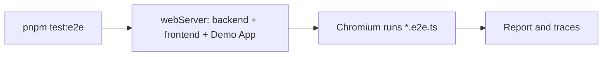

# E2E Tests

End-to-end tests drive the real frontend in Chromium against the real backend and database, covering the user flows the unit and integration tests cannot.

The cases they automate, and the test files they run, are in `docs/testing/test-cases.md`, shared with manual test passes. Every case marked **E2E** there has one test here.

## 1. Functional Definition

### 1.1 Scope

| Area | Rule |
| ---- | ---- |
| Runner | `@playwright/test@1.64.1`, the same version as the root `playwright` package, so both use one Chromium |
| Location | `src/tests/e2e/`, files named `*.e2e.ts`; vitest collects `*.test.ts` and `*.spec.ts`, so this name keeps E2E out of `pnpm test` |
| Browser | Chromium only |
| Servers | The backend (`pnpm backend`, dev mode), the frontend (`pnpm frontend`; in CI the build, served with `next start`, `docs/deploy/ci-cd.md`), and the Demo App (`src/tests/e2e/demo-app.ts`), started by Playwright's `webServer`, or reused when already running locally |
| Target site | Runs open only the Demo App at `DEMO_URL` (`http://127.0.0.1:8080`); a dev-mode backend's Runs may open local addresses (`backend.md` 1.6). No test opens an external site |
| Jev | No test calls Jev: every test file it runs locates by `selector` and asserts with Playwright checks. Cases that need Jev are **Live** in `test-cases.md` and stay out of this suite |
| Timeout | 120 s per test, since a test may wait for several Runs; each Run page waits up to 60 s for a final status |
| Workers | One. The Run Queue runs one Run at a time across all users (`RUN_CONCURRENCY=1`), and TC-RUN-07 needs no other Run active |
| Data | Each test registers its own account with a unique email, so tests do not depend on each other or on existing data |
| Setup | What a case lists as preconditions is set up through the REST API (`support.ts`); what a case tests is done through the UI |
| Names | A test's title starts with its case ID, such as `TC-RUN-01 runs a passing test and watches it live` |

### 1.2 Prerequisites (local)

- PostgreSQL running and migrated (`docs/deploy/backend-local.md` steps 2–4), with the root `.env` configured.
- Chromium installed: `pnpm exec playwright install chromium`.
- Ports 3000, 4000, and 8080 free, or already serving this repository's frontend, backend, and Demo App.

## 2. Internal Flow



1. Playwright starts the backend with `DEMO_APP_URL=http://127.0.0.1:8080`, so the Quick Start project's `BASE` is the local Demo App (no test runs its `4 Jev` files, which call Jev), and waits for `http://127.0.0.1:4000/api/v1/health`.
2. It starts the frontend and waits for `http://localhost:3000/login`.
3. It starts the Demo App and waits for `http://127.0.0.1:8080/`.
4. It runs every `*.e2e.ts` file in Chromium with `baseURL` `http://localhost:3000`, one worker at a time.
5. On failure it keeps the trace; the HTML report goes to `playwright-report/`.

## 3. External Interface

| Command | What it does |
| ------- | ------------ |
| `pnpm test:e2e` | Runs all E2E tests headless |
| `pnpm test:e2e --headed` | Runs them with a visible browser |
| `pnpm test:e2e -g TC-RUN-` | Runs the tests of one area, by case ID |
| `pnpm exec playwright show-report` | Opens the last HTML report |

`test-results/` and `playwright-report/` are git-ignored.

### 3.1 `support.ts`

Shared setup for the tests. Requests go straight to the backend at `API_URL` (`http://127.0.0.1:4000/api/v1`) with Playwright's `request` context.

| Export | Does |
| ------ | ---- |
| `API_URL`, `DEMO_URL`, `PASSWORD`, `SWAG_PASSWORD` | `http://127.0.0.1:4000/api/v1`, `http://127.0.0.1:8080`, `"e2e-password-123"`, `process.env.SWAG_PASSWORD ?? "secret_sauce"` |
| `WORKSPACE`, `QUICK_START` | `"/files"`, the files overview; `"Quick Start"`, the seeded Project's name |
| `alertsOf(page)` | The page's `role="alert"` elements without Next.js's hidden route announcer (`#__next-route-announcer__`), which has the same role |
| `uniqueEmail()` | `e2e-<Date.now()>-<6 random characters>@example.com` |
| `fixture(path)` | The text of `src/tests/e2e/fixtures/<path>` |
| `signUp(page, { quickStart? })` | Registers a new account through the API and stores its token in the page's `localStorage` (`auth-token`) before any page script runs. It then deletes the account's Quick Start project (`backend.md` 1.10), so the workspace starts empty, unless `quickStart` is `true`. Returns `{ email, token, api }`, where `api` sends `Authorization: Bearer <token>` |
| `createWorkspace(api)` | Creates Project `Demo Shop` and Module `Shopping`; returns their ids |
| `setDemoVariables(api, projectId)` | Sets the Project Variables `BASE` to `DEMO_URL` and `SWAG_PASSWORD` to `SWAG_PASSWORD` |
| `setUpDemoProject(page)` | Shared steps S1–S3 of `test-cases.md`: `signUp`, `createWorkspace`, and `setDemoVariables`; returns the Account with `projectId` and `moduleId` |
| `addTestFile(api, moduleId, name, source)` | Creates a Test File; returns its id |
| `startRun(api, testFileId)` | Triggers a Run; returns its id |
| `runToEnd(api, testFileId)` | `startRun`, then polls `GET /runs/:id` for up to 60 s until the Run is `passed` or `failed`; returns its id |
| `waitForFinalStatus(page)` | Waits up to 60 s until the Run page shows `Status: Passed` or `Status: Failed`; returns the label |
| `sidebarOf(page)` | The sidebar's "Projects" navigation |
| `createInSidebar(page, opener, name)` | Clicks a sidebar "New …" button, types `name` into the new row's "Name" input, and presses Enter; returns the input |
| `editorOf(page)` | The editor page's parts by role and name (frontend.md 1.7): `source`, `state`, `save`, `run`, `problems`, `runConsole`, `statusBar` |
| `sourceOf(page)` | The editor's whole text. CodeMirror renders only the lines in view, so it reads the document through the view CodeMirror keeps on its content element, as `EditorView.findFromDOM` does |
| `problemItemsOf(page)` | The Problems console's "Line <n>: <message>" buttons |
| `runFromEditor(page, testFileId)` | Shared step S5: opens the editor, clicks **Run**, clicks **Open run details** in the Run console, follows **Open full page** to `/runs/<id>`, and returns `waitForFinalStatus(page)` |

`api` methods throw when the response status is not the expected one, so a setup failure shows as the setup step, not as a later assertion.

## 4. Class Architecture

### 4.1 Modules

| File | Cases |
| ---- | ----- |
| `playwright.config.ts` | Test location, `baseURL`, Chromium project, `webServer` for backend, frontend, and Demo App, trace on failure |
| `src/tests/e2e/demo-app.ts` | Serves the Demo App on `127.0.0.1:8080` with `serveDemoApp(8080)` (`benchmark.md` 1.4) until it is stopped |
| `src/tests/e2e/support.ts` | Setup helpers (3.1) |
| `src/tests/e2e/landing.e2e.ts` | TC-LAND-01 – 07 |
| `src/tests/e2e/theme.e2e.ts` | TC-THEME-01 – 04 |
| `src/tests/e2e/auth.e2e.ts` | TC-AUTH-01 – 05, 07 – 10 |
| `src/tests/e2e/quick-start.e2e.ts` | TC-QS-01 – 03 |
| `src/tests/e2e/sidebar.e2e.ts` | TC-WS-01 – 03, 08 – 10 |
| `src/tests/e2e/sidebar-actions.e2e.ts` | TC-WS-04 – 06, 11 |
| `src/tests/e2e/editor.e2e.ts` | TC-ED-01 – 17 |
| `src/tests/e2e/variables.e2e.ts` | TC-VAR-01 – 06 |
| `src/tests/e2e/runs.e2e.ts` | TC-RUN-01 – 12, 15 – 19 |
| `src/tests/e2e/reports.e2e.ts` | TC-RPT-01 – 07 |
| `src/tests/e2e/overview.e2e.ts` | TC-OV-01 – 02 |
| `src/tests/e2e/security.e2e.ts` | TC-SEC-01 – 03, 05 – 07 |

### 4.2 Directory Layout

```text
playwright.config.ts
src/tests/e2e/
├── demo-app.ts
├── support.ts
├── *.e2e.ts
└── fixtures/          # the test files of test-cases.md 2.4
    ├── pass/
    ├── fail/
    ├── invalid/
    └── jev/           # Live only; no E2E test runs these
```

## 5. Test Plan

The steps and expected results of every test are those of its case in `docs/testing/test-cases.md` 4. A test asserts every expected result its case lists; where a case needs a server restart, a second browser window, or production, it is Manual and has no test here.

The selectors follow the accessible names of `frontend.md` 1.6–1.11 and 1.14. The mode buttons and the submit button on `/login` can share a label ("Register", "Log in"), so the submit button is always located inside the `form`; the overview and the sidebar share link names, so overview lookups are scoped to the "Test files" region.
