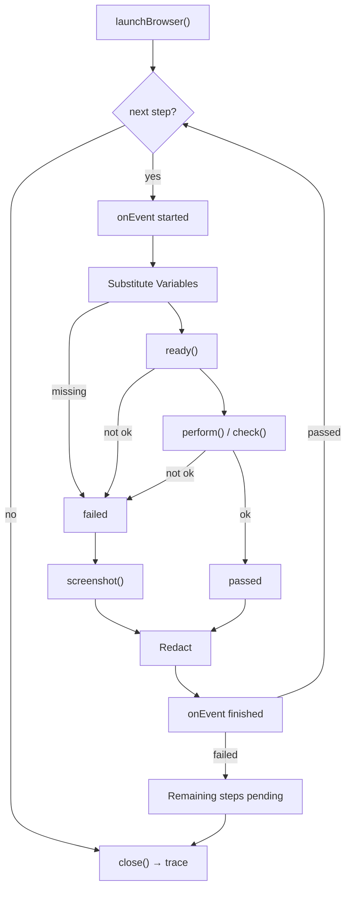
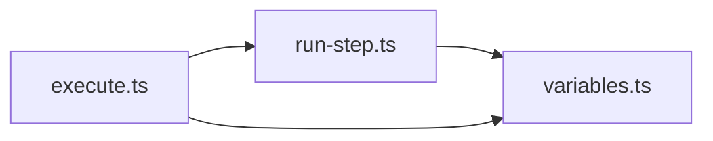

# Executor

The Executor runs one validated `TestCase`: it launches the Browser Adapter, runs the steps in order, stops at the first failed step or when the Run timeout expires, and closes the browser. It returns a Step result for every step and the trace. The Run Pipeline only connects it to the Syntax Analyzer and the Report.

## 1. Functional Definition

### 1.1 Terms

| Term | Meaning |
| ---- | ------- |
| **Executor** | The module that runs a whole `TestCase` on its own browser |
| **Step result** | The outcome of one step: `pending`, `passed`, or `failed`, with timing, locate method, dialogs, and failure reason |
| **Step event** | A progress message sent through `onEvent`: one when a step starts, one when it ends |
| **Variable** | A `{{NAME}}` placeholder in a test file string, filled in from the caller's `vars` before the Adapter sees the step |
| **Redaction** | Replacing a Variable's value with its `{{NAME}}` in reasons, dialog messages, events, and the Run error, so the value never reaches a report or log |
| **Run timeout** | `TestCase.runTimeoutMs`: the time the launch and all steps together may take, separate from the per-step `timeoutMs` |
| **Run error** | Why a Run was aborted: `timeout` when the Run timeout expired, `infrastructure` when the browser crashed or could not start (1.7) |

### 1.2 Run Lifecycle

1. Fill the Variables in `TestCase.baseUrl` (1.5), start the Run timeout (1.7), then launch the browser with `launchBrowser({ headed, baseUrl, timeoutMs })`. If a Variable in `baseUrl` is missing, the browser is not launched: the first step, if there is one, fails with `MISSING_VARIABLE` and no screenshot, the other steps are `pending`, and `trace` is empty.
2. Run each step in order (1.3). Send a `started` event before it and a `finished` event with its Step result after it.
3. After the first failed step, stop. Every step after it gets `{ status: "pending" }`; no event is sent for those steps.
4. Stop the Run timeout, close the browser in a `finally` block, and return the Step results with the trace from `close()`. The time `close()` takes is not part of the Run timeout. A `TestCase` with no steps returns no Step results.

When the Run timeout expires or the browser crashes, the Run is aborted and `execute()` throws a `RunAbortedError` that still carries the Step results and the trace (1.7).

### 1.3 One Step

1. **Substitute Variables** (1.5). If a Variable is not in `vars`, the step fails without calling the Adapter.
2. **`ready()`**. If it fails (for example, an Unexpected dialog appeared between steps), the step fails.
3. **Run the step** with one Adapter call, chosen by the mapping in 1.4.
4. **Collect dialogs** from `ready()` and the step's call, in that order.
5. **On failure, take a screenshot** with `screenshot()`. If the screenshot cannot be read, the result has no screenshot and keeps the step's own reason.
6. **Redact** the reason and every dialog message (1.5).

A step passes only when `ready()` and its call both return `ok: true`.

### 1.4 Step-to-Adapter Mapping

The mapping is one exhaustive `switch` over the `Step` types defined in `syntax-analyzer.md` 3.2.

| Step | Adapter call | Locate method |
| ---- | ------------ | ------------- |
| `open`, `back`, `forward`, `reload`, `press`, `scroll`, `sleep`, `switchTab` | `perform()` with the step's fields, including its Dialog response | – |
| Element action with `LocateBySelector` | `perform()` with `element: { selector }`; if the selector matches nothing, the step fails with the Adapter's reason | `selector` |
| Element action with `LocateByBoth` | Same; on failure the reason is `<Adapter reason>; <NEEDS_LOCATOR>`, because the Jev fallback on `target` is not available yet | `selector` |
| Element action with `LocateByTarget` | None; fails with `NEEDS_LOCATOR` | – |
| `WaitForSelector` | `check({ check: "visible", selector })` | – |
| `WaitForUrl` | `check({ check: "url", url })` | – |
| `WaitForCondition` | None; fails with `NEEDS_ASSERTER` | – |
| `AssertWithCheck`, `check` has `selector` only | `check({ check: "visible", selector })` | – |
| `AssertWithCheck`, `check` has `selector` and `text` | `check({ check: "text", selector, text })` | – |
| `AssertWithCheck`, `check` has `url` | `check({ check: "url", url })` | – |
| `AssertStatement` | None; fails with `NEEDS_ASSERTER` | – |

If an `AssertWithCheck` with a `statement` fails its check, the step fails with `<check reason>; <NEEDS_ASSERTER>`, because the Jev fallback is not available yet.

Steps that need Jev are never marked passed. Each such branch carries a `TODO` naming the Element Locator or the Asserter issue. When those modules exist, the Element Locator gives the `ElementRef` and locate method for every element action, and the Asserter runs `waitFor` and `assert`.

### 1.5 Variables

A Variable is `{{NAME}}`, where `NAME` matches `[A-Z_][A-Z0-9_]*`. The Executor replaces every Variable in `TestCase.baseUrl` and in every string field of a step: `url`, `key`, `value`, `selector`, `target`, `condition`, `statement`, `text`, and the Dialog response's `text` and `message`.

- Values come only from the caller's `vars`; the Executor does not read `process.env`. The CLI fills `vars` from `.env`, and the backend fills it from the platform configuration.
- If one or more Variables of a step are missing, the step fails with `MISSING_VARIABLE`, listing their names in order of first appearance.
- Redaction replaces every non-empty value of a Variable used anywhere in the `TestCase`, and its URL-encoded form (`encodeURIComponent`), with its `{{NAME}}`, longest first. A `{{NAME}}` already in the text is kept as written. It applies to the failure reason and to `DialogRecord.message` in Step results and Step events. Screenshots and the trace are not redacted.

Values are never logged.

### 1.6 Failure Reasons

| Constant | Reason |
| -------- | ------ |
| `MISSING_VARIABLE` | `Variable {{NAME}} is not set`, or `Variables {{A}}, {{B}} are not set` when several are missing |
| `NEEDS_LOCATOR` | `Locating by target needs the Element Locator, which is not available yet` |
| `NEEDS_ASSERTER` | `Judging a natural-language condition needs the Asserter, which is not available yet` |
| `runTimedOut(ms)` | `The run did not finish within runTimeoutMs (<ms> ms)` |

Every other reason comes from the Browser Adapter unchanged, apart from Redaction.

### 1.7 Aborted Runs

A Run is aborted in two cases; both throw a `RunAbortedError` (3.1) instead of returning:

| Case | Run error | The running step | Trace |
| ---- | --------- | ---------------- | ----- |
| The Run timeout expires during launch or a step | `timeout`, message `runTimedOut(runTimeoutMs)` | `failed` with that message as its reason | From `close()` |
| `launchBrowser()` throws | `infrastructure`, message from the error | – (every step `pending`) | Empty |
| An Adapter call throws (the browser crashed or disconnected, `browser-adapter.md` 1.10), or anything else throws while a step runs | `infrastructure`, message from the error | `failed` with that message as its reason | From `close()`, or empty when `close()` throws too |

- The message is the first line of the error's message, redacted (1.5). The original error is the `RunAbortedError`'s `cause`; it is not redacted, so callers must not log or report it.
- The running step's failed result has its `startedAt`, a `durationMs` up to the abort, no dialogs, and no screenshot; the trace already holds screenshots up to that point. It is sent in a `finished` event like any other step, and no event is sent after it.
- On a timeout the Executor calls `close()` at once, which makes the pending Adapter call reject; that rejection is ignored. A step result that arrives after the abort is dropped.
- When the timeout expires during launch, the Adapter that `launchBrowser()` returns later is closed and its trace is dropped.
- The steps before the running one keep their results; the steps after it are `pending`.

Steps that fail for a step timeout (`timeoutMs`) are ordinary failed steps, not aborted Runs.

## 2. Internal Flow



1. `execute()` launches the browser and loops over the steps.
2. `runStep()` substitutes Variables, calls `ready()`, maps the step to one Adapter call, and builds the Step result.
3. A failed step takes a screenshot, and every reason and dialog message is redacted before the result leaves the Executor.
4. After the first failure, the remaining steps are `pending`, and `close()` runs in `finally`.
5. A Run timeout or a thrown error aborts the loop at any point (1.7).

## 3. External Interface

### 3.1 Functions

```ts
function execute(testCase: TestCase, options: ExecuteOptions, launch?: typeof launchBrowser): Promise<ExecuteResult>;

type ExecuteOptions = {
  headed: boolean;
  vars: Record<string, string>;
  onEvent: (event: StepEvent) => void;
};

type ExecuteResult = {
  steps: StepResult[]; // one per TestCase step, in order
  trace: Buffer; // from BrowserAdapter.close()
};
```

`launch` defaults to `launchBrowser`; tests pass a function that returns a fake `BrowserAdapter`.

```ts
class RunAbortedError extends Error {
  readonly kind: RunError["kind"];
  readonly steps: StepResult[]; // one per TestCase step, in order
  readonly trace: Buffer; // empty when there is none
  // message: RunError message (redacted); cause: the original error, not redacted
}
```

### 3.2 Types

```ts
type LocateMethod = "selector" | "visual" | "dom";

type StepInfo = { index: number; line: number; action: Step["action"] };

type StepResult =
  | (StepInfo & { status: "pending" })
  | (StepInfo & {
      status: "passed";
      startedAt: string; // ISO 8601
      durationMs: number;
      locateMethod?: LocateMethod; // element actions only
      dialogs: DialogRecord[];
    })
  | (StepInfo & {
      status: "failed";
      startedAt: string;
      durationMs: number;
      locateMethod?: LocateMethod;
      dialogs: DialogRecord[];
      reason: string; // redacted
      screenshot?: Buffer; // PNG of the viewport; absent when it could not be read
    });

type RunError = { kind: "timeout" | "infrastructure"; message: string }; // message redacted

type StepEvent =
  | { type: "started"; step: StepInfo }
  | { type: "finished"; result: StepResult };
```

`index` is the step's 0-based position in `TestCase.steps`; `line` is its source line. `durationMs` runs from the start of Variable substitution to the end of the step's Adapter call and does not include the failure screenshot. `locateMethod` is set when an element is located, also when the action that follows fails.

Expected failures are Step results. The Executor throws only a `RunAbortedError` (1.7).

## 4. Class Architecture

### 4.1 Modules



| Module | Responsibility |
| ------ | -------------- |
| `execute.ts` | `execute()`: launch, step loop, events, `pending` steps, `close()` in `finally` (1.2) |
| `run-step.ts` | `runStep()`: `ready()`, the step-to-Adapter mapping, dialogs, failure screenshot (1.3, 1.4) |
| `variables.ts` | Variable substitution and Redaction (1.5) |
| `reasons.ts` | Failure reasons in 1.6 |
| `errors.ts` | `RunAbortedError` (1.7) |
| `types.ts` | Types in 3 |

### 4.2 Directory Layout

```text
src/core/executor/
├── index.ts       # exports execute and types
├── types.ts
├── execute.ts
├── run-step.ts
├── variables.ts
├── reasons.ts
└── errors.ts
```

## 5. Test Plan

Unit tests use a fake `BrowserAdapter` that records every call and returns scripted results.

| Type | Coverage | Location |
| ---- | -------- | -------- |
| Unit | `variables`: substitution in every string field, including the Dialog response; missing names listed in order; Redaction of reasons and dialog messages, longest value first, empty values ignored, only Variables used in the `TestCase` | `src/tests/unit/core/executor/variables.test.ts` |
| Unit | `runStep`: each row of 1.4 makes the stated Adapter call with substituted values; `ready()` failure skips the call; a missing Variable calls no Adapter method before the screenshot; dialogs from `ready()` and the call are merged in order; failure takes a screenshot and keeps the reason when the screenshot fails; `locateMethod` is `selector` for element actions; `LocateByTarget`, `WaitForCondition`, `AssertStatement`, and a failed check with a `statement` fail and are never passed | `src/tests/unit/core/executor/run-step.test.ts` |
| Unit | `execute`: launch options from the `TestCase` and `headed`; steps run in order; stop at the first failure with the rest `pending`; `started` and `finished` events per executed step and none for `pending` steps; `close()` runs after success, failure, and a thrown error | `src/tests/unit/core/executor/execute.test.ts` |
| Unit | Aborted Runs, each row of 1.7: the `RunAbortedError`'s kind, redacted message, `cause`, Step results, and trace; the running step failed with its timing; a `finished` event for it and none after; a late Adapter result dropped; the Adapter of a late launch closed; an empty trace when `close()` throws after a crash; a Run that ends before the timeout is not aborted | `src/tests/unit/core/executor/abort.test.ts` |
| Integration | A `TestCase` against local HTML pages with the real Browser Adapter: a passing run with actions, a dialog, `switchTab`, `waitFor`, and `assert`; a failing `assert` whose `text` is a Variable, with its value redacted from the reason | `src/tests/integration/core/executor/execute.test.ts` |

HTML pages live in `src/tests/integration/core/executor/fixtures/`, one page per scenario, named after it.
