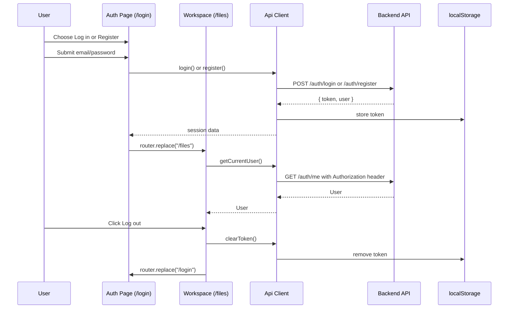

# Frontend

The Frontend is the browser app for Jevwright: an App Router Next.js client that authenticates with the backend, manages the user's workspace through the REST API, and lets the user edit Test Files in a code editor that checks them as they type, run them, and follow their Runs.

## 1. Functional Definition

### 1.1 Scope

This module covers the frontend package: the Next.js scaffold, generated API types, the auth-aware fetch client, the landing page, a two-mode login/register page, the workspace layout and sidebar, the files overview, the test file editor with its consoles, the Variables page, and the Run details (live progress, history and reports) as a sheet and a page. Tokens, themes, layouts, component rules and message wording are in [design-system.md](design-system.md).

| Area    | Scope                                                                                                          |
| ------- | -------------------------------------------------------------------------------------------------------------- |
| Package | `@jevwright/frontend` in `src/app/frontend`                                                                    |
| Runtime | Next.js 15 App Router, TypeScript strict, Node 22, pnpm 9                                                      |
| Styling | Tailwind v4 with `@tailwindcss/postcss`; no `tailwind.config.ts`; the tokens of [design-system.md](design-system.md) as shadcn variables; Light, Dark and System themes with `next-themes` |
| API     | OpenAPI-generated types from `docs/api/openapi.json`; native fetch wrapper                                     |
| Auth    | Bearer token from login/register responses; token stored in `localStorage`                                     |
| Pages   | `/` landing page; `/login` and `/register` two-mode auth form; workspace layout with sidebar; `/files` files overview; `/files/[testFileId]` editor; `/projects/[projectId]/variables` Variables page; `/runs/[runId]` Run page |
| Editor  | CodeMirror 6 with `@codemirror/lang-yaml` and `@codemirror/lint` (1.7)                                          |
| Tests   | Vitest for the API client, lib helpers, landing content and token contrast; Playwright E2E for the landing page, themes, auth, Quick Start, sidebar, editor, Variables, overview and the full flow |


### 1.2 Token and auth rules

The backend contract and docs specify the browser auth flow in [backend.md](backend.md):

- The known backend error codes are `invalid_request`, `unauthorized`, `not_found`, `conflict`, `too_large`, `invalid_test`, `internal`, and `not_implemented`.
- Any other backend error code is treated as `internal` by the frontend.
- Register and login respond with `{ token, user }`.
- The frontend sends the token as `Authorization: Bearer <token>`.
- A token that is rejected with `401` from routes other than login/register clears the token and calls `onUnauthorized`.
- A `401` from login/register does not clear the token and does not call `onUnauthorized`; it throws `ApiError` instead.
- The token storage must be browser-only; any access to `localStorage` is guarded with `typeof window`.
- The default client does not touch `localStorage` during server rendering.
- The default `apiClient` config sets `onUnauthorized` to `() => window.location.assign("/login")`.

### 1.3 Error handling contract

The client follows the backend’s JSON error payload shape exactly:

```ts
{
  error: {
    code: string;
    message: string;
    details?: unknown;
  }
}
```

Rules:

- `ApiError` extends `Error` and includes `status`, `code`, `message`, and `details`.
- If the backend responds with a non-JSON error body, the client keeps the real HTTP status and throws `ApiError` with:
  - `status`: the real HTTP status
  - `code`: `"internal"`
  - `message`: `"Internal server error"`
- Unknown backend error codes are normalized to `"internal"`, while the HTTP status is preserved.
- A 401 from a route other than login/register clears the token and calls the configured `onUnauthorized` callback.
- The frontend must not invent a message from the OpenAPI `description`; the message must match the mocked backend response body in unit tests.
- When `fetch` itself rejects (offline, DNS, CORS, the server is down), the client throws `NetworkError`, whose message is "Cannot reach the server. Check your connection and try again."

Every page shows errors through `formatError(error)` (lines) or `errorText(error)` (one line), never `Error.message` directly, so no user sees a server's internal wording:

| Error | Shown |
| ----- | ----- |
| `ApiError` with status ≥ 500 or code `internal` | "Something went wrong on the server. Try again in a moment." |
| `ApiError` `400` with `details` | Each detail's `message`, once; the backend's `message` joins the same sentences |
| Other `ApiError` | `ApiError.message`, a plain sentence from the backend (`backend.md` 1.7) |
| `NetworkError` or another `Error` | Its `message` |
| Anything else | "Something went wrong. Try again." |

Forms check the backend's rules first, with the backend's words, and send nothing while a field is wrong (`lib/validation.ts`). A field's problem shows under it in a `role="alert"`, and the field gets `aria-invalid` and `aria-describedby` pointing at it:

| Helper | Problem |
| ------ | ------- |
| `emailProblem(email)` | Not `x@y.z`: "Enter a valid email address." |
| `passwordProblem(password)` | Under 8 characters: "Password must be at least 8 characters."; over 200: "Password can be at most 200 characters." |
| `nameProblem(name)` | Blank after trimming: "Enter a name."; over 100 characters: "Names can be at most 100 characters." |
| `testFileNameProblem(name)` | The name before `.yaml`. Blank: "Enter a name."; anything but letters, digits, `-`, `_`, `.`: "Use only letters, digits, -, _ and ., with no spaces."; over 100 characters with `.yaml`: "Names can be at most 100 characters." |
| `variableNameProblem(name)` | Not `^[A-Z_][A-Z0-9_]*$`: "Variable names use capital letters, digits and _, and do not start with a digit, for example BASE_URL." |
| `variableValueProblem(value)` | Over 10,000 characters: "A Variable value can be at most 10,000 characters." |

Each helper returns `null` when the input is fine.

### 1.4 Generated types and API contract

The frontend types are generated from [docs/api/openapi.json](../api/openapi.json) via `openapi-typescript`. The generated file is `lib/api-schema.ts`, and it is excluded from lint and Prettier.

The generated file provides:

- `components["schemas"]["User"]`
- `components["schemas"]["Diagnostic"]`
- all named schema types used in API responses
- route-level request/response types from `paths`

Auth types are derived from those generated types instead of hand-written forms:

```ts
type User = components["schemas"]["User"];
type LoginResponse = paths["/auth/login"]["post"]["responses"][200]["content"]["application/json"];
type RegisterResponse = paths["/auth/register"]["post"]["responses"][201]["content"]["application/json"];
type AuthSession = LoginResponse;
```

This keeps `User`, `Diagnostic`, `Run`, and the login response in sync with the backend’s published contract.

### 1.5 Page requirements

The pages behave as follows:

- `/login` and `/register` render the same client-component form (`components/auth/auth-form.tsx`) with two modes, **Log in** and **Register**; `/login`, the header's **Sign in** button, starts in Log in mode; `/register`, the landing page's **Get started** links, opens the same page in Register mode. The mode buttons switch in place.
- The UI has exactly the PRD 7.1.1 form shape: email, password, submit.
- Submit calls `apiClient.login(email, password)` in Log in mode and `apiClient.register(email, password)` in Register mode.
- On successful login/register, the page navigates with `router.replace("/files")`, the workspace's home (`WORKSPACE_HOME` in `lib/routes.ts`).
- Guard: before showing the form, the page calls `checkSession(apiClient)` (`lib/auth-guard.ts`) and shows only `Loading…` meanwhile, so a signed-in user never sees the form:
  - no stored token: the form;
  - `GET /auth/me` succeeds: `router.replace("/files")`;
  - `401`: the token is cleared and the form shows. The request uses `skipAuthRedirect`, so the client's own `401` redirect to `/login` cannot loop;
  - any other failure, such as `NetworkError` or a `5xx`: the form shows, with `errorText(error)` in the page's `role="alert"`, and the token is kept.
- While the submit request is in flight, the submit button is disabled.
- Submit first checks the email with `emailProblem`, and the password with `passwordProblem` in Register mode or as non-empty ("Enter your password.") in Log in mode; a problem shows under its field (1.3) and nothing is sent.
- Auth errors from the backend show `formatError(error)` (1.3), one line each, in a `role="alert"`.
- Every authenticated page shares the workspace layout (see 1.6), a client component that calls `apiClient.getCurrentUser()` on load:
  - while pending, render minimal text `Loading…`;
  - when resolved, render the sidebar (with the current user email and a Log out button) and the page;
  - Log out calls `apiClient.clearToken()` and navigates with `router.replace("/login")`;
  - if `getCurrentUser()` fails with anything other than `401`, show the `formatError` lines instead (a `401` is handled by the API client, which redirects to `/login`).
- `/files` is the files overview (1.10); `/` is the landing page (1.14), which needs no token.

The root layout remains a server component, while the workspace layout and pages that need auth or data access are client components. This is a deliberate exception to the repo's "Server Components by default" guidance: the auth token is browser state, so auth and data fetching happen on the client.

### 1.6 Workspace sidebar

The workspace is every authenticated page. A shared layout guards auth and fills the window like a code editor: the sidebar on the left and the page on the right, edge to edge, separated only by the 1px resize handle; the window itself never scrolls, and the sidebar and the page scroll on their own. Pages use the full width: no centered column and no outer margin around the editor (design-system.md 4.1).

| Route                 | Page                                    |
| --------------------- | --------------------------------------- |
| `/files`              | Files overview (1.10)                   |
| `/files/[testFileId]` | Test file editor, its consoles and its Run history (1.7, 1.9) |
| `/projects/[projectId]/variables` | Project Variables (1.8)     |
| `/runs/[runId]`       | Run: live progress and report, full page (1.9) |

| Element         | Behavior                                                                                                                     |
| --------------- | ---------------------------------------------------------------------------------------------------------------------------- |
| Logo            | Above the tree, outside the "Projects" navigation: a link to the landing page `/` named "Jevwright home"                     |
| Width           | A draggable split (shadcn `resizable`): 320px by default, 220px at least and 600px at most, kept per browser in `localStorage` under `jevwright:sidebar`. The handle is a `separator` named "Resize sidebar" that also moves with the arrow keys |
| Header          | "Projects" with a "+" that adds a new Project row (below)                                                                     |
| Tree            | Projects from `GET /tree`, each with its folders nested to any level and its Test Files, in API order: in each Project or folder, its folders, then its Test Files. Projects and folders toggle open/closed; all open by default, also ones added later |
| Row "+"         | On a Project or folder: a menu (`components/ui/dropdown-menu.tsx`, shadcn's `dropdown-menu`) with **New folder**, **New test file**, and **Upload files…**. A folder at level 4 (`MAX_LEVEL`, counting the Project) has no New folder. New folder and New test file add a row named in place (below); the menu runs the choice once it has closed, so the new input keeps the focus |
| Upload files…   | Opens the system file picker for several `.yaml` and `.yml` files at once and imports them into that Project or folder (Import, below). One file imported with nothing skipped opens, as a new Test File does |
| Row "Variables" | On a Project: a link to its Variables page (1.8). Folders have no Variables: every Test File in the Project, at any level, runs with the Project's |
| Row actions     | On every Project, folder and Test File: Rename and Delete (1.11); on every folder and Test File also Move to… (below) |
| Add the Quick Start project | Under the tree while no Project is named `Quick Start` (`hasQuickStart`), as in the overview (1.10) |
| Messages        | A `role="status"` region named "Sidebar messages" under the header shows the last move (`Moved <name> to <place>.`) or import result, with a Dismiss button; a refused move shows in a `role="alert"` instead (`<name> was not moved. <the backend's message>`) |
| Long names      | A name cut off with an ellipsis shows in full in a tooltip on hover and on keyboard focus (shadcn `tooltip`); the row's accessible name is always the full name |
| Status icon     | From `statusOf(latestRun)`, with the icon and role of design-system.md 2.3: `passed` check, `failed` cross, `active` spinner, `none` dashed circle |
| Selection       | The Test File in the current route is highlighted                                                                            |
| Account         | Initials and the email from `me`, which is the account's name, with no "Signed in as" prefix on screen (the region's label says it); the theme switch (design-system.md 3), Log out (clears the token, goes to `/login`) |
| Narrow screens  | Below 768px the sidebar is hidden behind a ☰ button and takes the screen when open                                           |

#### Naming in place

New and renamed rows are named in the tree itself, like a file manager; there is no dialog (`components/workspace/inline-name-input.tsx`).

| Step | Behavior |
| ---- | -------- |
| Open | "+" adds a row with an empty input under its parent (opening the parent). Rename, or F2 on a focused row, turns that row's name into an input in the same spot, focused, with the name selected. A Test File's input holds the name without `.yaml` (`testFileBaseName`), and the fixed `.yaml` stays shown after it, as Windows selects a name without its extension |
| Type | The name is checked as the user types: Project and folder names with `nameProblem`, Test File names with `testFileNameProblem` (1.3). A problem shows under the input in a `role="alert"`, and the input gets `aria-invalid` and `aria-describedby` |
| Save | Enter or a click away saves. A name with a problem sends nothing and keeps the input open. An unchanged name, or a new row left empty by a click away, closes the input without a request; Enter on an empty new row shows "Enter a name." |
| Cancel | Escape closes the input and restores the name; a new row disappears |
| Fail | A save that fails, such as `409 conflict` for a taken name, keeps the input open with `errorText(error)` (1.3) under it |

Create submits `POST /projects`, `POST /projects/:id/folders` with the parent folder's `parentId`, or `POST /projects/:id/test-files` with its `folderId` (`toTestFileName(name)`, created with `starterSource(name)`), then reloads the tree; a new Test File opens. Names follow the backend rules (`backend.md` 1.3): a taken name, also one a folder and a Test File would share, keeps the input open with the backend's message.

#### Moving

A folder or Test File moves to another Project or folder by drag and drop, like VS Code's explorer, or with **Move to…**; both send `PATCH /folders/:id` with `{ projectId, parentId }` or `PATCH /test-files/:id` with `{ projectId, folderId }` (`moveFolder`, `moveTestFile`), then reload the tree and open the target. The backend checks every rule (`backend.md` 1.3): a taken name, a folder into itself or one of its own folders, and more than 4 levels are refused with its message, and nothing changes. Moving keeps every Run; in another Project the file runs with that Project's Variables.

| Step | Behavior |
| ---- | -------- |
| Drag | Folder and Test File rows are draggable (native HTML5 drag and drop, the row's id as `application/x-jevwright-row`); Projects are not |
| Hover | Project and folder rows are drop targets. The one under the pointer gets the focus ring's outline and the text "Move here", so the highlight is not color alone, and a visually hidden `aria-live="polite"` line says `Drop to move <name> to <place>.` |
| Drop | Moves the row there; a drop on the parent it is already in does nothing. A refused move shows `<name> was not moved. <message>` in the sidebar's alert |
| Move to… | The keyboard way: the row's Move button opens a dialog titled `Move <name>` listing `moveDestinations(tree, row)` as buttons labelled by their path, such as `Demo Shop / checkout`: every Project and folder except where the row is, and for a folder, except itself and the folders inside it. A choice moves it and closes the dialog; a refused move keeps the dialog open with the message in a `role="alert"` |

#### Importing

Dropping `.yaml` files, or whole folders, from the computer onto a Project or folder row imports them there, as **Upload files…** does with picked files. The drop reads `DataTransferItem.webkitGetAsEntry()`, which current Chrome, Edge, Firefox and Safari support, through `readDroppedEntries` (`lib/drop-entries.ts`), which reads every batch of a folder's entries and skips `node_modules` and hidden folders such as `.git` inside a dropped folder, as the CLI does; an item without an entry falls back to its file. While files are over a row it shows "Import here" and the live line says `Drop to import into <place>.`

`importEntries(target, entries, deps)` (`lib/import.ts`) then imports one entry at a time, waiting for each request:

| Entry | Behavior |
| ----- | -------- |
| Folder | Kept with its subfolders: created with `createFolder`, or, when the parent already has a folder of that name, the files go into that one (nothing is overwritten). A folder below level 4, a name `nameProblem` refuses, or one the backend refuses is skipped once as `<path>/`, and so is everything inside it |
| File | Not `.yaml` or `.yml`: skipped with `Only .yaml and .yml files can be imported.` Named `uploadedTestFileName(name)`; a name `testFileNameProblem` refuses is skipped with that problem. A source over 262,144 characters is skipped with the backend's `The test file is too long: …` without a request (a file over three times that in bytes without being read). Otherwise it becomes a Test File with its text, saved with its diagnostics like any other; a taken name or other API error skips it with `errorText(error)` |

Afterwards "Sidebar messages" shows `importSummary(result)`, such as `Imported 2 test files. 1 skipped:`, and a list named "Skipped" with `<path>: <reason>` for each skipped entry, paths from the drop target down.

The tree is loaded once in the layout and exposed through a `refreshTree()` context, so later pages (editor save, finished run) can update the status dots.

| Helper                  | Rule                                                                                                                                                            |
| ----------------------- | --------------------------------------------------------------------------------------------------------------------------------------------------------------- |
| `statusOf(latestRun)`   | `null` → `none`; `queued`/`running` → `active`; `passed` → `passed`; `failed` → `failed`                                                                        |
| `toTestFileName(input)` | Trims and adds `.yaml`; a trailing `.yaml` already typed is not doubled; empty input stays `""` |
| `testFileBaseName(name)` | The name without a trailing `.yaml`, for the Rename input |
| `uploadedTestFileName(fileName)` | The uploaded file's name with `.yaml` in place of a `.yaml` or `.yml` extension, any case: `checkout.yml` → `checkout.yaml` |
| `hasQuickStart(tree)` | Whether a Project is named exactly `Quick Start` |
| `allTestFiles(tree)` | Every Test File at any level, a level's files before its folders' (`lib/tree.ts`, like the rows below) |
| `canAddFolder(level)` | A Project (level 1) and folders above level 4 can hold a new folder |
| `parentOf(tree, row)`, `levelOf(tree, parent)`, `childFolderId(tree, parent, name)` | Where a folder or Test File sits; a parent's level; the folder of that name directly in a parent |
| `moveDestinations(tree, row)` | The places Move to… offers, with their paths, as above |
| `starterSource(name)`   | A valid Test Case: `name` is the file name without `.yaml`, one `open` step with `url: "https://example.com"`                                                   |
| `initials(email)`       | First two characters of the part before `@`, upper-cased                                                                                                        |

`starterSource("login.yaml")` returns the following, ending with a newline:

```yaml
name: "login"
steps:
  - open:
      url: "https://example.com"
```

#### Accessible names

E2E tests locate elements by role and accessible name, so these names are part of the contract.

| Element               | Role and name                                                                                                                                                                                  |
| --------------------- | ---------------------------------------------------------------------------------------------------------------------------------------------------------------------------------------------- |
| Logo                  | link "Jevwright home" to `/`                                                                                                                                                                   |
| Sidebar               | `navigation` named "Projects"; `separator` "Resize sidebar"                                                                                                                                    |
| Header "+"            | button "New project"                                                                                                                                                                           |
| Project or folder "+" | button "New in <name>", opening a `menu` with `menuitem`s "New folder" (not at level 4), "New test file", and "Upload files…"                                                                 |
| Project row Variables | link "Variables for <project name>"                                                                                                                                                            |
| Folder                | button named by the folder name, with `aria-expanded`, like a Project's                                                                                                                       |
| Move                  | buttons "Move folder <name>", "Move test file <name>"; `dialog` "Move <name>" with a `list` "Places" of buttons named by path, and "Cancel"                                                    |
| Messages              | `status` "Sidebar messages", with a `list` "Skipped" after an import that skipped entries, and button "Dismiss"; a refused move in a `role="alert"`                                              |
| Name input            | `textbox` labelled "Name" in the row; its problem in a `role="alert"` under it                                                                                                                 |
| Test File             | link named by the file name; the current one has `aria-current="page"`                                                                                                                         |
| Status icon           | inside the Test File link; `data-status` of `none`, `active`, `passed`, or `failed`, with a title: "Never run", "Running", "Passed", "Failed"                                                  |
| Full name             | the tooltip (`data-slot="tooltip-content"`) with the full name                                                                                                                                 |
| Account               | `region` named "Signed in as <email>" showing the email alone, cut off with an ellipsis and in full in a tooltip on hover and focus; `group` "Theme" with buttons "Light", "Dark", "System"; button "Log out"                                                                                     |

#### Tests
- Unit: the helpers above, `importEntries`, `importSummary` (`import.test.ts`), `readDroppedEntries` (`drop-entries.test.ts`).
- E2E `folders.e2e.ts`: folders nest in place down to level 4, whose "+" offers no New folder, and Test Files sit at level 4 and in the Project; a folder is renamed and deleted with everything inside, the open file inside returns to `/files`, and its Run stays with its path; a Test File and a folder move by drag and drop, also to another Project, with "Move here" on the target and their Runs kept; a drop that would take a name, put a folder into its own folder, or go below level 4 says why and changes nothing; Move to… moves with the keyboard and offers a folder no place inside itself; files and folders dropped from the computer are imported with their subfolders, `.yml` named `.yaml` and invalid files saved, `.git` skipped unseen, and a taken name, a non-`.yaml` file and a too-deep folder listed with their reasons while nothing is overwritten.
- E2E `editor.e2e.ts` (TC-ED-03, TC-ED-21): Upload files… from a folder's "+" imports one file and opens it, skips a second upload of the same name with the reason, and imports several files at once, listing the one it skips.
- E2E `sidebar.e2e.ts`: a new user with an empty workspace creates a Project, a folder, and a Test File in place through the "+" menus, with no dialog; each appears in the tree; the new file opens at `/files/<id>`, is marked current, and has status `none`; after a reload the tree is unchanged; a taken name, also a folder named like a Test File beside it, keeps the input open with an alert; name rules as the user types; the sidebar widens with its handle, keeps its width after a reload, and shows a cut-off name in full on hover and focus.

### 1.7 Test file editor

`/files/[testFileId]` loads the Test File with `GET /test-files/:id` and edits it in a code editor laid out like VS Code: the editor on the left, a console column on the right with the **Debug** console (the problems) on top and the **Output** console (the Run) below it, and a status bar along the bottom. The page fills the space next to the sidebar and never scrolls; the editor and each console scroll on their own. The page keeps two strings: `saved` (the last source from the API) and `draft` (the editor). The file is dirty when `draft !== saved`.

| State       | Render                                                                              |
| ----------- | ----------------------------------------------------------------------------------- |
| Pending     | `Loading…`                                                                          |
| `404`       | "Test file not found"                                                               |
| Other error | `errorText(error)` (1.3) in a `role="alert"`                                        |
| Loaded      | Header (file name, file state, Save, Run, the consoles toggle), the editor and the console column, the status bar |

#### Layout

| Part | Behavior |
| ---- | -------- |
| Splits | Draggable splits (shadcn `resizable`, react-resizable-panels), each with a `separator` handle that also moves with the arrow keys. Editor \| consoles: 60% / 40% by default, kept per browser in `localStorage` (`jevwright:editor`; `jevwright:editor-narrow` below 768px). Debug / Output: only while both consoles are open, 50% / 50% by default, each at least 64px; the Debug share is kept under `jevwright:console-split` (`parseConsoleSplit`), so collapsing and reopening a console, or a reload, restores the last dragged split. With one console collapsed there is no handle: it keeps only its header and the open one takes the rest; with both collapsed the column shows the two headers |
| Consoles | Each console's header ("Debug console", "Output console") collapses it to its header and opens it, on its own: any combination works, both open, either collapsed, or both collapsed (`toggleConsole`). Which are open is kept per browser under `jevwright:consoles-open` (`parseConsolesOpen`). The console column collapses completely (the editor takes the full width) with the toggle in the header or the one in the status bar, independently of the two consoles, which keep their state; a collapsed column is `inert` |
| Opening by itself | A collapsed console opens when it has something to report, showing the column too: Debug when new diagnostics arrive (`hasNewDiagnostics`), also from a refused Run; Output when the user clicks **Run** (and it stays open while the Run is live and after it ends). Opening one never closes the other (`openConsole`). Nothing else opens them, so a collapsed Debug console stays collapsed while the user types valid YAML |
| Narrow screens | Below 768px the consoles stack under the editor in a vertical split |
| Edges | The editor, the console column and the sidebar sit edge to edge, separated only by their 1px handles, with the code a few px from the gutter |

#### Editor

`components/workspace/code-editor.tsx` wraps CodeMirror 6 without a React wrapper package: YAML highlighting (`@codemirror/lang-yaml` with a `HighlightStyle` on the `--syntax-*` tokens, design-system.md 2.1), line numbers, the active line, history, bracket matching, and Tab to indent (Escape then Tab moves the focus on). The theme is `EditorView.theme` on the design tokens, reconfigured with `dark` when next-themes' `resolvedTheme` changes. Its content is a `textbox` labelled "Test file YAML".

There is no Validate button and no Upload button on the page: the file is checked automatically, while the user types and on every save. While the user types, the page waits 400 ms after the last change, then sends `POST /test-files/validate { source: draft }`. The newest answer for the source in the editor wins; the diagnostics are shown on their line with `@codemirror/lint` (a wavy underline from the line's first non-blank character to its end, a marker in the gutter, the message on hover; `diagnosticRanges`), and listed in the Debug console. A failed check shows `errorText(error)` in the Debug console's `role="alert"`.

| Action      | Behavior |
| ----------- | -------- |
| Edit        | Updates `draft`; the file state becomes Unsaved while dirty |
| Save, `Ctrl/Cmd+S` | Enabled only when dirty. `PATCH /test-files/:id { source: draft }`; on success `saved` and `draft` become the returned `testFile.source`, the returned diagnostics are shown, and `refreshTree()` is called. On failure the draft is kept and `errorText(error)` is shown in a `role="alert"` under the header |
| Run, `Ctrl/Cmd+Enter` | Opens the Output console, saves first when dirty (stops if the save fails), then `POST /test-files/:id/runs`. `202`: the Output console follows the new Run (1.9), its history reloads, and `refreshTree()` is called. `422`: `ApiError.details` (Diagnostic[]) become the problems, the Debug console opens, and the Output console shows `errorText(error)` in a `role="alert"`. Other errors: the Output console's `role="alert"` |

The shortcuts work wherever the focus is on the page; they are handled before the editor's own keys, so `Ctrl+Enter` does not insert a line. Buttons are disabled while their request is in flight. A failing `refreshTree()` shows its message in the page's `role="alert"`; the save or run itself still counts as done. Upload is in the sidebar (1.6).

#### Status

The file state shows as a badge next to the file name and at the left of the status bar, in place of banners. It is `fileState({ dirty, runStatus, savedSinceRun })`, where `runStatus` is the followed Run's status or else the tree's `latestRun`, and `savedSinceRun` is set by a save and cleared by a Run. The status bar also shows `problemsSummary` (a button that opens Problems), the latest Run's status, the cursor as "Ln <line>, Col <column>", and the consoles toggle.

#### Debug console

A `region` named "Debug": the file's problems. The header shows `problemsSummary(diagnostics)`. Each diagnostic is a list item with a button "Line <line>: <message>" (`formatDiagnostic`) and its code after it; the button moves the cursor to the start of the line's text, scrolls it into view and focuses the editor. With none it shows "No problems".

| Helper                  | Rule                                                                               |
| ----------------------- | ---------------------------------------------------------------------------------- |
| `problemsSummary(ds)`   | `[]` → "No problems"; 1 → "1 problem"; n → "n problems"                            |
| `formatDiagnostic(d)`   | "Line <line>: <message>"                                                           |
| `diagnosticRanges(source, ds)` | Pure. Each diagnostic as `{ from, to, line, message, code }`: its line from the first non-blank character to the end, an empty or blank line as an empty range at its start; a line past the end is the last line, a line below 1 the first. Diagnostics have a line but no column |
| `hasNewDiagnostics(previous, next)` | True when `next` has a diagnostic (by line, code and message) that `previous` does not |
| `fileState({ dirty, runStatus, savedSinceRun })` | `unsaved` when dirty; else `running` for a `queued` or `running` Run; else `saved` when there is no Run or the file was saved since; else the Run's `passed` or `failed` |
| `fileStateLabel(state)` | "Saved", "Unsaved", "Running", "Passed", "Failed" |
| `toggleConsole(open, key)` | Pure. `open` is `{ debug, output }`; flips `key` and leaves the other console as it is |
| `openConsole(open, key)` | Pure. Sets `key` open and leaves the other as it is; returns `open` itself when it already is |
| `parseConsolesOpen(stored)` | The stored `{ debug, output }`; both open for nothing stored, text that is not JSON, or another shape |
| `parseConsoleSplit(stored)` | The stored Debug share in percent; `DEFAULT_CONSOLE_SPLIT` (50) for nothing stored, empty text, text that is not a number, or a share outside 0–100 (exclusive); the panels' 64px minimum heights bound a dragged share |

Out of scope: several open files (tabs), an unsaved-changes guard, autocompletion.

### 1.8 Project Variables

A Project row's "Variables for <project>" link opens `/projects/[projectId]/variables`, a page in the editor area. It lists the Project's Variables from `GET /projects/:id/variables` by name, each value shown as `****` (the same mask whatever its length) with a show/hide toggle; the API answers the values (`backend.md` 1.3). Only Projects have Variables: every Test File in the Project, in any folder at any level, runs with them, and folders have no Variables page. The CLI reads a `.env` per directory instead (`cli.md` 1.2); the web keeps one set per Project on purpose.

| Action | Behavior                                                                                                                                                                                                                                                                                 |
| ------ | ---------------------------------------------------------------------------------------------------------------------------------------------------------------------------------------------------------------------------------------------------------------------------------------- |
| Open   | Loads the Variables; an empty list shows "No variables yet"                                                                                                                                                                                                                              |
| Show value | A toggle per Variable shows its value in place of `****`, and hides it again. Values start hidden on every visit |
| Save   | Enabled when Name and Value are non-empty. Shows the problem of `variableNameProblem`, then `variableValueProblem` (1.3), without calling the API; otherwise `PUT /projects/:id/variables/:name { value }`, then reloads the list and clears the form. An existing name is replaced |
| Delete | `DELETE /projects/:id/variables/:name`, then reloads the list                                                                                                                                                                                                                           |

API errors show `errorText(error)` (1.3) in a `role="alert"` on the page. Deleting the open page's Project goes to `/files`.

#### Accessible names (editor and Variables)

| Element          | Role and name                                                                                                                                                                           |
| ---------------- | --------------------------------------------------------------------------------------------------------------------------------------------------------------------------------------- |
| File name        | `heading` named by the file name                                                                                                                                                        |
| File state       | `status` named "File state" with "Saved", "Unsaved", "Running", "Passed" or "Failed"                                                                                                     |
| Header           | buttons "Save", "Run", "Toggle consoles" (`aria-expanded`)                                                                                                                              |
| Source           | `textbox` labelled "Test file YAML"                                                                                                                                                     |
| Splits           | `separator`s "Resize consoles" and, while both consoles are open, "Resize Debug and Output consoles"                                                                               |
| Debug console    | `region` named "Debug"; button "Debug console" (`aria-expanded`); one `listitem` per diagnostic with a button "Line <n>: <message>"; text "No problems"                         |
| Output console   | `region` named "Output"; button "Output console" (`aria-expanded`); errors in a `role="alert"` (1.9)                                                                                         |
| Status bar       | `region` named "Status bar" with the file state, the problems button, "Ln <n>, Col <n>" and a "Toggle consoles" button                                                                 |
| Variables page   | `region` named by its heading "Variables" (level 1); `list` "Variables" with one `listitem` per Variable showing its name and `****` or its value; buttons "Show value of <NAME>" (`aria-pressed`) and "Delete <NAME>"; inputs labelled "Name" and "Value" (password); button "Save"; errors in a `role="alert"` |

#### Tests
- Unit: `problemsSummary`, `formatDiagnostic`, `diagnosticRanges`, `hasNewDiagnostics`, `fileState`, `fileStateLabel`, `toggleConsole` and `openConsole` for every combination of open consoles, `parseConsolesOpen`, the validation helpers (5.6), and the API client functions (5.1).
- E2E `editor.e2e.ts`: the starter source and the file state, with no Validate or Upload button; save and reload; upload from the sidebar; the diagnostics of the invalid fixtures listed as the user types and marked on their lines, with no Validate button; the size limit; `Ctrl+S` and `Ctrl+Enter`; a clicked problem moves the cursor; at 1366×768 the editor fills the space between the sidebar and the consoles within 3px, about 60 / 40, with Debug over Output sharing the column evenly, three handles (sidebar, consoles, Debug / Output), and the page does not scroll; a collapsed Debug console stays collapsed after a reload and while the YAML is valid, and opens for a new problem; the whole column hides and reopens from the header or the status bar; Run opens a collapsed Output console; each console opens and collapses on its own in every combination, with the Debug / Output handle only while both are open, the column toggle keeps their state, and opening one by itself leaves the other as it is; the Debug / Output split moves with the keyboard, comes back after collapsing and reopening Output and after a reload; the sidebar tree, the editor and both consoles have the same scrollbar in both themes; on a phone the consoles are under the editor; Save and `Ctrl+S` show the diagnostics the save answers.
- E2E `variables.e2e.ts`: a new user adds Variable `BASE`; it is listed with `****` and its value shows only with the toggle; replacing it and deleting it; an invalid name shows the alert without a request; the value limits.

### 1.9 Runs: live progress and history

A Run's details (steps, screenshots, report, source when it ran) have one component, `RunReport`, shown in two places: the **Run details sheet**, which slides in from the right over most of the editor, and the Run's own page `/runs/[runId]`, which keeps working as a full page. Both load the Run and follow its Live Progress with the same hook, `useRun(runId, onFinal)` (`lib/use-run.ts`), and render steps with the same `StepList`, because the backend uses one `Step` shape for Live Progress and the Report. The Output console in the editor uses `useRun` too.

#### Output console (editor page)

A `region` named "Output" in the editor's console column (1.7).

| Part | Behavior |
| ---- | -------- |
| Live Run | After **Run**, the new Run: a status badge (`runStatusLabel`), "<passed>/<total> passed" once the summary exists, its duration, the Run error as `runErrorText(error)`, and a compact list named "Progress" with one item per step ("Step <n>", the action, "line <line>", the status and a failed step's `reason`), in an `aria-live="polite"` area. "Open run details" opens the sheet. When the Run is final, the history reloads and `refreshTree()` is called |
| History | A `region` named "Runs" loads `GET /runs?testFileId=<id>&limit=20` with the page and again after a Run starts and ends. Each Run is one list item with a link to `/runs/<id>` whose text is `runStatusLabel(status)`, the trigger time (`createdAt`, `toLocaleString()`), and `formatDuration(durationMs)`, newest first; a click opens the sheet, and a click with a modifier key opens the page as a link does. An empty list shows "No runs yet". There is no pagination. A failed load shows `errorText(error)` (1.3) in a `role="alert"` inside the region |

#### Run details sheet

`components/workspace/run-details-sheet.tsx`, `RunDetailsSheet({ runId, onClose })`: a shadcn `sheet` from the right, as wide as 85% of the window (at least 40rem, at most the window), over the page with its overlay. It is a `dialog` named by the Run's file name, with "Open full page" (a link to `/runs/<id>`), the close button "Close", and `RunReport` below. Escape, the close button, or a click on the uncovered part of the page closes it; the editor under it stays mounted with its draft, cursor and scroll position. `runId` of `null` closes it, so the files overview can reuse it.

#### Run page

| Step | Behavior |
| ---- | -------- |
| Load | `GET /runs/:id`. Pending: `Loading…`; `404`, also for a malformed id (`backend.md` 1.7): "Run not found"; other errors: `errorText(error)` (1.3) in a `role="alert"` and nothing else |
| Finished Run (`passed`/`failed`) | Steps come from `run.report.steps`. A Run without a Report (`interrupted`/`internal` error) shows no steps and "No step results" |
| Active Run (`queued`/`running`) | Opens the WebSocket at `liveUrl(baseUrl, runId, token)` and folds every message into `{ run, steps }` with `applyLiveMessage`. When a `status` message makes the Run final, it reloads `GET /runs/:id` (for the Report and trace) and calls `onFinal`; the page calls `refreshTree()` |
| Socket closes early | If the socket closes before the Run is final, the last state stays and "Live progress disconnected" shows in a `role="alert"` |
| Leave | The socket is closed |

The page header shows a "Back to <fileName>" link to `/files/<testFileId>` (hidden when `testFileId` is `null`), the file name as the heading, and, for a file in a folder, `Path when run: <path>`, the file's path in its Project when the Run was triggered. `RunReport` shows "Status: <runStatusLabel>", the trigger time, `formatDuration(durationMs)`, the summary as "<passed>/<total> passed" once it exists, and the Run error as `runErrorText(error)` when there is one. After the Run is final, a "Download report" link points to `runFileUrl(baseUrl, runId, "report.json", token)`, and a "Download trace" link to `runFileUrl(…, report.trace, token)` when `report.trace` exists.

`StepList` renders an ordered list named "Steps". Each step is one list item with "Step <index + 1>", the action, "line <line>", `runStatusLabel`-style status text (Pending, Running, Passed, Failed), and, when present, `formatDuration(durationMs)`, the locate method, the failure `reason`, and the screenshot as an `img` with alt "Step <index + 1> screenshot" from `runFileUrl(baseUrl, runId, step.screenshot, token)`. Dialog records are not shown.

The screenshot is a button named "Open step <n> screenshot full size". It opens a dialog named "Step <n> screenshot" with the image at full size (alt "Step <n> screenshot, full size"), scrolling when it is larger than the window; Escape or a click outside closes it.

Below the steps, a collapsed "Source when it ran" section shows the Run's `source` from `GET /runs/:id` in a `pre` with the same name, so a Run of an earlier version of the file shows that version. Live Progress messages carry no source, so the one loaded is kept.

| Helper | Rule |
| ------ | ---- |
| `runStatusLabel(status)` | `queued` → "Queued", `running` → "Running", `passed` → "Passed", `failed` → "Failed" |
| `stepStatusLabel(status)` | `pending` → "Pending", `running` → "Running", `passed` → "Passed", `failed` → "Failed" |
| `formatDuration(ms)` | `null` or `undefined` → "—"; under 1000 → "<ms> ms"; otherwise seconds with one decimal, "<s> s" |
| `liveUrl(baseUrl, runId, token)` | `baseUrl` with `http` → `ws` and `https` → `wss`, then `/runs/<runId>/live?token=<encodeURIComponent(token)>` |
| `runFileUrl(baseUrl, runId, path, token)` | `<baseUrl>/runs/<runId>/files/<path>?token=<encodeURIComponent(token)>` |
| `isFinalStatus(status)` | `true` for `passed` and `failed`, `false` for `queued` and `running` |
| `runErrorText(error)` | `timeout` → "Timed out: <message>"; `interrupted` → "Interrupted: <message>"; `infrastructure` → "Browser error: <message>"; `internal` → "Something went wrong while running the test. Try running it again.", since its message is the server's error name |
| `applyLiveMessage(state, message)` | Pure. `snapshot` → `{ run, steps }` from the message; `step` → the step with the same `index` is replaced (inserted in `index` order if absent); `status` → `run` replaced, steps kept. Never mutates `state` |

`state` is `{ run: Run | null; steps: Step[] }`; messages are the generated `LiveMessage` type.

#### Accessible names (Runs)

| Element | Role and name |
| ------- | ------------- |
| Output console | `region` named "Output"; text "<passed>/<total> passed"; `list` "Progress" with one `listitem` per step; button "Open run details" |
| Runs list | `region` named "Runs"; one `listitem` per Run containing a `link` to the Run; text "No runs yet" when empty |
| Sheet | `dialog` named by the file name; link "Open full page"; button "Close" |
| Run heading | `heading` named by the file name (page) |
| Run status | text "Status: <label>" |
| Steps | `list` named "Steps"; one `listitem` per step containing "Step <n>" |
| Screenshot | `img` with alt "Step <n> screenshot" |
| Links | "Back to <fileName>" (page), "Download report", "Download trace" |
| Disconnect | `role="alert"` with "Live progress disconnected" |

#### Tests
- Unit: the helpers above (5.4) and `getRun`, `listRuns`, `getBaseUrl` (5.1).
- E2E `runs.e2e.ts`: Run in the editor is followed live in the Output console without a navigation, to "6/6 passed", with the history and the sidebar status updated; the sheet shows the steps; the Run page, opened through "Open full page", for every other case.
- E2E `reports.e2e.ts`: the history lists every Run newest first and opens each in the sheet with its own source; the sheet covers most of the editor from the right, closes with Escape, the close button and a click on the uncovered part, keeps the editor's draft, and opens full page at the Run's URL.

Out of scope: project or folder dashboards, charts, filters, pagination, showing dialog records.

### 1.10 Files overview

`/files` lists every Test File in the workspace with its latest Run status, so a Tester can check test health at a glance (PRD 5.4.3). It reads the tree from `useWorkspace()`; there is no extra request, and the page updates whenever `refreshTree()` runs.

| Element | Behavior |
| ------- | -------- |
| Region | A `region` named "Test files" |
| Groups | `overviewGroups(tree)`: one heading (level 2) per Project; under it the Test Files directly in the Project, then one heading (level 3) per folder that holds Test Files, named by its path in the Project (`auth/session`), in tree order. Each group's files are a `list` named `In <project name>` or `In <path>` |
| File | One list item per Test File: a link to `/files/<id>` named by the file name, a status badge with the text `statusTitle(statusOf(latestRun))` (design-system.md 2.3), and, when `latestRun` exists, its trigger time (`latestRun.createdAt`, `toLocaleString()`) |
| Empty | When `overviewGroups(tree)` is empty: "No test files yet", and "Add the Quick Start project" while no Project is named Quick Start |
| Add the Quick Start project | Shown whenever no Project is named `Quick Start` (`hasQuickStart`), above the groups when there are any, and in the sidebar too (1.6); `components/workspace/add-quick-start.tsx`. `POST /projects/quick-start` (`addQuickStart()`, backend.md 1.10), then `refreshTree()`, so the overview and the sidebar show the new Project and the buttons go. Disabled while the request is in flight; an error, such as the `409` when another tab added a project named Quick Start meanwhile, shows `errorText(error)` (1.3) in a `role="alert"` |

| Helper | Rule |
| ------ | ---- |
| `overviewGroups(tree)` | Pure. Returns `{ id, name, groups }` per Project in API order; `groups` are `{ id, path, testFiles }`, the Project's own files first (`id` the Project's, `path` `""`), then each folder at any level that has Test Files, in tree order, with its path joined by `/`. Projects without groups are left out. Never mutates `tree` |
| `statusTitle(status)` | `none` → "Never run"; `active` → "Running"; `passed` → "Passed"; `failed` → "Failed" (the status dot titles in 1.6 use the same helper) |

#### Accessible names (overview)

| Element | Role and name |
| ------- | ------------- |
| Overview | `region` named "Test files" |
| Project | `heading` level 2 named by the Project name |
| Folder | `heading` level 3 named by the folder's path in the Project; each group's `list` named "In <project name>" or "In <path>" |
| Test File | `listitem` containing a `link` named by the file name, the status text, and the trigger time |
| Empty | text "No test files yet" |
| Quick Start | button "Add the Quick Start project" while no Project is named Quick Start; errors in a `role="alert"` |

The sidebar has links with the same names, so E2E tests scope overview lookups to the "Test files" region.

#### Tests
- Unit: `overviewGroups`, `statusTitle` (5.5).
- E2E `overview.e2e.ts`: a user with an empty workspace opens `/files` and sees "No test files yet"; after creating a Project with a file in it, a folder, and a folder inside that, each with a file, and opening `/files` again, the "Test files" region shows the Project heading, the folder paths `Shopping` and `Shopping/Cart`, and the file link with "Never run"; clicking the link opens `/files/<id>`.
- E2E `quick-start.e2e.ts`: an account registered through the form lands on `/files` with the Quick Start project, its four numbered folders (`backend.md` 1.10) and its Variables `BASE` and `SWAG_PASSWORD`, no "Add the Quick Start project", and its `sign-in-and-see-products.yaml` opens with its three-line header and passes; an empty workspace's "Add the Quick Start project" adds it to the overview and the sidebar; a workspace with other Projects offers it in both, and again once it is renamed; a project named Quick Start added by another tab meanwhile makes the button show the backend's `409` message.

Out of scope: filters, sorting, charts, pagination, distinguishing `queued` from `running`.

### 1.11 Rename and delete

Every Project, folder and Test File row in the sidebar has a Rename and a Delete button; moving is in 1.6.

| Action | Behavior |
| ------ | -------- |
| Rename | The button, or F2 on the focused row, names the row in place (1.6): a Test File's name shows without its fixed `.yaml` and is saved with `toTestFileName`. Submits `PATCH /projects/:id`, `PATCH /folders/:id`, or `PATCH /test-files/:id` with `{ name }`, then calls `refreshTree()` |
| Delete | Opens a confirmation dialog titled "Delete project", "Delete folder", or "Delete test file" with the text `confirmDeleteText(kind, name)`. Delete submits `DELETE /projects/:id`, `DELETE /folders/:id`, or `DELETE /test-files/:id`. If `deletesTestFile(tree, target, currentTestFileId)` is true, or the open Variables page belongs to the deleted Project, the page navigates with `router.replace("/files")`. Then it calls `refreshTree()` and closes |

API errors on delete show `errorText(error)` (1.3) in a `role="alert"` inside the dialog, and the dialog stays open; a failing rename keeps its input open with the message (1.6). Buttons are disabled while the request is in flight. A failing `refreshTree()` after a successful change is ignored, as in 1.6.

The editor heading (1.7) shows the Test File's name from the tree when the file is in it, falling back to the loaded `testFile.name`, so renaming the open file updates the heading at once.

The backend cascades: deleting a Project deletes its folders, Test Files and Variables; deleting a folder deletes every folder and Test File inside it. Runs are kept with their ids set to `null`.

| Helper | Rule |
| ------ | ---- |
| `confirmDeleteText(kind, name)` | `project` → `Delete project "<name>" and all its folders, test files and variables? Run history is kept.`; `folder` → `Delete folder "<name>" and every folder and test file in it? Run history is kept.`; `testFile` → `Delete test file "<name>"? Run history is kept.` |
| `deletesTestFile(tree, target, testFileId)` | Pure. `target` is `{ kind: "project" \| "folder" \| "testFile"; id: string }`. `false` when `testFileId` is `null`; otherwise `true` when `testFileId` is the target Test File or sits in the target folder or Project at any depth in `tree` |

`kind` is `"project" | "folder" | "testFile"`.

#### Accessible names (rename and delete)

| Element | Role and name |
| ------- | ------------- |
| Row buttons | "Rename project <name>", "Delete project <name>", "Rename folder <name>", "Delete folder <name>", "Rename test file <name>", "Delete test file <name>" |
| Rename input | `textbox` labelled "Name" in the row, as in 1.6 |
| Delete dialog | `dialog` titled "Delete project", "Delete folder", or "Delete test file"; the confirmation text; buttons "Delete" and "Cancel"; errors in a `role="alert"` |

Row buttons sit next to the Test File link, never inside it. They may be revealed on hover on wide screens, but must stay in the accessibility tree and be shown on keyboard focus. The dialogs' "Delete" button shares a prefix with the row buttons, so E2E tests scope it to the dialog.

#### Tests
- Unit: `confirmDeleteText`, `deletesTestFile` (5.5), and the API client functions (5.1).
- E2E `sidebar-actions.e2e.ts`:
  - renaming the open Test File in place selects its name without `.yaml`, which stays after the input, and shows the new name in the sidebar and the editor heading; a folder by Enter and a Project by a click away;
  - F2 renames the focused row, Escape restores the name, a taken name keeps the input open with an alert, and a problem shows as the user types;
  - deleting the open Test File returns to `/files` and removes its link;
  - deleting the Project shows the cascade text in the confirmation, then the "Test files" region shows "No test files yet";
  - deleting a folder is in `folders.e2e.ts` (1.6).

### 1.12 Packages and exact pins

The frontend package uses these exact versions:

- `next@15.5.29`
- `react@19.3.1`
- `react-dom@19.3.1`
- `@types/react@19.3.0`
- `@types/react-dom@19.3.0`
- `tailwindcss@4.3.5`
- `@tailwindcss/postcss@4.3.5`
- `openapi-typescript@7.13.0`

shadcn tooling and UI primitives are pinned exactly (no `^`). Primitives are added with `shadcn add` only as pages need them (currently `badge`, `button`, `card`, `dialog`, `dropdown-menu`, `input`, `label`, `resizable`, `sheet`, `tabs`, `toggle`, `toggle-group`, `tooltip`); every dependency that command adds is pinned to its exact installed version and listed below. `next-themes` is the theme provider that shadcn's Next.js dark-mode guide uses (design-system.md 3).


- `cn@0.5.2`
- `shadcn@4.23.0`
- `tw-animate-css@1.4.0`
- `@base-ui/react@1.9.0`
- `class-variance-authority@0.7.1`
- `lucide-react@1.64.0`
- `next-themes@0.4.6`
- `react-resizable-panels@4.14.8`, which shadcn's `resizable` wraps; later 4.x releases import React's `Activity`, which the React that Next.js 15 builds with does not export

The editor (1.7) uses CodeMirror 6, which ships as separate packages; only these are installed, with no React wrapper and no `basicSetup` bundle, so the editor loads what it uses:

- `@codemirror/state@6.7.6`, `@codemirror/view@6.43.15`: the document and the view
- `@codemirror/commands@6.11.1`: the default keys and history
- `@codemirror/language@6.13.1`, `@lezer/highlight@1.2.5`: highlighting with the design tokens
- `@codemirror/lang-yaml@6.1.3`: the YAML grammar
- `@codemirror/lint@6.9.7`: the diagnostics on their lines

The repo does not use `eslint-config-next`; instead the root `eslint.config.js` is extended to include `.tsx` and the frontend package files.

### 1.13 Scripts and config

The root workspace exposes the frontend app with `pnpm frontend`, which starts the Next.js dev server on port `3000`.

The frontend package also includes a generation script named `api:types` that regenerates `lib/api-schema.ts` from the published OpenAPI document in [docs/api/openapi.json](../api/openapi.json). The root and package scripts are used to keep the API schema in sync after the backend contract changes.

Lint, format, and type-check coverage include the frontend package:

- `pnpm lint` runs ESLint across the workspace, including the frontend package files
- `pnpm format` and `pnpm format:check` cover the frontend source files in the package
- `pnpm typecheck` includes the frontend TypeScript project

`apiClient` reads its base URL from `NEXT_PUBLIC_API_URL` (inlined at build time), falling back to `http://127.0.0.1:4000/api/v1`. The frontend environment file sets `NEXT_PUBLIC_API_URL=http://127.0.0.1:4000/api/v1`; use `127.0.0.1` because the backend listens on IPv4 only (`docs/deploy/backend-local.md`). The browser must open `http://localhost:3000`, not `127.0.0.1:3000`, because the backend CORS default is `http://localhost:3000`.

`next.config.ts` maps `.js` imports to `.ts`/`.tsx` (`webpack.resolve.extensionAlias`), because lib files use `.js` relative imports for the root NodeNext typecheck.

### 1.14 Landing page

`/` is the product page, a server component (`app/page.tsx`) that needs no token; the header, the Run replay and the copy buttons are client components. It shows real product output rather than mockups, and every claim on it is true of the code: its content is in `lib/landing.ts`, and a unit test checks each number and each receipt against the code it describes.

| Section | Content |
| ------- | ------- |
| Header | `SiteHeader` (`components/landing/site-header.tsx`): the logo, links to the docs on GitHub Pages, the API reference and the repository (hidden below 768px), the theme switch, and one button at the top right: "Sign in" (`/login`, where the form switches between Log in and Register), or "Open workspace" (`/files`) for a visitor whose browser holds a token. The header checks the token after mount, so the server renders the visitor's button. The logo always leads to `/`, signed in or not; the workspace is reached through Open workspace. `/login` and `/register` use the same header without the auth links |
| Hero | A two-beat heading ("Web tests as plain YAML steps." and a payoff line with one emphasized phrase), two sentences, "Get started" (`/register`), "See a real Run" (to the replay), and the copyable command `COMMAND` (`pnpm jevwright run tests/sign-in.yaml`, cli.md 3.1) |
| A real Run, not a screenshot | `RunReplay` (`components/landing/run-replay.tsx`): one tab per entry of `REPLAY_RUNS`, real Run reports of the Quick Start files `sign-in-and-see-products.yaml` and `fall-back-from-a-stale-selector.yaml` (the second called Jev and located step 4 with `visual`). Once the replay scrolls into view, its steps tick from pending to their real status with their locate method and duration; a step's button shows its screenshot. "Replay" starts it again and "Show all steps" shows the end state. Below it, the stat strip `STATS` |
| 01 How does Jev find an element? | Two small diagrams (`Flow`): a selector that matches skips Jev; a target, or a selector that matches nothing, goes to Visual Locate, then DOM Locate if Jev is unsure, then Playwright acts, with the method recorded (locator.md 1.2) |
| 02 What does it fix? | Four scenarios with a before and an after line |
| 03 Which should I write? | A table: `selector`, `target`, both, a Playwright `assert`, a `statement`, each with when and why, and the cost of Jev calls |
| 04 What runs where? | A diagram of the parts (web app, CLI and REST API, Core, Playwright and Chromium, Jev through OpenRouter), links to the interactive architecture and run sequence diagrams on GitHub Pages, and how this differs from runners where a model plans the test |
| Checked before it runs | Validate, Run, Report, each with real output: `VALIDATE_RECEIPT` and `RUN_RECEIPT`, captured from `jevwright validate` and `jevwright run` on the seeded Quick Start files, and the located step from the replayed report; each with the matching state of the web app |
| Light and dark | Screenshots of the workspace in both themes (`public/landing/workspace-light.webp`, `workspace-dark.webp`) |
| Quick start | Tabs: Web (three steps and `QUICK_START_FOLDERS`, a list named "Quick Start folders") and CLI (install, validate, run, as in the README) |
| What it is, and what it is not | Questions and answers on planning, self-healing, steps without a locator, the cost of Jev, browsers, and private networks |
| Closing | One line, the command again, "Get started" and GitHub |
| Footer | Docs, API reference, architecture, GitHub |

The replay is the page's only animation; with `prefers-reduced-motion: reduce` it shows every step's result at once. The shipped reports are the backend's `report.json` of each Run without the `trace` field, since the trace is not shipped; their screenshots are in `public/landing/runs/<file>/step-<n>.webp`, resized to 800px wide.

| Helper | Rule |
| ------ | ---- |
| `ACTIONS` | The 15 actions of syntax-analyzer.md 1.2; each is an action of the Syntax Analyzer |
| `LOCATE_METHODS` | `selector`, `visual`, `dom` |
| `COMMAND` | The hero and closing command |
| `VALIDATE_RECEIPT` | Real `validate` output for `seven-errors-at-once.yaml`; its error lines are the Syntax Analyzer's diagnostics of the seeded file |
| `RUN_RECEIPT` | Real `run` output for `sign-in-and-see-products.yaml`; one passed line per step, at the seeded file's lines |
| `REPLAY_RUNS` | `{ file, note, assets, report }` for the two Runs; both passed 6 of 6, and each step's screenshot is shipped |
| `STATS` | The number of actions, of locate methods, `0` test files rewritten, and the sign-in Run's duration from its report |
| `QUICK_START_FOLDERS` | The Quick Start folder names, as `quickStartProject` creates them, with what each teaches |

#### Accessible names (landing)

| Element | Role and name |
| ------- | ------------- |
| Header | `banner` with links "Jevwright home", "Docs", "API reference", "GitHub", and "Sign in", or "Open workspace" with a token; `group` "Theme" |
| Hero | `heading` level 1 starting "Web tests as plain YAML steps."; button "Copy command" with a `role="status"` that says "Copied" |
| Replay | `region` "Run replay"; one `tab` per file name; buttons "Replay" and "Show all steps"; `list` "Replay steps" with one `listitem` per step; `img` "Step <n> screenshot" |
| Sections | `heading` level 2 per section title; the Quick start section is a `region` "Quick start" with `tab`s "Web" and "CLI" |

#### Tests
- Unit `landing.test.ts`: `ACTIONS` are 15 distinct Syntax Analyzer actions; `LOCATE_METHODS`; `VALIDATE_RECEIPT` and `RUN_RECEIPT` match the Syntax Analyzer on the seeded Quick Start files; `REPLAY_RUNS` are passed 6 of 6 with shipped screenshots and the expected locate methods; `STATS` come from those; `QUICK_START_FOLDERS` match the backend.
- E2E `landing.e2e.ts`: the hero, every section heading, the command and the header links, with one Sign in button and no Log in or Register; Get started opens `/register` in Register mode; Sign in opens `/login`, where the mode switches to Register; Open workspace instead of Sign in with a token; the logo links to `/` with and without a token, also from the workspace sidebar; the replay shows six steps, a screenshot per step, and the Jev Run's `visual` or `dom` step; with reduced motion every step shows its result at once; the Quick start tabs.

## 2. Internal Flow



1. The `/login` page submits credentials through `apiClient.login` or `apiClient.register` based on the selected mode.
2. The API client appends the bearer token to requests when present, otherwise it sends a plain request.
3. A successful auth response stores the token, and `/login` or `/register` transitions to `/files` with `router.replace("/files")`.
4. The workspace layout calls `apiClient.getCurrentUser()` on load and shows `Loading…` while in flight.
5. A `401` from a non-login route clears the token and calls the configured `onUnauthorized` callback.
6. A `401` from login/register throws `ApiError` without mutating the token.
7. The `openapi-typescript` generator creates the frontend schema types from the published backend OpenAPI document.
8. The API client normalizes backend errors into the `ApiError` contract and preserves the real HTTP status.

## 3. External Interface

### 3.1 API client

```ts
export class ApiError extends Error {
  readonly status: number;
  readonly code: string;
  readonly details?: unknown;

  constructor(status: number, code: string, message: string, details?: unknown);
}

export type ApiErrorBody = {
  error: {
    code: string;
    message: string;
    details?: unknown;
  };
};

export type ApiClientConfig = {
  baseUrl?: string;
  getToken?: () => string | null;
  setToken?: (token: string | null) => void;
  onUnauthorized?: () => void;
  fetchImpl?: typeof fetch;
};

export type RequestOptions = {
  skipAuthRedirect?: boolean;
};

export type User = components["schemas"]["User"];
export type Diagnostic = components["schemas"]["Diagnostic"];
export type LoginResponse = paths["/auth/login"]["post"]["responses"][200]["content"]["application/json"];
export type RegisterResponse = paths["/auth/register"]["post"]["responses"][201]["content"]["application/json"];

export function parseApiError(payload: unknown): {
  code: string;
  message: string;
  details?: unknown;
};

export function createApiClient(config?: ApiClientConfig): {
  setToken(token: string | null): void;
  clearToken(): void;
  getToken(): string | null;
  getBaseUrl(): string;
  request<T>(path: string, init?: RequestInit, options?: RequestOptions): Promise<T>;
  login(email: string, password: string): Promise<LoginResponse>;
  register(email: string, password: string): Promise<RegisterResponse>;
  getCurrentUser(): Promise<User>;
  getTree(): Promise<TreeResponse>;
  createProject(name: string): Promise<CreateProjectResponse>;
  addQuickStart(): Promise<CreateProjectResponse>; // POST /projects/quick-start → 201 Project; 409 when one named Quick Start exists
  createFolder(parent: Parent, name: string): Promise<CreateFolderResponse>; // POST /projects/:projectId/folders { name, parentId }
  createTestFile(parent: Parent, name: string, source: string): Promise<CreateTestFileResponse>; // POST /projects/:projectId/test-files { name, source, folderId } → { testFile, diagnostics }
  getTestFile(testFileId: string): Promise<TestFile>;
  updateTestFile(testFileId: string, source: string): Promise<UpdateTestFileResponse>; // { testFile, diagnostics }
  validateSource(source: string): Promise<ValidateResponse>; // { diagnostics }
  startRun(testFileId: string): Promise<Run>; // 202; 422 rejects with ApiError whose details are Diagnostic[]
  listVariables(projectId: string): Promise<VariableListResponse>; // { items: { name, value }[] }
  setVariable(projectId: string, name: string, value: string): Promise<void>; // 204
  deleteVariable(projectId: string, name: string): Promise<void>; // 204
  listRuns(testFileId: string): Promise<RunListResponse>; // GET /runs?testFileId=&limit=20 → { items, nextCursor }
  getRun(runId: string): Promise<Run>; // with source and, once finished, report
  renameProject(projectId: string, name: string): Promise<UpdateProjectResponse>; // PATCH /projects/:id
  renameFolder(folderId: string, name: string): Promise<UpdateFolderResponse>; // PATCH /folders/:id
  renameTestFile(testFileId: string, name: string): Promise<UpdateTestFileResponse>; // PATCH /test-files/:id → { testFile, diagnostics }
  moveFolder(folderId: string, to: Parent): Promise<UpdateFolderResponse>; // PATCH /folders/:id { projectId, parentId }
  moveTestFile(testFileId: string, to: Parent): Promise<UpdateTestFileResponse>; // PATCH /test-files/:id { projectId, folderId }
  deleteProject(projectId: string): Promise<void>; // 204; cascades to folders, Test Files, Variables
  deleteFolder(folderId: string): Promise<void>; // 204; cascades to everything inside
  deleteTestFile(testFileId: string): Promise<void>; // 204
};

export const apiClient: ReturnType<typeof createApiClient>;
```

`Parent` is `{ projectId: string; folderId: string | null }`: a folder of a Project, or the Project itself with `folderId` `null`. `TreeResponse`, `CreateProjectResponse`, `CreateFolderResponse`, `CreateTestFileResponse`, `UpdateProjectResponse`, `UpdateFolderResponse`, `TestFile`, `Run`, `UpdateTestFileResponse`, `ValidateResponse`, `VariableListResponse`, `RunListResponse`, `Step`, and `LiveMessage` are aliases of the generated `components`/`paths` types for these routes; none are written by hand.

### 3.2 Request rules

- Base URL comes from `NEXT_PUBLIC_API_URL`.
- The client uses native `fetch` only.
- If a token exists, the request adds `Authorization: Bearer <token>`.
- If no token exists, the client sends no `Authorization` header.
- Login and register calls pass `skipAuthRedirect: true` so they are not treated as a generic auth-failure path.
- The client decides whether to redirect on `401` based on `skipAuthRedirect`, not by matching the request URL string.
- When a request returns `401` and `skipAuthRedirect` is not set, the client clears the token and invokes `onUnauthorized`.
- This is the only automatic redirect path; the app decides how it navigates after `onUnauthorized` fires.

### 3.3 Response mapping

The API client normalizes every response as follows:

- `204 No Content` resolves to `undefined`
- JSON success bodies resolve as typed data
- JSON error bodies become `ApiError` with the real HTTP status and the backend-provided message/code
- unknown backend codes become `code: "internal"`
- non-JSON or missing-error bodies become:
  - `status`: the real HTTP status
  - `code`: `"internal"`
  - `message`: `"Internal server error"`

This fallback is implemented in the client itself when the backend response is not JSON or does not include a usable error body; it is not a backend-required message contract.

## 4. Class Architecture

### 4.1 Modules

| Module / Class                                | Responsibility                                              |
| --------------------------------------------- | ----------------------------------------------------------- |
| `app/layout.tsx`                              | Fonts and the theme provider (design-system.md 3)           |
| `app/page.tsx`                                | Landing page (1.14)                                         |
| `app/login/page.tsx`, `app/register/page.tsx` | The auth form in Log in or Register mode                    |
| `app/(workspace)/layout.tsx`                  | Auth guard, loads `me` and the tree, renders the sidebar    |
| `app/(workspace)/files/page.tsx`              | Files overview and Add the Quick Start project (1.10)       |
| `app/(workspace)/files/[testFileId]/page.tsx` | Test file editor, consoles and status bar (1.7, 1.9)        |
| `app/(workspace)/projects/[projectId]/variables/page.tsx` | Variables page (1.8)                            |
| `app/(workspace)/runs/[runId]/page.tsx`       | Run page: live progress and report, full page (1.9)         |
| `lib/api.ts`                                  | Fetch wrapper, `ApiError`, `NetworkError`, typed API functions |
| `lib/api-schema.ts`                           | Generated OpenAPI types from `docs/api/openapi.json`        |
| `lib/format-error.ts`                         | Any error → the lines a user sees (`formatError`, `errorText`, 1.3) |
| `lib/validation.ts`                           | Form checks with the backend's rules and words (1.3)        |
| `lib/utils.ts`                                | Re-exports `cn` from the `cn` package for shadcn components |
| `lib/sidebar.ts`                              | Sidebar helpers (1.6, 1.10 `statusTitle`, 1.11)             |
| `lib/tree.ts`                                 | The nested tree's types and lookups, `moveDestinations` (1.6) |
| `lib/import.ts`                               | `importEntries`, `importSummary`: drop and upload import (1.6) |
| `lib/drop-entries.ts`                         | `readDroppedEntries`: a drop's files and folders (1.6)      |
| `lib/overview.ts`                             | Overview helper `overviewGroups` (1.10)                     |
| `lib/editor.ts`                               | Editor helpers (1.7)                                        |
| `lib/runs.ts`                                 | Run helpers (1.9)                                           |
| `lib/use-run.ts`                              | `useRun()`: a Run loaded and followed live (1.9)            |
| `lib/panel-layout.ts`                         | `usePanelLayout()`, `useConsolesOpen()`, `useConsoleSplit()`: split sizes, open consoles and the console split kept per browser (1.6, 1.7) |
| `lib/use-media-query.ts`                      | `useMediaQuery()`: the 768px breakpoint (1.6, 1.7)          |
| `lib/workspace-context.tsx`                   | `useWorkspace()`: `me`, `tree`, `refreshTree`               |
| `lib/routes.ts`                               | `WORKSPACE_HOME`, the overview's path `/files`              |
| `lib/auth-guard.ts`                           | `checkSession()`: the auth pages' guard (1.5)               |
| `lib/landing.ts`                              | Landing content and receipts (1.14)                         |
| `lib/landing-runs/`                           | The two replayed Run reports (1.14)                         |
| `public/landing/`                             | Replay screenshots and the workspace screenshots (1.14)     |
| `components/landing/run-replay.tsx`           | The Run replay (1.14)                                       |
| `components/landing/flow.tsx`                 | The small landing diagrams (1.14)                           |
| `components/landing/copy-command.tsx`         | A command with a copy button (1.14)                         |
| `components/auth/auth-form.tsx`               | Two-mode auth form (Log in/Register, 1.5)                   |
| `components/landing/site-header.tsx`          | Header of the landing and auth pages (1.14)                 |
| `components/landing/brand-mark.tsx`           | The product mark                                            |
| `components/theme/`                           | Theme provider and switch (design-system.md 3)              |
| `components/workspace/status-badge.tsx`       | Status icons and badges (design-system.md 2.3)              |
| `components/workspace/sidebar-nav.tsx`        | Sidebar tree, naming in place, moves, imports, account      |
| `components/workspace/add-menu.tsx`           | A Project's or folder's "+" menu (1.6)                      |
| `components/workspace/move-dialog.tsx`        | Move to… (1.6)                                              |
| `components/workspace/add-quick-start.tsx`    | Add the Quick Start project, in the overview and sidebar (1.10) |
| `components/workspace/inline-name-input.tsx`  | A row's name as an input in place (1.6, 1.11)               |
| `components/workspace/tree-name.tsx`          | The full-name tooltip of a cut-off row (1.6)                |
| `components/workspace/confirm-delete-dialog.tsx` | Delete confirmation dialog (1.11)                        |
| `components/workspace/code-editor.tsx`        | The CodeMirror YAML editor (1.7)                            |
| `components/workspace/console-panel.tsx`      | A collapsible console of the console column (1.7)           |
| `components/workspace/run-list.tsx`           | Run history in the Output console (1.9)                        |
| `components/workspace/run-report.tsx`         | A Run's details, shared by the sheet and the page (1.9)     |
| `components/workspace/run-details-sheet.tsx`  | The Run details sheet (1.9)                                 |
| `components/workspace/step-list.tsx`          | Shared step list for live progress and report (1.9)         |
| `components/ui/`                              | shadcn primitives                                           |

### 4.2 Directory layout

```text
src/app/frontend/
├── app/
│   ├── globals.css
│   ├── layout.tsx
│   ├── page.tsx
│   ├── login/
│   │   └── page.tsx
│   ├── register/
│   │   └── page.tsx
│   └── (workspace)/
│       ├── layout.tsx
│       ├── files/
│       │   ├── page.tsx
│       │   └── [testFileId]/
│       │       └── page.tsx
│       ├── projects/
│       │   └── [projectId]/
│       │       └── variables/
│       │           └── page.tsx
│       └── runs/
│           └── [runId]/
│               └── page.tsx
├── components.json
├── components/
│   ├── auth/
│   │   └── auth-form.tsx
│   ├── landing/
│   │   ├── brand-mark.tsx
│   │   ├── copy-command.tsx
│   │   ├── flow.tsx
│   │   ├── run-replay.tsx
│   │   └── site-header.tsx
│   ├── theme/
│   │   ├── theme-provider.tsx
│   │   └── theme-toggle.tsx
│   ├── ui/
│   │   ├── badge.tsx
│   │   ├── button.tsx
│   │   ├── card.tsx
│   │   ├── dialog.tsx
│   │   ├── dropdown-menu.tsx
│   │   ├── input.tsx
│   │   ├── label.tsx
│   │   ├── resizable.tsx
│   │   ├── sheet.tsx
│   │   ├── tabs.tsx
│   │   ├── toggle-group.tsx
│   │   ├── toggle.tsx
│   │   └── tooltip.tsx
│   └── workspace/
│       ├── add-menu.tsx
│       ├── add-quick-start.tsx
│       ├── code-editor.tsx
│       ├── confirm-delete-dialog.tsx
│       ├── console-panel.tsx
│       ├── inline-name-input.tsx
│       ├── move-dialog.tsx
│       ├── run-details-sheet.tsx
│       ├── run-list.tsx
│       ├── run-report.tsx
│       ├── sidebar-nav.tsx
│       ├── status-badge.tsx
│       ├── step-list.tsx
│       └── tree-name.tsx
├── lib/
│   ├── api.ts
│   ├── api-schema.ts
│   ├── drop-entries.ts
│   ├── editor.ts
│   ├── format-error.ts
│   ├── import.ts
│   ├── landing.ts
│   ├── landing-runs/    # the replayed Run reports
│   ├── overview.ts
│   ├── panel-layout.ts
│   ├── routes.ts
│   ├── runs.ts
│   ├── sidebar.ts
│   ├── tree.ts
│   ├── use-media-query.ts
│   ├── use-run.ts
│   ├── utils.ts
│   ├── validation.ts
│   └── workspace-context.tsx
├── public/
│   └── landing/         # replay and workspace screenshots
├── .env.example
├── .gitignore
├── Dockerfile
├── next-env.d.ts        # generated, not committed
├── next.config.ts
├── package.json
├── postcss.config.mjs
└── tsconfig.json
```

## 5. Test Plan

| Type | Coverage                                                                                                         | Location                                                |
| ---- | ---------------------------------------------------------------------------------------------------------------- | ------------------------------------------------------- |
| Unit | API client: error parsing, 401 behavior, auth header, 204 success, HTML fallback, workspace and editor functions | `src/tests/unit/app/frontend/api.test.ts`               |
| Unit | `formatError` for every kind of error (1.3)                                                                      | `src/tests/unit/app/frontend/format-error.test.ts`      |
| Unit | Form checks (1.3)                                                                                                | `src/tests/unit/app/frontend/validation.test.ts`        |
| Unit | Sidebar helpers (1.6, 1.10, 1.11)                                                                                | `src/tests/unit/app/frontend/sidebar.test.ts`           |
| Unit | Overview helper (1.10)                                                                                           | `src/tests/unit/app/frontend/overview.test.ts`          |
| Unit | Tree lookups and Move to… places (1.6)                                                                           | `src/tests/unit/app/frontend/tree.test.ts`              |
| Unit | Drop and upload import, and reading a drop's entries (1.6)                                                       | `src/tests/unit/app/frontend/import.test.ts`, `drop-entries.test.ts` |
| Unit | Editor helpers (1.7)                                                                                             | `src/tests/unit/app/frontend/editor.test.ts`            |
| Unit | Run helpers (1.9)                                                                                                | `src/tests/unit/app/frontend/runs.test.ts`              |
| Unit | Auth page guard: no token, accepted, rejected and cleared, network and server failures (1.5)                    | `src/tests/unit/app/frontend/auth-guard.test.ts`        |
| Unit | Landing content checked against the code: actions, receipts, replayed reports, stats, Quick Start folders (1.14) | `src/tests/unit/app/frontend/landing.test.ts`           |
| Unit | Token contrast in both themes (design-system.md 2.2)                                                             | `src/tests/unit/app/frontend/design-tokens.test.ts`     |
| E2E  | Landing page: sections, command, Log in, Register, Open workspace, logo, Run replay, Quick start tabs (1.14)    | `src/tests/e2e/landing.e2e.ts`                          |
| E2E  | Themes: system default, persisted choice, no flash, switch placement (design-system.md 3)                       | `src/tests/e2e/theme.e2e.ts`                            |
| E2E  | Quick Start: seeded on register and runnable, offered whenever no Project is named Quick Start, `409` message (1.10) | `src/tests/e2e/quick-start.e2e.ts`                  |
| E2E  | Auth flow                                                                                                        | `src/tests/e2e/auth.e2e.ts`                             |
| E2E  | Sidebar: create in place, duplicate names, name rules, width and full names (1.6)                                | `src/tests/e2e/sidebar.e2e.ts`                          |
| E2E  | Folders: nesting to level 4, rename and delete, drag and drop and Move to…, refused moves, drop import (1.6)     | `src/tests/e2e/folders.e2e.ts`                          |
| E2E  | Editor: diagnostics as you type, save, upload, shortcuts, layout, consoles (1.7)                                 | `src/tests/e2e/editor.e2e.ts`                           |
| E2E  | Variables page: add, show and hide, replace, invalid name, delete (1.8)                                          | `src/tests/e2e/variables.e2e.ts`                        |
| E2E  | Runs: the Output console, the sheet and the Run page (1.9)                                                          | `src/tests/e2e/runs.e2e.ts`, `reports.e2e.ts`           |
| E2E  | Files overview: empty state, grouped list, open a file (1.10)                                                    | `src/tests/e2e/overview.e2e.ts`                         |
| E2E  | Rename in place, F2, duplicate rename, delete open file, delete Project (1.11)                                   | `src/tests/e2e/sidebar-actions.e2e.ts`                  |

The tests use `fetchImpl`, `getToken`, `setToken`, and `onUnauthorized` injection where applicable; no DOM environment is required. The expected values are written by hand from mocked payloads and backend contract behavior, never generated from implementation output.

`format-error.test.ts` imports its lib module via the `@/` alias with a `.js` extension (`@/app/frontend/lib/format-error.js`), matching the repo's test convention; lib files import each other with relative `./xxx.js` paths.

### 5.1 Exact unit-test cases

1. `it("sends Authorization: Bearer jwt-token when a token exists", async () => { ... })`
   - expected request header: `Authorization: Bearer jwt-token`

2. `it("omits the Authorization header when there is no token", async () => { ... })`
   - expected request headers: no `Authorization` header present

3. `it("stores the token and resolves the login body when POST /auth/login succeeds", async () => { ... })`
   - mocked response body:
     ```ts
     { token: "jwt-token", user: { id: "user-1", email: "test@example.com", createdAt: "2026-01-01T00:00:00.000Z" } }
     ```
   - expected side effects:
     - `setToken("jwt-token")` called once
   - expected resolved value:
     ```ts
     { token: "jwt-token", user: { id: "user-1", email: "test@example.com", createdAt: "2026-01-01T00:00:00.000Z" } }
     ```

4. `it("handles a 401 on GET /auth/me by clearing the token and calling onUnauthorized", async () => { ... })`
   - mocked response body:
     ```ts
     { error: { code: "unauthorized", message: "No valid token" } }
     ```
   - expected thrown value:
     ```ts
     {
       status: 401,
       code: "unauthorized",
       message: "No valid token"
     }
     ```
   - expected side effects:
     - `setToken(null)` once
     - `onUnauthorized()` once

5. `it("does not clear the token on a 401 from POST /auth/login", async () => { ... })`
   - mocked response body:
     ```ts
     { error: { code: "unauthorized", message: "Wrong email or password" } }
     ```
   - expected thrown value:
     ```ts
     {
       status: 401,
       code: "unauthorized",
       message: "Wrong email or password"
     }
     ```
   - expected side effects:
     - `setToken` not called
     - `onUnauthorized` not called

6. `it("keeps the HTTP status but converts an unknown code to internal", async () => { ... })`
   - mocked response body:
     ```ts
     { error: { code: "brand_new_code", message: "Some unknown backend error" } }
     ```
   - expected thrown value:
     ```ts
     {
       status: 409,
       code: "internal",
       message: "Some unknown backend error"
     }
     ```

7. `it("keeps 422 details as the Diagnostic[] it received", async () => { ... })`
   - mocked response body:
     ```ts
     {
       error: {
         code: "invalid_test",
         message: "The Test File has diagnostics",
         details: [{ code: "E003", message: "Missing required field \"url\"", line: 4 }]
       }
     }
     ```
   - expected thrown value:
     ```ts
     {
       status: 422,
       code: "invalid_test",
       message: "The Test File has diagnostics",
       details: [{ code: "E003", message: "Missing required field \"url\"", line: 4 }]
     }
     ```
   - `Diagnostic` is from the generated OpenAPI schema: `{ code, message, line }`, with no `kind` and no `column`.

8. `it("converts a 502 HTML response to ApiError with code internal", async () => { ... })`
   - mocked body:
     ```ts
     "<html><body>Bad Gateway</body></html>"
     ```
   - expected thrown value:
     ```ts
     {
       status: 502,
       code: "internal",
       message: "Internal server error"
     }
     ```

9. `it("resolves a 204 response to undefined", async () => { ... })`
   - expected value: `undefined`

10. `it("sends GET /test-files/tf-1 and resolves the Test File", async () => { ... })`
    - expected request: `GET /test-files/tf-1`
    - expected value: the mocked body

11. `it("sends PATCH /test-files/tf-1 with the source and resolves { testFile, diagnostics }", async () => { ... })`
    - call: `updateTestFile("tf-1", "name: x")`
    - expected request: `PATCH /test-files/tf-1`, body `{"source":"name: x"}`
    - expected value: `{ testFile, diagnostics: [] }`

12. `it("sends POST /test-files/validate and resolves the diagnostics", async () => { ... })`
    - call: `validateSource("bad")`
    - expected request: `POST /test-files/validate`, body `{"source":"bad"}`
    - expected value: `{ diagnostics: [{ code: "E005", message: "Unknown action \"aiAct\"", line: 3 }] }`

13. `it("sends POST /test-files/tf-1/runs and resolves the Run on 202", async () => { ... })`
    - expected request: `POST /test-files/tf-1/runs`
    - expected value: the mocked Run

14. `it("rejects startRun with ApiError 422 and the diagnostics as details", async () => { ... })`
    - mocked response: `422 { error: { code: "invalid_test", message: "Test file has errors", details: [{ code: "E005", message: "Unknown action \"aiAct\"", line: 3 }] } }`
    - expected: `ApiError` with status `422`, code `invalid_test`, those details

15. `it("sends GET /projects/p-1/variables and resolves the Variables with their values", async () => { ... })`
    - expected value: `{ items: [{ name: "BASE", value: "http://127.0.0.1:8080" }, { name: "SWAG_PASSWORD", value: "secret_sauce" }] }`

16. `it("sends PUT /projects/p-1/variables/BASE with the value and resolves undefined on 204", async () => { ... })`
    - call: `setVariable("p-1", "BASE", "https://demo.example.com")`
    - expected body: `{"value":"https://demo.example.com"}`
    - expected value: `undefined`

17. `it("sends DELETE /projects/p-1/variables/BASE and resolves undefined on 204", async () => { ... })`
    - expected value: `undefined`

18. `it("sends GET /runs?testFileId=tf-1&limit=20 and resolves the list", async () => { ... })`
    - expected request: `GET /runs?testFileId=tf-1&limit=20`
    - expected value: the mocked `{ items: [<Run>], nextCursor: null }`

19. `it("sends GET /runs/run-1 and resolves the Run", async () => { ... })`
    - expected request: `GET /runs/run-1`
    - expected value: the mocked Run

20. `it("returns the configured base URL from getBaseUrl", () => { ... })`
    - config `baseUrl: "http://localhost:4000/api/v1"` → `"http://localhost:4000/api/v1"`

21. `it("sends PATCH /projects/p-1 with the name and resolves the body", async () => { ... })`
    - call: `renameProject("p-1", "Shop")`
    - expected request: `PATCH /projects/p-1`, body `{"name":"Shop"}`
    - expected value: the mocked body

22. `it("sends PATCH /folders/f-1 with the name and resolves the body", async () => { ... })`
    - call: `renameFolder("f-1", "Cart")`
    - expected request: `PATCH /folders/f-1`, body `{"name":"Cart"}`
    - expected value: the mocked body

23. `it("sends PATCH /test-files/tf-1 with the name and resolves { testFile, diagnostics }", async () => { ... })`
    - call: `renameTestFile("tf-1", "checkout.yaml")`
    - expected request: `PATCH /test-files/tf-1`, body `{"name":"checkout.yaml"}`
    - expected value: `{ testFile, diagnostics: [] }`

24. `it("sends DELETE /projects/p-1 and resolves undefined on 204", async () => { ... })`

25. `it("sends DELETE /folders/f-1 and resolves undefined on 204", async () => { ... })`

26. `it("sends DELETE /test-files/tf-1 and resolves undefined on 204", async () => { ... })`

27. `it("sends POST /projects/quick-start without a body and resolves the Quick Start project", async () => { ... })`
    - expected request: `POST /projects/quick-start`, no body
    - expected value: the mocked Project named `Quick Start`

28. `createFolder({ projectId: "p1", folderId: "f0" }, "Auth")` sends `POST /projects/p1/folders` with `{"name":"Auth","parentId":"f0"}`; `createTestFile({ projectId: "p1", folderId: null }, "login.yaml", "name: x\n")` sends `POST /projects/p1/test-files` with `{"name":"login.yaml","source":"name: x\n","folderId":null}`

29. `moveFolder("f-1", { projectId: "p-2", folderId: null })` sends `PATCH /folders/f-1` with `{"projectId":"p-2","parentId":null}`; `moveTestFile("tf-1", { projectId: "p-1", folderId: "f-2" })` sends `PATCH /test-files/tf-1` with `{"projectId":"p-1","folderId":"f-2"}`

28. `it("rejects addQuickStart with the backend's 409 message when the project exists", async () => { ... })`
    - mocked response: `409 { error: { code: "conflict", message: "You already have a project named Quick Start. Rename or delete it, then add it again." } }`
    - expected: `ApiError` with status `409`, code `conflict`, that message

These exact values are the source of truth for the API client tests and are intentionally written by hand rather than read from generated responses.

### 5.2 Exact `formatError` unit-test cases

1. `new ApiError(401, "unauthorized", "Wrong email or password")` → `["Wrong email or password"]`
2. `new ApiError(400, "invalid_request", "<both sentences>", [{ path: "body.email", message: "Enter a valid email address." }, { path: "body.password", message: "Password must be at least 8 characters." }])` → `["Enter a valid email address.", "Password must be at least 8 characters."]`
3. `new ApiError(400, "invalid_request", "Summary", [{ path: "body.email" }, "not-an-object", { message: 123 }])` → `["Summary"]`
4. `new ApiError(500, "internal", "Internal server error")` and the same with status `502` → `["Something went wrong on the server. Try again in a moment."]`
5. `new NetworkError()` → `["Cannot reach the server. Check your connection and try again."]`
6. `new Error("Could not read the file")` → `["Could not read the file"]`
7. `null` → `["Something went wrong. Try again."]`

### 5.3 Exact editor helper unit-test cases

`editor.test.ts` imports `@/app/frontend/lib/editor.js`.

1. `problemsSummary`: `[]` → `"No problems"`; one diagnostic → `"1 problem"`; two → `"2 problems"`
2. `formatDiagnostic({ code: "E005", message: "Unknown action \"aiAct\"", line: 3 })` → `Line 3: Unknown action "aiAct"`
3. `diagnosticRanges` on `name: "x"\nsteps:\n  - aiAct: "go"\n`: line 3 → `{ from: 19, to: 32 }`; the empty line 4 → `{ from: 33, to: 33 }`; line 9 of `a: 1` → `{ from: 0, to: 4, line: 1 }`; line 1 of `""` → `{ from: 0, to: 0 }`; each keeps its message and code
4. `hasNewDiagnostics`: a diagnostic added → `true`; the same ones in another order → `false`; one removed → `false`; one moved to another line → `true`
5. `fileState`: dirty → `unsaved`, also while a Run is running; `queued` or `running` → `running`; `passed`/`failed` with nothing saved since → that status; saved since the Run → `saved`; no Run → `saved`
6. `fileStateLabel`: each state → its label
7. `toggleConsole`: from each of the four combinations, toggling either console changes only that one; the input is not changed
8. `openConsole`: opening either console from any combination never closes the other
9. `parseConsolesOpen`: a stored `{"debug":false,"output":true}` is read; `null`, `{`, `{"problems":50,"run":50}` and a non-boolean value give both open
10. `parseConsoleSplit`: `"62.5"` → `62.5`, `"5"` → `5`, `"92.3"` → `92.3`; `null`, `"wide"`, `""`, `"0"`, `"100"`, `"-1"` and a layout object → `50`

### 5.4 Exact run helper unit-test cases

`runs.test.ts` imports `@/app/frontend/lib/runs.js`. Mock Runs and Steps are typed with the generated `Run` and `Step` types.

1. `runStatusLabel`: `"queued"` → `"Queued"`; `"running"` → `"Running"`; `"passed"` → `"Passed"`; `"failed"` → `"Failed"`
2. `stepStatusLabel`: `"pending"` → `"Pending"`; `"running"` → `"Running"`; `"passed"` → `"Passed"`; `"failed"` → `"Failed"`
3. `formatDuration`: `null` → `"—"`; `850` → `"850 ms"`; `1000` → `"1.0 s"`; `1400` → `"1.4 s"`
4. `liveUrl`
   - `("http://127.0.0.1:4000/api/v1", "run-1", "a b")` → `"ws://127.0.0.1:4000/api/v1/runs/run-1/live?token=a%20b"`
   - `("https://api.example.com/api/v1", "run-1", "t")` → `"wss://api.example.com/api/v1/runs/run-1/live?token=t"`
5. `runFileUrl("https://api.example.com/api/v1", "run-1", "screenshots/step-0.png", "t")` → `"https://api.example.com/api/v1/runs/run-1/files/screenshots/step-0.png?token=t"`
6. `applyLiveMessage`
   - from `{ run: null, steps: [] }`, a `snapshot` with a queued Run and one `pending` step (index 0) → that Run and that step
   - then a `step` message with index 0 `running` → the single step is now `running`
   - then a `status` message with the Run `running` → `run.status` is `"running"` and the step is unchanged
   - a `step` message for index 1 when only index 0 exists → two steps in index order
   - the input state object is not mutated (compare with a deep copy)
7. `runErrorText`: each `kind` gives the line of 1.9, and an `internal` error's message is not shown
8. `isFinalStatus`: `passed`, `failed` → `true`; `queued`, `running` → `false`

### 5.5 Exact sidebar and overview helper unit-test cases

`sidebar.test.ts` imports `@/app/frontend/lib/sidebar.js`; `overview.test.ts` imports `@/app/frontend/lib/overview.js`. Trees are hand-written and typed with the generated `TreeResponse` type.

1. `statusTitle`: `"none"` → `"Never run"`; `"active"` → `"Running"`; `"passed"` → `"Passed"`; `"failed"` → `"Failed"`

2. `confirmDeleteText`
   - `("project", "Shop")` → `Delete project "Shop" and all its folders, test files and variables? Run history is kept.`
   - `("folder", "Cart")` → `Delete folder "Cart" and every folder and test file in it? Run history is kept.`
   - `("testFile", "login.yaml")` → `Delete test file "login.yaml"? Run history is kept.`

3. `deletesTestFile`, with a tree of Project `p-1` → folder `f-1` → folder `f-2` → Test File `tf-1`, and Project `p-2` with folder `f-3` and Test File `tf-2` directly in it:
   - `{ kind: "testFile", id: "tf-1" }`, current `"tf-1"` → `true`
   - `{ kind: "testFile", id: "tf-2" }`, current `"tf-1"` → `false`
   - `{ kind: "folder", id: "f-2" }` and `{ kind: "folder", id: "f-1" }`, current `"tf-1"` → `true`
   - `{ kind: "folder", id: "f-3" }`, current `"tf-1"` → `false`
   - `{ kind: "project", id: "p-1" }`, current `"tf-1"` → `true`; `{ kind: "project", id: "p-2" }`, current `"tf-2"` → `true`
   - `{ kind: "project", id: "p-2" }`, current `"tf-1"` → `false`
   - `{ kind: "project", id: "p-1" }`, current `null` → `false`

4. `overviewGroups`, with Project `Shop` (`smoke.yaml`, folder `auth` with `login.yaml` and folder `session` with `expire.yaml`, empty folder `empty`), Project `Blog` (an empty folder), and Project `Checkout` (folder `cart` with `add.yaml`):
   - `Shop`'s groups are `""` (`smoke.yaml`), `auth` (`login.yaml`), `auth/session` (`expire.yaml`), keyed by the Project's and the folders' ids
   - only `Shop` and `Checkout` are kept, `Checkout` with the group `cart`
   - the input tree is not mutated

5. `hasQuickStart`: `true` with a Project named `Quick Start`; `false` for none, `Quick Start 2`, or `quick start`

6. `tree.test.ts` (`lib/tree.ts`), with Shop (`smoke.yaml`, `checkout/` with `pay.yaml` and `cards/` with `visa.yaml`, `cart/`) and Blog (`posts/`): `allTestFiles` lists `smoke`, `pay`, `visa`; `canAddFolder` is true for levels 1 to 3 and false for 4; `parentOf` answers the Project or folder a row sits in, or `undefined`; `levelOf` counts the Project as 1; `childFolderId` finds a folder by name only directly in its parent; `moveDestinations` offers `pay.yaml` `Shop`, `Shop / checkout / cards`, `Shop / cart`, `Blog`, `Blog / posts`, and `checkout/` only `Shop / cart`, `Blog`, `Blog / posts`

7. `import.test.ts` (`lib/import.ts`), with a fake API that records requests: a file becomes a Test File with its text; a dropped folder and its subfolders are created before what is in them, also an empty one; an existing folder of the name is reused; `.yml` is named `.yaml`; a non-`.yaml` file, a bad name, and a source over the limit are skipped without a request; a taken name is skipped with the backend's message and the next file still comes in; a folder below level 4, a bad folder name, and a folder the backend refuses are skipped once with everything inside; `importSummary` counts the imported files and the skipped entries

8. `drop-entries.test.ts` (`lib/drop-entries.ts`), with fake entries: dropped files by name; a folder, its subfolders and files by path; every batch of a large folder; each file's text; `node_modules`, `.git` and `.github` inside a dropped folder skipped

### 5.6 Exact validation helper unit-test cases

`validation.test.ts` imports `@/app/frontend/lib/validation.js`. Each helper returns `null` for a good input and the sentence of 1.3 for a bad one.

1. `emailProblem`: `"ada@example.com"` → `null`; `""`, `"ada"`, `"ada@"`, `"@example.com"`, `"ada @example.com"` → the email sentence
2. `passwordProblem`: 8 and 200 characters → `null`; 7 → the "at least 8" sentence; 201 → the "at most 200" sentence
3. `nameProblem`: `"Démo 商店 🛒"` and 100 characters inside spaces → `null`; `""` and `"   "` → "Enter a name."; 101 characters → the length sentence
4. `testFileNameProblem`: `"sign-in"`, `"sign_in"`, `"v1.2"`, `"Checkout2"` → `null`; `"  "` → "Enter a name."; `"sign in"`, `"商店"`, `"a/b"`, `""` → the characters sentence; 96 characters → the length sentence, 95 → `null`
5. `variableNameProblem`: `"BASE"`, `"_BASE_1"`, `"API_KEY2"` → `null`; `"base"`, `"1BASE"`, `"MY-VAR"`, `"MY VAR"`, `""` → the sentence with the example
6. `variableValueProblem`: 10,000 characters → `null`; 10,001 → the value sentence
7. `sourceProblem`: 262,144 characters → `null`; 262,145 → `The test file is too long: it can be at most 262,144 characters.`

`sidebar.test.ts` also covers `toTestFileName` (`"login"`, `"login.yaml"`, and `"  login  "` → `"login.yaml"`; `"v1.2"` → `"v1.2.yaml"`; `""` and `"   "` → `""`) and `testFileBaseName` (`"sign-in.yaml"` → `"sign-in"`; `"notes"` → `"notes"`), and `uploadedTestFileName` (`"checkout.yaml"`, `"checkout.yml"` → `"checkout.yaml"`; `"Checkout.YML"` → `"Checkout.yaml"`; `"v1.2.yaml"` → `"v1.2.yaml"`).
