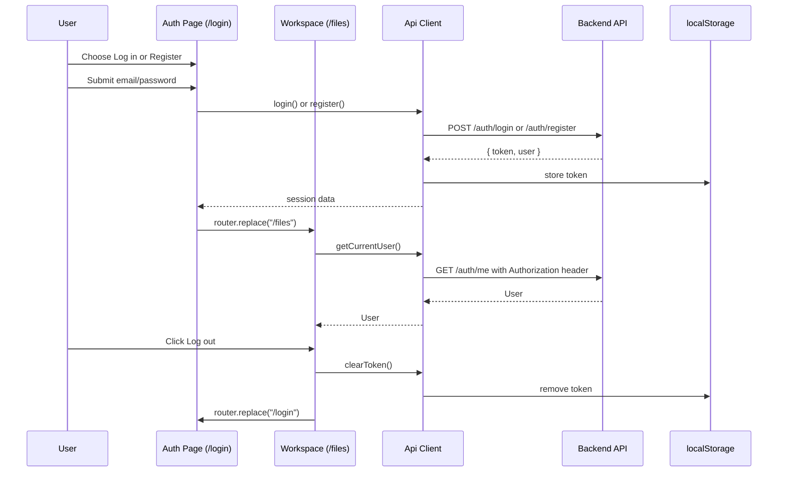

# Frontend

The Frontend is the browser app for Jevwright: an App Router Next.js client that authenticates with the backend, manages the user's workspace through the REST API, and lets the user edit, validate and run Test Files and follow their Runs.

## 1. Functional Definition

### 1.1 Scope

This module covers the frontend package: the Next.js scaffold, generated API types, the auth-aware fetch client, the landing page, a two-mode login/register page, the workspace layout and sidebar, the files overview, the test file editor, Project Variables, and the Run pages (live progress, history and reports). Tokens, themes, layouts, component rules and message wording are in [design-system.md](design-system.md).

| Area    | Scope                                                                                                          |
| ------- | -------------------------------------------------------------------------------------------------------------- |
| Package | `@jevwright/frontend` in `src/app/frontend`                                                                    |
| Runtime | Next.js 15 App Router, TypeScript strict, Node 22, pnpm 9                                                      |
| Styling | Tailwind v4 with `@tailwindcss/postcss`; no `tailwind.config.ts`; the tokens of [design-system.md](design-system.md) as shadcn variables; Light, Dark and System themes with `next-themes` |
| API     | OpenAPI-generated types from `docs/api/openapi.json`; native fetch wrapper                                     |
| Auth    | Bearer token from login/register responses; token stored in `localStorage`                                     |
| Pages   | `/` landing page; `/login` and `/register` two-mode auth form; workspace layout with sidebar; `/files` files overview; `/files/[testFileId]` editor; `/runs/[runId]` Run page |
| Tests   | Vitest for the API client, lib helpers, landing content and token contrast; Playwright E2E for the landing page, themes, auth, Quick Start, sidebar, editor, Variables, overview and the full flow |


### 1.2 Token and auth rules

The backend contract and docs specify the browser auth flow in [backend.md](backend.md):

- The known backend error codes are `invalid_request`, `unauthorized`, `not_found`, `conflict`, `too_large`, `invalid_test`, `internal`, and `not_implemented`.
- Any other backend error code is treated as `internal` by the frontend.
- Register and login respond with `{ token, user }`.
- The frontend sends the token as `Authorization: Bearer <token>`.
- A token that is rejected with `401` from routes other than login/register clears the token and calls `onUnauthorized`.
- A `401` from login/register does not clear the token and does not call `onUnauthorized`; it throws `ApiError` instead.
- The token storage must be browser-only; any access to `localStorage` is guarded with `typeof window`.
- The default client does not touch `localStorage` during server rendering.
- The default `apiClient` config sets `onUnauthorized` to `() => window.location.assign("/login")`.

### 1.3 Error handling contract

The client follows the backend’s JSON error payload shape exactly:

```ts
{
  error: {
    code: string;
    message: string;
    details?: unknown;
  }
}
```

Rules:

- `ApiError` extends `Error` and includes `status`, `code`, `message`, and `details`.
- If the backend responds with a non-JSON error body, the client keeps the real HTTP status and throws `ApiError` with:
  - `status`: the real HTTP status
  - `code`: `"internal"`
  - `message`: `"Internal server error"`
- Unknown backend error codes are normalized to `"internal"`, while the HTTP status is preserved.
- A 401 from a route other than login/register clears the token and calls the configured `onUnauthorized` callback.
- The frontend must not invent a message from the OpenAPI `description`; the message must match the mocked backend response body in unit tests.
- When `fetch` itself rejects (offline, DNS, CORS, the server is down), the client throws `NetworkError`, whose message is "Cannot reach the server. Check your connection and try again."

Every page shows errors through `formatError(error)` (lines) or `errorText(error)` (one line), never `Error.message` directly, so no user sees a server's internal wording:

| Error | Shown |
| ----- | ----- |
| `ApiError` with status ≥ 500 or code `internal` | "Something went wrong on the server. Try again in a moment." |
| `ApiError` `400` with `details` | Each detail's `message`, once; the backend's `message` joins the same sentences |
| Other `ApiError` | `ApiError.message`, a plain sentence from the backend (`backend.md` 1.7) |
| `NetworkError` or another `Error` | Its `message` |
| Anything else | "Something went wrong. Try again." |

Forms check the backend's rules first, with the backend's words, and send nothing while a field is wrong (`lib/validation.ts`). A field's problem shows under it in a `role="alert"`, and the field gets `aria-invalid` and `aria-describedby` pointing at it:

| Helper | Problem |
| ------ | ------- |
| `emailProblem(email)` | Not `x@y.z`: "Enter a valid email address." |
| `passwordProblem(password)` | Under 8 characters: "Password must be at least 8 characters."; over 200: "Password can be at most 200 characters." |
| `nameProblem(name)` | Blank after trimming: "Enter a name."; over 100 characters: "Names can be at most 100 characters." |
| `testFileNameProblem(name)` | The name before `.yaml`. Blank: "Enter a name."; anything but letters, digits, `-`, `_`, `.`: "Use only letters, digits, -, _ and ., with no spaces."; over 100 characters with `.yaml`: "Names can be at most 100 characters." |
| `variableNameProblem(name)` | Not `^[A-Z_][A-Z0-9_]*$`: "Variable names use capital letters, digits and _, and do not start with a digit, for example BASE_URL." |
| `variableValueProblem(value)` | Over 10,000 characters: "A Variable value can be at most 10,000 characters." |

Each helper returns `null` when the input is fine.

### 1.4 Generated types and API contract

The frontend types are generated from [docs/api/openapi.json](../api/openapi.json) via `openapi-typescript`. The generated file is `lib/api-schema.ts`, and it is excluded from lint and Prettier.

The generated file provides:

- `components["schemas"]["User"]`
- `components["schemas"]["Diagnostic"]`
- all named schema types used in API responses
- route-level request/response types from `paths`

Auth types are derived from those generated types instead of hand-written forms:

```ts
type User = components["schemas"]["User"];
type LoginResponse = paths["/auth/login"]["post"]["responses"][200]["content"]["application/json"];
type RegisterResponse = paths["/auth/register"]["post"]["responses"][201]["content"]["application/json"];
type AuthSession = LoginResponse;
```

This keeps `User`, `Diagnostic`, `Run`, and the login response in sync with the backend’s published contract.

### 1.5 Page requirements

The pages behave as follows:

- `/login` and `/register` render the same client-component form (`components/auth/auth-form.tsx`) with two modes, **Log in** and **Register**; `/login`, the header's **Sign in** button, starts in Log in mode; `/register`, the landing page's **Get started** links, opens the same page in Register mode. The mode buttons switch in place.
- The UI has exactly the PRD 7.1.1 form shape: email, password, submit.
- Submit calls `apiClient.login(email, password)` in Log in mode and `apiClient.register(email, password)` in Register mode.
- On successful login/register, the page navigates with `router.replace("/files")`, the workspace's home (`WORKSPACE_HOME` in `lib/routes.ts`).
- While the submit request is in flight, the submit button is disabled.
- Submit first checks the email with `emailProblem`, and the password with `passwordProblem` in Register mode or as non-empty ("Enter your password.") in Log in mode; a problem shows under its field (1.3) and nothing is sent.
- Auth errors from the backend show `formatError(error)` (1.3), one line each, in a `role="alert"`.
- Every authenticated page shares the workspace layout (see 1.6), a client component that calls `apiClient.getCurrentUser()` on load:
  - while pending, render minimal text `Loading…`;
  - when resolved, render the sidebar (with the current user email and a Log out button) and the page;
  - Log out calls `apiClient.clearToken()` and navigates with `router.replace("/login")`;
  - if `getCurrentUser()` fails with anything other than `401`, show the `formatError` lines instead (a `401` is handled by the API client, which redirects to `/login`).
- `/files` is the files overview (1.10); `/` is the landing page (1.14), which needs no token.

The root layout remains a server component, while the workspace layout and pages that need auth or data access are client components. This is a deliberate exception to the repo's "Server Components by default" guidance: the auth token is browser state, so auth and data fetching happen on the client.

### 1.6 Workspace sidebar

The workspace is every authenticated page. A shared layout guards auth, renders the sidebar on the left and the page on the right.

| Route                 | Page                                    |
| --------------------- | --------------------------------------- |
| `/files`              | Files overview (1.10)                   |
| `/files/[testFileId]` | Test file editor (1.7) and its Runs list (1.9) |
| `/runs/[runId]`       | Run: live progress and report (1.9)     |

| Element         | Behavior                                                                                                                     |
| --------------- | ---------------------------------------------------------------------------------------------------------------------------- |
| Logo            | Above the tree, outside the "Projects" navigation: a link to the landing page `/` named "Jevwright home"                     |
| Header          | "Projects" with a "+" that opens the New Project dialog                                                                      |
| Tree            | Projects → Modules → Test Files from `GET /tree`, in API order. Projects and Modules toggle open/closed; all open by default |
| Row "+"         | On a Project: New Module dialog. On a Module: New Test File dialog                                                           |
| Row "Variables" | On a Project: opens the Variables dialog (1.8)                                                                              |
| Row actions     | On every Project, Module and Test File: Rename and Delete (1.11)                                                             |
| Status icon     | From `statusOf(latestRun)`, with the icon and role of design-system.md 2.3: `passed` check, `failed` cross, `active` spinner, `none` dashed circle |
| Selection       | The Test File in the current route is highlighted                                                                            |
| Account         | Initials, email from `me`, the theme switch (design-system.md 3), Log out (clears the token, goes to `/login`)               |
| Narrow screens  | Sidebar hidden behind a ☰ button                                                                                             |

Names follow the backend rules (`backend.md` 1.3), and the dialogs check them as the user types: Project and Module names with `nameProblem`, Test File names with `testFileNameProblem` (1.3). A problem shows under the input once the user has typed or submitted, and a submit with a problem sends nothing.

A Test File's name is typed before a fixed `.yaml`, shown after the input like a file manager's extension; the Rename input shows the name without it (`testFileBaseName`). `toTestFileName` adds the suffix, and the new file is created with `starterSource(name)`. After creation the page navigates to the new file.

Create dialogs submit `POST /projects`, `POST /projects/:id/modules`, or `POST /modules/:id/test-files`, then reload the tree. API errors (such as `409 conflict`) show inside the dialog via `errorText` (1.3), and the dialog stays open.

The tree is loaded once in the layout and exposed through a `refreshTree()` context, so later pages (editor save, finished run) can update the status dots.

| Helper                  | Rule                                                                                                                                                            |
| ----------------------- | --------------------------------------------------------------------------------------------------------------------------------------------------------------- |
| `statusOf(latestRun)`   | `null` → `none`; `queued`/`running` → `active`; `passed` → `passed`; `failed` → `failed`                                                                        |
| `toTestFileName(input)` | Trims and adds `.yaml`; a trailing `.yaml` already typed is not doubled; empty input stays `""` |
| `testFileBaseName(name)` | The name without a trailing `.yaml`, for the Rename input |
| `starterSource(name)`   | A valid Test Case: `name` is the file name without `.yaml`, one `open` step with `url: "https://example.com"`                                                   |
| `initials(email)`       | First two characters of the part before `@`, upper-cased                                                                                                        |

`starterSource("login.yaml")` returns the following, ending with a newline:

```yaml
name: "login"
steps:
  - open:
      url: "https://example.com"
```

#### Accessible names

E2E tests locate elements by role and accessible name, so these names are part of the contract.

| Element               | Role and name                                                                                                                                                                                  |
| --------------------- | ---------------------------------------------------------------------------------------------------------------------------------------------------------------------------------------------- |
| Logo                  | link "Jevwright home" to `/`                                                                                                                                                                   |
| Sidebar               | `navigation` named "Projects"                                                                                                                                                                  |
| Header "+"            | button "New project"                                                                                                                                                                           |
| Project row "+"       | button "New module in <project name>"                                                                                                                                                          |
| Project row Variables | button "Variables for <project name>"                                                                                                                                                          |
| Module row "+"        | button "New test file in <module name>"                                                                                                                                                        |
| Dialogs               | `dialog` titled "New project", "New module", or "New test file"; text input labelled "Name"; buttons "Create" and "Cancel"; an API error renders in a `role="alert"` element inside the dialog |
| Test File             | link named by the file name; the current one has `aria-current="page"`                                                                                                                         |
| Status icon           | inside the Test File link; `data-status` of `none`, `active`, `passed`, or `failed`, with a title: "Never run", "Running", "Passed", "Failed"                                                  |
| Account               | the text "Signed in as <email>"; `group` "Theme" with buttons "Light", "Dark", "System"; button "Log out"                                                                                     |

#### Tests
- Unit: the four helpers above.
- E2E `sidebar.e2e.ts`: a new user with an empty workspace creates a Project, a Module, and a Test File through the dialogs; each appears in the tree; the new file opens at `/files/<id>`, is marked current, and has status `none`; after a reload the tree is unchanged.
- E2E: creating a second Project with the same name keeps the dialog open and shows an alert.

### 1.7 Test file editor

`/files/[testFileId]` loads the Test File with `GET /test-files/:id` and edits its source in a plain textarea. The page keeps two strings: `saved` (the last source from the API) and `draft` (the textarea). The file is dirty when `draft !== saved`.

| State       | Render                                                                              |
| ----------- | ----------------------------------------------------------------------------------- |
| Pending     | `Loading…`                                                                          |
| `404`       | "Test file not found"                                                               |
| Other error | `errorText(error)` (1.3) in a `role="alert"`                                        |
| Loaded      | File name heading, toolbar (Upload file, Validate, Save, Run), textarea, result bar, Runs list (1.9) |

| Action      | Behavior                                                                                                                                                                                                                                                                           |
| ----------- | ---------------------------------------------------------------------------------------------------------------------------------------------------------------------------------------------------------------------------------------------------------------------------------- |
| Edit        | Updates `draft`; shows "Unsaved changes" while dirty; clears the result bar                                                                                                                                                                                                        |
| Validate    | `POST /test-files/validate { source: draft }`; shows the diagnostics in the result bar                                                                                                                                                                                             |
| Save        | Enabled only when dirty. `PATCH /test-files/:id { source: draft }`; on success `saved` and `draft` become the returned `testFile.source`, so the editor keeps showing what was saved, the returned diagnostics are shown, and `refreshTree()` is called. On failure the draft is kept and `errorText(error)` is shown in a `role="alert"` |
| Upload file | Opens a file picker accepting `.yaml` and `.yml`; the chosen file's text replaces `draft` (not saved until Save)                                                                                                                                                                   |
| Run         | Saves first when dirty (stops if the save fails), then `POST /test-files/:id/runs`. `202`: shows "Run queued." in a `role="status"` with a "View run" link to `/runs/<id>` next to it (outside the status element), reloads the Runs list (1.9), and calls `refreshTree()`. `422`: shows `ApiError.details` (Diagnostic[]) in the result bar. Other errors: `role="alert"`                      |

Buttons are disabled while their request is in flight. A failing `refreshTree()` shows its message in the page's `role="alert"`; the save or run itself still counts as done.

The result bar is a `region` named "Validation". It shows `validationSummary(diagnostics)`, then one list item per diagnostic with `formatDiagnostic(d)`. Diagnostics have a line but no column.

| Helper                  | Rule                                                                               |
| ----------------------- | ---------------------------------------------------------------------------------- |
| `validationSummary(ds)` | `[]` → "Valid. Ready to run."; 1 → "1 validation error"; n → "n validation errors" |
| `formatDiagnostic(d)`   | "Line <line>: <message>"                                                           |

Out of scope: validating while typing, line numbers, keyboard shortcuts, an unsaved-changes guard.

### 1.8 Project Variables

The "Variables for <project>" button opens the Variables dialog. It lists the Project's Variable names from `GET /projects/:id/variables`; values are write-only and never shown.

| Action | Behavior                                                                                                                                                                                                                                                                                 |
| ------ | ---------------------------------------------------------------------------------------------------------------------------------------------------------------------------------------------------------------------------------------------------------------------------------------- |
| Open   | Loads the names; an empty list shows "No variables yet"                                                                                                                                                                                                                                  |
| Save   | Enabled when Name and Value are non-empty. Shows the problem of `variableNameProblem`, then `variableValueProblem` (1.3), without calling the API; otherwise `PUT /projects/:id/variables/:name { value }`, then reloads the names and clears the form. An existing name is replaced |
| Delete | `DELETE /projects/:id/variables/:name`, then reloads the names                                                                                                                                                                                                                           |

API errors show `errorText(error)` (1.3) in a `role="alert"` inside the dialog, and the dialog stays open.

#### Accessible names (editor and Variables)

| Element          | Role and name                                                                                                                                                                           |
| ---------------- | --------------------------------------------------------------------------------------------------------------------------------------------------------------------------------------- |
| File name        | `heading` named by the file name                                                                                                                                                        |
| Unsaved marker   | text "Unsaved changes"                                                                                                                                                                  |
| Toolbar          | buttons "Upload file", "Validate", "Save", "Run"                                                                                                                                        |
| Source           | textbox labelled "Test file YAML"                                                                                                                                                       |
| Result bar       | `region` named "Validation"; summary text; one `listitem` per diagnostic                                                                                                                |
| Run feedback     | `role="status"` with "Run queued."                                                                                                                                                      |
| Variables dialog | `dialog` titled "Variables"; one `listitem` per name with button "Delete <NAME>"; inputs labelled "Name" and "Value" (password); buttons "Save" and "Close"; errors in a `role="alert"` |

#### Tests
- Unit: `validationSummary`, `formatDiagnostic`, the validation helpers (5.6), and the new API client functions (5.1).
- E2E `editor.e2e.ts`: a new user creates a Test File; the textarea shows the starter source; an invalid edit shows "Unsaved changes" and Validate shows "1 validation error" with a "Line …" item; restoring a valid source and saving hides "Unsaved changes"; after a reload the saved source is shown; Run shows "Run queued.".
- E2E `variables.e2e.ts`: a new user adds Variable `BASE`; it is listed and its value is not shown; an invalid name shows the alert; Delete removes it.

### 1.9 Runs: live progress and history

A Run has one page, `/runs/[runId]`, used both while it runs (live progress) and after it finishes (report). The editor page lists the file's recent Runs. Both render steps with the same `StepList` component, because the backend uses one `Step` shape for Live Progress and the Report.

#### Runs list (editor page)

Below the result bar, a `region` named "Runs" loads `GET /runs?testFileId=<id>&limit=20` with the page and again after a successful Run. Each Run is one list item with a link to `/runs/<id>` whose text is `runStatusLabel(status)`, the trigger time (`createdAt`, `toLocaleString()`), and `formatDuration(durationMs)`. An empty list shows "No runs yet". There is no pagination. A failed load shows `errorText(error)` (1.3) in a `role="alert"` inside the region.

#### Run page

| Step | Behavior |
| ---- | -------- |
| Load | `GET /runs/:id`. Pending: `Loading…`; `404`, also for a malformed id (`backend.md` 1.7): "Run not found"; other errors: `errorText(error)` (1.3) in a `role="alert"` and nothing else |
| Finished Run (`passed`/`failed`) | Steps come from `run.report.steps`. A Run without a Report (`interrupted`/`internal` error) shows no steps and "No step results" |
| Active Run (`queued`/`running`) | Opens the WebSocket at `liveUrl(baseUrl, runId, token)` and folds every message into `{ run, steps }` with `applyLiveMessage`. When a `status` message makes the Run final, the page reloads `GET /runs/:id` (for the Report and trace) and calls `refreshTree()` |
| Socket closes early | If the socket closes before the Run is final, the page keeps the last state and shows "Live progress disconnected" in a `role="alert"` |
| Leave the page | The socket is closed |

The header shows the file name as the heading, "Status: <runStatusLabel>", the trigger time, `formatDuration(durationMs)`, the summary as "<passed>/<total> passed" once it exists, and the Run error as `runErrorText(error)` when there is one. A "Back to <fileName>" link goes to `/files/<testFileId>` (hidden when `testFileId` is `null`). After the Run is final, a "Download report" link points to `runFileUrl(baseUrl, runId, "report.json", token)`, and a "Download trace" link to `runFileUrl(…, report.trace, token)` when `report.trace` exists.

`StepList` renders an ordered list named "Steps". Each step is one list item with "Step <index + 1>", the action, "line <line>", `runStatusLabel`-style status text (Pending, Running, Passed, Failed), and, when present, `formatDuration(durationMs)`, the locate method, the failure `reason`, and the screenshot as an `img` with alt "Step <index + 1> screenshot" from `runFileUrl(baseUrl, runId, step.screenshot, token)`. Dialog records are not shown.

The screenshot is a button named "Open step <n> screenshot full size". It opens a dialog named "Step <n> screenshot" with the image at full size (alt "Step <n> screenshot, full size"), scrolling when it is larger than the window; Escape or a click outside closes it.

Below the steps, a collapsed "Source when it ran" section shows the Run's `source` from `GET /runs/:id` in a `pre` with the same name, so a Run of an earlier version of the file shows that version. Live Progress messages carry no source, so the page keeps the one it loaded.

| Helper | Rule |
| ------ | ---- |
| `runStatusLabel(status)` | `queued` → "Queued", `running` → "Running", `passed` → "Passed", `failed` → "Failed" |
| `stepStatusLabel(status)` | `pending` → "Pending", `running` → "Running", `passed` → "Passed", `failed` → "Failed" |
| `formatDuration(ms)` | `null` or `undefined` → "—"; under 1000 → "<ms> ms"; otherwise seconds with one decimal, "<s> s" |
| `liveUrl(baseUrl, runId, token)` | `baseUrl` with `http` → `ws` and `https` → `wss`, then `/runs/<runId>/live?token=<encodeURIComponent(token)>` |
| `runFileUrl(baseUrl, runId, path, token)` | `<baseUrl>/runs/<runId>/files/<path>?token=<encodeURIComponent(token)>` |
| `runErrorText(error)` | `timeout` → "Timed out: <message>"; `interrupted` → "Interrupted: <message>"; `infrastructure` → "Browser error: <message>"; `internal` → "Something went wrong while running the test. Try running it again.", since its message is the server's error name |
| `applyLiveMessage(state, message)` | Pure. `snapshot` → `{ run, steps }` from the message; `step` → the step with the same `index` is replaced (inserted in `index` order if absent); `status` → `run` replaced, steps kept. Never mutates `state` |

`state` is `{ run: Run | null; steps: Step[] }`; messages are the generated `LiveMessage` type.

#### Accessible names (Runs)

| Element | Role and name |
| ------- | ------------- |
| Runs list | `region` named "Runs"; one `listitem` per Run containing a `link` to the Run; text "No runs yet" when empty |
| Editor run link | `link` "View run" |
| Run heading | `heading` named by the file name |
| Run status | text "Status: <label>" |
| Steps | `list` named "Steps"; one `listitem` per step containing "Step <n>" |
| Screenshot | `img` with alt "Step <n> screenshot" |
| Links | "Back to <fileName>", "Download report", "Download trace" |
| Disconnect | `role="alert"` with "Live progress disconnected" |

#### Tests
- Unit: the six helpers above (5.4) and `getRun`, `listRuns`, `getBaseUrl` (5.1).
- E2E `flow.e2e.ts` (the full PRD flow, #84): a new user creates a Test File, enters a valid source, Validate shows "Valid. Ready to run.", saves, clicks Run and sees "Run queued.", follows "View run" to `/runs/<id>`, sees the file name heading, a "Status: …" text, and a "Steps" list with one item containing "Step 1"; "Back to <file>" returns to the editor, where the "Runs" region lists one Run. The test does not wait for the Run to finish.

Out of scope: project or module dashboards, charts, filters, pagination, showing dialog records.

### 1.10 Files overview

`/files` lists every Test File in the workspace with its latest Run status, so a Tester can check test health at a glance (PRD 5.4.3). It reads the tree from `useWorkspace()`; there is no extra request, and the page updates whenever `refreshTree()` runs.

| Element | Behavior |
| ------- | -------- |
| Region | A `region` named "Test files" |
| Groups | `overviewGroups(tree)`: one heading (level 2) per Project and one heading (level 3) per Module, in API order |
| File | One list item per Test File: a link to `/files/<id>` named by the file name, a status badge with the text `statusTitle(statusOf(latestRun))` (design-system.md 2.3), and, when `latestRun` exists, its trigger time (`latestRun.createdAt`, `toLocaleString()`) |
| Empty | When `overviewGroups(tree)` is empty: "No test files yet" and the button "Add the Quick Start project" |
| Add the Quick Start project | `POST /projects/quick-start` (`addQuickStart()`, backend.md 1.10), then `refreshTree()`, so the overview and the sidebar show the new Project. Disabled while the request is in flight; an error, such as the `409` for an existing project named Quick Start, shows `errorText(error)` (1.3) in a `role="alert"` |

| Helper | Rule |
| ------ | ---- |
| `overviewGroups(tree)` | Pure. Returns the tree's Projects in API order with the same shape, keeping only Modules that have at least one Test File and only Projects that keep at least one Module. Never mutates `tree` |
| `statusTitle(status)` | `none` → "Never run"; `active` → "Running"; `passed` → "Passed"; `failed` → "Failed" (the status dot titles in 1.6 use the same helper) |

#### Accessible names (overview)

| Element | Role and name |
| ------- | ------------- |
| Overview | `region` named "Test files" |
| Project | `heading` level 2 named by the Project name |
| Module | `heading` level 3 named by the Module name |
| Test File | `listitem` containing a `link` named by the file name, the status text, and the trigger time |
| Empty | text "No test files yet"; button "Add the Quick Start project"; errors in a `role="alert"` |

The sidebar has links with the same names, so E2E tests scope overview lookups to the "Test files" region.

#### Tests
- Unit: `overviewGroups`, `statusTitle` (5.5).
- E2E `overview.e2e.ts`: a user with an empty workspace opens `/files` and sees "No test files yet"; after creating a Project, a Module and a Test File and opening `/files` again, the "Test files" region shows the Project and Module headings and the file link with "Never run"; clicking the link opens `/files/<id>`.
- E2E `quick-start.e2e.ts`: an account registered through the form lands on `/files` with the Quick Start project, its four numbered Modules (`backend.md` 1.10) and its Variables `BASE` and `SWAG_PASSWORD`, and its `sign-in-and-see-products.yaml` opens with its three-line header and passes; an empty workspace's "Add the Quick Start project" adds it to the overview and the sidebar; with a project named Quick Start already there, the button shows the backend's `409` message.

Out of scope: filters, sorting, charts, pagination, distinguishing `queued` from `running`.

### 1.11 Rename and delete

Every Project, Module and Test File row in the sidebar has a Rename and a Delete button. Moving a Test File to another Module is out of scope.

| Action | Behavior |
| ------ | -------- |
| Rename | Opens the name dialog titled "Rename project", "Rename module", or "Rename test file", prefilled with the current name; a Test File's name is shown without its fixed `.yaml` (1.6) and normalized with `toTestFileName`. Names are checked as in 1.6. Save is disabled while the normalized name is empty or equal to the current name. Submits `PATCH /projects/:id`, `PATCH /modules/:id`, or `PATCH /test-files/:id` with `{ name }`, then calls `refreshTree()` and closes |
| Delete | Opens a confirmation dialog titled "Delete project", "Delete module", or "Delete test file" with the text `confirmDeleteText(kind, name)`. Delete submits `DELETE /projects/:id`, `DELETE /modules/:id`, or `DELETE /test-files/:id`. If `deletesTestFile(tree, target, currentTestFileId)` is true, the page navigates with `router.replace("/files")`. Then it calls `refreshTree()` and closes |

API errors (such as `409 conflict` on rename) show `errorText(error)` (1.3) in a `role="alert"` inside the dialog, and the dialog stays open. Buttons are disabled while the request is in flight. A failing `refreshTree()` after a successful change closes the dialog and is otherwise ignored, as in 1.6.

The editor heading (1.7) shows the Test File's name from the tree when the file is in it, falling back to the loaded `testFile.name`, so renaming the open file updates the heading at once.

The backend cascades: deleting a Project deletes its Modules, Test Files and Variables; deleting a Module deletes its Test Files. Runs are kept with their ids set to `null`.

| Helper | Rule |
| ------ | ---- |
| `confirmDeleteText(kind, name)` | `project` → `Delete project "<name>" and all its modules, test files and variables? Run history is kept.`; `module` → `Delete module "<name>" and all its test files? Run history is kept.`; `testFile` → `Delete test file "<name>"? Run history is kept.` |
| `deletesTestFile(tree, target, testFileId)` | Pure. `target` is `{ kind: "project" \| "module" \| "testFile"; id: string }`. `false` when `testFileId` is `null`; otherwise `true` when `testFileId` is the target Test File or belongs to the target Module or Project in `tree` |

`kind` is `"project" | "module" | "testFile"`.

#### Accessible names (rename and delete)

| Element | Role and name |
| ------- | ------------- |
| Row buttons | "Rename project <name>", "Delete project <name>", "Rename module <name>", "Delete module <name>", "Rename test file <name>", "Delete test file <name>" |
| Rename dialog | `dialog` titled "Rename project", "Rename module", or "Rename test file"; text input labelled "Name"; buttons "Save" and "Cancel"; errors in a `role="alert"` |
| Delete dialog | `dialog` titled "Delete project", "Delete module", or "Delete test file"; the confirmation text; buttons "Delete" and "Cancel"; errors in a `role="alert"` |

Row buttons sit next to the Test File link, never inside it. They may be revealed on hover on wide screens, but must stay in the accessibility tree and be shown on keyboard focus. The dialogs' "Delete" button shares a prefix with the row buttons, so E2E tests scope it to the dialog.

#### Tests
- Unit: `confirmDeleteText`, `deletesTestFile` (5.5), and the new API client functions (5.1).
- E2E `sidebar-actions.e2e.ts`:
  - a new user creates a Project, a Module and a Test File; renaming the Test File shows the new name in the sidebar and the editor heading;
  - renaming a second Project to the first Project's name keeps the dialog open and shows an alert;
  - deleting the open Test File returns to `/files` and removes its link;
  - deleting the Project shows the cascade text in the confirmation, then the "Test files" region shows "No test files yet".

### 1.12 Packages and exact pins

The frontend package uses these exact versions:

- `next@15.5.29`
- `react@19.3.1`
- `react-dom@19.3.1`
- `@types/react@19.3.0`
- `@types/react-dom@19.3.0`
- `tailwindcss@4.3.5`
- `@tailwindcss/postcss@4.3.5`
- `openapi-typescript@7.13.0`

shadcn tooling and UI primitives are pinned exactly (no `^`). Primitives are added with `shadcn add` only as pages need them (currently `badge`, `button`, `card`, `dialog`, `input`, `label`, `tabs`, `toggle`, `toggle-group`); every dependency that command adds is pinned to its exact installed version and listed below. `next-themes` is the theme provider that shadcn's Next.js dark-mode guide uses (design-system.md 3).


- `cn@0.5.2`
- `shadcn@4.23.0`
- `tw-animate-css@1.4.0`
- `@base-ui/react@1.9.0`
- `class-variance-authority@0.7.1`
- `lucide-react@1.64.0`
- `next-themes@0.4.6`

The repo does not use `eslint-config-next`; instead the root `eslint.config.js` is extended to include `.tsx` and the frontend package files.

### 1.13 Scripts and config

The root workspace exposes the frontend app with `pnpm frontend`, which starts the Next.js dev server on port `3000`.

The frontend package also includes a generation script named `api:types` that regenerates `lib/api-schema.ts` from the published OpenAPI document in [docs/api/openapi.json](../api/openapi.json). The root and package scripts are used to keep the API schema in sync after the backend contract changes.

Lint, format, and type-check coverage include the frontend package:

- `pnpm lint` runs ESLint across the workspace, including the frontend package files
- `pnpm format` and `pnpm format:check` cover the frontend source files in the package
- `pnpm typecheck` includes the frontend TypeScript project

`apiClient` reads its base URL from `NEXT_PUBLIC_API_URL` (inlined at build time), falling back to `http://127.0.0.1:4000/api/v1`. The frontend environment file sets `NEXT_PUBLIC_API_URL=http://127.0.0.1:4000/api/v1`; use `127.0.0.1` because the backend listens on IPv4 only (`docs/deploy/backend-local.md`). The browser must open `http://localhost:3000`, not `127.0.0.1:3000`, because the backend CORS default is `http://localhost:3000`.

`next.config.ts` maps `.js` imports to `.ts`/`.tsx` (`webpack.resolve.extensionAlias`), because lib files use `.js` relative imports for the root NodeNext typecheck.

### 1.14 Landing page

`/` is the product page, a server component (`app/page.tsx`) that needs no token; the header, the Run replay and the copy buttons are client components. It shows real product output rather than mockups, and every claim on it is true of the code: its content is in `lib/landing.ts`, and a unit test checks each number and each receipt against the code it describes.

| Section | Content |
| ------- | ------- |
| Header | `SiteHeader` (`components/landing/site-header.tsx`): the logo, links to the docs on GitHub Pages, the API reference and the repository (hidden below 768px), the theme switch, and one button at the top right: "Sign in" (`/login`, where the form switches between Log in and Register), or "Open workspace" (`/files`) for a visitor whose browser holds a token. The header checks the token after mount, so the server renders the visitor's button. The logo always leads to `/`, signed in or not; the workspace is reached through Open workspace. `/login` and `/register` use the same header without the auth links |
| Hero | A two-beat heading ("Web tests as plain YAML steps." and a payoff line with one emphasized phrase), two sentences, "Get started" (`/register`), "See a real Run" (to the replay), and the copyable command `COMMAND` (`pnpm jevwright run tests/sign-in.yaml`, cli.md 3.1) |
| A real Run, not a screenshot | `RunReplay` (`components/landing/run-replay.tsx`): one tab per entry of `REPLAY_RUNS`, real Run reports of the Quick Start files `sign-in-and-see-products.yaml` and `fall-back-from-a-stale-selector.yaml` (the second called Jev and located step 4 with `visual`). Once the replay scrolls into view, its steps tick from pending to their real status with their locate method and duration; a step's button shows its screenshot. "Replay" starts it again and "Show all steps" shows the end state. Below it, the stat strip `STATS` |
| 01 How does Jev find an element? | Two small diagrams (`Flow`): a selector that matches skips Jev; a target, or a selector that matches nothing, goes to Visual Locate, then DOM Locate if Jev is unsure, then Playwright acts, with the method recorded (locator.md 1.2) |
| 02 What does it fix? | Four scenarios with a before and an after line |
| 03 Which should I write? | A table: `selector`, `target`, both, a Playwright `assert`, a `statement`, each with when and why, and the cost of Jev calls |
| 04 What runs where? | A diagram of the parts (web app, CLI and REST API, Core, Playwright and Chromium, Jev through OpenRouter), links to the interactive architecture and run sequence diagrams on GitHub Pages, and how this differs from runners where a model plans the test |
| Checked before it runs | Validate, Run, Report, each with real output: `VALIDATE_RECEIPT` and `RUN_RECEIPT`, captured from `jevwright validate` and `jevwright run` on the seeded Quick Start files, and the located step from the replayed report; each with the matching state of the web app |
| Light and dark | Screenshots of the workspace in both themes (`public/landing/workspace-light.webp`, `workspace-dark.webp`) |
| Quick start | Tabs: Web (three steps and `QUICK_START_MODULES`) and CLI (install, validate, run, as in the README) |
| What it is, and what it is not | Questions and answers on planning, self-healing, steps without a locator, the cost of Jev, browsers, and private networks |
| Closing | One line, the command again, "Get started" and GitHub |
| Footer | Docs, API reference, architecture, GitHub |

The replay is the page's only animation; with `prefers-reduced-motion: reduce` it shows every step's result at once. The shipped reports are the backend's `report.json` of each Run without the `trace` field, since the trace is not shipped; their screenshots are in `public/landing/runs/<file>/step-<n>.webp`, resized to 800px wide.

| Helper | Rule |
| ------ | ---- |
| `ACTIONS` | The 15 actions of syntax-analyzer.md 1.2; each is an action of the Syntax Analyzer |
| `LOCATE_METHODS` | `selector`, `visual`, `dom` |
| `COMMAND` | The hero and closing command |
| `VALIDATE_RECEIPT` | Real `validate` output for `seven-errors-at-once.yaml`; its error lines are the Syntax Analyzer's diagnostics of the seeded file |
| `RUN_RECEIPT` | Real `run` output for `sign-in-and-see-products.yaml`; one passed line per step, at the seeded file's lines |
| `REPLAY_RUNS` | `{ file, note, assets, report }` for the two Runs; both passed 6 of 6, and each step's screenshot is shipped |
| `STATS` | The number of actions, of locate methods, `0` test files rewritten, and the sign-in Run's duration from its report |
| `QUICK_START_MODULES` | The Quick Start Module names, as `quickStartProject` creates them, with what each teaches |

#### Accessible names (landing)

| Element | Role and name |
| ------- | ------------- |
| Header | `banner` with links "Jevwright home", "Docs", "API reference", "GitHub", and "Sign in", or "Open workspace" with a token; `group` "Theme" |
| Hero | `heading` level 1 starting "Web tests as plain YAML steps."; button "Copy command" with a `role="status"` that says "Copied" |
| Replay | `region` "Run replay"; one `tab` per file name; buttons "Replay" and "Show all steps"; `list` "Replay steps" with one `listitem` per step; `img` "Step <n> screenshot" |
| Sections | `heading` level 2 per section title; the Quick start section is a `region` "Quick start" with `tab`s "Web" and "CLI" |

#### Tests
- Unit `landing.test.ts`: `ACTIONS` are 15 distinct Syntax Analyzer actions; `LOCATE_METHODS`; `VALIDATE_RECEIPT` and `RUN_RECEIPT` match the Syntax Analyzer on the seeded Quick Start files; `REPLAY_RUNS` are passed 6 of 6 with shipped screenshots and the expected locate methods; `STATS` come from those; `QUICK_START_MODULES` match the backend.
- E2E `landing.e2e.ts`: the hero, every section heading, the command and the header links, with one Sign in button and no Log in or Register; Get started opens `/register` in Register mode; Sign in opens `/login`, where the mode switches to Register; Open workspace instead of Sign in with a token; the logo links to `/` with and without a token, also from the workspace sidebar; the replay shows six steps, a screenshot per step, and the Jev Run's `visual` or `dom` step; with reduced motion every step shows its result at once; the Quick start tabs.

## 2. Internal Flow



1. The `/login` page submits credentials through `apiClient.login` or `apiClient.register` based on the selected mode.
2. The API client appends the bearer token to requests when present, otherwise it sends a plain request.
3. A successful auth response stores the token, and `/login` or `/register` transitions to `/files` with `router.replace("/files")`.
4. The workspace layout calls `apiClient.getCurrentUser()` on load and shows `Loading…` while in flight.
5. A `401` from a non-login route clears the token and calls the configured `onUnauthorized` callback.
6. A `401` from login/register throws `ApiError` without mutating the token.
7. The `openapi-typescript` generator creates the frontend schema types from the published backend OpenAPI document.
8. The API client normalizes backend errors into the `ApiError` contract and preserves the real HTTP status.

## 3. External Interface

### 3.1 API client

```ts
export class ApiError extends Error {
  readonly status: number;
  readonly code: string;
  readonly details?: unknown;

  constructor(status: number, code: string, message: string, details?: unknown);
}

export type ApiErrorBody = {
  error: {
    code: string;
    message: string;
    details?: unknown;
  };
};

export type ApiClientConfig = {
  baseUrl?: string;
  getToken?: () => string | null;
  setToken?: (token: string | null) => void;
  onUnauthorized?: () => void;
  fetchImpl?: typeof fetch;
};

export type RequestOptions = {
  skipAuthRedirect?: boolean;
};

export type User = components["schemas"]["User"];
export type Diagnostic = components["schemas"]["Diagnostic"];
export type LoginResponse = paths["/auth/login"]["post"]["responses"][200]["content"]["application/json"];
export type RegisterResponse = paths["/auth/register"]["post"]["responses"][201]["content"]["application/json"];

export function parseApiError(payload: unknown): {
  code: string;
  message: string;
  details?: unknown;
};

export function createApiClient(config?: ApiClientConfig): {
  setToken(token: string | null): void;
  clearToken(): void;
  getToken(): string | null;
  getBaseUrl(): string;
  request<T>(path: string, init?: RequestInit, options?: RequestOptions): Promise<T>;
  login(email: string, password: string): Promise<LoginResponse>;
  register(email: string, password: string): Promise<RegisterResponse>;
  getCurrentUser(): Promise<User>;
  getTree(): Promise<TreeResponse>;
  createProject(name: string): Promise<CreateProjectResponse>;
  addQuickStart(): Promise<CreateProjectResponse>; // POST /projects/quick-start → 201 Project; 409 when one named Quick Start exists
  createModule(projectId: string, name: string): Promise<CreateModuleResponse>;
  createTestFile(moduleId: string, name: string, source: string): Promise<CreateTestFileResponse>; // { testFile, diagnostics }
  getTestFile(testFileId: string): Promise<TestFile>;
  updateTestFile(testFileId: string, source: string): Promise<UpdateTestFileResponse>; // { testFile, diagnostics }
  validateSource(source: string): Promise<ValidateResponse>; // { diagnostics }
  startRun(testFileId: string): Promise<Run>; // 202; 422 rejects with ApiError whose details are Diagnostic[]
  listVariables(projectId: string): Promise<VariableListResponse>; // { items: string[] }
  setVariable(projectId: string, name: string, value: string): Promise<void>; // 204
  deleteVariable(projectId: string, name: string): Promise<void>; // 204
  listRuns(testFileId: string): Promise<RunListResponse>; // GET /runs?testFileId=&limit=20 → { items, nextCursor }
  getRun(runId: string): Promise<Run>; // with source and, once finished, report
  renameProject(projectId: string, name: string): Promise<UpdateProjectResponse>; // PATCH /projects/:id
  renameModule(moduleId: string, name: string): Promise<UpdateModuleResponse>; // PATCH /modules/:id
  renameTestFile(testFileId: string, name: string): Promise<UpdateTestFileResponse>; // PATCH /test-files/:id → { testFile, diagnostics }
  deleteProject(projectId: string): Promise<void>; // 204; cascades to Modules, Test Files, Variables
  deleteModule(moduleId: string): Promise<void>; // 204; cascades to Test Files
  deleteTestFile(testFileId: string): Promise<void>; // 204
};

export const apiClient: ReturnType<typeof createApiClient>;
```

`TreeResponse`, `CreateProjectResponse`, `CreateModuleResponse`, `CreateTestFileResponse`, `UpdateProjectResponse`, `UpdateModuleResponse`, `TestFile`, `Run`, `UpdateTestFileResponse`, `ValidateResponse`, `VariableListResponse`, `RunListResponse`, `Step`, and `LiveMessage` are aliases of the generated `components`/`paths` types for these routes; none are written by hand.

### 3.2 Request rules

- Base URL comes from `NEXT_PUBLIC_API_URL`.
- The client uses native `fetch` only.
- If a token exists, the request adds `Authorization: Bearer <token>`.
- If no token exists, the client sends no `Authorization` header.
- Login and register calls pass `skipAuthRedirect: true` so they are not treated as a generic auth-failure path.
- The client decides whether to redirect on `401` based on `skipAuthRedirect`, not by matching the request URL string.
- When a request returns `401` and `skipAuthRedirect` is not set, the client clears the token and invokes `onUnauthorized`.
- This is the only automatic redirect path; the app decides how it navigates after `onUnauthorized` fires.

### 3.3 Response mapping

The API client normalizes every response as follows:

- `204 No Content` resolves to `undefined`
- JSON success bodies resolve as typed data
- JSON error bodies become `ApiError` with the real HTTP status and the backend-provided message/code
- unknown backend codes become `code: "internal"`
- non-JSON or missing-error bodies become:
  - `status`: the real HTTP status
  - `code`: `"internal"`
  - `message`: `"Internal server error"`

This fallback is implemented in the client itself when the backend response is not JSON or does not include a usable error body; it is not a backend-required message contract.

## 4. Class Architecture

### 4.1 Modules

| Module / Class                                | Responsibility                                              |
| --------------------------------------------- | ----------------------------------------------------------- |
| `app/layout.tsx`                              | Fonts and the theme provider (design-system.md 3)           |
| `app/page.tsx`                                | Landing page (1.14)                                         |
| `app/login/page.tsx`, `app/register/page.tsx` | The auth form in Log in or Register mode                    |
| `app/(workspace)/layout.tsx`                  | Auth guard, loads `me` and the tree, renders the sidebar    |
| `app/(workspace)/files/page.tsx`              | Files overview and Add the Quick Start project (1.10)       |
| `app/(workspace)/files/[testFileId]/page.tsx` | Test file editor (1.7) and Runs list (1.9)                  |
| `app/(workspace)/runs/[runId]/page.tsx`       | Run page: live progress and report (1.9)                    |
| `lib/api.ts`                                  | Fetch wrapper, `ApiError`, `NetworkError`, typed API functions |
| `lib/api-schema.ts`                           | Generated OpenAPI types from `docs/api/openapi.json`        |
| `lib/format-error.ts`                         | Any error → the lines a user sees (`formatError`, `errorText`, 1.3) |
| `lib/validation.ts`                           | Form checks with the backend's rules and words (1.3)        |
| `lib/utils.ts`                                | Re-exports `cn` from the `cn` package for shadcn components |
| `lib/sidebar.ts`                              | Sidebar helpers (1.6, 1.10 `statusTitle`, 1.11)             |
| `lib/overview.ts`                             | Overview helper `overviewGroups` (1.10)                     |
| `lib/editor.ts`                               | Editor and Variables helpers (1.7, 1.8)                     |
| `lib/runs.ts`                                 | Run helpers (1.9)                                           |
| `lib/workspace-context.tsx`                   | `useWorkspace()`: `me`, `tree`, `refreshTree`               |
| `lib/routes.ts`                               | `WORKSPACE_HOME`, the overview's path `/files`              |
| `lib/landing.ts`                              | Landing content and receipts (1.14)                         |
| `lib/landing-runs/`                           | The two replayed Run reports (1.14)                         |
| `public/landing/`                             | Replay screenshots and the workspace screenshots (1.14)     |
| `components/landing/run-replay.tsx`           | The Run replay (1.14)                                       |
| `components/landing/flow.tsx`                 | The small landing diagrams (1.14)                           |
| `components/landing/copy-command.tsx`         | A command with a copy button (1.14)                         |
| `components/auth/auth-form.tsx`               | Two-mode auth form (Log in/Register, 1.5)                   |
| `components/landing/site-header.tsx`          | Header of the landing and auth pages (1.14)                 |
| `components/landing/brand-mark.tsx`           | The product mark                                            |
| `components/theme/`                           | Theme provider and switch (design-system.md 3)              |
| `components/workspace/status-badge.tsx`       | Status icons and badges (design-system.md 2.3)              |
| `components/workspace/sidebar-nav.tsx`        | Sidebar tree, dialogs, account                              |
| `components/workspace/create-name-dialog.tsx` | Shared name dialog for create (1.6) and rename (1.11)       |
| `components/workspace/confirm-delete-dialog.tsx` | Delete confirmation dialog (1.11)                        |
| `components/workspace/variables-dialog.tsx`   | Variables dialog (1.8)                                      |
| `components/workspace/run-list.tsx`           | Runs list on the editor page (1.9)                          |
| `components/workspace/step-list.tsx`          | Shared step list for live progress and report (1.9)         |
| `components/ui/`                              | shadcn primitives                                           |

### 4.2 Directory layout

```text
src/app/frontend/
├── app/
│   ├── globals.css
│   ├── layout.tsx
│   ├── page.tsx
│   ├── login/
│   │   └── page.tsx
│   ├── register/
│   │   └── page.tsx
│   └── (workspace)/
│       ├── layout.tsx
│       ├── files/
│       │   ├── page.tsx
│       │   └── [testFileId]/
│       │       └── page.tsx
│       └── runs/
│           └── [runId]/
│               └── page.tsx
├── components.json
├── components/
│   ├── auth/
│   │   └── auth-form.tsx
│   ├── landing/
│   │   ├── brand-mark.tsx
│   │   ├── copy-command.tsx
│   │   ├── flow.tsx
│   │   ├── run-replay.tsx
│   │   └── site-header.tsx
│   ├── theme/
│   │   ├── theme-provider.tsx
│   │   └── theme-toggle.tsx
│   ├── ui/
│   │   ├── badge.tsx
│   │   ├── button.tsx
│   │   ├── card.tsx
│   │   ├── dialog.tsx
│   │   ├── input.tsx
│   │   ├── label.tsx
│   │   ├── tabs.tsx
│   │   ├── toggle-group.tsx
│   │   └── toggle.tsx
│   └── workspace/
│       ├── confirm-delete-dialog.tsx
│       ├── create-name-dialog.tsx
│       ├── run-list.tsx
│       ├── sidebar-nav.tsx
│       ├── status-badge.tsx
│       ├── step-list.tsx
│       └── variables-dialog.tsx
├── lib/
│   ├── api.ts
│   ├── api-schema.ts
│   ├── editor.ts
│   ├── format-error.ts
│   ├── landing.ts
│   ├── landing-runs/    # the replayed Run reports
│   ├── overview.ts
│   ├── routes.ts
│   ├── runs.ts
│   ├── sidebar.ts
│   ├── utils.ts
│   ├── validation.ts
│   └── workspace-context.tsx
├── public/
│   └── landing/         # replay and workspace screenshots
├── .env.example
├── .gitignore
├── Dockerfile
├── next-env.d.ts        # generated, not committed
├── next.config.ts
├── package.json
├── postcss.config.mjs
└── tsconfig.json
```

## 5. Test Plan

| Type | Coverage                                                                                                         | Location                                                |
| ---- | ---------------------------------------------------------------------------------------------------------------- | ------------------------------------------------------- |
| Unit | API client: error parsing, 401 behavior, auth header, 204 success, HTML fallback, workspace and editor functions | `src/tests/unit/app/frontend/api.test.ts`               |
| Unit | `formatError` for every kind of error (1.3)                                                                      | `src/tests/unit/app/frontend/format-error.test.ts`      |
| Unit | Form checks (1.3)                                                                                                | `src/tests/unit/app/frontend/validation.test.ts`        |
| Unit | Sidebar helpers (1.6, 1.10, 1.11)                                                                                | `src/tests/unit/app/frontend/sidebar.test.ts`           |
| Unit | Overview helper (1.10)                                                                                           | `src/tests/unit/app/frontend/overview.test.ts`          |
| Unit | Editor and Variables helpers (1.7, 1.8)                                                                          | `src/tests/unit/app/frontend/editor.test.ts`            |
| Unit | Run helpers (1.9)                                                                                                | `src/tests/unit/app/frontend/runs.test.ts`              |
| Unit | Landing content checked against the code: actions, receipts, replayed reports, stats, Quick Start Modules (1.14) | `src/tests/unit/app/frontend/landing.test.ts`           |
| Unit | Token contrast in both themes (design-system.md 2.2)                                                             | `src/tests/unit/app/frontend/design-tokens.test.ts`     |
| E2E  | Landing page: sections, command, Log in, Register, Open workspace, logo, Run replay, Quick start tabs (1.14)    | `src/tests/e2e/landing.e2e.ts`                          |
| E2E  | Themes: system default, persisted choice, no flash, switch placement (design-system.md 3)                       | `src/tests/e2e/theme.e2e.ts`                            |
| E2E  | Quick Start: seeded on register and runnable, added from the empty overview, `409` message (1.10)                | `src/tests/e2e/quick-start.e2e.ts`                      |
| E2E  | Auth flow                                                                                                        | `src/tests/e2e/auth.e2e.ts`                             |
| E2E  | Sidebar create flow and duplicate name (1.6)                                                                     | `src/tests/e2e/sidebar.e2e.ts`                          |
| E2E  | Editor: validate, save, reload, run (1.7)                                                                        | `src/tests/e2e/editor.e2e.ts`                           |
| E2E  | Variables: add, invalid name, delete (1.8)                                                                       | `src/tests/e2e/variables.e2e.ts`                        |
| E2E  | Full flow: create, validate, save, run, live view, history (1.9)                                                 | `src/tests/e2e/flow.e2e.ts`                             |
| E2E  | Files overview: empty state, grouped list, open a file (1.10)                                                    | `src/tests/e2e/overview.e2e.ts`                         |
| E2E  | Rename, duplicate rename, delete open file, delete Project (1.11)                                                | `src/tests/e2e/sidebar-actions.e2e.ts`                  |

The tests use `fetchImpl`, `getToken`, `setToken`, and `onUnauthorized` injection where applicable; no DOM environment is required. The expected values are written by hand from mocked payloads and backend contract behavior, never generated from implementation output.

`format-error.test.ts` imports its lib module via the `@/` alias with a `.js` extension (`@/app/frontend/lib/format-error.js`), matching the repo's test convention; lib files import each other with relative `./xxx.js` paths.

### 5.1 Exact unit-test cases

1. `it("sends Authorization: Bearer jwt-token when a token exists", async () => { ... })`
   - expected request header: `Authorization: Bearer jwt-token`

2. `it("omits the Authorization header when there is no token", async () => { ... })`
   - expected request headers: no `Authorization` header present

3. `it("stores the token and resolves the login body when POST /auth/login succeeds", async () => { ... })`
   - mocked response body:
     ```ts
     { token: "jwt-token", user: { id: "user-1", email: "test@example.com", createdAt: "2026-01-01T00:00:00.000Z" } }
     ```
   - expected side effects:
     - `setToken("jwt-token")` called once
   - expected resolved value:
     ```ts
     { token: "jwt-token", user: { id: "user-1", email: "test@example.com", createdAt: "2026-01-01T00:00:00.000Z" } }
     ```

4. `it("handles a 401 on GET /auth/me by clearing the token and calling onUnauthorized", async () => { ... })`
   - mocked response body:
     ```ts
     { error: { code: "unauthorized", message: "No valid token" } }
     ```
   - expected thrown value:
     ```ts
     {
       status: 401,
       code: "unauthorized",
       message: "No valid token"
     }
     ```
   - expected side effects:
     - `setToken(null)` once
     - `onUnauthorized()` once

5. `it("does not clear the token on a 401 from POST /auth/login", async () => { ... })`
   - mocked response body:
     ```ts
     { error: { code: "unauthorized", message: "Wrong email or password" } }
     ```
   - expected thrown value:
     ```ts
     {
       status: 401,
       code: "unauthorized",
       message: "Wrong email or password"
     }
     ```
   - expected side effects:
     - `setToken` not called
     - `onUnauthorized` not called

6. `it("keeps the HTTP status but converts an unknown code to internal", async () => { ... })`
   - mocked response body:
     ```ts
     { error: { code: "brand_new_code", message: "Some unknown backend error" } }
     ```
   - expected thrown value:
     ```ts
     {
       status: 409,
       code: "internal",
       message: "Some unknown backend error"
     }
     ```

7. `it("keeps 422 details as the Diagnostic[] it received", async () => { ... })`
   - mocked response body:
     ```ts
     {
       error: {
         code: "invalid_test",
         message: "The Test File has diagnostics",
         details: [{ code: "E003", message: "Missing required field \"url\"", line: 4 }]
       }
     }
     ```
   - expected thrown value:
     ```ts
     {
       status: 422,
       code: "invalid_test",
       message: "The Test File has diagnostics",
       details: [{ code: "E003", message: "Missing required field \"url\"", line: 4 }]
     }
     ```
   - `Diagnostic` is from the generated OpenAPI schema: `{ code, message, line }`, with no `kind` and no `column`.

8. `it("converts a 502 HTML response to ApiError with code internal", async () => { ... })`
   - mocked body:
     ```ts
     "<html><body>Bad Gateway</body></html>"
     ```
   - expected thrown value:
     ```ts
     {
       status: 502,
       code: "internal",
       message: "Internal server error"
     }
     ```

9. `it("resolves a 204 response to undefined", async () => { ... })`
   - expected value: `undefined`

10. `it("sends GET /test-files/tf-1 and resolves the Test File", async () => { ... })`
    - expected request: `GET /test-files/tf-1`
    - expected value: the mocked body

11. `it("sends PATCH /test-files/tf-1 with the source and resolves { testFile, diagnostics }", async () => { ... })`
    - call: `updateTestFile("tf-1", "name: x")`
    - expected request: `PATCH /test-files/tf-1`, body `{"source":"name: x"}`
    - expected value: `{ testFile, diagnostics: [] }`

12. `it("sends POST /test-files/validate and resolves the diagnostics", async () => { ... })`
    - call: `validateSource("bad")`
    - expected request: `POST /test-files/validate`, body `{"source":"bad"}`
    - expected value: `{ diagnostics: [{ code: "E005", message: "Unknown action \"aiAct\"", line: 3 }] }`

13. `it("sends POST /test-files/tf-1/runs and resolves the Run on 202", async () => { ... })`
    - expected request: `POST /test-files/tf-1/runs`
    - expected value: the mocked Run

14. `it("rejects startRun with ApiError 422 and the diagnostics as details", async () => { ... })`
    - mocked response: `422 { error: { code: "invalid_test", message: "Test file has errors", details: [{ code: "E005", message: "Unknown action \"aiAct\"", line: 3 }] } }`
    - expected: `ApiError` with status `422`, code `invalid_test`, those details

15. `it("sends GET /projects/p-1/variables and resolves the names", async () => { ... })`
    - expected value: `{ items: ["BASE", "SWAG_PASSWORD"] }`

16. `it("sends PUT /projects/p-1/variables/BASE with the value and resolves undefined on 204", async () => { ... })`
    - call: `setVariable("p-1", "BASE", "https://demo.example.com")`
    - expected body: `{"value":"https://demo.example.com"}`
    - expected value: `undefined`

17. `it("sends DELETE /projects/p-1/variables/BASE and resolves undefined on 204", async () => { ... })`
    - expected value: `undefined`

18. `it("sends GET /runs?testFileId=tf-1&limit=20 and resolves the list", async () => { ... })`
    - expected request: `GET /runs?testFileId=tf-1&limit=20`
    - expected value: the mocked `{ items: [<Run>], nextCursor: null }`

19. `it("sends GET /runs/run-1 and resolves the Run", async () => { ... })`
    - expected request: `GET /runs/run-1`
    - expected value: the mocked Run

20. `it("returns the configured base URL from getBaseUrl", () => { ... })`
    - config `baseUrl: "http://localhost:4000/api/v1"` → `"http://localhost:4000/api/v1"`

21. `it("sends PATCH /projects/p-1 with the name and resolves the body", async () => { ... })`
    - call: `renameProject("p-1", "Shop")`
    - expected request: `PATCH /projects/p-1`, body `{"name":"Shop"}`
    - expected value: the mocked body

22. `it("sends PATCH /modules/m-1 with the name and resolves the body", async () => { ... })`
    - call: `renameModule("m-1", "Cart")`
    - expected request: `PATCH /modules/m-1`, body `{"name":"Cart"}`
    - expected value: the mocked body

23. `it("sends PATCH /test-files/tf-1 with the name and resolves { testFile, diagnostics }", async () => { ... })`
    - call: `renameTestFile("tf-1", "checkout.yaml")`
    - expected request: `PATCH /test-files/tf-1`, body `{"name":"checkout.yaml"}`
    - expected value: `{ testFile, diagnostics: [] }`

24. `it("sends DELETE /projects/p-1 and resolves undefined on 204", async () => { ... })`

25. `it("sends DELETE /modules/m-1 and resolves undefined on 204", async () => { ... })`

26. `it("sends DELETE /test-files/tf-1 and resolves undefined on 204", async () => { ... })`

27. `it("sends POST /projects/quick-start without a body and resolves the Quick Start project", async () => { ... })`
    - expected request: `POST /projects/quick-start`, no body
    - expected value: the mocked Project named `Quick Start`

28. `it("rejects addQuickStart with the backend's 409 message when the project exists", async () => { ... })`
    - mocked response: `409 { error: { code: "conflict", message: "You already have a project named Quick Start. Rename or delete it, then add it again." } }`
    - expected: `ApiError` with status `409`, code `conflict`, that message

These exact values are the source of truth for the API client tests and are intentionally written by hand rather than read from generated responses.

### 5.2 Exact `formatError` unit-test cases

1. `new ApiError(401, "unauthorized", "Wrong email or password")` → `["Wrong email or password"]`
2. `new ApiError(400, "invalid_request", "<both sentences>", [{ path: "body.email", message: "Enter a valid email address." }, { path: "body.password", message: "Password must be at least 8 characters." }])` → `["Enter a valid email address.", "Password must be at least 8 characters."]`
3. `new ApiError(400, "invalid_request", "Summary", [{ path: "body.email" }, "not-an-object", { message: 123 }])` → `["Summary"]`
4. `new ApiError(500, "internal", "Internal server error")` and the same with status `502` → `["Something went wrong on the server. Try again in a moment."]`
5. `new NetworkError()` → `["Cannot reach the server. Check your connection and try again."]`
6. `new Error("Could not read the file")` → `["Could not read the file"]`
7. `null` → `["Something went wrong. Try again."]`

### 5.3 Exact editor helper unit-test cases

`editor.test.ts` imports `@/app/frontend/lib/editor.js`.

1. `validationSummary`
   - `[]` → `"Valid. Ready to run."`
   - one diagnostic → `"1 validation error"`
   - two diagnostics → `"2 validation errors"`

2. `formatDiagnostic({ code: "E005", message: "Unknown action \"aiAct\"", line: 3 })` → `Line 3: Unknown action "aiAct"`


### 5.4 Exact run helper unit-test cases

`runs.test.ts` imports `@/app/frontend/lib/runs.js`. Mock Runs and Steps are typed with the generated `Run` and `Step` types.

1. `runStatusLabel`: `"queued"` → `"Queued"`; `"running"` → `"Running"`; `"passed"` → `"Passed"`; `"failed"` → `"Failed"`
2. `stepStatusLabel`: `"pending"` → `"Pending"`; `"running"` → `"Running"`; `"passed"` → `"Passed"`; `"failed"` → `"Failed"`
3. `formatDuration`: `null` → `"—"`; `850` → `"850 ms"`; `1000` → `"1.0 s"`; `1400` → `"1.4 s"`
4. `liveUrl`
   - `("http://127.0.0.1:4000/api/v1", "run-1", "a b")` → `"ws://127.0.0.1:4000/api/v1/runs/run-1/live?token=a%20b"`
   - `("https://api.example.com/api/v1", "run-1", "t")` → `"wss://api.example.com/api/v1/runs/run-1/live?token=t"`
5. `runFileUrl("https://api.example.com/api/v1", "run-1", "screenshots/step-0.png", "t")` → `"https://api.example.com/api/v1/runs/run-1/files/screenshots/step-0.png?token=t"`
6. `applyLiveMessage`
   - from `{ run: null, steps: [] }`, a `snapshot` with a queued Run and one `pending` step (index 0) → that Run and that step
   - then a `step` message with index 0 `running` → the single step is now `running`
   - then a `status` message with the Run `running` → `run.status` is `"running"` and the step is unchanged
   - a `step` message for index 1 when only index 0 exists → two steps in index order
   - the input state object is not mutated (compare with a deep copy)
7. `runErrorText`: each `kind` gives the line of 1.9, and an `internal` error's message is not shown

### 5.5 Exact sidebar and overview helper unit-test cases

`sidebar.test.ts` imports `@/app/frontend/lib/sidebar.js`; `overview.test.ts` imports `@/app/frontend/lib/overview.js`. Trees are hand-written and typed with the generated `TreeResponse` type.

1. `statusTitle`: `"none"` → `"Never run"`; `"active"` → `"Running"`; `"passed"` → `"Passed"`; `"failed"` → `"Failed"`

2. `confirmDeleteText`
   - `("project", "Shop")` → `Delete project "Shop" and all its modules, test files and variables? Run history is kept.`
   - `("module", "Cart")` → `Delete module "Cart" and all its test files? Run history is kept.`
   - `("testFile", "login.yaml")` → `Delete test file "login.yaml"? Run history is kept.`

3. `deletesTestFile`, with a tree of Project `p-1` → Module `m-1` → Test File `tf-1`, and Project `p-2` → Module `m-2` → Test File `tf-2`:
   - `{ kind: "testFile", id: "tf-1" }`, current `"tf-1"` → `true`
   - `{ kind: "testFile", id: "tf-2" }`, current `"tf-1"` → `false`
   - `{ kind: "module", id: "m-1" }`, current `"tf-1"` → `true`
   - `{ kind: "module", id: "m-2" }`, current `"tf-1"` → `false`
   - `{ kind: "project", id: "p-1" }`, current `"tf-1"` → `true`
   - `{ kind: "project", id: "p-2" }`, current `"tf-1"` → `false`
   - `{ kind: "project", id: "p-1" }`, current `null` → `false`

4. `overviewGroups`
   - a tree of Project `p-1` (Module `m-1` with Test File `tf-1`, Module `m-empty` with none), Project `p-2` (no Modules), and Project `p-3` (Module `m-3` with Test Files `tf-3`, `tf-4`) → Project `p-1` with only Module `m-1`, then Project `p-3` with Module `m-3` and both Test Files in order
   - an empty tree → no Projects
   - the input tree is not mutated (compare with a deep copy)

### 5.6 Exact validation helper unit-test cases

`validation.test.ts` imports `@/app/frontend/lib/validation.js`. Each helper returns `null` for a good input and the sentence of 1.3 for a bad one.

1. `emailProblem`: `"ada@example.com"` → `null`; `""`, `"ada"`, `"ada@"`, `"@example.com"`, `"ada @example.com"` → the email sentence
2. `passwordProblem`: 8 and 200 characters → `null`; 7 → the "at least 8" sentence; 201 → the "at most 200" sentence
3. `nameProblem`: `"Démo 商店 🛒"` and 100 characters inside spaces → `null`; `""` and `"   "` → "Enter a name."; 101 characters → the length sentence
4. `testFileNameProblem`: `"sign-in"`, `"sign_in"`, `"v1.2"`, `"Checkout2"` → `null`; `"  "` → "Enter a name."; `"sign in"`, `"商店"`, `"a/b"`, `""` → the characters sentence; 96 characters → the length sentence, 95 → `null`
5. `variableNameProblem`: `"BASE"`, `"_BASE_1"`, `"API_KEY2"` → `null`; `"base"`, `"1BASE"`, `"MY-VAR"`, `"MY VAR"`, `""` → the sentence with the example
6. `variableValueProblem`: 10,000 characters → `null`; 10,001 → the value sentence

`sidebar.test.ts` also covers `toTestFileName` (`"login"`, `"login.yaml"`, and `"  login  "` → `"login.yaml"`; `"v1.2"` → `"v1.2.yaml"`; `""` and `"   "` → `""`) and `testFileBaseName` (`"sign-in.yaml"` → `"sign-in"`; `"notes"` → `"notes"`).
