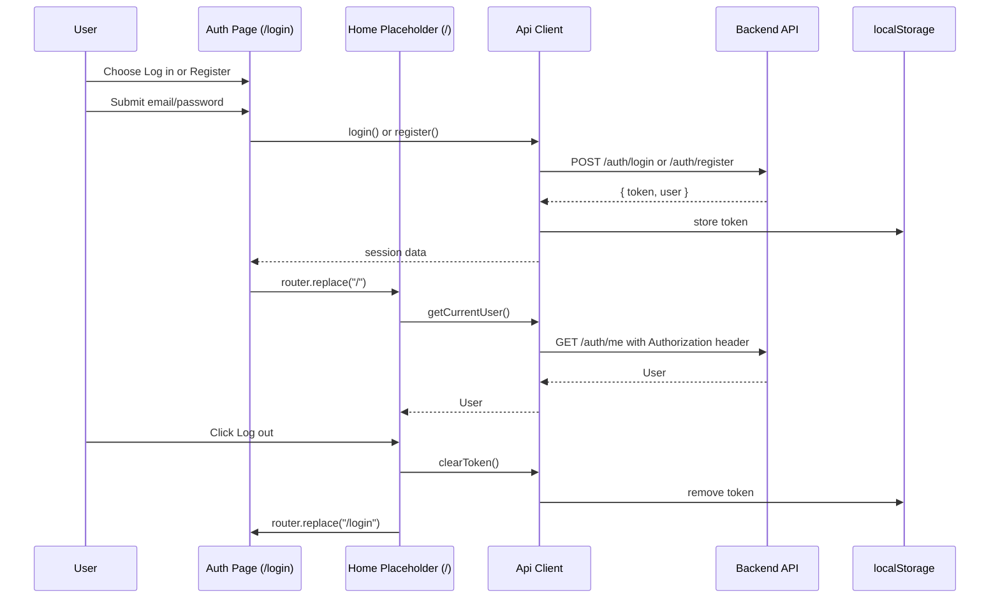

# Frontend

The Frontend is the browser app for Jevwright: an App Router Next.js client that authenticates with the backend, manages the user's workspace through the REST API, and presents placeholder login and workspace views while the backend contract is in place.

## 1. Functional Definition

### 1.1 Scope

This module covers the frontend package: the Next.js scaffold, generated API types, the auth-aware fetch client, a two-mode login/register page. It also covers the workspace layout and sidebar; the editor, live run, history and reports are not built yet.

| Area    | Scope                                                                                                          |
| ------- | -------------------------------------------------------------------------------------------------------------- |
| Package | `@jevwright/frontend` in `src/app/frontend`                                                                    |
| Runtime | Next.js 15 App Router, TypeScript strict, Node 22, pnpm 9                                                      |
| Styling | Tailwind v4 with `@tailwindcss/postcss`; no `tailwind.config.ts`; shadcn dark theme (`dark` class on `<html>`) |
| API     | OpenAPI-generated types from `docs/api/openapi.json`; native fetch wrapper                                     |
| Auth    | Bearer token from login/register responses; token stored in `localStorage`                                     |
| Pages   | `/login` two-mode auth form; workspace layout with sidebar; `/` empty state; `/files/[testFileId]` placeholder |
| Tests   | Vitest for API client, auth-error formatter, and sidebar helpers; Playwright E2E for auth and sidebar          |


### 1.2 Token and auth rules

The backend contract and docs specify the browser auth flow in [backend.md](backend.md):

- The known backend error codes are `invalid_request`, `unauthorized`, `not_found`, `conflict`, `too_large`, `invalid_test`, `internal`, and `not_implemented`.
- Any other backend error code is treated as `internal` by the frontend.
- Register and login respond with `{ token, user }`.
- The frontend sends the token as `Authorization: Bearer <token>`.
- A token that is rejected with `401` from routes other than login/register clears the token and calls `onUnauthorized`.
- A `401` from login/register does not clear the token and does not call `onUnauthorized`; it throws `ApiError` instead.
- The token storage must be browser-only; any access to `localStorage` is guarded with `typeof window`.
- The default client does not touch `localStorage` during server rendering.
- The default `apiClient` config sets `onUnauthorized` to `() => window.location.assign("/login")`.

### 1.3 Error handling contract

The client follows the backend’s JSON error payload shape exactly:

```ts
{
  error: {
    code: string;
    message: string;
    details?: unknown;
  }
}
```

Rules:

- `ApiError` extends `Error` and includes `status`, `code`, `message`, and `details`.
- If the backend responds with a non-JSON error body, the client keeps the real HTTP status and throws `ApiError` with:
  - `status`: the real HTTP status
  - `code`: `"internal"`
  - `message`: `"Internal server error"`
- Unknown backend error codes are normalized to `"internal"`, while the HTTP status is preserved.
- A 401 from a route other than login/register clears the token and calls the configured `onUnauthorized` callback.
- The frontend must not invent a message from the OpenAPI `description`; the message must match the mocked backend response body in unit tests.

### 1.4 Generated types and API contract

The frontend types are generated from [docs/api/openapi.json](../api/openapi.json) via `openapi-typescript`. The generated file is `lib/api-schema.ts`, and it is excluded from lint and Prettier.

The generated file provides:

- `components["schemas"]["User"]`
- `components["schemas"]["Diagnostic"]`
- all named schema types used in API responses
- route-level request/response types from `paths`

Auth types are derived from those generated types instead of hand-written forms:

```ts
type User = components["schemas"]["User"];
type LoginResponse = paths["/auth/login"]["post"]["responses"][200]["content"]["application/json"];
type RegisterResponse = paths["/auth/register"]["post"]["responses"][201]["content"]["application/json"];
type AuthSession = LoginResponse;
```

This keeps `User`, `Diagnostic`, `Run`, and the login response in sync with the backend’s published contract.

### 1.5 Page requirements

The pages behave as follows:

- `/login` is a single client-component page with two modes: **Log in** and **Register**.
- The UI has exactly the PRD 7.1.1 form shape: email, password, submit.
- Submit calls `apiClient.login(email, password)` in Log in mode and `apiClient.register(email, password)` in Register mode.
- On successful login/register, the page navigates with `router.replace("/")`.
- While the submit request is in flight, the submit button is disabled.
- Auth errors render backend-provided text only:
  - always show `ApiError.message`;
  - for `ApiError.status === 400`, also render each string message from `ApiError.details`.
- Every authenticated page shares the workspace layout (see 1.6), a client component that calls `apiClient.getCurrentUser()` on load:
  - while pending, render minimal text `Loading…`;
  - when resolved, render the sidebar (with the current user email and a Log out button) and the page;
  - Log out calls `apiClient.clearToken()` and navigates with `router.replace("/login")`;
  - if `getCurrentUser()` fails with anything other than `401`, show the `formatAuthError` messages instead (a `401` is handled by the API client, which redirects to `/login`).
- `/` is the workspace empty state: "Pick a test file to edit".

The root layout remains a server component, while the workspace layout and pages that need auth or data access are client components. This is a deliberate exception to the repo's "Server Components by default" guidance: the auth token is browser state, so auth and data fetching happen on the client.

### 1.6 Workspace sidebar

The workspace is every authenticated page. A shared layout guards auth, renders the sidebar on the left and the page on the right.

| Route                 | Page                                    |
| --------------------- | --------------------------------------- |
| `/`                   | Empty state: "Pick a test file to edit" |
| `/files/[testFileId]` | Test file editor (1.7) and its Runs list (1.9) |
| `/runs/[runId]`       | Run: live progress and report (1.9)     |

| Element         | Behavior                                                                                                                     |
| --------------- | ---------------------------------------------------------------------------------------------------------------------------- |
| Header          | "Projects" with a "+" that opens the New Project dialog                                                                      |
| Tree            | Projects → Modules → Test Files from `GET /tree`, in API order. Projects and Modules toggle open/closed; all open by default |
| Row "+"         | On a Project: New Module dialog. On a Module: New Test File dialog                                                           |
| Row "Variables" | On a Project: opens the Variables dialog (1.8)                                                                              |
| Status dot      | From `latestRun.status`: `passed` green, `failed` red, `queued`/`running` amber, no run gray                                 |
| Selection       | The Test File in the current route is highlighted                                                                            |
| Account         | Initials, email from `me`, Log out (clears the token, goes to `/login`)                                                      |
| Narrow screens  | Sidebar hidden behind a ☰ button                                                                                             |

Names follow the backend rules: Project and Module names are 1–100 characters, a Test File name ends in `.yaml`, and names are unique within their parent. The New Test File dialog normalizes the input with `toTestFileName`, and the new file is created with `starterSource(name)`. After creation the page navigates to the new file.

Create dialogs submit `POST /projects`, `POST /projects/:id/modules`, or `POST /modules/:id/test-files`, then reload the tree. API errors (such as `409 conflict`) show inside the dialog via `ApiError.message`, and the dialog stays open.

The tree is loaded once in the layout and exposed through a `refreshTree()` context, so later pages (editor save, finished run) can update the status dots.

| Helper                  | Rule                                                                                                                                                            |
| ----------------------- | --------------------------------------------------------------------------------------------------------------------------------------------------------------- |
| `statusOf(latestRun)`   | `null` → `none`; `queued`/`running` → `active`; `passed` → `passed`; `failed` → `failed`                                                                        |
| `toTestFileName(input)` | Trims; appends `.yaml` when the trimmed name is non-empty and contains no `.`; otherwise returns the trimmed name unchanged (the backend rejects invalid names) |
| `starterSource(name)`   | A valid Test Case: `name` is the file name without `.yaml`, one `open` step with `url: "https://example.com"`                                                   |
| `initials(email)`       | First two characters of the part before `@`, upper-cased                                                                                                        |

`starterSource("login.yaml")` returns the following, ending with a newline:

```yaml
name: "login"
steps:
  - open:
      url: "https://example.com"
```

#### Accessible names

E2E tests locate elements by role and accessible name, so these names are part of the contract.

| Element               | Role and name                                                                                                                                                                                  |
| --------------------- | ---------------------------------------------------------------------------------------------------------------------------------------------------------------------------------------------- |
| Sidebar               | `navigation` named "Projects"                                                                                                                                                                  |
| Header "+"            | button "New project"                                                                                                                                                                           |
| Project row "+"       | button "New module in <project name>"                                                                                                                                                          |
| Project row Variables | button "Variables for <project name>"                                                                                                                                                          |
| Module row "+"        | button "New test file in <module name>"                                                                                                                                                        |
| Dialogs               | `dialog` titled "New project", "New module", or "New test file"; text input labelled "Name"; buttons "Create" and "Cancel"; an API error renders in a `role="alert"` element inside the dialog |
| Test File             | link named by the file name; the current one has `aria-current="page"`                                                                                                                         |
| Status dot            | inside the Test File link; `data-status` of `none`, `active`, `passed`, or `failed`, with a title: "Never run", "Running", "Passed", "Failed"                                                  |
| Account               | the user email as text; button "Log out"                                                                                                                                                       |

#### Tests
- Unit: the four helpers above.
- E2E `sidebar.e2e.ts`: a new user creates a Project, a Module, and a Test File through the dialogs; each appears in the tree; the new file opens at `/files/<id>`, is marked current, and has status `none`; after a reload the tree is unchanged.
- E2E: creating a second Project with the same name keeps the dialog open and shows an alert.

### 1.7 Test file editor

`/files/[testFileId]` loads the Test File with `GET /test-files/:id` and edits its source in a plain textarea. The page keeps two strings: `saved` (the last source from the API) and `draft` (the textarea). The file is dirty when `draft !== saved`.

| State       | Render                                                                              |
| ----------- | ----------------------------------------------------------------------------------- |
| Pending     | `Loading…`                                                                          |
| `404`       | "Test file not found"                                                               |
| Other error | `ApiError.message` in a `role="alert"`                                              |
| Loaded      | File name heading, toolbar (Upload file, Validate, Save, Run), textarea, result bar, Runs list (1.9) |

| Action      | Behavior                                                                                                                                                                                                                                                                           |
| ----------- | ---------------------------------------------------------------------------------------------------------------------------------------------------------------------------------------------------------------------------------------------------------------------------------- |
| Edit        | Updates `draft`; shows "Unsaved changes" while dirty; clears the result bar                                                                                                                                                                                                        |
| Validate    | `POST /test-files/validate { source: draft }`; shows the diagnostics in the result bar                                                                                                                                                                                             |
| Save        | Enabled only when dirty. `PATCH /test-files/:id { source: draft }`; on success `saved` becomes the returned `testFile.source`, the returned diagnostics are shown, and `refreshTree()` is called. On failure the draft is kept and `ApiError.message` is shown in a `role="alert"` |
| Upload file | Opens a file picker accepting `.yaml` and `.yml`; the chosen file's text replaces `draft` (not saved until Save)                                                                                                                                                                   |
| Run         | Saves first when dirty (stops if the save fails), then `POST /test-files/:id/runs`. `202`: shows "Run queued." in a `role="status"` with a "View run" link to `/runs/<id>` next to it (outside the status element), reloads the Runs list (1.9), and calls `refreshTree()`. `422`: shows `ApiError.details` (Diagnostic[]) in the result bar. Other errors: `role="alert"`                      |

Buttons are disabled while their request is in flight. A failing `refreshTree()` shows its message in the page's `role="alert"`; the save or run itself still counts as done.

The result bar is a `region` named "Validation". It shows `validationSummary(diagnostics)`, then one list item per diagnostic with `formatDiagnostic(d)`. Diagnostics have a line but no column.

| Helper                  | Rule                                                                               |
| ----------------------- | ---------------------------------------------------------------------------------- |
| `validationSummary(ds)` | `[]` → "Valid. Ready to run."; 1 → "1 validation error"; n → "n validation errors" |
| `formatDiagnostic(d)`   | "Line <line>: <message>"                                                           |

Out of scope: validating while typing, line numbers, keyboard shortcuts, an unsaved-changes guard.

### 1.8 Project Variables

The "Variables for <project>" button opens the Variables dialog. It lists the Project's Variable names from `GET /projects/:id/variables`; values are write-only and never shown.

| Action | Behavior                                                                                                                                                                                                                                                                                 |
| ------ | ---------------------------------------------------------------------------------------------------------------------------------------------------------------------------------------------------------------------------------------------------------------------------------------- |
| Open   | Loads the names; an empty list shows "No variables yet"                                                                                                                                                                                                                                  |
| Save   | Enabled when Name and Value are non-empty. Rejects a name that fails `isVariableName` with "Name must match [A-Z_][A-Z0-9_]*" without calling the API; otherwise `PUT /projects/:id/variables/:name { value }`, then reloads the names and clears the form. An existing name is replaced |
| Delete | `DELETE /projects/:id/variables/:name`, then reloads the names                                                                                                                                                                                                                           |

API errors show `ApiError.message` in a `role="alert"` inside the dialog, and the dialog stays open.

| Helper                 | Rule                                                                 |
| ---------------------- | -------------------------------------------------------------------- |
| `isVariableName(name)` | `true` when `name` matches `^[A-Z_][A-Z0-9_]*$` (the backend's rule) |

#### Accessible names (editor and Variables)

| Element          | Role and name                                                                                                                                                                           |
| ---------------- | --------------------------------------------------------------------------------------------------------------------------------------------------------------------------------------- |
| File name        | `heading` named by the file name                                                                                                                                                        |
| Unsaved marker   | text "Unsaved changes"                                                                                                                                                                  |
| Toolbar          | buttons "Upload file", "Validate", "Save", "Run"                                                                                                                                        |
| Source           | textbox labelled "Test file YAML"                                                                                                                                                       |
| Result bar       | `region` named "Validation"; summary text; one `listitem` per diagnostic                                                                                                                |
| Run feedback     | `role="status"` with "Run queued."                                                                                                                                                      |
| Variables dialog | `dialog` titled "Variables"; one `listitem` per name with button "Delete <NAME>"; inputs labelled "Name" and "Value" (password); buttons "Save" and "Close"; errors in a `role="alert"` |

#### Tests
- Unit: `validationSummary`, `formatDiagnostic`, `isVariableName`, and the new API client functions (5.1).
- E2E `editor.e2e.ts`: a new user creates a Test File; the textarea shows the starter source; an invalid edit shows "Unsaved changes" and Validate shows "1 validation error" with a "Line …" item; restoring a valid source and saving hides "Unsaved changes"; after a reload the saved source is shown; Run shows "Run queued.".
- E2E `variables.e2e.ts`: a new user adds Variable `BASE`; it is listed and its value is not shown; an invalid name shows the alert; Delete removes it.

### 1.9 Runs: live progress and history

A Run has one page, `/runs/[runId]`, used both while it runs (live progress) and after it finishes (report). The editor page lists the file's recent Runs. Both render steps with the same `StepList` component, because the backend uses one `Step` shape for Live Progress and the Report.

#### Runs list (editor page)

Below the result bar, a `region` named "Runs" loads `GET /runs?testFileId=<id>&limit=20` with the page and again after a successful Run. Each Run is one list item with a link to `/runs/<id>` whose text is `runStatusLabel(status)`, the trigger time (`createdAt`, `toLocaleString()`), and `formatDuration(durationMs)`. An empty list shows "No runs yet". There is no pagination. A failed load shows `ApiError.message` in a `role="alert"` inside the region.

#### Run page

| Step | Behavior |
| ---- | -------- |
| Load | `GET /runs/:id`. Pending: `Loading…`; `404`: "Run not found"; other errors: `ApiError.message` in a `role="alert"` and nothing else |
| Finished Run (`passed`/`failed`) | Steps come from `run.report.steps`. A Run without a Report (`interrupted`/`internal` error) shows no steps and "No step results" |
| Active Run (`queued`/`running`) | Opens the WebSocket at `liveUrl(baseUrl, runId, token)` and folds every message into `{ run, steps }` with `applyLiveMessage`. When a `status` message makes the Run final, the page reloads `GET /runs/:id` (for the Report and trace) and calls `refreshTree()` |
| Socket closes early | If the socket closes before the Run is final, the page keeps the last state and shows "Live progress disconnected" in a `role="alert"` |
| Leave the page | The socket is closed |

The header shows the file name as the heading, "Status: <runStatusLabel>", the trigger time, `formatDuration(durationMs)`, the summary as "<passed>/<total> passed" once it exists, and the Run error as "<kind>: <message>" when there is one. A "Back to <fileName>" link goes to `/files/<testFileId>` (hidden when `testFileId` is `null`). After the Run is final, a "Download report" link points to `runFileUrl(baseUrl, runId, "report.json", token)`, and a "Download trace" link to `runFileUrl(…, report.trace, token)` when `report.trace` exists.

`StepList` renders an ordered list named "Steps". Each step is one list item with "Step <index + 1>", the action, "line <line>", `runStatusLabel`-style status text (Pending, Running, Passed, Failed), and, when present, `formatDuration(durationMs)`, the locate method, the failure `reason`, and the screenshot as an `img` with alt "Step <index + 1> screenshot" from `runFileUrl(baseUrl, runId, step.screenshot, token)`. Dialog records are not shown.

| Helper | Rule |
| ------ | ---- |
| `runStatusLabel(status)` | `queued` → "Queued", `running` → "Running", `passed` → "Passed", `failed` → "Failed" |
| `stepStatusLabel(status)` | `pending` → "Pending", `running` → "Running", `passed` → "Passed", `failed` → "Failed" |
| `formatDuration(ms)` | `null` or `undefined` → "—"; under 1000 → "<ms> ms"; otherwise seconds with one decimal, "<s> s" |
| `liveUrl(baseUrl, runId, token)` | `baseUrl` with `http` → `ws` and `https` → `wss`, then `/runs/<runId>/live?token=<encodeURIComponent(token)>` |
| `runFileUrl(baseUrl, runId, path, token)` | `<baseUrl>/runs/<runId>/files/<path>?token=<encodeURIComponent(token)>` |
| `applyLiveMessage(state, message)` | Pure. `snapshot` → `{ run, steps }` from the message; `step` → the step with the same `index` is replaced (inserted in `index` order if absent); `status` → `run` replaced, steps kept. Never mutates `state` |

`state` is `{ run: Run | null; steps: Step[] }`; messages are the generated `LiveMessage` type.

#### Accessible names (Runs)

| Element | Role and name |
| ------- | ------------- |
| Runs list | `region` named "Runs"; one `listitem` per Run containing a `link` to the Run; text "No runs yet" when empty |
| Editor run link | `link` "View run" |
| Run heading | `heading` named by the file name |
| Run status | text "Status: <label>" |
| Steps | `list` named "Steps"; one `listitem` per step containing "Step <n>" |
| Screenshot | `img` with alt "Step <n> screenshot" |
| Links | "Back to <fileName>", "Download report", "Download trace" |
| Disconnect | `role="alert"` with "Live progress disconnected" |

#### Tests
- Unit: the six helpers above (5.4) and `getRun`, `listRuns`, `getBaseUrl` (5.1).
- E2E `flow.e2e.ts` (the full PRD flow, #84): a new user creates a Test File, enters a valid source, Validate shows "Valid. Ready to run.", saves, clicks Run and sees "Run queued.", follows "View run" to `/runs/<id>`, sees the file name heading, a "Status: …" text, and a "Steps" list with one item containing "Step 1"; "Back to <file>" returns to the editor, where the "Runs" region lists one Run. The test does not wait for the Run to finish.

Out of scope: project or module dashboards, charts, filters, pagination, showing dialog records.

### 1.10 Packages and exact pins

The frontend package uses these exact versions:

- `next@15.5.29`
- `react@19.3.1`
- `react-dom@19.3.1`
- `@types/react@19.3.0`
- `@types/react-dom@19.3.0`
- `tailwindcss@4.3.5`
- `@tailwindcss/postcss@4.3.5`
- `openapi-typescript@7.13.0`

shadcn tooling and UI primitives are pinned exactly (no `^`). Primitives are added with `shadcn add` only as pages need them (currently `button`, `input`, `label`); every dependency that command adds is pinned to its exact installed version and listed below.


- `cn@0.5.2`
- `shadcn@4.23.0`
- `tw-animate-css@1.4.0`
- `@base-ui/react@1.9.0`
- `class-variance-authority@0.7.1`

The repo does not use `eslint-config-next`; instead the root `eslint.config.js` is extended to include `.tsx` and the frontend package files.

### 1.11 Scripts and config

The root workspace exposes the frontend app with `pnpm frontend`, which starts the Next.js dev server on port `3000`.

The frontend package also includes a generation script named `api:types` that regenerates `lib/api-schema.ts` from the published OpenAPI document in [docs/api/openapi.json](../api/openapi.json). The root and package scripts are used to keep the API schema in sync after the backend contract changes.

Lint, format, and type-check coverage include the frontend package:

- `pnpm lint` runs ESLint across the workspace, including the frontend package files
- `pnpm format` and `pnpm format:check` cover the frontend source files in the package
- `pnpm typecheck` includes the frontend TypeScript project

`apiClient` reads its base URL from `NEXT_PUBLIC_API_URL` (inlined at build time), falling back to `http://127.0.0.1:4000/api/v1`. The frontend environment file sets `NEXT_PUBLIC_API_URL=http://127.0.0.1:4000/api/v1`; use `127.0.0.1` because the backend listens on IPv4 only (`docs/deploy/backend-local.md`). The browser must open `http://localhost:3000`, not `127.0.0.1:3000`, because the backend CORS default is `http://localhost:3000`.

`next.config.ts` maps `.js` imports to `.ts`/`.tsx` (`webpack.resolve.extensionAlias`), because lib files use `.js` relative imports for the root NodeNext typecheck.

## 2. Internal Flow



1. The `/login` page submits credentials through `apiClient.login` or `apiClient.register` based on the selected mode.
2. The API client appends the bearer token to requests when present, otherwise it sends a plain request.
3. A successful auth response stores the token, and `/login` transitions to `/` with `router.replace("/")`.
4. The `/` page calls `apiClient.getCurrentUser()` on load and shows `Loading…` while in flight.
5. A `401` from a non-login route clears the token and calls the configured `onUnauthorized` callback.
6. A `401` from login/register throws `ApiError` without mutating the token.
7. The `openapi-typescript` generator creates the frontend schema types from the published backend OpenAPI document.
8. The API client normalizes backend errors into the `ApiError` contract and preserves the real HTTP status.

## 3. External Interface

### 3.1 API client

```ts
export class ApiError extends Error {
  readonly status: number;
  readonly code: string;
  readonly details?: unknown;

  constructor(status: number, code: string, message: string, details?: unknown);
}

export type ApiErrorBody = {
  error: {
    code: string;
    message: string;
    details?: unknown;
  };
};

export type ApiClientConfig = {
  baseUrl?: string;
  getToken?: () => string | null;
  setToken?: (token: string | null) => void;
  onUnauthorized?: () => void;
  fetchImpl?: typeof fetch;
};

export type RequestOptions = {
  skipAuthRedirect?: boolean;
};

export type User = components["schemas"]["User"];
export type Diagnostic = components["schemas"]["Diagnostic"];
export type LoginResponse = paths["/auth/login"]["post"]["responses"][200]["content"]["application/json"];
export type RegisterResponse = paths["/auth/register"]["post"]["responses"][201]["content"]["application/json"];

export function parseApiError(payload: unknown): {
  code: string;
  message: string;
  details?: unknown;
};

export function createApiClient(config?: ApiClientConfig): {
  setToken(token: string | null): void;
  clearToken(): void;
  getToken(): string | null;
  getBaseUrl(): string;
  request<T>(path: string, init?: RequestInit, options?: RequestOptions): Promise<T>;
  login(email: string, password: string): Promise<LoginResponse>;
  register(email: string, password: string): Promise<RegisterResponse>;
  getCurrentUser(): Promise<User>;
  getTree(): Promise<TreeResponse>;
  createProject(name: string): Promise<CreateProjectResponse>;
  createModule(projectId: string, name: string): Promise<CreateModuleResponse>;
  createTestFile(moduleId: string, name: string, source: string): Promise<CreateTestFileResponse>; // { testFile, diagnostics }
  getTestFile(testFileId: string): Promise<TestFile>;
  updateTestFile(testFileId: string, source: string): Promise<UpdateTestFileResponse>; // { testFile, diagnostics }
  validateSource(source: string): Promise<ValidateResponse>; // { diagnostics }
  startRun(testFileId: string): Promise<Run>; // 202; 422 rejects with ApiError whose details are Diagnostic[]
  listVariables(projectId: string): Promise<VariableListResponse>; // { items: string[] }
  setVariable(projectId: string, name: string, value: string): Promise<void>; // 204
  deleteVariable(projectId: string, name: string): Promise<void>; // 204
  listRuns(testFileId: string): Promise<RunListResponse>; // GET /runs?testFileId=&limit=20 → { items, nextCursor }
  getRun(runId: string): Promise<Run>; // with source and, once finished, report
};

export const apiClient: ReturnType<typeof createApiClient>;
```

`TreeResponse`, `CreateProjectResponse`, `CreateModuleResponse`, `CreateTestFileResponse`, `TestFile`, `Run`, `UpdateTestFileResponse`, `ValidateResponse`, `VariableListResponse`, `RunListResponse`, `Step`, and `LiveMessage` are aliases of the generated `components`/`paths` types for these routes; none are written by hand.

### 3.2 Request rules

- Base URL comes from `NEXT_PUBLIC_API_URL`.
- The client uses native `fetch` only.
- If a token exists, the request adds `Authorization: Bearer <token>`.
- If no token exists, the client sends no `Authorization` header.
- Login and register calls pass `skipAuthRedirect: true` so they are not treated as a generic auth-failure path.
- The client decides whether to redirect on `401` based on `skipAuthRedirect`, not by matching the request URL string.
- When a request returns `401` and `skipAuthRedirect` is not set, the client clears the token and invokes `onUnauthorized`.
- This is the only automatic redirect path; the app decides how it navigates after `onUnauthorized` fires.

### 3.3 Response mapping

The API client normalizes every response as follows:

- `204 No Content` resolves to `undefined`
- JSON success bodies resolve as typed data
- JSON error bodies become `ApiError` with the real HTTP status and the backend-provided message/code
- unknown backend codes become `code: "internal"`
- non-JSON or missing-error bodies become:
  - `status`: the real HTTP status
  - `code`: `"internal"`
  - `message`: `"Internal server error"`

This fallback is implemented in the client itself when the backend response is not JSON or does not include a usable error body; it is not a backend-required message contract.

## 4. Class Architecture

### 4.1 Modules

| Module / Class                                | Responsibility                                              |
| --------------------------------------------- | ----------------------------------------------------------- |
| `app/login/page.tsx`                          | Two-mode auth form (Log in/Register)                        |
| `app/(workspace)/layout.tsx`                  | Auth guard, loads `me` and the tree, renders the sidebar    |
| `app/(workspace)/page.tsx`                    | Empty state                                                 |
| `app/(workspace)/files/[testFileId]/page.tsx` | Test file editor (1.7) and Runs list (1.9)                  |
| `app/(workspace)/runs/[runId]/page.tsx`       | Run page: live progress and report (1.9)                    |
| `lib/api.ts`                                  | Fetch wrapper, `ApiError`, typed API functions              |
| `lib/api-schema.ts`                           | Generated OpenAPI types from `docs/api/openapi.json`        |
| `lib/format-auth-error.ts`                    | Unknown auth error → UI-safe strings                        |
| `lib/utils.ts`                                | Re-exports `cn` from the `cn` package for shadcn components |
| `lib/sidebar.ts`                              | Sidebar helpers (1.6)                                       |
| `lib/editor.ts`                               | Editor and Variables helpers (1.7, 1.8)                     |
| `lib/runs.ts`                                 | Run helpers (1.9)                                           |
| `lib/workspace-context.tsx`                   | `useWorkspace()`: `me`, `tree`, `refreshTree`               |
| `components/workspace/sidebar-nav.tsx`        | Sidebar tree, dialogs, account                              |
| `components/workspace/create-name-dialog.tsx` | Shared New project/module/test file dialog                  |
| `components/workspace/variables-dialog.tsx`   | Variables dialog (1.8)                                      |
| `components/workspace/run-list.tsx`           | Runs list on the editor page (1.9)                          |
| `components/workspace/step-list.tsx`          | Shared step list for live progress and report (1.9)         |
| `components/ui/`                              | shadcn primitives                                           |

### 4.2 Directory layout

```text
src/app/frontend/
├── app/
│   ├── globals.css
│   ├── layout.tsx
│   ├── login/
│   │   └── page.tsx
│   └── (workspace)/
│       ├── layout.tsx
│       ├── page.tsx
│       ├── files/
│       │   └── [testFileId]/
│       │       └── page.tsx
│       └── runs/
│           └── [runId]/
│               └── page.tsx
├── components.json
├── components/
│   ├── ui/
│   │   ├── button.tsx
│   │   ├── dialog.tsx
│   │   ├── input.tsx
│   │   └── label.tsx
│   └── workspace/
│       ├── create-name-dialog.tsx
│       ├── run-list.tsx
│       ├── sidebar-nav.tsx
│       ├── step-list.tsx
│       └── variables-dialog.tsx
├── lib/
│   ├── api.ts
│   ├── api-schema.ts
│   ├── editor.ts
│   ├── format-auth-error.ts
│   ├── runs.ts
│   ├── sidebar.ts
│   ├── utils.ts
│   └── workspace-context.tsx
├── .env.example
├── .gitignore
├── Dockerfile
├── next-env.d.ts        # generated, not committed
├── next.config.ts
├── package.json
├── postcss.config.mjs
└── tsconfig.json
```

## 5. Test Plan

| Type | Coverage                                                                                                         | Location                                                |
| ---- | ---------------------------------------------------------------------------------------------------------------- | ------------------------------------------------------- |
| Unit | API client: error parsing, 401 behavior, auth header, 204 success, HTML fallback, workspace and editor functions | `src/tests/unit/app/frontend/api.test.ts`               |
| Unit | `formatAuthError` for login/register and backend `400 details`                                                   | `src/tests/unit/app/frontend/format-auth-error.test.ts` |
| Unit | Sidebar helpers (1.6)                                                                                            | `src/tests/unit/app/frontend/sidebar.test.ts`           |
| Unit | Editor and Variables helpers (1.7, 1.8)                                                                          | `src/tests/unit/app/frontend/editor.test.ts`            |
| Unit | Run helpers (1.9)                                                                                                | `src/tests/unit/app/frontend/runs.test.ts`              |
| E2E  | Auth flow                                                                                                        | `src/tests/e2e/auth.e2e.ts`                             |
| E2E  | Sidebar create flow and duplicate name (1.6)                                                                     | `src/tests/e2e/sidebar.e2e.ts`                          |
| E2E  | Editor: validate, save, reload, run (1.7)                                                                        | `src/tests/e2e/editor.e2e.ts`                           |
| E2E  | Variables: add, invalid name, delete (1.8)                                                                       | `src/tests/e2e/variables.e2e.ts`                        |
| E2E  | Full flow: create, validate, save, run, live view, history (1.9)                                                 | `src/tests/e2e/flow.e2e.ts`                             |

The tests use `fetchImpl`, `getToken`, `setToken`, and `onUnauthorized` injection where applicable; no DOM environment is required. The expected values are written by hand from mocked payloads and backend contract behavior, never generated from implementation output.

`format-auth-error.test.ts` imports its lib module via the `@/` alias with a `.js` extension (`@/app/frontend/lib/format-auth-error.js`), matching the repo's test convention; lib files import each other with relative `./xxx.js` paths.

### 5.1 Exact unit-test cases

1. `it("sends Authorization: Bearer jwt-token when a token exists", async () => { ... })`
   - expected request header: `Authorization: Bearer jwt-token`

2. `it("omits the Authorization header when there is no token", async () => { ... })`
   - expected request headers: no `Authorization` header present

3. `it("stores the token and resolves the login body when POST /auth/login succeeds", async () => { ... })`
   - mocked response body:
     ```ts
     { token: "jwt-token", user: { id: "user-1", email: "test@example.com", createdAt: "2026-01-01T00:00:00.000Z" } }
     ```
   - expected side effects:
     - `setToken("jwt-token")` called once
   - expected resolved value:
     ```ts
     { token: "jwt-token", user: { id: "user-1", email: "test@example.com", createdAt: "2026-01-01T00:00:00.000Z" } }
     ```

4. `it("handles a 401 on GET /auth/me by clearing the token and calling onUnauthorized", async () => { ... })`
   - mocked response body:
     ```ts
     { error: { code: "unauthorized", message: "No valid token" } }
     ```
   - expected thrown value:
     ```ts
     {
       status: 401,
       code: "unauthorized",
       message: "No valid token"
     }
     ```
   - expected side effects:
     - `setToken(null)` once
     - `onUnauthorized()` once

5. `it("does not clear the token on a 401 from POST /auth/login", async () => { ... })`
   - mocked response body:
     ```ts
     { error: { code: "unauthorized", message: "Wrong email or password" } }
     ```
   - expected thrown value:
     ```ts
     {
       status: 401,
       code: "unauthorized",
       message: "Wrong email or password"
     }
     ```
   - expected side effects:
     - `setToken` not called
     - `onUnauthorized` not called

6. `it("keeps the HTTP status but converts an unknown code to internal", async () => { ... })`
   - mocked response body:
     ```ts
     { error: { code: "brand_new_code", message: "Some unknown backend error" } }
     ```
   - expected thrown value:
     ```ts
     {
       status: 409,
       code: "internal",
       message: "Some unknown backend error"
     }
     ```

7. `it("keeps 422 details as the Diagnostic[] it received", async () => { ... })`
   - mocked response body:
     ```ts
     {
       error: {
         code: "invalid_test",
         message: "The Test File has diagnostics",
         details: [{ code: "E003", message: "Missing required field \"url\"", line: 4 }]
       }
     }
     ```
   - expected thrown value:
     ```ts
     {
       status: 422,
       code: "invalid_test",
       message: "The Test File has diagnostics",
       details: [{ code: "E003", message: "Missing required field \"url\"", line: 4 }]
     }
     ```
   - `Diagnostic` is from the generated OpenAPI schema: `{ code, message, line }`, with no `kind` and no `column`.

8. `it("converts a 502 HTML response to ApiError with code internal", async () => { ... })`
   - mocked body:
     ```ts
     "<html><body>Bad Gateway</body></html>"
     ```
   - expected thrown value:
     ```ts
     {
       status: 502,
       code: "internal",
       message: "Internal server error"
     }
     ```

9. `it("resolves a 204 response to undefined", async () => { ... })`
   - expected value: `undefined`

10. `it("sends GET /test-files/tf-1 and resolves the Test File", async () => { ... })`
    - expected request: `GET /test-files/tf-1`
    - expected value: the mocked body

11. `it("sends PATCH /test-files/tf-1 with the source and resolves { testFile, diagnostics }", async () => { ... })`
    - call: `updateTestFile("tf-1", "name: x")`
    - expected request: `PATCH /test-files/tf-1`, body `{"source":"name: x"}`
    - expected value: `{ testFile, diagnostics: [] }`

12. `it("sends POST /test-files/validate and resolves the diagnostics", async () => { ... })`
    - call: `validateSource("bad")`
    - expected request: `POST /test-files/validate`, body `{"source":"bad"}`
    - expected value: `{ diagnostics: [{ code: "E005", message: "Unknown action \"aiAct\"", line: 3 }] }`

13. `it("sends POST /test-files/tf-1/runs and resolves the Run on 202", async () => { ... })`
    - expected request: `POST /test-files/tf-1/runs`
    - expected value: the mocked Run

14. `it("rejects startRun with ApiError 422 and the diagnostics as details", async () => { ... })`
    - mocked response: `422 { error: { code: "invalid_test", message: "Test file has errors", details: [{ code: "E005", message: "Unknown action \"aiAct\"", line: 3 }] } }`
    - expected: `ApiError` with status `422`, code `invalid_test`, those details

15. `it("sends GET /projects/p-1/variables and resolves the names", async () => { ... })`
    - expected value: `{ items: ["BASE", "SWAG_PASSWORD"] }`

16. `it("sends PUT /projects/p-1/variables/BASE with the value and resolves undefined on 204", async () => { ... })`
    - call: `setVariable("p-1", "BASE", "https://demo.example.com")`
    - expected body: `{"value":"https://demo.example.com"}`
    - expected value: `undefined`

17. `it("sends DELETE /projects/p-1/variables/BASE and resolves undefined on 204", async () => { ... })`
    - expected value: `undefined`

18. `it("sends GET /runs?testFileId=tf-1&limit=20 and resolves the list", async () => { ... })`
    - expected request: `GET /runs?testFileId=tf-1&limit=20`
    - expected value: the mocked `{ items: [<Run>], nextCursor: null }`

19. `it("sends GET /runs/run-1 and resolves the Run", async () => { ... })`
    - expected request: `GET /runs/run-1`
    - expected value: the mocked Run

20. `it("returns the configured base URL from getBaseUrl", () => { ... })`
    - config `baseUrl: "http://localhost:4000/api/v1"` → `"http://localhost:4000/api/v1"`

These exact values are the source of truth for the API client tests and are intentionally written by hand rather than read from generated responses.

### 5.2 Exact `formatAuthError` unit-test cases

1. `it("returns ApiError.message for a non-400 ApiError", () => { ... })`
   - input:
     ```ts
     new ApiError(401, "unauthorized", "Wrong email or password")
     ```
   - expected output:
     ```ts
     ["Wrong email or password"]
     ```

2. `it("returns message and detail messages for 400 invalid_request", () => { ... })`
   - input:
     ```ts
     new ApiError(400, "invalid_request", "Invalid request", [
       { path: "body.password", message: "password shorter than 8 characters" },
       { path: "body.email", message: "Invalid email address" },
     ])
     ```
   - expected output:
     ```ts
     ["Invalid request", "password shorter than 8 characters", "Invalid email address"]
     ```

3. `it("ignores 400 details entries without a string message", () => { ... })`
   - input:
     ```ts
     new ApiError(400, "invalid_request", "Invalid request", [
       { path: "body.password", message: "password shorter than 8 characters" },
       { path: "body.email" },
       "not-an-object",
       { path: "body.other", message: 123 },
     ])
     ```
   - expected output:
     ```ts
     ["Invalid request", "password shorter than 8 characters"]
     ```

4. `it("returns Error.message for non-ApiError errors", () => { ... })`
   - input:
     ```ts
     new Error("Network request failed")
     ```
   - expected output:
     ```ts
     ["Network request failed"]
     ```

5. `it("returns Internal server error for unknown throw values", () => { ... })`
   - input:
     ```ts
     null
     ```
   - expected output:
     ```ts
     ["Internal server error"]
     ```

### 5.3 Exact editor helper unit-test cases

`editor.test.ts` imports `@/app/frontend/lib/editor.js`.

1. `validationSummary`
   - `[]` → `"Valid. Ready to run."`
   - one diagnostic → `"1 validation error"`
   - two diagnostics → `"2 validation errors"`

2. `formatDiagnostic({ code: "E005", message: "Unknown action \"aiAct\"", line: 3 })` → `Line 3: Unknown action "aiAct"`

3. `isVariableName`
   - `"BASE"` → `true`; `"_X1"` → `true`
   - `"base"` → `false`; `"1A"` → `false`; `""` → `false`; `"SWAG-PASSWORD"` → `false`

### 5.4 Exact run helper unit-test cases

`runs.test.ts` imports `@/app/frontend/lib/runs.js`. Mock Runs and Steps are typed with the generated `Run` and `Step` types.

1. `runStatusLabel`: `"queued"` → `"Queued"`; `"running"` → `"Running"`; `"passed"` → `"Passed"`; `"failed"` → `"Failed"`
2. `stepStatusLabel`: `"pending"` → `"Pending"`; `"running"` → `"Running"`; `"passed"` → `"Passed"`; `"failed"` → `"Failed"`
3. `formatDuration`: `null` → `"—"`; `850` → `"850 ms"`; `1000` → `"1.0 s"`; `1400` → `"1.4 s"`
4. `liveUrl`
   - `("http://127.0.0.1:4000/api/v1", "run-1", "a b")` → `"ws://127.0.0.1:4000/api/v1/runs/run-1/live?token=a%20b"`
   - `("https://api.example.com/api/v1", "run-1", "t")` → `"wss://api.example.com/api/v1/runs/run-1/live?token=t"`
5. `runFileUrl("https://api.example.com/api/v1", "run-1", "screenshots/step-0.png", "t")` → `"https://api.example.com/api/v1/runs/run-1/files/screenshots/step-0.png?token=t"`
6. `applyLiveMessage`
   - from `{ run: null, steps: [] }`, a `snapshot` with a queued Run and one `pending` step (index 0) → that Run and that step
   - then a `step` message with index 0 `running` → the single step is now `running`
   - then a `status` message with the Run `running` → `run.status` is `"running"` and the step is unchanged
   - a `step` message for index 1 when only index 0 exists → two steps in index order
   - the input state object is not mutated (compare with a deep copy)