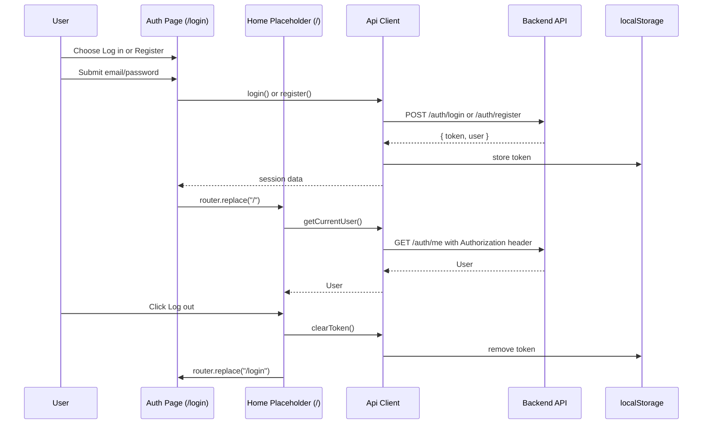

# Frontend

The Frontend is the browser app for Jevwright: an App Router Next.js client that authenticates with the backend, manages the user's workspace through the REST API, and presents placeholder login and workspace views while the backend contract is in place.

## 1. Functional Definition

### 1.1 Scope

This module covers the frontend package: the Next.js scaffold, generated API types, the auth-aware fetch client, a two-mode login/register page, and a placeholder authenticated home page. The workspace UI (sidebar, editor, live run, history and reports) is not built yet.

| Area    | Scope                                                                      |
| ------- | -------------------------------------------------------------------------- |
| Package | `@jevwright/frontend` in `src/app/frontend`                                |
| Runtime | Next.js 15 App Router, TypeScript strict, Node 22, pnpm 9                  |
| Styling | Tailwind v4 with `@tailwindcss/postcss`; no `tailwind.config.ts`           |
| API     | OpenAPI-generated types from `docs/api/openapi.json`; native fetch wrapper |
| Auth    | Bearer token from login/register responses; token stored in `localStorage` |
| Pages   | `/login` two-mode auth form and `/` authenticated placeholder              |
| Tests   | Vitest for API client and auth-error formatter                             |

### 1.2 Token and auth rules

The backend contract and docs specify the browser auth flow in [backend.md](backend.md):

- The known backend error codes are `invalid_request`, `unauthorized`, `not_found`, `conflict`, `too_large`, `invalid_test`, `internal`, and `not_implemented`.
- Any other backend error code is treated as `internal` by the frontend.
- Register and login respond with `{ token, user }`.
- The frontend sends the token as `Authorization: Bearer <token>`.
- A token that is rejected with `401` from routes other than login/register clears the token and calls `onUnauthorized`.
- A `401` from login/register does not clear the token and does not call `onUnauthorized`; it throws `ApiError` instead.
- The token storage must be browser-only; any access to `localStorage` is guarded with `typeof window`.
- The default client does not touch `localStorage` during server rendering.
- The default `apiClient` config sets `onUnauthorized` to `() => window.location.assign("/login")`.

### 1.3 Error handling contract

The client follows the backend’s JSON error payload shape exactly:

```ts
{
  error: {
    code: string;
    message: string;
    details?: unknown;
  }
}
```

Rules:

- `ApiError` extends `Error` and includes `status`, `code`, `message`, and `details`.
- If the backend responds with a non-JSON error body, the client keeps the real HTTP status and throws `ApiError` with:
  - `status`: the real HTTP status
  - `code`: `"internal"`
  - `message`: `"Internal server error"`
- Unknown backend error codes are normalized to `"internal"`, while the HTTP status is preserved.
- A 401 from a route other than login/register clears the token and calls the configured `onUnauthorized` callback.
- The frontend must not invent a message from the OpenAPI `description`; the message must match the mocked backend response body in unit tests.

### 1.4 Generated types and API contract

The frontend types are generated from [docs/api/openapi.json](../api/openapi.json) via `openapi-typescript`. The generated file is `lib/api-schema.ts`, and it is excluded from lint and Prettier.

The generated file provides:

- `components["schemas"]["User"]`
- `components["schemas"]["Diagnostic"]`
- all named schema types used in API responses
- route-level request/response types from `paths`

Auth types are derived from those generated types instead of hand-written forms:

```ts
type User = components["schemas"]["User"];
type LoginResponse = paths["/auth/login"]["post"]["responses"][200]["content"]["application/json"];
type RegisterResponse = paths["/auth/register"]["post"]["responses"][201]["content"]["application/json"];
type AuthSession = LoginResponse;
```

This keeps `User`, `Diagnostic`, `Run`, and the login response in sync with the backend’s published contract.

### 1.5 Page requirements

The pages behave as follows:

- `/login` is a single client-component page with two modes: **Log in** and **Register**.
- The UI has exactly the PRD 7.1.1 form shape: email, password, submit.
- Submit calls `apiClient.login(email, password)` in Log in mode and `apiClient.register(email, password)` in Register mode.
- On successful login/register, the page navigates with `router.replace("/")`.
- While the submit request is in flight, the submit button is disabled.
- Auth errors render backend-provided text only:
  - always show `ApiError.message`;
  - for `ApiError.status === 400`, also render each string message from `ApiError.details`.
- `/` remains a placeholder page, but on load it calls `apiClient.getCurrentUser()`:
  - while pending, render minimal text `Loading…`;
  - when resolved, show the current user email and a Log out button;
  - Log out calls `apiClient.clearToken()` and navigates with `router.replace("/login")`.

The root layout remains a server component, while pages that need auth or data access are client components. This is a deliberate split because the auth token is browser state and the repo’s guidance says “Server Components by default,” but the token lives in the browser and the app needs client-side auth fetch behavior.

### 1.6 Packages and exact pins

The frontend package uses these exact versions:

- `next@15.5.29`
- `react@19.3.1`
- `react-dom@19.3.1`
- `@types/react@19.3.0`
- `@types/react-dom@19.3.0`
- `tailwindcss@4.3.5`
- `@tailwindcss/postcss@4.3.5`
- `openapi-typescript@7.13.0`

shadcn tooling and UI primitives are pinned exactly (no `^`). Primitives are added with `shadcn add` only as pages need them (currently `button`, `input`, `label`); every dependency that command adds is pinned to its exact installed version and listed below.


- `cn@0.5.2`
- `shadcn@4.23.0`
- `tw-animate-css@1.4.0`

The repo does not use `eslint-config-next`; instead the root `eslint.config.js` is extended to include `.tsx` and the frontend package files.

### 1.7 Scripts and config

The root workspace exposes the frontend app with `pnpm frontend`, which starts the Next.js dev server on port `3000`.

The frontend package also includes a generation script named `api:types` that regenerates `lib/api-schema.ts` from the published OpenAPI document in [docs/api/openapi.json](../api/openapi.json). The root and package scripts are used to keep the API schema in sync after the backend contract changes.

Lint, format, and type-check coverage include the frontend package:

- `pnpm lint` runs ESLint across the workspace, including the frontend package files
- `pnpm format` and `pnpm format:check` cover the frontend source files in the package
- `pnpm typecheck` includes the frontend TypeScript project

The frontend environment file sets `NEXT_PUBLIC_API_URL=http://localhost:4000/api/v1` so the browser talks to the backend API while the app itself runs on `http://localhost:3000`. The browser must use `http://localhost:3000`, not `127.0.0.1`, because the backend CORS default is `http://localhost:3000`.

## 2. Internal Flow



1. The `/login` page submits credentials through `apiClient.login` or `apiClient.register` based on the selected mode.
2. The API client appends the bearer token to requests when present, otherwise it sends a plain request.
3. A successful auth response stores the token, and `/login` transitions to `/` with `router.replace("/")`.
4. The `/` page calls `apiClient.getCurrentUser()` on load and shows `Loading…` while in flight.
5. A `401` from a non-login route clears the token and calls the configured `onUnauthorized` callback.
6. A `401` from login/register throws `ApiError` without mutating the token.
7. The `openapi-typescript` generator creates the frontend schema types from the published backend OpenAPI document.
8. The API client normalizes backend errors into the `ApiError` contract and preserves the real HTTP status.

## 3. External Interface

### 3.1 API client

```ts
export class ApiError extends Error {
  readonly status: number;
  readonly code: string;
  readonly details?: unknown;

  constructor(status: number, code: string, message: string, details?: unknown);
}

export type ApiErrorBody = {
  error: {
    code: string;
    message: string;
    details?: unknown;
  };
};

export type ApiClientConfig = {
  baseUrl?: string;
  getToken?: () => string | null;
  setToken?: (token: string | null) => void;
  onUnauthorized?: () => void;
  fetchImpl?: typeof fetch;
};

export type RequestOptions = {
  skipAuthRedirect?: boolean;
};

export type User = components["schemas"]["User"];
export type Diagnostic = components["schemas"]["Diagnostic"];
export type LoginResponse = paths["/auth/login"]["post"]["responses"][200]["content"]["application/json"];
export type RegisterResponse = paths["/auth/register"]["post"]["responses"][201]["content"]["application/json"];

export function parseApiError(payload: unknown): {
  code: string;
  message: string;
  details?: unknown;
};

export function createApiClient(config?: ApiClientConfig): {
  setToken(token: string | null): void;
  clearToken(): void;
  getToken(): string | null;
  request<T>(path: string, init?: RequestInit, options?: RequestOptions): Promise<T>;
  login(email: string, password: string): Promise<LoginResponse>;
  register(email: string, password: string): Promise<RegisterResponse>;
  getCurrentUser(): Promise<User>;
};

export const apiClient: ReturnType<typeof createApiClient>;
```

### 3.2 Request rules

- Base URL comes from `NEXT_PUBLIC_API_URL`.
- The client uses native `fetch` only.
- If a token exists, the request adds `Authorization: Bearer <token>`.
- If no token exists, the client sends no `Authorization` header.
- Login and register calls pass `skipAuthRedirect: true` so they are not treated as a generic auth-failure path.
- The client decides whether to redirect on `401` based on `skipAuthRedirect`, not by matching the request URL string.
- When a request returns `401` and `skipAuthRedirect` is not set, the client clears the token and invokes `onUnauthorized`.
- This is the only automatic redirect path; the app decides how it navigates after `onUnauthorized` fires.

### 3.3 Response mapping

The API client normalizes every response as follows:

- `204 No Content` resolves to `undefined`
- JSON success bodies resolve as typed data
- JSON error bodies become `ApiError` with the real HTTP status and the backend-provided message/code
- unknown backend codes become `code: "internal"`
- non-JSON or missing-error bodies become:
  - `status`: the real HTTP status
  - `code`: `"internal"`
  - `message`: `"Internal server error"`

This fallback is implemented in the client itself when the backend response is not JSON or does not include a usable error body; it is not a backend-required message contract.

## 4. Class Architecture

### 4.1 Modules

| Module / Class                 | Responsibility                                                                      |
| ------------------------------ | ----------------------------------------------------------------------------------- |
| `app/login/page.tsx`           | Two-mode auth form (Log in/Register), submit, in-flight disable, and navigation     |
| `app/page.tsx`                 | Authenticated placeholder: load current user, show email, and log out               |
| `lib/api.ts`                   | Native fetch wrapper, `ApiError`, auth normalization, login/register/getCurrentUser |
| `lib/api-schema.ts`            | Generated OpenAPI types from `docs/api/openapi.json`                                |
| `lib/format-auth-error.ts`     | Pure mapping from unknown auth error to UI-safe string array                        |
| `components/ui/`               | shadcn primitives (`button`, `input`, `label`)                                      |
| `lib/utils.ts`                 | `shadcn` utility helpers for class composition                                      |
| `src/tests/unit/app/frontend/` | API client and `formatAuthError` unit tests                                         |

### 4.2 Directory layout

```text
src/app/frontend/
├── app/
│   ├── globals.css
│   ├── layout.tsx
│   ├── page.tsx
│   └── login/
│       └── page.tsx
├── components.json
├── components/
│   └── ui/
│       ├── button.tsx
│       ├── input.tsx
│       └── label.tsx
├── lib/
│   ├── api.ts
│   ├── api-schema.ts
│   ├── format-auth-error.ts
│   └── utils.ts
├── .env.example
├── next-env.d.ts
├── next.config.ts
├── package.json
├── postcss.config.js
├── tsconfig.json
└── …
```

## 5. Test Plan

| Type | Coverage                                                                                 | Location                                                |
| ---- | ---------------------------------------------------------------------------------------- | ------------------------------------------------------- |
| Unit | API client error parsing, 401 behavior, auth header behavior, 204 success, HTML fallback | `src/tests/unit/app/frontend/api.test.ts`               |
| Unit | Auth error formatter behavior for login/register and backend `400 details` rendering     | `src/tests/unit/app/frontend/format-auth-error.test.ts` |

The tests use `fetchImpl`, `getToken`, `setToken`, and `onUnauthorized` injection where applicable; no DOM environment is required. The expected values are written by hand from mocked payloads and backend contract behavior, never generated from implementation output.

`format-auth-error.test.ts` imports its lib module via the `@/` alias with a `.js` extension (`@/app/frontend/lib/format-auth-error.js`), matching the repo's test convention; lib files import each other with relative `./xxx.js` paths.

### 5.1 Exact unit-test cases

1. `it("sends Authorization: Bearer jwt-token when a token exists", async () => { ... })`
   - expected request header: `Authorization: Bearer jwt-token`

2. `it("omits the Authorization header when there is no token", async () => { ... })`
   - expected request headers: no `Authorization` header present

3. `it("stores the token and resolves the login body when POST /auth/login succeeds", async () => { ... })`
   - mocked response body:
     ```ts
     { token: "jwt-token", user: { id: "user-1", email: "test@example.com", createdAt: "2026-01-01T00:00:00.000Z" } }
     ```
   - expected side effects:
     - `setToken("jwt-token")` called once
   - expected resolved value:
     ```ts
     { token: "jwt-token", user: { id: "user-1", email: "test@example.com", createdAt: "2026-01-01T00:00:00.000Z" } }
     ```

4. `it("handles a 401 on GET /auth/me by clearing the token and calling onUnauthorized", async () => { ... })`
   - mocked response body:
     ```ts
     { error: { code: "unauthorized", message: "No valid token" } }
     ```
   - expected thrown value:
     ```ts
     {
       status: 401,
       code: "unauthorized",
       message: "No valid token"
     }
     ```
   - expected side effects:
     - `setToken(null)` once
     - `onUnauthorized()` once

5. `it("does not clear the token on a 401 from POST /auth/login", async () => { ... })`
   - mocked response body:
     ```ts
     { error: { code: "unauthorized", message: "Wrong email or password" } }
     ```
   - expected thrown value:
     ```ts
     {
       status: 401,
       code: "unauthorized",
       message: "Wrong email or password"
     }
     ```
   - expected side effects:
     - `setToken` not called
     - `onUnauthorized` not called

6. `it("keeps the HTTP status but converts an unknown code to internal", async () => { ... })`
   - mocked response body:
     ```ts
     { error: { code: "brand_new_code", message: "Some unknown backend error" } }
     ```
   - expected thrown value:
     ```ts
     {
       status: 409,
       code: "internal",
       message: "Some unknown backend error"
     }
     ```

7. `it("keeps 422 details as the Diagnostic[] it received", async () => { ... })`
   - mocked response body:
     ```ts
     {
       error: {
         code: "invalid_test",
         message: "The Test File has diagnostics",
         details: [{ code: "E003", message: "Missing required field \"url\"", line: 4 }]
       }
     }
     ```
   - expected thrown value:
     ```ts
     {
       status: 422,
       code: "invalid_test",
       message: "The Test File has diagnostics",
       details: [{ code: "E003", message: "Missing required field \"url\"", line: 4 }]
     }
     ```
   - `Diagnostic` is from the generated OpenAPI schema: `{ code, message, line }`, with no `kind` and no `column`.

8. `it("converts a 502 HTML response to ApiError with code internal", async () => { ... })`
   - mocked body:
     ```ts
     "<html><body>Bad Gateway</body></html>"
     ```
   - expected thrown value:
     ```ts
     {
       status: 502,
       code: "internal",
       message: "Internal server error"
     }
     ```

9. `it("resolves a 204 response to undefined", async () => { ... })`
   - expected value: `undefined`

These exact values are the source of truth for the API client tests and are intentionally written by hand rather than read from generated responses.

### 5.2 Exact `formatAuthError` unit-test cases

1. `it("returns ApiError.message for a non-400 ApiError", () => { ... })`
   - input:
     ```ts
     new ApiError(401, "unauthorized", "Wrong email or password")
     ```
   - expected output:
     ```ts
     ["Wrong email or password"]
     ```

2. `it("returns message and detail messages for 400 invalid_request", () => { ... })`
   - input:
     ```ts
     new ApiError(400, "invalid_request", "Invalid request", [
       { path: "body.password", message: "password shorter than 8 characters" },
       { path: "body.email", message: "Invalid email address" },
     ])
     ```
   - expected output:
     ```ts
     ["Invalid request", "password shorter than 8 characters", "Invalid email address"]
     ```

3. `it("ignores 400 details entries without a string message", () => { ... })`
   - input:
     ```ts
     new ApiError(400, "invalid_request", "Invalid request", [
       { path: "body.password", message: "password shorter than 8 characters" },
       { path: "body.email" },
       "not-an-object",
       { path: "body.other", message: 123 },
     ])
     ```
   - expected output:
     ```ts
     ["Invalid request", "password shorter than 8 characters"]
     ```

4. `it("returns Error.message for non-ApiError errors", () => { ... })`
   - input:
     ```ts
     new Error("Network request failed")
     ```
   - expected output:
     ```ts
     ["Network request failed"]
     ```

5. `it("returns Internal server error for unknown throw values", () => { ... })`
   - input:
     ```ts
     null
     ```
   - expected output:
     ```ts
     ["Internal server error"]
     ```
