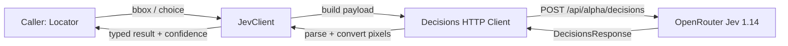

# Jev Harness

The Jev Harness (`src/core/jev/`) is the only component in Jevwright that communicates with the Jev decision model (`typesafe/jev-1.14`) on OpenRouter. It assembles structured Decisions API requests (`POST https://openrouter.ai/api/alpha/decisions`), parses typed answers and confidence scores, converts normalized bounding boxes to image pixels, and handles bounded retries.

## 1. Functional Definition

### 1.1 Scope

The Harness implements the `JevClient` interface consumed by the Element Locator:

| Method   | Jev Primitives     | Input                       | Output |
| -------- | ------------------ | --------------------------- | ------ |
| `bbox`   | `box` + `noul`     | `question`, PNG/JPEG `Buffer` | `{ box: BoundingBox \| null; confidence: number }` |
| `choice` | `choice`           | `question`, `options: string[]` | `{ index: number \| null; confidence: number }` |

No other module calls OpenRouter directly.

### 1.2 OpenRouter Decisions API

Every request is sent to `POST https://openrouter.ai/api/alpha/decisions` with:

- Header `Authorization: Bearer <OPENROUTER_API_KEY>`
- Header `Content-Type: application/json`
- Body `{ model: "typesafe/jev-1.14", state, questions }`

### 1.3 Visual Locate (`bbox`)

1. Read the image dimensions `(width, height)` in pixels from the PNG or JPEG buffer header.
2. Encode the image as a `data:image/<format>;base64,...` URL in the top-level `state` array.
3. Because Jev's `box` primitive always returns four edges even when the target is absent from the image, pair two questions in the same request:
   - `present` (`type: "noul"`): asks whether the target described in `question` is visible in the screenshot.
   - `box` (`type: "box"`): asks for the bounding box of the target described in `question`.
4. If `present.noul < PRESENCE_THRESHOLD` (`0.5`), return `{ box: null, confidence: present.noul }`.
5. Convert the normalized `[0, 1]` edges (`left`, `top`, `right`, `bottom`) to image pixel coordinates:
   - `x = left * width`
   - `y = top * height`
   - `width = (right - left) * width`
   - `height = (bottom - top) * height`
6. Return `{ box, confidence: boxAnswer.confidence }`.

### 1.4 DOM Locate (`choice`)

1. If `options` is empty, return `{ index: null, confidence: 0 }` without making an HTTP request.
2. Build `criteria` mapping each stringified option index (`"0"`, `"1"`, ...) to its option description, plus `"none"` for when no candidate matches the target description.
3. Send a `choice` question with `instructions: question` and the numbered candidate list in `state`.
4. If the returned `choice` is `"none"` or not a valid index into `options`, return `{ index: null, confidence }`.
5. Otherwise return `{ index: Number(choice), confidence }`.

### 1.5 Retries and Error Handling

| Constant             | Value                                        | Description |
| -------------------- | -------------------------------------------- | ----------- |
| `JEV_MODEL`          | `"typesafe/jev-1.14"`                        | Pinned Jev model on OpenRouter |
| `JEV_DECISIONS_URL`  | `"https://openrouter.ai/api/alpha/decisions"` | OpenRouter Decisions API endpoint |
| `DEFAULT_MAX_RETRIES`| `2`                                          | Retries after the initial attempt on transient errors |
| `PRESENCE_THRESHOLD` | `0.5`                                        | Minimum `noul` probability for `bbox` target presence |

- Transient failures (network errors, HTTP `429`, HTTP `5xx`, or malformed response payloads) are retried up to `maxRetries` times.
- Non-retryable HTTP errors (`400`, `401`, `402`, `403`, `404`, `413`) fail immediately.
- When all attempts fail, the Harness throws a `JevError`. API keys are never included in error messages or logs.

## 2. Internal Flow



1. Validate inputs and read image dimensions (for `bbox`).
2. Build the Decisions API request body (`model`, `state`, `questions`).
3. Send the HTTP POST request with bounded retries on transient failures.
4. Validate the response structure and extract the typed answer and confidence score.
5. Convert normalized coordinates to pixels (for `bbox`) or option key to index (for `choice`).

## 3. External Interface

```ts
export type BoundingBox = {
  x: number;
  y: number;
  width: number;
  height: number;
};

export interface JevClient {
  bbox(question: string, image: Buffer): Promise<{ box: BoundingBox | null; confidence: number }>;
  choice(question: string, options: string[]): Promise<{ index: number | null; confidence: number }>;
}

export type JevClientOptions = {
  apiKey?: string;
  model?: string;
  endpoint?: string;
  maxRetries?: number;
  fetchFn?: typeof fetch;
};

export class JevError extends Error {}

export function createJevClient(options?: JevClientOptions): JevClient;
```

## 4. Class Architecture

### 4.1 Modules

| Module         | Responsibility |
| -------------- | -------------- |
| `client.ts`    | `createJevClient()`: implements `bbox()` and `choice()`, retry loop, and Decisions API calls |
| `image.ts`     | `getImageDimensions()`: reads width/height and format (`png` / `jpeg`) from an image buffer |
| `constants.ts` | `JEV_MODEL`, `JEV_DECISIONS_URL`, `DEFAULT_MAX_RETRIES`, `PRESENCE_THRESHOLD` |
| `types.ts`     | `BoundingBox`, `JevClient`, `JevClientOptions`, `JevError`, Decisions API payload types |

### 4.2 Directory Layout

```text
src/core/jev/
├── index.ts
├── types.ts
├── constants.ts
├── image.ts
└── client.ts
```

## 5. Test Plan

| Type        | Coverage | Location |
| ----------- | -------- | -------- |
| Unit        | PNG/JPEG dimension parsing and invalid buffer rejection | `src/tests/unit/core/jev/image.test.ts` |
| Unit        | `bbox()` and `choice()` request formatting, coordinate conversion, `present` gating, `"none"` handling, bounded retries on `5xx`/network errors, immediate failure on `4xx`, missing API key error | `src/tests/unit/core/jev/client.test.ts` |
