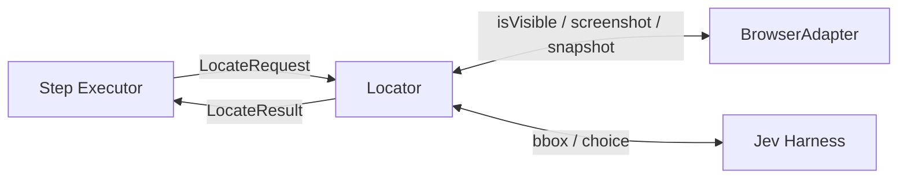
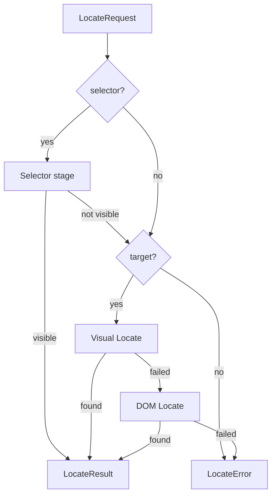
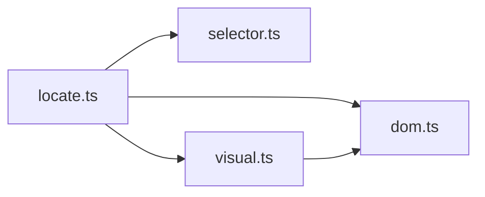

# Element Locator

The Element Locator decides which page element a step refers to. It reads the page through the BrowserAdapter (selector check, screenshot, element snapshot), asks the Jev Harness when AI is needed, and returns an `ElementRef` for the chosen element. It does not import Playwright, never performs the action itself, and never modifies the test file.

## 1. Functional Definition

### 1.1 Scope

The Locator is used only by the element interaction actions defined in the Syntax Analyzer doc (1.2): `click`, `doubleClick`, `rightClick`, `hover`, and `input`. It reads the step's `selector` and `target` fields, which the Syntax Analyzer has already validated (at least one is present).

Page-level actions (`open`, `back`, `press`, ...), `waitFor`, and `assert` do not go through the Locator. The Step Executor calls it once per element step, right before the action, because the page changes after every action.

### 1.2 Locating Strategy

There are three stages, always tried in this order:

| Stage         | Method name | Input                            | Succeeds when                                                                                                              |
| ------------- | ----------- | -------------------------------- | -------------------------------------------------------------------------------------------------------------------------- |
| Selector      | `selector`  | `selector`                       | The BrowserAdapter finds a visible element for `selector` within the stage timeout                                         |
| Visual Locate | `visual`    | `target` + screenshot + snapshot | Jev returns a bounding box (not `null`) with confidence ≥ threshold, and the box center falls on a usable snapshot element |
| DOM Locate    | `dom`       | `target` + snapshot              | Jev chooses a candidate (an index in range, not `null`) with confidence ≥ threshold                                        |

Which stages run depends on the fields present, matching the Syntax Analyzer doc (1.1):

| Fields                | Stages run                                               | Selector stage timeout                                   |
| --------------------- | -------------------------------------------------------- | -------------------------------------------------------- |
| `selector` only       | Selector. On failure the step fails; Jev is never called | `timeoutMs`                                              |
| `target` only         | Visual → DOM                                             | –                                                        |
| `selector` + `target` | Selector → Visual → DOM                                  | `SELECTOR_PROBE_MS` (2000 ms), or `timeoutMs` if smaller |

A later stage runs only if the previous one failed. The first stage that succeeds ends the process.

### 1.3 Page Data from the BrowserAdapter

The Locator reads the page only through the `BrowserAdapter` interface (see 3.3), implemented in `src/core/browser/`. It asks for data only when a stage needs it:

| Stage    | BrowserAdapter calls                                                                                     |
| -------- | -------------------------------------------------------------------------------------------------------- |
| Selector | `isVisible(selector, timeoutMs)`. If several elements match, the first one is used; this is not an error |
| Visual   | `screenshot()`, then `snapshot()` right after it, both before asking Jev                                 |
| DOM      | `snapshot()`, reusing the one from Visual Locate if it was already taken successfully                    |

So a selector hit costs no screenshot. The screenshot and the snapshot are taken one right after the other, with no action and no Jev call in between, so both describe the same page state even if the page changes while Jev is answering.

The snapshot uses the same format as the integration fixtures (`src/tests/integration/hw3/README.md`): every visible interactive element inside the viewport, in DOM order, marked in the page with `data-jev-id`. The Locator reads these fields of each element:

| Field                           | Use                                                                             |
| ------------------------------- | ------------------------------------------------------------------------------- |
| `id`                            | Returned to the Step Executor as `{ snapshotId }`                               |
| `role`, `name`, `text`, `attrs` | DOM Locate description lines; `role` and `attrs.disabled` also decide usability |
| `bbox`                          | Matching the Visual Locate box center                                           |
| `hittable`                      | Elements covered by something else (e.g. a modal backdrop) are skipped          |

All coordinates are CSS pixels relative to the viewport, so screenshot pixels and `bbox` values share one coordinate system.

### 1.4 Visual Locate

1. Take a screenshot and then a snapshot through the BrowserAdapter, one right after the other, so both describe the same page state. If either returns `{ ok: false }`, the stage fails and its reason is recorded.
2. Ask Jev for a bounding box on the screenshot (see 3.2) with the question:
   `Find the element described as: "<target>". Return its bounding box.`
3. The stage fails if the Harness returns `{ ok: false, reason }`, if it returns `box: null` (Jev judged the element not visible, i.e. the presence answer is below 0.5), or if the returned `confidence` is below `CONFIDENCE_THRESHOLD`.
4. Compute the box center and find the snapshot elements whose `bbox` contains it, considering only usable elements (see 1.5, step 1). The `MAX_DOM_CANDIDATES` cap does not apply here. A point on an edge counts as inside, and elements with zero width or height never match.
5. If several elements contain the point (e.g. a button inside a clickable card), choose the one with the smallest area. If the areas are equal, choose the one that comes first in the snapshot, i.e. in DOM order.
6. The stage fails if no element contains the point. Otherwise it returns `{ snapshotId }` set to that element's `id`.

Matching the box to an element is pure geometry on the snapshot. Targets that are not interactive, such as an alert message or a canvas chart, are not in the snapshot and cannot be returned, which is fine because they are never the target of an interaction step.

### 1.5 DOM Locate

1. Build the list of snapshot elements that are usable for the action:
   - `hittable` is `true` and `attrs.disabled` is not `true`;
   - for the `input` action, only editable elements: `role` is `textbox` or `searchbox`.
2. The DOM stage then keeps at most `MAX_DOM_CANDIDATES` (50) of them, in snapshot order.
3. Build one description line per candidate from `role`, `name`, `text`, and the `type`, `placeholder`, `checked`, and `aria-checked` attributes, omitting empty fields. `false` is not an empty field, so `checked=false` is shown. Text is first truncated to `MAX_TEXT_LENGTH` (50) characters, without an ellipsis, and then `\` and `"` are escaped:
   ```text
   textbox "Email" type=email placeholder="you@example.com"
   button "Show password"
   checkbox "Remember me" checked=false
   switch "Send a weekly summary" aria-checked=false
   ```
4. The stage fails if there are no candidates.
5. Ask Jev to choose one line (see 3.2) with the question:
   `Which element best matches the description: "<target>"?`
6. The stage fails if the Harness returns `{ ok: false, reason }`, if it returns `index: null` or an index out of range, or if the returned `confidence` is below `CONFIDENCE_THRESHOLD`. Otherwise it returns `{ snapshotId }` set to the chosen candidate's `id`.

Known limitation: identical elements, such as six "Delete task" buttons in different table rows, produce identical lines, so DOM Locate cannot tell them apart. Visual Locate usually can, because it sees the row around the button. Adding nearby text to each line is left as a later accuracy improvement (PRD 4.3.9). Contenteditable elements without an explicit role get the tag name as their role, so they are not input candidates.

### 1.6 Constants

| Constant               | Value  | Description                                          |
| ---------------------- | ------ | ---------------------------------------------------- |
| `SELECTOR_PROBE_MS`    | `2000` | Selector stage timeout when `target` is also present |
| `CONFIDENCE_THRESHOLD` | `0.7`  | Minimum Jev confidence for Visual and DOM Locate     |
| `MAX_DOM_CANDIDATES`   | `50`   | Maximum candidates sent to Jev in DOM Locate         |
| `MAX_TEXT_LENGTH`      | `50`   | Maximum characters of text per candidate line        |

All constants live in `constants.ts`. There are two separate checks: the Jev Harness turns a presence answer below 0.5 into `box: null` or `index: null`, and the Locator then rejects an answer whose `confidence` is below `CONFIDENCE_THRESHOLD`. The `data-jev-id` marking belongs to the BrowserAdapter.

### 1.7 Failure

If every stage that ran has failed, `locate()` throws a `LocateError` containing one attempt record per stage, for example:

```text
Could not locate "Sign in button":
  selector "#login" — not visible within 2000 ms
  visual — confidence 0.42 below 0.7
  dom — Jev chose no candidate
```

The Locator does not retry. Request-level retry policy belongs to the Jev Harness; see [docs/tech/jev-harness.md](jev-harness.md).

ReadResult failures are part of a stage's normal control flow, not infrastructure failures:

- `isVisible(selector, timeoutMs)` returning `{ ok: false, reason }` is a selector-stage failure: record the `selector` attempt with that reason and continue to the next stage if a `target` exists.
- `screenshot()` or `snapshot()` returning `{ ok: false, reason }` is also a stage failure for the current stage: record the attempt with the reason and continue to the next stage if any.
- Only a thrown error (for example, the browser disconnected or crashed) propagates as an infrastructure failure.

This matches the BrowserAdapter contract in [docs/tech/browser-adapter.md](browser-adapter.md): timeout and read failures stay typed, while a disconnected browser is thrown.

Taking the failure screenshot and marking the step as `failed` are handled by the execution pipeline.

## 2. Internal Flow

Where the Locator sits in one element step:



Inside the Locator:



1. If `selector` is present, run the Selector stage.
2. If not yet found and there is no `target`, throw `LocateError`.
3. Run Visual Locate, then DOM Locate if needed.
4. Record every attempt (method, success, duration, confidence, reason).
5. Return a `LocateResult` for the first success, or throw `LocateError`.

## 3. External Interface

### 3.1 Function

```ts
function locate(
  request: LocateRequest,
  adapter: BrowserAdapter,
  jev: JevClient,
): Promise<LocateResult>;

type LocateRequest = {
  action: "click" | "doubleClick" | "rightClick" | "hover" | "input";
  selector?: string; // from Step
  target?: string; // from Step
  timeoutMs: number; // TestCase.timeoutMs
  signal?: AbortSignal; // passed to Jev calls
};

type LocateMethod = "selector" | "visual" | "dom";

type LocateAttempt = {
  method: LocateMethod;
  ok: boolean;
  durationMs: number;
  confidence?: number; // Visual and DOM only: the confidence returned by the Jev Harness
  reason?: string; // present when ok is false
};

type LocateResult = {
  method: LocateMethod; // the stage that succeeded
  element: ElementRef; // { selector } or { snapshotId }; the BrowserAction element reference
  confidence?: number; // Visual and DOM only: the confidence returned by the Jev Harness
  durationMs: number; // total time of all attempts
  attempts: LocateAttempt[];
};

class LocateError extends Error {
  attempts: LocateAttempt[];
}
```

In the run sequence diagram this call is `locate(page, step)`, where `page` stands for the BrowserAdapter, and the returned element reference is `ElementRef`.

The Step Executor performs the located element immediately, without any extra action or snapshot in between:

```ts
const result = await locate(
  {
    action: step.action,
    selector: step.selector,
    target: step.target,
    timeoutMs: testCase.timeoutMs,
    signal,
  },
  adapter,
  jev,
);

await adapter.perform({
  action: step.action,
  element: result.element,
  ...(step.action === "input" ? { value: step.value } : {}),
  ...(step.dialog ? { dialog: step.dialog } : {}),
});
```

A `snapshotId` is only valid for the snapshot just taken, so the Executor must call `perform()` right after `locate()`, with no other snapshot or action in between.

`method`, `confidence`, and `durationMs` are passed on to the report, e.g. the CLI line `click "Sign In button" [visual, conf=0.92] (1420ms)`.

### 3.2 Jev Harness Interface

The Locator uses the shared Jev client from [src/core/jev/index.ts](../../src/core/jev/index.ts), and the public contract is described there. This doc keeps the assumptions that matter for Locator behavior:

Assumptions:

- The screenshot must cover exactly the current viewport and be taken at the same scroll position as the snapshot; it must not be a full-page screenshot.
- Conversion uses the viewport size, not the PNG dimensions: `x = left * width`, `y = top * height`, `width = (right - left) * width`, `height = (bottom - top) * height`.
- Transport and API failures come back as `{ ok: false, reason }`; only successful model answers are `{ ok: true, data }`.
- `box: null` and `index: null` are stage failures, not successful answers.
- The Harness handles request-level retries using the policy in [docs/tech/jev-harness.md](jev-harness.md); the Locator records the failed stage and does not retry itself.
- `jev` is passed in as a parameter, so tests can use a fake `JevClient`.

### 3.3 BrowserAdapter Interface Used by the Locator

The Locator depends only on the BrowserAdapter methods in [docs/tech/browser-adapter.md](browser-adapter.md) and [src/core/browser/types.ts](../../src/core/browser/types.ts):

```ts
interface BrowserAdapter {
  isVisible(selector: string, timeoutMs: number): Promise<ReadResult<boolean>>;
  screenshot(): Promise<ReadResult<Buffer>>;
  snapshot(): Promise<ReadResult<PageSnapshot>>;
}
```

The Locator uses only the fields it needs from `PageSnapshot` and `SnapshotElement`, defined in [src/core/browser/types.ts](../../src/core/browser/types.ts):

```ts
type PageSnapshot = {
  viewport: { width: number; height: number };
  elements: SnapshotElement[];
};

type SnapshotElement = {
  id: number;
  role: string;
  name: string;
  text?: string;
  attrs: Record<string, string | boolean>;
  bbox: { x: number; y: number; width: number; height: number };
  hittable: boolean;
};
```

`adapter` is passed in as a parameter, so tests can use a fake adapter that serves fixture files instead of a real browser.

## 4. Class Architecture

### 4.1 Modules



| Module         | Responsibility                                                                                                               |
| -------------- | ---------------------------------------------------------------------------------------------------------------------------- |
| `locate.ts`    | Entry point `locate()`: decides which stages run, records attempts, returns `LocateResult` or throws `LocateError`           |
| `selector.ts`  | Selector stage (1.2): `adapter.isVisible()` with the right timeout                                                           |
| `visual.ts`    | Visual Locate (1.4): screenshot and snapshot, Jev `bbox`, box center, element at point                                       |
| `dom.ts`       | DOM Locate (1.5): usable elements (`filterUsable`, also used by `visual.ts`), candidate cap, description lines, Jev `choice` |
| `constants.ts` | Constants in 1.6                                                                                                             |

None of these modules imports Playwright. `BrowserAdapter` and `JevClient` are imported from `src/core/browser/` and `src/core/jev/`, not redefined here. To add a new stage, add a module and call it from `locate.ts` in the desired order.

### 4.2 Directory Layout

```text
src/core/locator/
├── index.ts       # exports locate, LocateError and types
├── types.ts       # LocateRequest, LocateMethod, LocateAttempt, LocateResult
├── constants.ts
├── locate.ts
├── selector.ts
├── visual.ts
└── dom.ts
```

## 5. Test Plan

All tests use Vitest and never launch a browser. Tests pass a fake `BrowserAdapter` (serving fixture files and counting calls) and a fake `JevClient` (returning scripted answers); the product always uses the real ones.

| Type        | Coverage                                                                                                                                                                                                                                                                                                                                                                                                     | Location                                                                                        |
| ----------- | ------------------------------------------------------------------------------------------------------------------------------------------------------------------------------------------------------------------------------------------------------------------------------------------------------------------------------------------------------------------------------------------------------------ | ----------------------------------------------------------------------------------------------- |
| Unit        | Usable elements (`hittable: false` and disabled skipped, editable filter for `input`); candidate cap; description lines (truncation, escaping, omitted fields, `checked=false`, `aria-checked`)                                                                                                                                                                                                              | `src/tests/unit/core/locator/dom.test.ts`                                                       |
| Unit        | Element at point (inside, edge point counts, zero-size element never matches, smallest area wins, area tie goes to the earliest, no match returns `null`); box center                                                                                                                                                                                                                                        | `src/tests/unit/core/locator/visual.test.ts`                                                    |
| Unit        | `locate()` flow: `selector` only never calls Jev; a selector hit takes no screenshot; a confidence below `CONFIDENCE_THRESHOLD` fails the stage; probe timeout is the smaller of `SELECTOR_PROBE_MS` and `timeoutMs` when `target` is present, `timeoutMs` otherwise; Visual takes the snapshot before calling Jev; order Visual → DOM; snapshot is reused between stages; `LocateError` lists every attempt | `src/tests/unit/core/locator/locate.test.ts`                                                    |
| Integration | For every target in the hw3 fixtures: a fake Jev returning the ground-truth `bbox` makes Visual Locate return { snapshotId: <fixture elementId> }; a fake Jev choosing the ground-truth element does the same for DOM Locate; targets with `present: false` or `elementId: null` end in `LocateError`                                                                                                        | `src/tests/integration/locator/fixtures.test.ts`, reading `src/tests/integration/hw3/fixtures/` |
| Manual      | The same fixtures with the real Jev through OpenRouter, to measure accuracy; not run in CI                                                                                                                                                                                                                                                                                                                   | Benchmark Test Suite                                                                            |