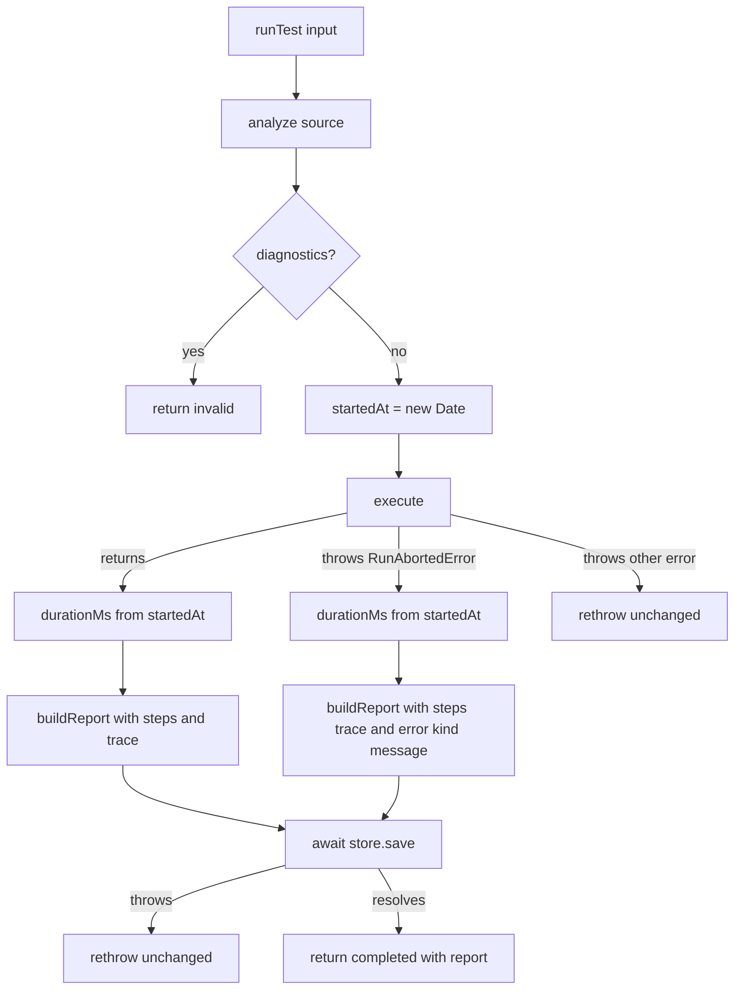

# Run Pipeline

The Run Pipeline orchestrates one test file from analysis to saved report. It runs `analyze()`, `execute()`, `buildReport()`, and `ReportStore.save()` in order.
It does no file I/O and reads no environment variables. The caller (CLI or backend) reads the file, creates the Jev client, and provides the ReportStore.

## 1. Functional Definition

### 1.1 Terms

| Term             | Meaning                                                                                |
| ---------------- | -------------------------------------------------------------------------------------- |
| **Run Pipeline** | The module that runs one test file through analysis, execution, report build, and save |
| **Run result**   | The returned union: `invalid` with diagnostics, or `completed` with a report           |

Report Store and Report are defined in [report.md](report.md). Run error and `RunAbortedError` are defined in [executor.md](executor.md).

### 1.2 Outcomes

| Case                                 | Behavior                                                                                                                                                                    |
| ------------------------------------ | --------------------------------------------------------------------------------------------------------------------------------------------------------------------------- |
| `analyze()` returns diagnostics      | Return `{ kind: "invalid", diagnostics }`. Do not launch a browser. Do not save a report.                                                                                   |
| `execute()` returns                  | Build a report from `{ file, testCase, startedAt, durationMs, steps, trace }`. Await `store.save(bundle)`. Return `{ kind: "completed", report }` only after save resolves. |
| `execute()` throws `RunAbortedError` | Build a report from the error's `steps` and `trace`, with `error: { kind, message }`. Await `store.save(bundle)`. Return `{ kind: "completed", report }`.                   |
| `execute()` throws any other error   | Rethrow the error unchanged.                                                                                                                                                |
| `store.save()` throws                | Rethrow the error unchanged.                                                                                                                                                |

### 1.3 Timing and RunAbortedError Cause

- Set `startedAt = new Date()` immediately before `execute()`.
- Set `durationMs` from `startedAt` to the end of `execute()`, including the `RunAbortedError` path.
- When `execute()` throws `RunAbortedError`, include only `{ kind, message }` in report `error`.
- Never copy, log, or save the `RunAbortedError` cause because it is not redacted (`executor.md` 1.7).

### 1.4 Known Limits

- No per-step abort exists. A slow Jev call can exceed step `timeoutMs`. The Run timeout still bounds the whole Run.
- Confidence, noul probability, and fallback pass are not in the Report yet.

## 2. Internal Flow



1. Analyze the test source.
2. Return `invalid` on diagnostics.
3. Otherwise execute and measure duration from `startedAt`.
4. Build the report from execute output, or from `RunAbortedError` fields.
5. Save through `ReportStore`.
6. Return `completed` only after save resolves.

## 3. External Interface

### 3.1 Function Signature

```ts
export async function runTest(
  input: { file: string; source: string },
  options: RunTestOptions,
  launch?: typeof launchBrowser,
): Promise<RunTestResult>;
```

### 3.2 Types

```ts
type RunTestOptions = {
  headed: boolean;
  vars: Record<string, string>;
  jev: JevClient;
  store: ReportStore;
  onEvent?: (event: StepEvent) => void;
};

type RunTestResult = { kind: "invalid"; diagnostics: Diagnostic[] } | { kind: "completed"; report: Report };
```

`StepEvent` and `RunAbortedError` come from the Executor ([executor.md](executor.md) section 3). `Report` and `ReportStore` come from the Report ([report.md](report.md) section 3). `Diagnostic` comes from the Syntax Analyzer. The pipeline throws only non-`RunAbortedError` errors from `execute()` and errors from `store.save()`, unchanged.

## 4. Class Architecture

### 4.1 Modules

| Module        | Responsibility                                        |
| ------------- | ----------------------------------------------------- |
| `run-test.ts` | Orchestrates analyze, execute, report build, and save |
| `types.ts`    | Defines `RunTestOptions` and `RunTestResult`          |
| `index.ts`    | Re-exports the pipeline interface                     |

### 4.2 Directory Layout

```text
src/core/pipeline/
├── index.ts
├── types.ts
└── run-test.ts
```

## 5. Test Plan

| Type        | Coverage                                                                                                                                                                                                                                                                                                                                                                                                                                                                                                                                                                                                                                                                                                                                                                                                                                                 | Location                                               |
| ----------- | -------------------------------------------------------------------------------------------------------------------------------------------------------------------------------------------------------------------------------------------------------------------------------------------------------------------------------------------------------------------------------------------------------------------------------------------------------------------------------------------------------------------------------------------------------------------------------------------------------------------------------------------------------------------------------------------------------------------------------------------------------------------------------------------------------------------------------------------------------- | ------------------------------------------------------ |
| Unit        | `runTest()` with `vi.mock` for `execute()` and real `buildReport()`, using `vi.importActual` to keep the real `RunAbortedError`. Covers: diagnostics path returns `invalid`, and neither `execute()` nor `save` is called; `headed`, `vars`, `jev`, `onEvent`, and `launch` are passed to `execute()` unchanged; when `onEvent` is omitted, `execute()` still receives a function; the saved Report's `file` and `name` come from the input; `RunAbortedError` is converted with only `{ kind, message }`, and the cause message never appears in `JSON.stringify(report)`; non-`RunAbortedError` execute errors rethrow unchanged; save errors rethrow unchanged; fake timers advanced inside the execute mock verify `durationMs`; `runTest()` does not resolve before `store.save()` resolves; an empty trace produces no `trace.zip` in saved files. | `src/tests/unit/core/pipeline/run-test.test.ts`        |
| Integration | One Run with the real browser against a local HTML page where a selector-only step fails, a Jev client that throws if called, and an in-memory `ReportStore`. Assert the saved report is failed, the screenshot file starts with PNG signature, and the trace is a non-empty zip.                                                                                                                                                                                                                                                                                                                                                                                                                                                                                                                                                                        | `src/tests/integration/core/pipeline/run-test.test.ts` |

HTML pages live in `src/tests/integration/core/pipeline/fixtures/`, one page per scenario, named after it.