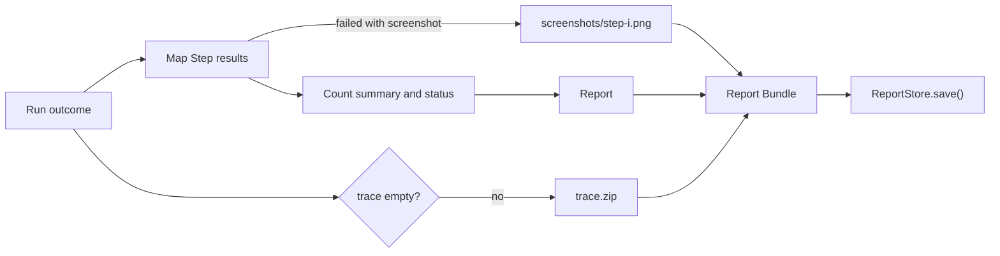

# Report

The Report turns the outcome of one Run into a Report Bundle: the Report itself, which is written as `report.json`, and the files it points to (the Playwright trace and the failure screenshots). It does no I/O. A Report Store, implemented by the caller, saves the Bundle.

## 1. Functional Definition

### 1.1 Terms

| Term | Meaning |
| ---- | ------- |
| **Report** | The structured result of one Run: its outcome, a summary, every Step result, and the Run error if there is one. It is a plain object that serializes to `report.json` |
| **Report Bundle** | The Report together with its files, each with a path relative to the Run's folder |
| **Report Store** | The interface that saves a Report Bundle. The CLI saves it to the file system; the backend saves the Report to Postgres and the files to its Run Files directory (`backend.md`) |
| **Run error** | Why a Run ended before its steps did: `timeout` when it exceeded `runTimeoutMs`, `infrastructure` when the browser crashed or could not start (`executor.md` 1.7) |

### 1.2 When a Report Is Built

| Run outcome | Report |
| ----------- | ------ |
| Every step passed | `status: "passed"` |
| A step failed | `status: "failed"`; the steps after it are `pending` |
| The Run ended with a Run error | `status: "failed"` with `error`; the steps that ran keep their results, the step that was running is `failed`, the rest are `pending` |
| The test file has diagnostics | No Report. The Run never starts; the caller reports the diagnostics (exit code `2` in the CLI) |

### 1.3 Bundle Layout

| Path | Content | Present |
| ---- | ------- | ------- |
| `report.json` | The Report, written by the Store (`REPORT_PATH`) | Always |
| `trace.zip` | Playwright trace from `BrowserAdapter.close()`; open it with `npx playwright show-trace` | When the trace is not empty |
| `screenshots/step-<index>.png` | PNG of the viewport when step `<index>` failed (0-based, as `steps[].index`) | For each failed step that has a screenshot |

The trace is empty when the browser never launched, or when `close()` failed after a crash. The Report then has no `trace` field and the Bundle no `trace.zip`.

### 1.4 Report Fields

| Field | Type | Description |
| ----- | ---- | ----------- |
| `file` | string | Path of the `.yaml` test file, as the caller gives it |
| `name` | string | `TestCase.name` |
| `status` | `passed` \| `failed` | `failed` when a step failed or there is a Run error |
| `startedAt` | string | ISO 8601 time the Run started |
| `durationMs` | number | Run duration, from the caller |
| `summary` | object | `total`, `passed`, `failed`, and `pending` step counts |
| `steps` | ReportStep[] | One per step, in order: the Step result (`executor.md` 3.2), with `screenshot` replaced by its path in the Bundle |
| `trace` | string | `"trace.zip"`; absent when the trace is empty |
| `error` | Run error | `{ kind, message }`; absent when the Run ended normally |

Reasons, dialog messages, and the Run error message come redacted from the Executor. The Report adds no text of its own.

### 1.5 Example

```json
{
  "file": "tests/login.yaml",
  "name": "User Login",
  "status": "failed",
  "startedAt": "2026-11-05T10:00:00.000Z",
  "durationMs": 2900,
  "summary": { "total": 3, "passed": 1, "failed": 1, "pending": 1 },
  "steps": [
    { "index": 0, "line": 5, "action": "open", "status": "passed", "startedAt": "2026-11-05T10:00:00.200Z", "durationMs": 410, "dialogs": [] },
    {
      "index": 1, "line": 7, "action": "click", "status": "failed", "startedAt": "2026-11-05T10:00:00.610Z", "durationMs": 2000,
      "locateMethod": "selector", "dialogs": [], "reason": "Timed out after 2000 ms waiting for #submit",
      "screenshot": "screenshots/step-1.png"
    },
    { "index": 2, "line": 10, "action": "assert", "status": "pending" }
  ],
  "trace": "trace.zip"
}
```

## 2. Internal Flow



1. Map each Step result to a ReportStep; a failed step's screenshot becomes a file and its path.
2. Add `trace.zip` when the trace is not empty.
3. Count the summary and set `status` from the steps and the Run error.
4. The caller passes the Bundle to its Report Store.

## 3. External Interface

### 3.1 Functions

```ts
function buildReport(run: RunOutcome): ReportBundle;

type RunOutcome = {
  file: string;
  testCase: TestCase;
  startedAt: Date;
  durationMs: number;
  steps: StepResult[];
  trace: Buffer; // empty when there is none
  error?: RunError;
};

interface ReportStore {
  save(bundle: ReportBundle): Promise<void>;
}
```

`buildReport()` is pure and never throws for a valid `RunOutcome`. A Store throws when saving fails; that is an infrastructure error for its caller.

### 3.2 Types

```ts
// RunError, StepResult, and FailedStep come from the Executor (executor.md 3.2).
type ReportStep =
  | Exclude<StepResult, FailedStep>
  | (Omit<FailedStep, "screenshot"> & { screenshot?: string }); // path in the Bundle

type Report = {
  file: string;
  name: string;
  status: "passed" | "failed";
  startedAt: string; // ISO 8601
  durationMs: number;
  summary: { total: number; passed: number; failed: number; pending: number };
  steps: ReportStep[];
  trace?: string;
  error?: RunError;
};

type ReportFile = { path: string; data: Buffer };

type ReportBundle = { report: Report; files: ReportFile[] }; // files: trace first, then screenshots by step
```

### 3.3 Constants

| Constant | Value |
| -------- | ----- |
| `REPORT_PATH` | `report.json` |
| `TRACE_PATH` | `trace.zip` |
| `screenshotPath(index)` | `screenshots/step-<index>.png` |

## 4. Class Architecture

### 4.1 Modules

| Module | Responsibility |
| ------ | -------------- |
| `build.ts` | `buildReport()`: ReportSteps, files, summary, status (2) |
| `paths.ts` | Bundle paths in 3.3 |
| `types.ts` | Types in 3, including `ReportStore` |

### 4.2 Directory Layout

```text
src/core/report/
├── index.ts       # exports buildReport, paths, and types
├── types.ts
├── build.ts
└── paths.ts
```

## 5. Test Plan

| Type | Coverage | Location |
| ---- | -------- | -------- |
| Unit | `buildReport`: a passing Run; a failed step with its screenshot as a file and a path; a failed step without a screenshot; `pending` steps; summary counts; `status` failed from a step and from a Run error alone; `error` copied; `trace` and `trace.zip` present only for a non-empty trace; `file`, `name`, `startedAt`, `durationMs` copied; the Report survives `JSON.stringify` with no Buffer in it | `src/tests/unit/core/report/build.test.ts` |
| Integration | A Run of the Executor against a local HTML page with a failing step, built into a Bundle whose screenshot is a PNG and whose trace is a zip | `src/tests/integration/core/report/build.test.ts` |
