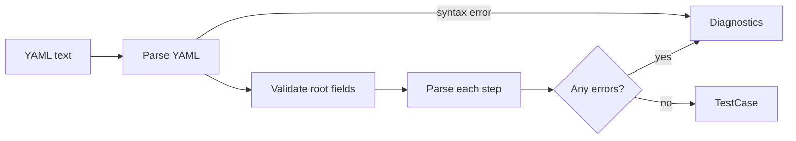
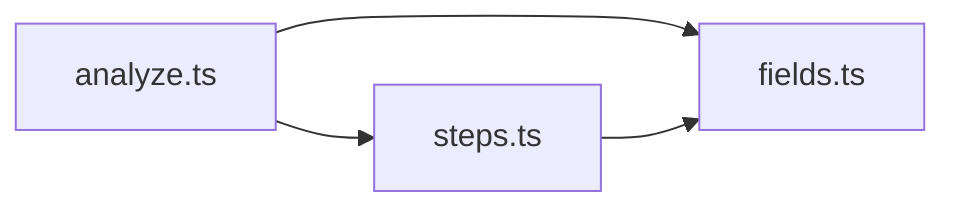

# Syntax Analyzer

The Syntax Analyzer parses a `.yaml` test file into a validated `TestCase`, or returns a list of line-numbered errors. It never launches a browser.

## 1. Functional Definition

### 1.1 Execution Model

The core job is translating our custom YAML syntax into the matching Playwright calls. AI is used only to choose elements. There are three ways to locate an element:

| Fields                | Execution |
| --------------------- | --------- |
| `selector` only       | Pure Playwright. The step fails if nothing matches; Jev is never called |
| `target` only         | Jev locate (Visual Locate first, then DOM Locate) |
| `selector` + `target` | Try `selector` first; if nothing matches, Jev locates `target` |

`selector` uses Playwright selector syntax, i.e. any string accepted by `page.locator()`, such as CSS `#email`, XPath `//input[@name='email']`, or `text=Sign in`.

`target` describes in natural language how the element looks on the page, such as its type, visible text, and location:

```yaml
steps:
  # selector only: pure Playwright
  - click:
      selector: "button[type=submit]"

  # target only: Jev locate
  - click:
      target: "Blue 'Sign in' button in the top-right corner"

  # selector + target: try selector, fall back to Jev
  - input:
      selector: "#email"
      target: "Email input in the login form"
      value: "student@example.com"
```

### 1.2 Actions

**Page-level**: no element is located; executed entirely by Playwright.

| Action    | Playwright API          | Description |
| --------- | ----------------------- | ----------- |
| `open`    | `page.goto()`           | Open a URL |
| `back`    | `page.goBack()`         | Go back; the step fails if there is no history entry |
| `forward` | `page.goForward()`      | Go forward; the step fails if there is no history entry |
| `reload`  | `page.reload()`         | Reload the page |
| `press`   | `keyboard.press()`      | Press a key on the focused element. Key names follow Playwright (e.g. `Enter`, `Shift+A`) and are case-sensitive |
| `scroll`  | `mouse.wheel()`         | Scroll the page; `direction` is the side of the off-screen content to reveal |
| `sleep`   | `page.waitForTimeout()` | Wait for a fixed time |

**Element interaction**: at least one of `selector` and `target` is required; see 1.1.

| Action        | Playwright API                       | Description |
| ------------- | ------------------------------------ | ----------- |
| `click`       | `locator.click()`                    | Click |
| `doubleClick` | `locator.dblclick()`                 | Double-click |
| `rightClick`  | `locator.click({ button: 'right' })` | Right-click |
| `hover`       | `locator.hover()`                    | Hover |
| `input`       | `locator.fill()`                     | Type text, replacing the current value |

**Wait and assert**: Playwright checks never call Jev; natural-language conditions are judged by Jev. `assert` may also have both: Playwright first, then Jev if it fails.

`waitFor` waits until the condition holds or the step times out. Use exactly one of:

| Field       | Execution |
| ----------- | --------- |
| `condition` | Jev polls the condition, one Jev call per poll |
| `selector`  | `locator.waitFor()`, waits until the element is visible |
| `url`       | `page.waitForURL()` |

`assert` checks whether a condition holds:

| Fields              | Execution |
| ------------------- | --------- |
| `statement`         | Jev judges the semantic statement |
| `selector`          | `toBeVisible()`, the element is visible |
| `selector` + `text` | `toContainText()`, the element contains the text |
| `url`               | `toHaveURL()` |

When both a Playwright check and `statement` are present, the step falls back: the Playwright assertion runs first, and if it fails (including when `selector` matches nothing), Jev judges `statement`. If Jev says it holds, the step passes and the report marks it as a fallback pass.

```yaml
steps:
  - assert:
      selector: ".welcome-banner"
      text: "Welcome"
      statement: "A welcome banner is shown at the top of the page"
```

### 1.3 File Structure

| Field         | Type             | Required | Default | Description |
| ------------- | ---------------- | -------- | ------- | ----------- |
| `name`        | string           | ✔        | –       | Test name, non-empty |
| `description` | string           |          | –       | Test description |
| `baseUrl`     | string           |          | –       | Base for relative paths in `open` and `url` |
| `timeoutMs`   | positive integer |          | `15000` | Timeout for each step |
| `steps`       | Step[]           | ✔        | –       | At least one step, executed in order |

`{{NAME}}` in strings is kept as is and replaced at execution time with a variable from the local `.env` or the platform configuration.

### 1.4 Step Syntax

Each step is an object with exactly one key. The key is the action name and the value is a parameter object. Actions without parameters use `{}`:

```yaml
steps:
  - input:                       # "-" is one level deeper than steps
      selector: "#email"         # parameters are one level deeper than the action name
      value: "student@example.com"
  - back: {}
```

Indentation rules:

- Indent with spaces only, never tabs.
- Each level is 2 spaces.
- Each step under `steps` starts with `- ` and is one level deeper than `steps`.
- Parameters are one level deeper than the action name, and all parameters of an action share the same indentation.

### 1.5 Action Fields

`*` marks a required field.

| Action                                       | Fields |
| -------------------------------------------- | ------ |
| `open`                                       | `url`* string |
| `back`, `forward`, `reload`                  | none |
| `press`                                      | `key`* string |
| `scroll`                                     | `direction`* `up` \| `down` \| `left` \| `right`, `distance`* positive integer in pixels |
| `sleep`                                      | `ms`* positive integer |
| `click`, `doubleClick`, `rightClick`, `hover` | `selector` string, `target` string; at least one |
| `input`                                      | `value`* string; `selector` string, `target` string, at least one |
| `waitFor`                                    | `condition` string, `selector` string, `url` string; exactly one |
| `assert`                                     | `statement` string; a Playwright check: `selector` string (optionally with `text` string) or `url` string. At least one of `statement` and a Playwright check |

### 1.6 Example

```yaml
name: "User Login"
description: "A valid user can sign in and reach the dashboard"
baseUrl: "https://demo.example.com"
steps:
  - open:
      url: "/login"
  - input:
      selector: "#email"
      value: "{{TEST_EMAIL}}"
  - input:
      target: "Password input field"
      value: "{{TEST_PASSWORD}}"
  - click:
      selector: "button[type=submit]"
      target: "Sign in button"
  - waitFor:
      url: "/dashboard"
  - assert:
      selector: "h1"
      text: "Welcome"
  - assert:
      statement: "The navigation bar shows the logged-in account"
```

## 2. Internal Flow



1. Parse with `parseDocument` from the [`yaml`](https://eemeli.org/yaml/) library, using a `LineCounter` to keep each node's position in the source.
2. Validate directly on the YAML node tree, converting node positions to line and column numbers for errors.
3. Do not stop at the first error; keep validating the remaining fields and steps and return all errors at once.
4. If there are no errors, output the `TestCase`.

## 3. External Interface

### 3.1 Function

```ts
function analyze(source: string): AnalyzeResult;

type AnalyzeResult = {
  testCase?: TestCase; // present only when there are no errors
  diagnostics: Diagnostic[];
};

type Diagnostic = {
  code: string;
  message: string;
  line: number; // 1-based
  column: number; // 1-based
};
```

### 3.2 TestCase

```ts
type Locate = { selector?: string; target?: string };

type Step = { line: number } & (
  | { action: "open"; url: string }
  | { action: "back" | "forward" | "reload" }
  | { action: "press"; key: string }
  | { action: "scroll"; direction: "up" | "down" | "left" | "right"; distance: number }
  | { action: "sleep"; ms: number }
  | ({ action: "click" | "doubleClick" | "rightClick" | "hover" } & Locate)
  | ({ action: "input"; value: string } & Locate)
  | { action: "waitFor"; condition?: string; selector?: string; url?: string }
  | { action: "assert"; statement?: string; selector?: string; text?: string; url?: string }
);

type TestCase = {
  name: string;
  description?: string;
  baseUrl?: string;
  timeoutMs: number;
  steps: Step[];
};
```

`line` is the step's line number in the source file, used for errors and reports.

### 3.3 Error Codes

| Code   | Meaning | Reported at |
| ------ | ------- | ----------- |
| `E001` | YAML syntax error | Position given by the parser |
| `E002` | Invalid root: the root is not an object, or `steps` is not an array or is empty | Root node or `steps` |
| `E003` | Missing required field | Key of the enclosing object |
| `E004` | Unknown field | The field's key |
| `E005` | Unknown action | The action's key |
| `E006` | Invalid step: not an object, has zero or multiple actions, or its parameters are not an object | The step node |
| `E007` | Wrong type or invalid value | The field's value |
| `E008` | Invalid field combination, i.e. violates an "at least one" or "exactly one" rule in 1.5 | The action's key |

### 3.4 CLI Output

`validate` prints one line per error as `file:line:column — Error: message`; with `--json` it prints the `diagnostics` array. It exits with code `2` when there are errors.

```text
$ jevwright validate ./tests/broken.yaml
✖ ./tests/broken.yaml:12:5 — Error: Unknown action "aiAct"
✖ ./tests/broken.yaml:18:3 — Error: Step must contain exactly one action, found "click" and "input"
Validation FAILED (2 errors).
```

## 4. Class Architecture

### 4.1 Modules



| Module       | Responsibility |
| ------------ | -------------- |
| `analyze.ts` | Entry point `analyze()`: parses YAML, validates root fields, iterates `steps`, and checks that each step has exactly one action |
| `steps.ts`   | One parse function per action, plus a map from action name to parse function; reports `E005` when the action is not found |
| `fields.ts`  | `FieldReader` class: wraps a YAML object, reads fields by type, and records `E003`/`E004`/`E007` with line and column |

To add an action, add a parse function in `steps.ts` and register it in the map.

### 4.2 Directory Layout

```text
src/core/syntax/
├── index.ts     # exports analyze and types
├── types.ts     # TestCase, Step, Diagnostic
├── analyze.ts
├── steps.ts
└── fields.ts
```

## 5. Test Plan

| Type        | Coverage | Location |
| ----------- | -------- | -------- |
| Unit        | `FieldReader`: reading fields by type, line/column conversion | `src/tests/unit/core/syntax/fields.test.ts` |
| Integration | `analyze()` valid fixtures: at least one per action; the output `TestCase` matches the expected one | `src/tests/integration/syntax/fixtures/valid/` |
| Integration | `analyze()` invalid fixtures: at least one per error code; assert `code`, `line`, `column` | `src/tests/integration/syntax/fixtures/invalid/` |
| Integration | CLI `validate`: output format, `--json`, exit code | `src/tests/integration/cli/` |

Invalid fixtures are named after the error code, e.g. `E003-missing-value.yaml`, with a `.json` file of the same name next to it containing the expected `diagnostics`.
