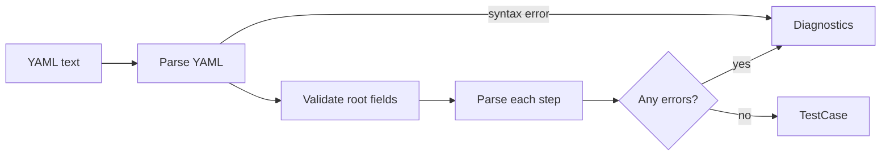
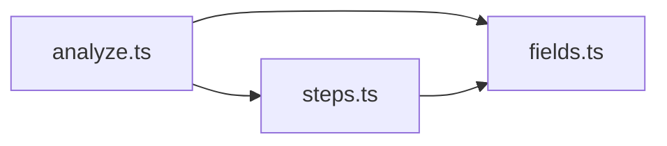

# Syntax Analyzer

The Syntax Analyzer parses a `.yaml` test file into a validated `TestCase`, or returns a list of line-numbered errors. It never launches a browser.

## 1. Functional Definition

### 1.1 Execution Model

The core job is translating our custom YAML syntax into the matching Playwright calls. AI is used only to choose elements. There are three ways to locate an element:

| Fields                | Execution                                                               |
| --------------------- | ----------------------------------------------------------------------- |
| `selector` only       | Pure Playwright. The step fails if nothing matches; Jev is never called |
| `target` only         | Jev locate (Visual Locate first, then DOM Locate)                       |
| `selector` + `target` | Try `selector` first; if nothing matches, Jev locates `target`          |

`selector` uses Playwright selector syntax, i.e. any string accepted by `page.locator()`, such as CSS `#email`, XPath `//input[@name='email']`, or `text=Sign in`.

`target` describes in natural language how the element looks on the page, such as its type, visible text, and location:

```yaml
steps:
  # selector only: pure Playwright
  - click:
      selector: "button[type=submit]"

  # target only: Jev locate
  - click:
      target: "Blue 'Sign in' button in the top-right corner"

  # selector + target: try selector, fall back to Jev
  - input:
      selector: "#email"
      target: "Email input in the login form"
      value: "student@example.com"
```

### 1.2 Actions

**Page-level**: no element is located; executed entirely by Playwright.

| Action      | Playwright API          | Description                                                                                                                         |
| ----------- | ----------------------- | ----------------------------------------------------------------------------------------------------------------------------------- |
| `open`      | `page.goto()`           | Open a URL                                                                                                                          |
| `back`      | `page.goBack()`         | Go back; the step fails if there is no history entry                                                                                |
| `forward`   | `page.goForward()`      | Go forward; the step fails if there is no history entry                                                                             |
| `reload`    | `page.reload()`         | Reload the page                                                                                                                     |
| `press`     | `keyboard.press()`      | Press a key on the focused element. Key names follow Playwright (e.g. `Enter`, `Shift+A`) and are case-sensitive                    |
| `scroll`    | `mouse.wheel()`         | Scroll the page; `direction` is the side of the off-screen content to reveal                                                        |
| `sleep`     | `page.waitForTimeout()` | Wait for a fixed time                                                                                                               |
| `switchTab` | `page.bringToFront()`   | Make the tab whose URL matches `url` the current tab; waits for it to appear. The step fails if no tab or more than one tab matches |

**Element interaction**: at least one of `selector` and `target` is required; see 1.1.

| Action        | Playwright API                       | Description                            |
| ------------- | ------------------------------------ | -------------------------------------- |
| `click`       | `locator.click()`                    | Click                                  |
| `doubleClick` | `locator.dblclick()`                 | Double-click                           |
| `rightClick`  | `locator.click({ button: 'right' })` | Right-click                            |
| `hover`       | `locator.hover()`                    | Hover                                  |
| `input`       | `locator.fill()`                     | Type text, replacing the current value |

**Wait and assert**: Playwright checks never call Jev; natural-language conditions are judged by Jev. `assert` may also have both: Playwright first, then Jev if it fails.

`waitFor` waits until the condition holds or the step times out. Use exactly one of:

| Field       | Execution                                               |
| ----------- | ------------------------------------------------------- |
| `condition` | Jev polls the condition, one Jev call per poll          |
| `selector`  | `locator.waitFor()`, waits until the element is visible |
| `url`       | `page.waitForURL()`                                     |

`assert` checks whether a condition holds:

| Fields              | Execution                                        |
| ------------------- | ------------------------------------------------ |
| `statement`         | Jev judges the semantic statement                |
| `selector`          | `toBeVisible()`, the element is visible          |
| `selector` + `text` | `toContainText()`, the element contains the text |
| `url`               | `toHaveURL()`                                    |

When both a Playwright check and `statement` are present, the step falls back: the Playwright assertion runs first, and if it fails (including when `selector` matches nothing), Jev judges `statement`. If Jev says it holds, the step passes and the report marks it as a fallback pass.

```yaml
steps:
  - assert:
      selector: ".welcome-banner"
      text: "Welcome"
      statement: "A welcome banner is shown at the top of the page"
```

**Dialogs**: native `alert`, `confirm`, `prompt`, and `beforeunload` dialogs are answered through the `dialog` field of the action that triggers them. The answer is set up before the action runs, because Playwright must know it before the dialog opens.

| Field     | Description                                                                 |
| --------- | --------------------------------------------------------------------------- |
| `accept`  | `true` accepts the dialog (OK), `false` dismisses it (Cancel)               |
| `text`    | Text typed into a `prompt` before accepting; only with `accept: true`       |
| `message` | The dialog text must contain this, case-sensitive; otherwise the step fails |

```yaml
steps:
  - click:
      target: "Delete button in the 'Write release notes' row"
      dialog:
        accept: true
        message: "Delete this task?"
```

The step fails if its dialog does not appear. A dialog on a step without `dialog`, or between steps, is dismissed and fails that step (or the next one).

**Tabs**: a tab opened by the page (`target=_blank`, `window.open`) does not become the current tab by itself. `switchTab` selects a tab by URL, which also switches back:

```yaml
steps:
  - click:
      selector: "a[target=_blank]"
  - switchTab:
      url: "**/help"
  - switchTab:
      url: "/board"
```

### 1.3 File Structure

| Field          | Type             | Required | Default  | Description                                                                     |
| -------------- | ---------------- | -------- | -------- | ------------------------------------------------------------------------------- |
| `name`         | string           | ✔        | –        | Test name                                                                       |
| `description`  | string           |          | –        | Test description                                                                |
| `baseUrl`      | absolute URL     |          | –        | Base for relative URLs in `open` and `url`; see 1.5                             |
| `timeoutMs`    | positive integer |          | `15000`  | Timeout for each step                                                           |
| `runTimeoutMs` | positive integer |          | `600000` | Timeout for the whole Run: the browser launch and all steps (`executor.md` 1.7) |
| `steps`        | Step[]           | ✔        | –        | At least one step, executed in order                                            |

`{{NAME}}` in strings is kept as is and replaced at execution time with a variable from the local `.env` or the platform configuration.

### 1.4 Step Syntax

Each step is an object with exactly one key. The key is the action name and the value is a parameter object. The action name is checked first, so an unknown action such as `aiAct: "log in"`, or a bare `- aiAct`, is `E005` whatever its value. Actions without parameters use `{}`:

```yaml
steps:
  - input:
      selector: "#email"
      value: "student@example.com"
  - back: {}
```

YAML anchors and aliases (`&name`, `*name`) can reuse a step, a parameter object, a key, or a value. An error inside aliased content is reported at the alias, once for each place it is used. Merge keys (`<<`) are not part of YAML 1.2, so `<<` is reported as an unknown field.

### 1.5 Action Fields

`*` marks a required field. String fields must not be empty, except `input`'s `value`, where `""` clears the field. Positive integers are written in plain decimal digits, so `1e3`, `0x10` and `1000.0` are invalid.

URLs are absolute when they start with `scheme://` (such as `https://`) or with a `{{NAME}}` variable; anything else is relative. `localhost:3000/login` has no `//`, so it is relative.

- `baseUrl` must be absolute.
- `open`'s `url` may be relative only when the file has a `baseUrl`.
- `waitFor`, `assert`, and `switchTab` use `url` as a URL pattern. A glob that starts with `*` (such as `**/dashboard`) matches without a `baseUrl`; any other relative `url` needs one, including a glob such as `/board/*`, which is resolved against `baseUrl`.

| Action                                        | Fields                                                                                                                                                        |
| --------------------------------------------- | ------------------------------------------------------------------------------------------------------------------------------------------------------------- |
| `open`                                        | `url`* string; `dialog`                                                                                                                                       |
| `back`, `forward`, `reload`                   | `dialog`                                                                                                                                                      |
| `press`                                       | `key`* string; `dialog`                                                                                                                                       |
| `scroll`                                      | `direction`* `up` \| `down` \| `left` \| `right`, `distance`* positive integer in pixels                                                                      |
| `sleep`                                       | `ms`* positive integer                                                                                                                                        |
| `click`, `doubleClick`, `rightClick`, `hover` | `selector` string, `target` string; at least one. `dialog`                                                                                                    |
| `input`                                       | `value`* string; `selector` string, `target` string, at least one. `dialog`                                                                                   |
| `switchTab`                                   | `url`* string                                                                                                                                                 |
| `waitFor`                                     | `condition` string, `selector` string, `url` string; exactly one                                                                                              |
| `assert`                                      | `statement` string; a Playwright check: `selector` string (optionally with `text` string) or `url` string. At least one of `statement` and a Playwright check |

`dialog` is an object: `accept`* boolean (`true` or `false`), `text` string (may be `""`), `message` string. `text` needs `accept: true`.

### 1.6 Example

```yaml
name: "User Login"
description: "A valid user can sign in and reach the dashboard"
baseUrl: "https://demo.example.com"
steps:
  - open:
      url: "/login"
  - input:
      selector: "#email"
      value: "{{TEST_EMAIL}}"
  - input:
      target: "Password input field"
      value: "{{TEST_PASSWORD}}"
  - click:
      selector: "button[type=submit]"
      target: "Sign in button"
  - waitFor:
      url: "/dashboard"
  - assert:
      selector: "h1"
      text: "Welcome"
  - assert:
      statement: "The navigation bar shows the logged-in account"
```

## 2. Internal Flow



1. Parse with `parseDocument` from the [`yaml`](https://eemeli.org/yaml/) library, using a `LineCounter` to keep each node's position in the source.
2. Validate directly on the YAML node tree, converting node positions to line numbers for errors.
3. Do not stop at the first error; keep validating the remaining fields and steps and return all errors at once.
4. If there are no errors, output the `TestCase`.

## 3. External Interface

### 3.1 Function

```ts
function analyze(source: string): AnalyzeResult;

type AnalyzeResult = {
  testCase?: TestCase; // present only when there are no errors
  diagnostics: Diagnostic[];
};

type Diagnostic = {
  code: string;
  message: string;
  line: number; // 1-based
};
```

### 3.2 TestCase

```ts
type LocateBySelector = { selector: string; target?: undefined };
type LocateByTarget = { target: string; selector?: undefined };
type LocateByBoth = { selector: string; target: string };
type Locate = LocateBySelector | LocateByTarget | LocateByBoth;

type DialogResponse = { accept: boolean; text?: string; message?: string };
type Dialog = { dialog?: DialogResponse };

type WaitForCondition = { action: "waitFor"; condition: string };
type WaitForSelector = { action: "waitFor"; selector: string };
type WaitForUrl = { action: "waitFor"; url: string };
type WaitFor = WaitForCondition | WaitForSelector | WaitForUrl;

type SelectorCheck = { selector: string; text?: string };
type UrlCheck = { url: string };
type AssertCheck = SelectorCheck | UrlCheck;
type AssertWithCheck = { action: "assert"; check: AssertCheck; statement?: string };
type AssertStatement = { action: "assert"; statement: string };
type Assert = AssertWithCheck | AssertStatement;

type Step = { line: number } & (
  | ({ action: "open"; url: string } & Dialog)
  | ({ action: "back" | "forward" | "reload" } & Dialog)
  | ({ action: "press"; key: string } & Dialog)
  | { action: "scroll"; direction: "up" | "down" | "left" | "right"; distance: number }
  | { action: "sleep"; ms: number }
  | { action: "switchTab"; url: string }
  | ({ action: "click" | "doubleClick" | "rightClick" | "hover" } & Locate & Dialog)
  | ({ action: "input"; value: string } & Locate & Dialog)
  | WaitFor
  | Assert
);

type TestCase = {
  name: string;
  description?: string;
  baseUrl?: string;
  timeoutMs: number;
  runTimeoutMs: number;
  steps: Step[];
};
```

`line` is the step's line number in the source file, used for errors and reports.

Each combination of fields that 1.5 allows has its own named type, so a `switch` over them is exhaustive. In `assert`, the Playwright check (`selector` with optional `text`, or `url`) is grouped under `check`; the YAML keeps these fields flat.

### 3.3 Error Codes

| Code   | Meaning                                                                                                                   | Reported at                                                               |
| ------ | ------------------------------------------------------------------------------------------------------------------------- | ------------------------------------------------------------------------- |
| `E001` | YAML syntax error                                                                                                         | Position given by the parser                                              |
| `E002` | Invalid root: the root is not an object, or `steps` is not an array or is empty                                           | Root node or `steps`                                                      |
| `E003` | Missing required field                                                                                                    | Key of the enclosing object                                               |
| `E004` | Unknown field                                                                                                             | The field's key                                                           |
| `E005` | Unknown action                                                                                                            | The action's key                                                          |
| `E006` | Invalid step: not an object, has zero or multiple actions, or its parameters are not an object                            | The step node                                                             |
| `E007` | Wrong type or invalid value                                                                                               | The field's value, or its key when the value is empty (`key:` or `? key`) |
| `E008` | Invalid field combination, i.e. violates an "at least one" or "exactly one" rule in 1.5, or `text` without `accept: true` | The key of the enclosing object                                           |

### 3.4 CLI Output

`validate` prints one line per error as `file:line — Error: message`; with `--json` it prints only a JSON array of `{ file, code, message, line }` for all files. It exits with code `2` when there are errors.

```text
$ jevwright validate ./tests/broken.yaml
✖ ./tests/broken.yaml:12 — Error: Unknown action "aiAct"
✖ ./tests/broken.yaml:18 — Error: Step must contain exactly one action, found "click" and "input"
Validation FAILED (2 errors).
```

## 4. Class Architecture

### 4.1 Modules



| Module       | Responsibility                                                                                                                                                               |
| ------------ | ---------------------------------------------------------------------------------------------------------------------------------------------------------------------------- |
| `analyze.ts` | Entry point `analyze()`: parses YAML, validates root fields, iterates `steps`, checks that each step has exactly one action, and reports `E005` when the action is unknown   |
| `steps.ts`   | One parse function per action, plus a map from action name to parse function, typed so it must cover every action in `Step`; `isAction()` tells whether a name is in the map |
| `fields.ts`  | `FieldReader` class: wraps a YAML object, reads fields by type (including nested objects such as `dialog`), and records `E003`/`E004`/`E007` with the line number            |

To add an action, add its variant to `Step` in `types.ts`, then add a parse function in `steps.ts` and register it in the map. The type check fails until both are done.

### 4.2 Directory Layout

```text
src/core/syntax/
├── index.ts     # exports analyze and types
├── types.ts     # TestCase, Step, Diagnostic
├── analyze.ts
├── steps.ts
└── fields.ts
```

## 5. Test Plan

| Type        | Coverage                                                                                            | Location                                              |
| ----------- | --------------------------------------------------------------------------------------------------- | ----------------------------------------------------- |
| Unit        | `FieldReader`: reading fields by type, line number conversion                                       | `src/tests/unit/core/syntax/fields.test.ts`           |
| Integration | `analyze()` valid fixtures: at least one per action; the output `TestCase` matches the expected one | `src/tests/integration/core/syntax/fixtures/valid/`   |
| Integration | `analyze()` invalid fixtures: at least one per error code; assert `code` and `line`                 | `src/tests/integration/core/syntax/fixtures/invalid/` |
| Integration | CLI `validate`: output format, `--json`, exit code                                                  | `src/tests/integration/cli/`                          |

Invalid fixtures are named after the error code, e.g. `E003-missing-value.yaml`, with a `.json` file of the same name next to it containing the expected `diagnostics`.
